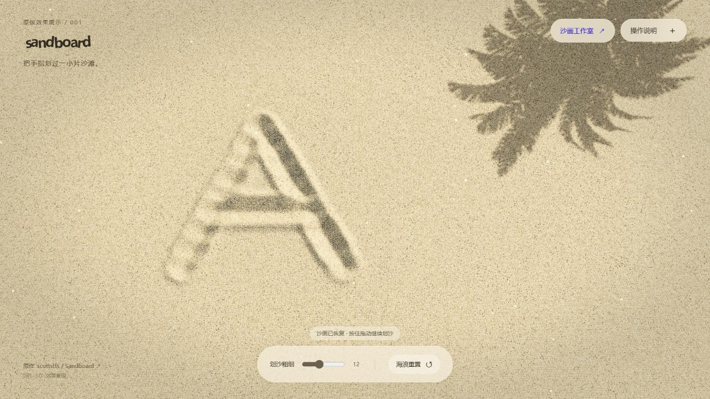

# GitHub 项目研究集

记录近期发现的优秀开源项目：为什么值得研究、核心实现如何工作，以及自己的实验与改进。

每个子项目都有固定编号、独立研究文档和代码目录。这里保留简短索引、预览图片与访问入口，详细分析放在子项目内部。

## 项目索引

按编号从小到大排列；新增项目顺延编号，已有编号保持不变。

<!-- PROJECT_INDEX:START -->

| 序号 | 项目 / 来源 | 研究摘要 | 状态 | 演示 |
| --- | --- | --- | --- | --- |
| 001 | [Sandboard 交互沙盘](projects/001-sandboard/README.md) · [Sandboard](https://github.com/scottstts/Sandboard) | Sandboard 是 WebGPU 交互沙盘：高度场与邻域输运呈现沟槽、堆积和飞沙，适合触控创作与材料研究。我们保留原版，扩展七工具手绘、照片沙画、动作回放和纪念赠礼原型；可继续探索教学、展演与创作工具，真实成画质感仍待验收。 | 研究中 | — |

### 001 · Sandboard 交互沙盘



2026-10-08 本地原版精细画质实测：2560 × 1440 绘制后截图，保留上游 489cb01 的沙床与渲染算法。

<!-- PROJECT_INDEX:END -->

<!-- SANDBOARD_OVERVIEW:START -->
## 从 Sandboard 交互沙盘，到光阴沙画的探索

Sandboard 提供可触摸、可推挤、可扬起沙粒的数字沙盘。我们的研究从保留原版开始，尝试手绘工具、照片转沙画、动作成画、真实手部与纪念赠礼流程；已有可操作原型，但自然成画和真实沙画质感仍未通过验收。

发布目标：`https://yydshly.github.io/1008_codex_project/001-sandboard/`，待首次部署后核验并登记索引。以下入口对应保留的原版与全部探索页面。

- [统一平台首页](https://yydshly.github.io/1008_codex_project/001-sandboard/art/home/)：原版、手绘、照片、作品集与历史试验的总入口。
- [Sandboard 原版效果](https://yydshly.github.io/1008_codex_project/001-sandboard/original/)：保留研究基线的沙床与渲染，体验沟槽、堆积和飞沙。
- [沙耙等手绘工具](https://yydshly.github.io/1008_codex_project/001-sandboard/art/#mode=surface&tool=rake)：回到原工作室，操作七种工具。
- [统一作品集](https://yydshly.github.io/1008_codex_project/001-sandboard/art/gallery/#examples)：直接看手绘示例、照片收藏与历史效果。
- [照片沙画创作](https://yydshly.github.io/1008_codex_project/001-sandboard/art/memories/#create)：上传照片、调整效果、保存本机作品。
- [纪念短片原型](https://yydshly.github.io/1008_codex_project/001-sandboard/art/memories/keepsake/)：从杯子照片与故事尝试完整成片流程。
- [研究历程与总览图](https://yydshly.github.io/1008_codex_project/001-sandboard/art/research/#overview)：放大阅读一图总览，核对实际效果与失败记录。

### 源库的能力与底层原理

源库 Sandboard 使用 WebGPU 在 GPU 上计算与渲染：以二维网格记录沙床高度，通过邻域间的沙量输运形成沟槽和堆积；快速划动会扬起飞沙粒子，落地后回到沙床。高度梯度生成表面法线，再结合微小颗粒、光照和阴影呈现沙面。鼠标、触控和多指输入驱动同一材料状态，并提供波浪重置、声音等体验。它是高度场与粒子的组合近似，不是完整三维逐粒物理，也没有内置照片识别或 AI 成画能力。

### 我们的探索与实际输入输出

保留原版后，新增沙耙、撒沙、推沙、刮沙、印章、抚平、掌扫七种手绘工具，汇总九幅可继续编辑的示例；照片路线支持照片与风格参数到沙画预览、草稿和收藏；过程路线尝试将明暗与人工确认的重点区域转成撒沙、推拢、收沙的动作谱，在同一沙层上回放。纪念物模板接收杯子照片、故事与关键区域确认，输出实际过程 WebM、成品 PNG、工程备份或离线赠礼网页，具体能力因入口而异。研究档案保留 v1–v36 的 27 项尝试、34 项历史效果与 11 段精选录像。

### 使用场景与研究价值

原版适合互动沙盘、触控创作、WebGPU 教学及材料交互研究；扩展工作室适合数字沙画试画和工具教学，照片平台适合风格与情绪构图试验。当前价值在于能操作、能对比、能保留过程的原型平台：明确区分源库能力、实际效果、AI 目标和失败尝试，帮助选择产品方向与验证制作方法。照片在浏览器本机处理，草稿与收藏保存在本机；不同设备、浏览器和站点域名之间尚不自动同步。

### 可扩展产品方向与推进顺序

优先方向是个人纪念与赠礼：照片＋故事 → 构图确认 → 沙画短片 → 海报与赠礼页面。其他可尝试的方向包括手绘创作工具、沙画教学、品牌与活动叙事、互动展陈、创作者动作编辑器，以及舒缓的数字沙盘体验。下一步应先以少量典型纪念物建立质量标准，验证成品辨识度、沙的体积与透光、撒收动作的因果关系，再完善稳定的视频导出、模板和交付；人物、复杂场景、云端分享、商业支付等属于待验证扩展。

### 当前边界与失败结论

早期照片效果曾获得认可，但部分后续尝试出现模糊、逐块显像像打印、均匀撒沙、收沙缺少可见堆积，以及三维手部塑料感。增加颗粒或手部模型没有自动提高真实感；杯子模板仍容易简化为图标。现有照片转换并非任意照片的语义理解，动作回放仍是程序材料近似，不能承诺大师水平或实拍质感。旧版全部保留，作品集与研究页提供对照，以实际效果决定继续方向。

### 引导图：能力、原理、输入输出与完整探索

[](projects/001-sandboard/assets/understanding/overview.png)

总览图使用项目内真实截图和历史输出；AI 目标与材料概念图分别标注，未用生成图片替代实际成品。网页支持分章放大、高清下载和文字阅读。 [高清图](projects/001-sandboard/assets/understanding/overview.png) · [文字版](projects/001-sandboard/assets/understanding/content.txt) · [图源与复现](projects/001-sandboard/assets/understanding/README.md)。

研究基线：[Sandboard 489cb01](https://github.com/scottstts/Sandboard/tree/489cb01e81b11ba575887f7c76760498eb41aaa8)，GPL-3.0-only。保留上游署名、许可证与独立改动范围；第三方素材来源见 [署名记录](projects/001-sandboard/experiments/sand-art/ATTRIBUTION.md)。
<!-- SANDBOARD_OVERVIEW:END -->

## 添加一个研究项目

安装 Node.js 22 或更新版本后，在仓库根目录执行（无需安装依赖）：

```bash
npm run project:add -- --slug repo-name --name "项目名称" --upstream https://github.com/owner/repo --summary "这个项目解决什么问题，为什么值得研究"
```

命令会生成 `projects/001-repo-name/`（后续为 `002-…`、`003-…`），登记项目信息并更新本页索引。随后填写研究文档，把真实截图放入项目的 `assets/`，在 `projects.json` 中设置图片路径、替代文字、图注及已可访问的演示链接。

```bash
npm run index:build  # 修改项目信息后更新首页
npm run check        # 检查编号、目录、链接字段与首页同步情况
```

## 目录导航

```text
.
├── README.md              # 总索引、项目摘要、图片与入口
├── projects.json          # 索引数据：编号、来源、状态、图片和演示
├── projects/
│   └── 001-repo-name/      # 添加首个真实项目后生成
│       ├── README.md       # 项目概览、研究结论与使用方式
│       ├── notes.md        # 阅读笔记、复现过程与问题
│       ├── assets/         # 截图、架构图及图注
│       ├── src/            # 独立实验与改进代码
│       └── web/            # 可选的 Web 演示源码
├── templates/project/     # 新项目模板
├── docs/                  # 研究约定和多 Web 部署说明
└── scripts/               # 添加项目、生成索引和校验
```

- [子项目目录](projects/README.md)
- [研究与编号约定](docs/PROJECT_GUIDE.md)
- [多个 Web 的部署方式](docs/DEPLOYMENT.md)
- [子项目模板](templates/project/README.md)

Web 演示可按项目分别构建，再统一发布到 GitHub Pages 的不同子路径，也可以链接外部部署。目前尚未添加研究项目或发布 Web 演示。

## 来源与许可

研究文档应记录原仓库、研究版本或提交及其许可证；引用的代码、截图和其他素材保留来源及许可信息。各上游项目遵循各自的许可证。本仓库暂未为原创内容指定统一的开源许可证。
