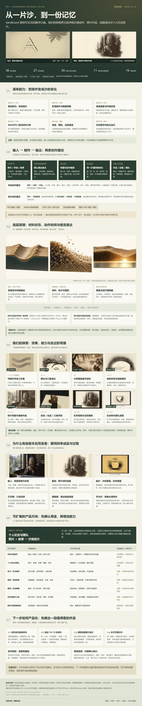
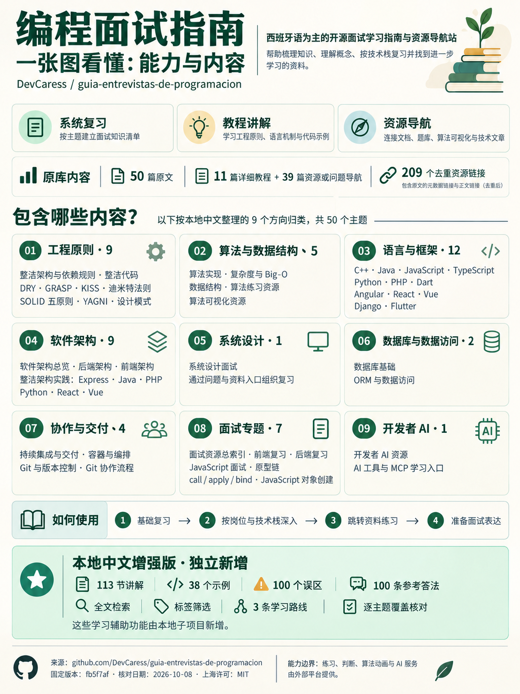
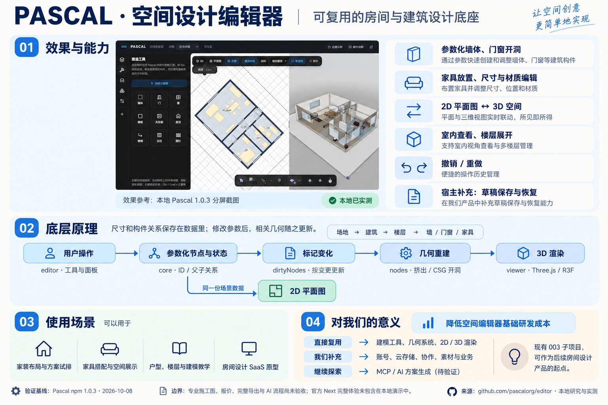
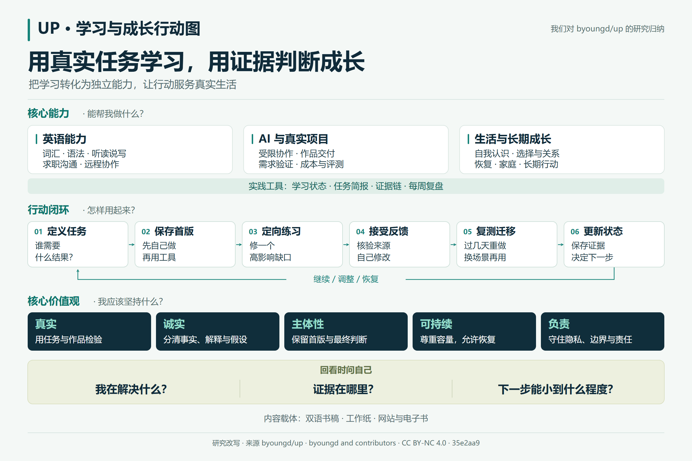
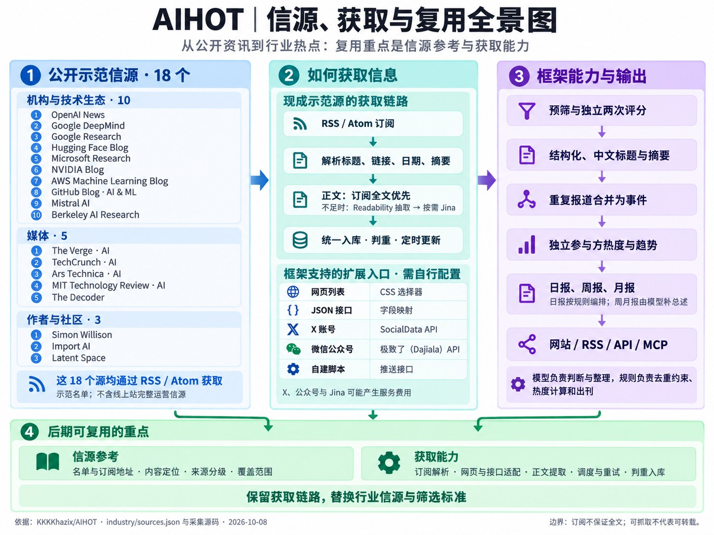

# GitHub 项目研究集

先从索引比较项目，再阅读各引导图上方的定位、能力、原理、使用场景和复用价值，判断它能怎样帮助自己。完整研究、实际效果与来源依据见各子项目。

## 项目索引

从索引进入研究说明、源库或在线体验。

<!-- PROJECT_INDEX:START -->

| 序号 | 项目 / 来源 | 研究摘要 | 状态 | 演示 |
| --- | --- | --- | --- | --- |
| 001 | [Sandboard 交互沙盘](projects/001-sandboard/README.md) · [Sandboard](https://github.com/scottstts/Sandboard) | **能力**：鼠标/触控数字沙盘，可划沟槽、推沙堆积和扬起飞沙；保留可操作原版。<br>**原理**：WebGPU 并行更新沙床高度、邻域沙量输运与飞沙粒子，结合颗粒、光照和阴影渲染。<br>**本地探索**：七种手绘工具、照片沙画预览、作品收藏、动作回放及纪念赠礼原型，保留历史效果和失败记录。<br>**场景**：触控创作、工具教学、材料实验与互动展陈；照片和故事可用于纪念短片与赠礼试作。<br>**价值**：复用输入—材料—渲染链路，以可操作效果和过程对照选择创作手法与产品方向。<br>**方向**：纪念物模板、动作编辑器、教学和品牌叙事；先验证辨识度、沙的体积感与稳定导出。<br>**边界**：自然成画与真实沙画质感待验收；上游没有照片语义识别或 AI 成画，云分享和商业交付需另开发。 | 研究中 | [访问](https://yydshly.github.io/1008_codex_project/001-sandboard/) |
| 002 | [编程面试知识指南](projects/002-interview-guide/README.md) · [guia-entrevistas-de-programacion](https://github.com/DevCaress/guia-entrevistas-de-programacion) | **能力**：面试复习与资源导航：50篇原文、209个资料入口，含11篇教程与39篇导航。<br>**模块**：工程、算法、语言框架、架构、系统设计、数据访问、交付、面试与AI九个方向。<br>**原理**：Astro将校验过的MDX静态出版；本地通过固定快照、主题关联、全文检索和覆盖审计组织知识。<br>**增强**：113节中文讲解、38个示例、100个误区与100条答法；检索筛选、三条路线与完整引导图。<br>**价值**：查漏复习、组织面试表达、对照技术栈，也可作为团队培训和可追溯知识库的起点。<br>**方向**：学习进度、错题与间隔复习、上游差异和外链监测；可选AI问答需提供出处与验证。<br>**边界**：第三方判题、算法动画与AI/MCP仅为资料入口；本站无代码运行、判题或模拟面试服务。 | 已完成 | [访问](https://yydshly.github.io/1008_codex_project/002-interview-guide/) |
| 003 | [Pascal 3D 建筑编辑器](projects/003-pascal-editor/README.md) · [editor](https://github.com/pascalorg/editor) | **能力**：参数化建筑构件与家具布局、材质显示、2D/3D 分屏、多层查看、选择编辑和撤销重做；本地真实演示保留住宅与官方示例。<br>**模块**：core 管节点、状态、注册与空间查询；nodes 提供构件、工具和几何；viewer 负责 3D；editor 负责交互与多视图；另有独立应用、CLI、MCP 与共享 UI。<br>**原理**：场景以带 ID 和父子关系的参数节点保存，编辑触发 dirty 更新；构件系统重建几何、处理墙交接和门窗 CSG 开洞，再由 Three.js/R3F 渲染；2D 直接投影同一节点数据。<br>**本地实现**：固定四个 npm 包 1.0.3，增加中文宿主、原创住宅、42 类本地资产、114 项材质配套资源、按示例保存的浏览器草稿和完整理解网页。<br>**场景**：家装方案试排、家具商品空间展示、户型与楼层教学、房间设计产品原型；测绘参考和设施维护可以作为后续探索，需补足数据与业务。<br>**价值**：复用参数—几何—视图的编辑链路，减少基础编辑器开发，把精力投入资产、方案管理、服务流程及自己的产品体验；不预设节省比例或工程精度。<br>**复用路线**：可从 Viewer 展示、Editor 嵌入、独立 CLI 或 MCP 路线切入；先完成创建项目—编辑—保存恢复，再接入自己的资产目录、分享与业务规则。<br>**扩展方向**：云端项目与版本、商品资产与规则、布局约束与方案比较、受控 AI/MCP、数据交换、测绘参考、自定义构件插件，以及专业服务流程。<br>**边界**：官方 Next 完整托管体验尚未进入开源发行；本网站没有账号、云协作或 AI/MCP 后端，完整导出、IFC、专业施工图、真实触摸与工程校验未逐项验收。<br>**验证与许可**：已实测墙厚修改及撤销重做、楼层高度保存刷新与还原、家具新增、多层展开和分屏；研究固定 c5eaf51，代码 MIT，材质单独许可待逐项核实，Basis 解码器保留 Apache 2.0。 | 研究中 | [访问](https://yydshly.github.io/1008_codex_project/003-pascal-editor/overview/) |
| 004 | [Up 终身学习指南](projects/004-up-learning-guide/README.md) · [up](https://github.com/byoungd/up) | **能力**：帮助读者把英语、AI 协作、项目交付与生活成长转成可执行任务，通过诊断、练习、反馈、复习保持和迁移判断进展。<br>**模块**：七篇中文专题覆盖学习系统、英语、AI项目创业、生活长期成长、25张工作纸、出版实现、术语资源；完整对应97页中文及97个英文文件。<br>**方法原理**：定义任务→保存独立首版→诊断并定向练习→核验反馈并自己修改→延迟复测与新场景迁移→更新状态；分别检查即时表现、保持与应用。<br>**技术原理**：上游以Markdown和统一导航驱动VitePress/Vue双语网站、工作纸与EPUB/PDF；本地以Node/marked生成静态HTML和检索JSON，浏览器完成阅读、搜索与筛选。<br>**本地实现**：十一项摘要、十章完整理解、既有引导图、全文检索、段落目录、25 张工作纸分类、392 个分组词条与67 个引用链接；资料可下载、来源可回查。<br>**价值观**：真实、诚实、主体性、可持续、负责：以任务和证据判断成长，保留自己的首版与最终判断，尊重容量、隐私、关系和责任。<br>**场景**：独立写英文邮件与岗位沟通、验收 AI 作品、工作流评测、客户与小生意验证、团队带教、家庭共学和计划中断后的恢复。<br>**价值与复用**：把无目标输入转成可比较的作品和能力证据；复用任务简报、验收、证据链、学习状态和周期复盘，支持自主选择、团队交接与持续行动。<br>**扩展方向**：私有学习工作台、保持迁移提醒、岗位训练包、带出处的AI助手、作品评测、团队家庭协议、多语内容维护与离线同步；均为待开发方向。<br>**边界**：源库主要交付内容和出版代码；本站没有自动教学、模型推理、账户、云同步或能力认证。关联产品与合成示例不计作本库运行成果。<br>**来源与许可**：研究固定35e2aa9；byoungd and contributors内容采用CC BY-NC 4.0，上游程序MIT，第三方素材独立许可；本地网页与学习效果分别验证。 | 已完成 | [访问](https://yydshly.github.io/1008_codex_project/004-up-learning-guide/) |
| 013 | [AIHOT 信源与资讯引擎研究](projects/013-aihot/README.md) · [AIHOT](https://github.com/KKKKhazix/AIHOT) | **能力**：把多源资讯采集、预筛、评分、结构化、中文写作、事件归组、热度与定期出刊串成可自托管的资讯流水线。<br>**模块**：api、worker、web 三个进程；sources/content/editorial/events/publication/reports 等业务模块；site 与 industry 分离站点身份和行业判断。<br>**原理**：先确定可用材料与发布时间，再由同一评分模型独立评两次；报道 report → 一次发生 fact → 持续事件 story，公开出口统一经过 publication。<br>**信源**：18 个示范源全部使用 rss 适配器：10 个机构与技术生态源、5 个媒体、3 个作者与社区源。适配器兼容 RSS、Atom 和 RDF，不包含线上完整运营名单。<br>**获取**：订阅解析与正文补取是两层；另支持网页 CSS、JSON 字段映射、X/SocialData、公众号/Dajiala 与外部推送。扩展入口需要自行配置，并非现成示范源。<br>**场景**：行业晨报、产品与竞品监测、开发者资讯、团队情报入口、垂直内容站，以及向 Agent 提供可追溯的资讯。<br>**价值**：减少重复阅读与手工编报，把编辑经验写成可评测的筛选标准；源质量、标注与持续运营决定最终效果。<br>**复用**：既可只借用来源清单和采集配置，也可复用正文清洗、事件模型、评测方法、公开范围控制，或部署完整引擎。<br>**方向**：中文行业包、人工审稿、多租户、个性化、更多通知渠道和带出处的问答可在此基础上开发；这些是规划，不是当前已交付的能力。<br>**边界**：模型评分不是事实核验；热度不是全网热搜；全文获取不代表转载授权；GitHub Pages 研究页不提供上游数据库、采集或模型服务。<br>**验证**：结论来自文档与固定提交源码阅读。保留 10 月 8 日观察基线，10 月 12 日整理归档；本地研究网页构建与浏览器核验另记，不把阅读当作端到端运行。 | 已完成 | [访问](https://yydshly.github.io/1008_codex_project/013-aihot/) |

### 001 · Sandboard 交互沙盘

**定位与能力**：Sandboard 是能用鼠标或触控操作的数字沙盘：划动产生沟槽，推挤形成沙脊，快速动作扬起飞沙。本地研究保留可操作原版，并增加七种手绘工具、照片转沙画预览、作品收藏和动作回放，让读者从材料交互进一步尝试画面创作。

**模块与原理**：底层用 WebGPU 并行计算二维沙床高度，按邻域输运沙量，以飞沙粒子补充扬起和落下的过程，再用表面法线、颗粒、光照与阴影表现沙面。本地平台把原版、手绘工作室、照片创作、作品集和历史试验连成独立入口；照片构图与动作谱属于我们的扩展。

**场景与产出**：可以用于触控创作、沙耙等工具教学、WebGPU 材料实验和互动展陈原型。个人纪念与赠礼路线尝试把照片、故事和重点区域确认变成沙画预览、过程短片、PNG 成品与离线赠礼页面；各入口产出不同，可通过真实作品和历史录像对照效果。

**价值与复用**：对创作者，价值是能操作材料、保留作品并回看成画过程；对开发者，可研究输入如何改变材料状态，以及模拟、渲染和工具怎样配合。研究同时保留认可过的效果和失败版本，便于判断哪种手法值得继续，照片与草稿当前在浏览器本机处理和保存。

**扩展与边界**：可继续探索纪念物模板、动作编辑器、教学课程、品牌叙事和展陈设备，先验证辨识度、沙的体积感、撒收动作与稳定导出。当前已有可操作原型，自然成画和真实沙画质感仍未通过验收；上游没有内置照片语义识别或 AI 成画，云分享与商业交付也需另做。

[研究说明](projects/001-sandboard/README.md) · [在线体验](https://yydshly.github.io/1008_codex_project/001-sandboard/) · [高清引导图](projects/001-sandboard/assets/understanding/overview.png)

[](projects/001-sandboard/assets/understanding/overview.png)

一图了解 Sandboard 的能力与原理，以及我们从手绘、照片沙画到纪念赠礼的探索。图中保留真实效果，标明 AI 目标与待验证方向。

### 002 · 编程面试知识指南

**定位与能力**：这是一份帮助程序员建立知识地图、查漏复习并练习技术表达的指南。固定版覆盖 50 个主题和 209 个资料入口，其中 11 篇是教程、39 篇主要是资源导航；本地补充中文讲解、代码示例、常见误区和参考答法，并提供全文检索、筛选和学习路线。

**模块与原理**：内容分为工程实践、算法、语言与框架、架构、系统设计、数据访问、交付、面试和 AI 九个方向。上游用 Astro 将带元数据的 MDX 出版为静态网站；本地固定原文快照，关联主题和引用，再通过覆盖审计组织 113 节讲解、38 个示例、100 个误区及 100 条答法。

**场景与产出**：面试前可以按通用基础、前端或后端路线列出短板，先独立回答复习题，再对照答法补上自己的项目例子。日常工作可用事务、架构和交付主题复盘设计取舍；带教时可组织误区讨论，形成可核对的复习清单、代码例子和技术说明。

**价值与复用**：把分散资料放回知识结构，帮助读者明确先学什么、哪里需要动手、怎样解释选择理由。原文、中文增强和外部平台分别标注，来源可回查；内容与元数据分离、主题关联、固定来源和覆盖报告也可用于自己的团队培训站或技术知识库。

**扩展与边界**：可在现有主题与复习题之上增加个人进度、错题、间隔复习、上游差异和外链监测；带出处的 AI 问答需要另建检索和核验流程。当前网页提供阅读、检索与复习材料，在线判题、代码执行、模拟面试及能力评分尚未交付，学习结果仍由实践和表达检验。

[研究说明](projects/002-interview-guide/README.md) · [在线体验](https://yydshly.github.io/1008_codex_project/002-interview-guide/) · [高清引导图](projects/002-interview-guide/assets/repository-map.png)

[](projects/002-interview-guide/assets/repository-map.png)

使用我们2026-10-08生成的完整内容总览图，引导阅读原库能力与知识模块；研究说明进一步解释原理、价值和扩展方向，图中区分原库、本地新增与外部服务。

### 003 · Pascal 3D 建筑编辑器

**定位与能力**：Pascal 提供可嵌入网页的参数化建筑编辑组件，能创建和修改墙体、门窗、楼板等构件，布置家具、显示材质，以 2D/3D 分屏和多层视图查看空间，并支持选择与撤销重做。本地真实编辑器可操作原创住宅与官方示例，保存并恢复按场景区分的浏览器草稿。

**模块与原理**：core 管场景节点、状态和历史，nodes 提供构件与几何，viewer 渲染三维，editor 组合工具和多视图；另有应用、CLI、MCP 与共享 UI。场景保存为带参数和父子关系的节点，修改触发几何更新、墙交接和门窗开洞，再由 Three.js/R3F 显示，2D 使用同一份节点数据。

**场景与产出**：家装方案试排可以调整墙厚、楼层高度和家具位置，对照平面与立体效果；家具商品展示可把资产放入房间，户型教学可观察构件和多楼层关系。开发者可先做房间设计产品原型，产出可继续编辑的结构化场景、方案视图与本机草稿，再接入自己的业务。

**价值与复用**：核心价值是复用从参数、几何到视图和交互的完整编辑链路，把更多开发精力投入商品资产、方案管理和服务流程。可以从独立 Viewer 展示、Editor 嵌入、CLI 或 MCP 路线切入；本地已核验墙厚修改与撤销、楼层保存刷新、家具新增、多层展开和分屏。

**扩展与边界**：可继续开发云端项目与版本、商品目录、布局约束、方案比较、自定义构件、数据交换和受控 AI 设计，需补足存储、权限、规则及验收。本网站没有账号、云协作或 AI/MCP 后端；专业施工图、IFC、完整导出和工程精度未逐项验收，使用时不能把编辑原型当作已认证的工程工具。

[研究说明](projects/003-pascal-editor/README.md) · [在线体验](https://yydshly.github.io/1008_codex_project/003-pascal-editor/overview/) · [高清引导图](projects/003-pascal-editor/assets/pascal-summary.png)

[](projects/003-pascal-editor/assets/pascal-summary.png)

沿用2026-10-08生成的1536×1024完整引导图，原始PNG保持一致；2026-10-12整理能力、模块、原理、价值与扩展方向。AI信息图参考真实运行截图，用途与价值属于研究分析。

### 004 · Up 终身学习指南

**定位与能力**：Up 是把终身学习组织成真实任务、独立作品和可检查证据的开放指南。它帮助读者诊断缺口、安排练习、使用反馈、复习保持、迁移应用和复盘调整；英语、AI 协作与真实项目、生活与长期成长是三条主要方向，作者经历说明方法的来路，章节和工作纸提供可执行的步骤。

**模块与原理**：本研究用七篇专题覆盖学习系统、英语、AI 项目与创业、长期生活、25 张工作纸、网站出版和术语资源，保留 97 页中文及英文配对来源。方法是定义任务→保存独立首版→诊断并定向练习→核验反馈并自己修改→延迟复测与新场景迁移→更新状态，分别判断当下表现、过几天的保持和换场景的应用。

**场景与产出**：英文邮件依赖润色时，先写首稿、记录帮助和反馈，再换主题独立重写；AI 作品难以判断时，先写任务简报和验收标准，保留人工基线、版本与测试。工作协作、小生意验证、团队带教、家庭共同学习和计划中断后的恢复，也可使用相应工作纸，留下样本、证据链、每周复盘和下一步。

**价值与复用**：个人价值是把“学了很多”转成能比较的输出，让学习服务实际选择与行动；团队可借用简报、验收、证据和复盘格式改善交接，家庭可借用共同目标与职责约定。我们归纳的五项价值观是：真实任务、诚实记录、保留自主判断、尊重现实容量并持续恢复、对输出和他人负责。回看图时问自己：我在解决什么？证据在哪里？下一步能小到什么程度？

**扩展与边界**：上游用 Markdown、双语导航和 VitePress/Vue 发布网站、工作纸与 EPUB/PDF；本地静态网页提供完整理解、搜索、分类和下载。可进一步开发私有学习工作台、保持迁移提醒、岗位训练包、带出处的 AI 助手、作品评测、团队家庭协议、多语维护和离线同步；这些均为规划，当前没有自动教学、模型服务、账号云同步或能力认证，实际效果需自己的样本检验。

[研究说明](projects/004-up-learning-guide/README.md) · [在线体验](https://yydshly.github.io/1008_codex_project/004-up-learning-guide/) · [高清引导图](projects/004-up-learning-guide/assets/up-core-map.png)

[](projects/004-up-learning-guide/assets/up-core-map.png)

沿用2026-10-09生成的2400×1600完整行动图：核心方向、三类能力、六步闭环、五项价值观与回看三问。2026-10-12补全理解并发布，PNG原始字节保持一致；分类与价值观为本研究归纳。

### 013 · AIHOT 信源与资讯引擎研究

**定位与能力**：AIHOT 是可自托管的行业资讯引擎，把多源采集、材料处理、精选评分、中文写作、事件归组、热度和定期出刊串成流水线。它既可以形成面向读者的资讯站，也提供检索、RSS、API、MCP 和 Agent Markdown 等出口；本项目网页展示源码研究与配置参考。

**模块与原理**：api、worker、web 分别承担接口、后台处理与网页，业务模块管理来源、内容、编辑、事件和出版。先确定可用材料与发布时间，再由同一模型独立评分两次；报道 report 归为一次发生 fact，再关联持续事件 story，公开输出统一经过 publication 的范围、代表和许可规则。模型评分本身不能核实事实。

**场景与产出**：适合探索行业晨报、产品与竞品监测、开发者资讯、团队情报入口和垂直内容站，将分散报道组织成有原文出处的中文摘要、事件列表与日报、周报、月报。固定示范包含 18 个订阅源，均使用 RSS 适配器；网页、JSON、X、公众号和外部推送是框架另可配置的接入方式。

**价值与复用**：价值在于减少重复阅读和手工编报，把编辑经验写成可比较、可评测的筛选标准，并沿事件查看后续变化。可以只借来源清单和采集配置，也可复用正文清洗、事件模型、评测方法和公开范围控制，或自行部署完整引擎；源质量、标注、审稿和持续运营决定最终效果。

**扩展与边界**：可继续建设中文行业包、人工审稿、多租户、个性化、通知和带出处的问答，先验证来源质量、事件归组和出刊稳定性。当前 GitHub Pages 页面提供研究与资料，没有运行上游数据库、采集或模型服务；热度仅反映已接入来源，全文获取不等于转载授权，扩展方向也不是已经交付的产品能力。

[研究说明](projects/013-aihot/README.md) · [在线体验](https://yydshly.github.io/1008_codex_project/013-aihot/) · [高清引导图](projects/013-aihot/assets/aihot-overview.png)

[](projects/013-aihot/assets/aihot-overview.png)

沿用2026-10-08生成的完整研究引导图，基于固定提交6e67a9d；2026-10-12整理发布。轻量预览保留完整画面，高清原图逐字节保留。

<!-- PROJECT_INDEX:END -->

<details>
<summary>维护仓库：新增项目与目录约定</summary>

## 添加一个研究项目

安装 Node.js 22 或更新版本后，在仓库根目录执行（无需安装依赖）：

```bash
npm run project:add -- --slug repo-name --name "项目名称" --upstream https://github.com/owner/repo --summary "这个项目解决什么问题，为什么值得研究"
```

命令会生成 `projects/001-repo-name/`（后续为 `002-…`、`003-…`），登记项目信息并更新本页索引。随后填写研究文档，把真实截图放入项目的 `assets/`，在 `projects.json` 中设置图片路径、替代文字、图注及已可访问的演示链接。

```bash
npm run index:build  # 修改项目信息后更新首页
npm run check        # 检查编号、目录、链接字段与首页同步情况
```

## 目录导航

```text
.
├── README.md              # 总索引、项目摘要、图片与入口
├── projects.json          # 索引数据：编号、来源、状态、图片和演示
├── projects/
│   └── 001-sandboard/      # 交互沙盘的研究与网页复现
│       ├── README.md       # 项目概览、研究结论与使用方式
│       ├── notes.md        # 阅读笔记、复现过程与问题
│       ├── assets/         # 截图、架构图及图注
│       ├── src/            # 独立实验与改进代码
│       └── web/            # 可选的 Web 演示源码
├── templates/project/     # 新项目模板
├── docs/                  # 研究约定和多 Web 部署说明
└── scripts/               # 添加项目、生成索引和校验
```

- [子项目目录](projects/README.md)
- [研究与编号约定](docs/PROJECT_GUIDE.md)
- [多个 Web 的部署方式](docs/DEPLOYMENT.md)
- [子项目模板](templates/project/README.md)

已上线 [研究总入口](https://yydshly.github.io/1008_codex_project/) 与 [001 · Sandboard 完整平台](https://yydshly.github.io/1008_codex_project/001-sandboard/)，包含原版沙盘、手绘工具、照片创作、作品集与历次试验。其他项目按各自说明研究和独立构建，在线地址仅在实际部署核验后登记。

</details>

## 来源与许可

研究文档应记录原仓库、研究版本或提交及其许可证；引用的代码、截图和其他素材保留来源及许可信息。各上游项目遵循各自的许可证。本仓库暂未为原创内容指定统一的开源许可证。
