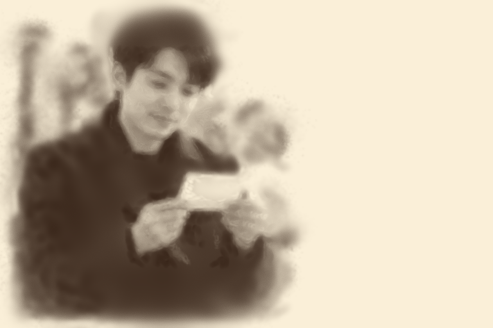
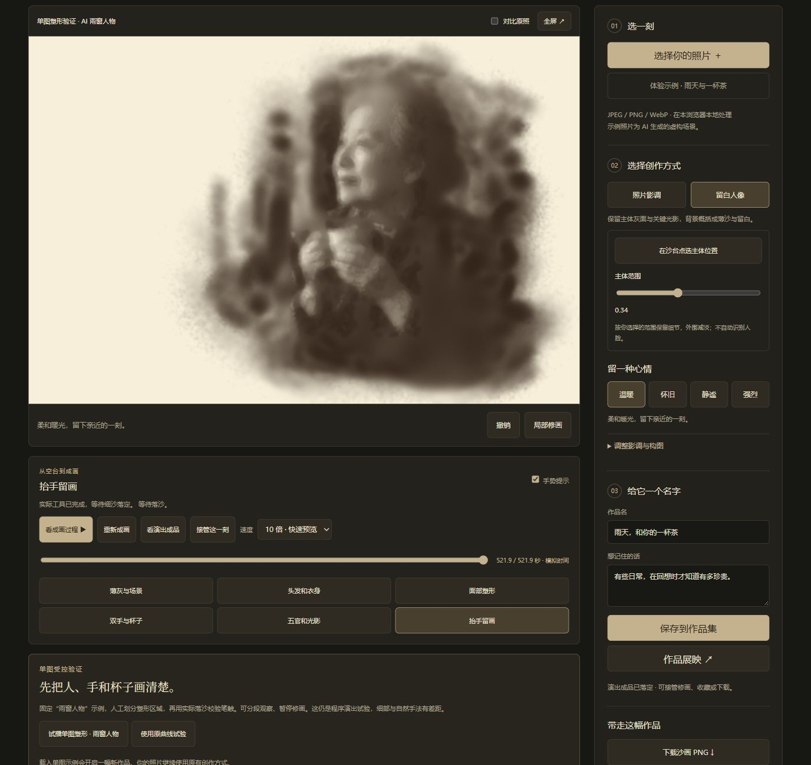
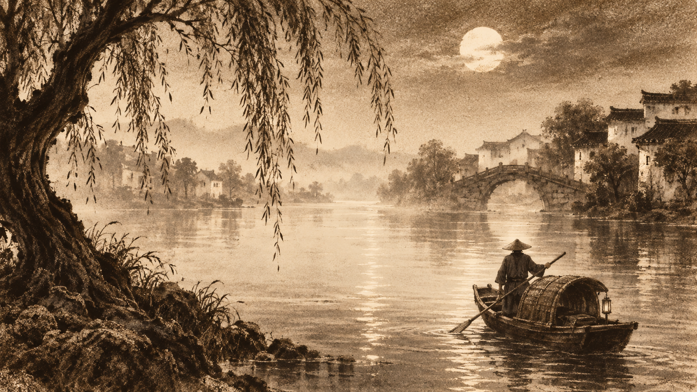
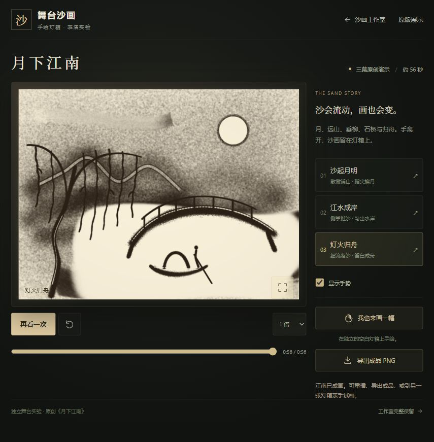

# 001 · Sandboard 交互沙盘

<!-- PUBLICATION_SUMMARY:START -->
## 能力、价值与发布入口

Sandboard 提供可触摸、可推挤、可扬起沙粒的数字沙盘。我们的研究从保留原版开始，尝试手绘工具、照片转沙画、动作成画、真实手部与纪念赠礼流程；已有可操作原型，但自然成画和真实沙画质感仍未通过验收。

[完整引导图](assets/understanding/overview.png) · [网页分章放大阅读](https://yydshly.github.io/1008_codex_project/001-sandboard/art/research/#overview) · [文字版总览](assets/understanding/content.txt)。根 README 保留宏观入口，本页汇总原理、输入输出、场景、价值、产品方向与失败记录。

[源库 Sandboard](https://github.com/scottstts/Sandboard) · 固定研究提交 `489cb01e81b11ba575887f7c76760498eb41aaa8` · GPL-3.0-only。已公开部署并核验：[研究总入口](https://yydshly.github.io/1008_codex_project/)。旧研究条目中的 localhost 地址保留为历史测试记录，访问当前版本使用以下统一入口。

- [统一平台首页](https://yydshly.github.io/1008_codex_project/001-sandboard/art/home/)：原版、手绘、照片、作品集与历史试验的总入口。
- [Sandboard 原版效果](https://yydshly.github.io/1008_codex_project/001-sandboard/original/)：保留研究基线的沙床与渲染，体验沟槽、堆积和飞沙。
- [沙耙等手绘工具](https://yydshly.github.io/1008_codex_project/001-sandboard/art/#mode=surface&tool=rake)：回到原工作室，操作七种工具。
- [统一作品集](https://yydshly.github.io/1008_codex_project/001-sandboard/art/gallery/#examples)：直接看手绘示例、照片收藏与历史效果。
- [照片沙画创作](https://yydshly.github.io/1008_codex_project/001-sandboard/art/memories/#create)：上传照片、调整效果、保存本机作品。
- [纪念短片原型](https://yydshly.github.io/1008_codex_project/001-sandboard/art/memories/keepsake/)：从杯子照片与故事尝试完整成片流程。
- [研究历程与总览图](https://yydshly.github.io/1008_codex_project/001-sandboard/art/research/#overview)：放大阅读一图总览，核对实际效果与失败记录。

### 源库的能力与底层原理

- **交互能力**：鼠标、触控和多指推动同一沙床；慢划形成沟槽、堆积，快划扬起飞沙，另有波浪重置和声音体验。
- **材料计算**：WebGPU 在 GPU 上更新二维高度场，以邻域间的沙量输运形成沙痕；飞沙粒子落地后回到沙床。
- **画面渲染**：高度梯度生成表面法线，结合微小颗粒、光照与阴影呈现沙面。
- **源库边界**：高度场与粒子的组合近似，没有完整三维逐粒物理、照片识别或 AI 成画能力。照片、故事与动作成画来自我们的独立实验。

### 我们的探索与实际输入输出

| 路线 | 输入 | 处理方式 | 输出 |
| --- | --- | --- | --- |
| 原版交互沙盘 | 鼠标、触控、多指动作 | 高度场输运与飞沙 | 可实时操作的沙床、沟槽与堆积 |
| 七工具手绘 | 笔触、工具与力度 | 沙耙、撒沙、推沙、刮沙、印章、抚平、掌扫 | 可编辑沙层、手绘草稿与作品收藏 |
| 照片沙画 | 照片与风格参数 | 明暗及结构转换、效果调整 | 沙画预览、本机草稿与收藏 |
| 动作成画试验 | 明暗结构与人工确认的重点区域 | 撒沙、推拢、收沙动作谱在同一沙层回放 | 可播放的成画过程及效果对照 |
| 纪念物赠礼原型 | 杯子照片、故事与关键区域确认 | 构图确认、模板动作与成片编排 | 过程 WebM、成品 PNG、工程备份、离线赠礼网页 |

各入口能力不同，杯子模板不等于任意照片的语义重绘。统一作品集保留九幅可继续编辑的手绘示例；研究档案保留 v1–v36 的 27 项尝试、34 项历史效果与 11 段精选录像。

### 使用场景与研究价值

- **使用场景**：原版用于互动沙盘、触控创作、WebGPU 教学与材料研究；手绘工作室用于试画与工具教学；照片平台用于风格和情绪构图试验。
- **研究价值**：能够操作、对比、保留过程，区分源库能力、实际效果、AI 目标与失败尝试，帮助判断产品方向和制作方法。
- **数据方式**：照片在浏览器本机处理，草稿与收藏保存在本机；设备、浏览器和站点域名之间尚不自动同步。

### 可扩展产品方向与推进顺序

**优先产品：个人纪念与赠礼。** 照片＋故事 → 构图确认 → 沙画短片 → 海报与赠礼页面。

1. **先验收画面与过程**：以少量典型纪念物核对成品辨识度、沙的体积与透光、撒收动作的因果关系。
2. **再完善交付**：稳定的视频导出、可复用模板与赠礼页面。
3. **再扩大范围**：人物、复杂场景、云端分享和商业支付仍待验证。

其他产品方向：手绘创作工具、沙画教学、品牌与活动叙事、互动展陈、创作者动作编辑器、舒缓的数字沙盘体验。

### 当前边界与失败结论

早期照片效果曾获得认可，但部分后续尝试出现模糊、逐块显像像打印、均匀撒沙、收沙缺少可见堆积，以及三维手部塑料感。增加颗粒或手部模型没有自动提高真实感；杯子模板仍容易简化为图标。现有照片转换并非任意照片的语义理解，动作回放仍是程序材料近似，不能承诺大师水平或实拍质感。旧版全部保留，作品集与研究页提供对照，以实际效果决定继续方向。

[完整引导图](assets/understanding/overview.png) · [图源、输入哈希与复现](assets/understanding/README.md) · [代码与素材署名](experiments/sand-art/ATTRIBUTION.md)。原版、十五功能页、所有旧版效果和本机作品库均保留；线上新域名不会自动带入 localhost 的私人收藏。
<!-- PUBLICATION_SUMMARY:END -->

<details>
<summary>历次探索与保留效果：v1–v36、手部试验、作品集与旧版入口</summary>

新增 [完整理解总览图](assets/understanding/overview.png) 与 [网页放大阅读](http://127.0.0.1:4174/1008_codex_project/001-sandboard/art/research/#overview)：用原版、手绘、照片、舞台、手部和纪念短片的保留素材，归纳源库能力、输入输出、底层原理、探索历程、问题及七类产品方向。AI 目标、概念示意和待验证方向分别标注；首页直达，支持按章节定位与高清下载，原功能和效果保留。[来源与生成记录](assets/understanding/README.md)。

[历史作品与过程](http://127.0.0.1:4174/1008_codex_project/001-sandboard/art/gallery/#history) 已补入统一作品集：34项记录覆盖v1–v36。柳、桥、侧脸、归舟与三幅参考还原可从作品卡片打开正确编排，再接过实际沙层；AI目标单独标记，十一段保存录像按需播放。原功能、九工具示例和私人收藏保留；本轮改善组织与流程，不代表沙画视觉达标。[实现与验证](experiments/sand-art/gallery/README.md)。

[手绘示例作品](http://127.0.0.1:4174/1008_codex_project/001-sandboard/art/gallery/#examples) 已加入统一作品集：原沙纹园、山月沙画与七种工具小样，共九幅实际效果。点击画面进入原工作室，带着对应的可编辑沙层和工具试画；试画独立暂存、可恢复原示例或返回原草稿，保存后加入自己的收藏。原画台、照片作品和历史效果继续保留。[实际预览与验证](assets/handdraw-examples/README.md)。

[统一作品集](experiments/sand-art/gallery/README.md) 现已汇总手绘与照片收藏，支持分类、搜索、预览和继续创作。[首页](http://127.0.0.1:4174/1008_codex_project/001-sandboard/) 七个工具直接进入原沙台；十四个原功能页和全部历史效果继续保留，加入作品集后共十五功能页。

新增 [光阴沙画统一首页](experiments/sand-art/home/README.md)：[本地打开全部平台](http://127.0.0.1:4174/1008_codex_project/001-sandboard/)。早期照片平台、工作室、创作台优先展示，原版沙盘、舞台、手部与无手试验、五版纪念短片、研究档案共十四个功能页全部关联。每个页面都有返回首页和完整目录；旧 `art/` 路径、作品库与效果保留。

新增 [沙画研究历程网页](experiments/sand-art/research/README.md)，入口 `art/research/`。整理 v1–v36 的 27 项尝试、11 段历史过程录像、实际效果对照与失败结论；可按方向、关键词和版本查找，再打开原演示与记录。照片产品和最新纪念短片导航均已接入。原版、旧算法、作品存储与历史媒体保留。

新增 [v36 局部推拢试片](experiments/sand-art/memories/keepsake/handwork/README.md)：拆掉整块杯身清空，改为三笔弧形推拢；沙先聚在前缘、停驻，再只拾实际推起的沙堆。保留 v35 灯台留白版及全部旧版，照片与故事到成片的流程继续可用；仍为轮廓模板与程序材料近似。

新增 [v35 灯台留白试片](experiments/sand-art/memories/keepsake/sandlight/README.md)：重新尝试厚沙遮光、收沙透光与边缘沙脊，避免整杯填成灰色素描。照片和故事到 45 秒实际过程导出的流程继续可用；v34、v33 与所有旧版源文件和证据保留。本次仍是手法与材料小样，成品轮廓偏模板化，未达到真实大师沙画或商业交付质量。

新增 [v34 杯身塑形版](experiments/sand-art/memories/keepsake/composition/README.md)：重做完整杯身灰面、明暗体积与杯口深度，收敛背景散沙，放大成品构图；v33 与所有旧版保留。仍为数字沙画样片，尚未达到实拍大师作品质量。

新增 [v33 杯子质感版](experiments/sand-art/memories/keepsake/natural/README.md)：更清楚的沙粒、宽幅铺沙与守恒推拢，继续沿用照片、故事到成片的产品流程；保留 v32 与全部旧版。

v32 新增独立“纪念短片”产品入口：杯子照片与故事 → 框选确认杯身、杯把、托碟 → 45 秒实际撒沙收沙 → WebM、PNG 海报和离线赠礼网页。照片比例真正驱动动作几何，文字进入成片；支持本机草稿与工程备份。第一版限杯子轮廓模板，不复刻花纹或背景，尚无在线分享、配乐或支付；v31、v30 与所有旧版保留。[使用与限制](experiments/sand-art/memories/keepsake/README.md)。

v31 增加独立“茶杯手法 · 30 秒”小样：9 个原创连续动作，贴台推拢形成前缘沙堆，坡度松落后停驻、分次拾起。支持单笔、慢放、收沙前后对照、近景和实际导出；原 v30 默认雨窗与全部旧版保留。实际结果与限制见 [v31 记录](assets/cup-action-v31/README.md)。

v30 新增“沿形撒收”：重点调整细部短笔与完整节奏，沿明暗轮廓连续移动、笔内渐变力度、停沙换笔，保留 v29 及更早版本。实际运行、完整过程和局限见 [v30 记录](assets/no-hand-photo-v30/README.md)。

v29 继续增加“细节撒收”：从原照重新规划五官、指节与杯口，缩窄下落沙流，收沙带起并移出已有颗粒，保留薄沙脊。新增单笔慢动作与片段视频、沙量去向，默认关键动作放慢；v28、v27 与原版保留。实际产物和近似边界见 [v29 记录](assets/no-hand-photo-v29/README.md)。

v28 增加独立“连续撒收”实验：重新规划较长曲线，供沙渐起渐停、近台下落，停沙不自动揉散，收沙留下少量薄沙脊。按章节进度对照保留的 v27 与原版逐笔，支持 12 秒慢看、双光线、视角和实际导出；仍是算法沙画，未达到实拍或大师表演质量。实现与实际产物见 [v28 记录](assets/no-hand-photo-v28/README.md)，[v27 记录](assets/no-hand-photo-v27/README.md) 保留。

v26 继续优化无手照片演出：默认约 73 秒的分章节奏，面部与杯子放慢、细筆加快、章间停留；可单独以 1 倍慢看面部或双手与茶杯，到章末暂停。沙面改为固定米制粒径、远景明暗与近景颗粒分开呈现，增加透光 / 侧光对照和可退出的专注观看。全部材料时间步仍逐一执行，原流程保留。实现与实际产物见 [v26 记录](assets/no-hand-photo-v26/README.md)。

v25 将同一 `art/memories/hands/contact/` 推进到「雨窗与茶杯」无手照片成画：从空台执行 2,042 笔添沙、收沙与揉沙，所有视角读取原精度 768×512 沙层。可分章定位、选择 1/4/10 倍速度、固定查看人物/双手与杯子/衣身近景，并导出实际画面与过程。芦苇落沙和两个手部实验继续保留；照片创作页支持自己的照片和结构规划。当前三维镜头只接入雨窗示例，原照为此前 AI 虚构场景；尚未达到实拍沙画质感。实际输出与验证见 [v25 记录](assets/no-hand-photo-v25/README.md)。

v24 将同一 `art/memories/hands/contact/` 默认切到 12 秒「无手落沙」：从空台连续撒出芦苇，支持俯视成画、沙粒近景和从画面外进入的落沙特写，改进颗粒显示、供沙惯性与过程流畅度。原 24 秒取沙、20 秒接触演示继续可切换。实际画面、完整过程和局限见 [v24 记录](assets/no-hand-v24/README.md)。本轮是简单曲线的材质与镜头小样，复杂照片成画尚未接入这条流程，也未达到实拍质感。

v23 在同一 `art/memories/hands/contact/` 增加 24 秒「取沙与漏沙」：从台上小沙堆收取材料，翻掌显示可见沙堆，再细漏、散漏和掌推。台上、手中、下落与台外共用材料记账，新增颗粒掌内表面与跟随手部的近景；原 20 秒接触演示和固定工具对照继续可用。实际输出与近似边界见 [v23 记录](assets/hand-contact-v23/README.md)。这是可操作的同场材料试验，掌内沙尚无逐颗碰撞，真人摄影目标仍未达到。以下保留历史版本记录。

v22 改用当前变形皮肤的最低接触片移沙，加入渐进力度、指腹压缩和手背张力的程序近似，以及手指/腕部联动。页面可切换「皮肤接触 / 固定工具」，在同一时刻比较两种沙痕，并显示接触轮廓。20 秒入口仍为 `art/memories/hands/contact/`，实际同帧对照、过程视频和局限见 [v22 记录](assets/hand-contact-v22/README.md)。当前还没有从沙堆中实际抓沙或真实肌肉/皮肤碰撞，摄影级目标仍未达到。

v21 继续优化同一三维试验：拇指对掌与松指开度、三处指缝散撒、同一把沙的有限预算、布料褶皱与织纹、皮肤微孔和柔化阴影。沙脊通过局部守恒移沙逐步落稳，定位期间显示进度并暂时锁定导出。入口仍为 `art/memories/hands/contact/`，实际画面、过程视频与能力边界见 [v21 记录](assets/hand-contact-v21/README.md)。这仍是实时三维近似，没有达到难以辨别生成画面的目标；旧能力和 v20 输出保留。

v20 新增独立的 [三维手与沙接触试验](assets/hand-contact-v20/README.md)，入口 `art/memories/hands/contact/`：20 秒内演示细撒、散撒、掌缘推沙和指腹划线，支持俯视/斜视、暂停定位、隐藏手部、PNG 与过程视频。手部为带骨骼的 CC0 模型和皮肤纹理，接触位置取自实际变形后的网格；沙从空台供料并移动同一沙层。当前验证了动作与沙的对应，仍有明显三维渲染感，尚未达到真人摄影质感。v19 与所有旧模式保留。

v19 优化无需照片的手与沙小样，入口 `art/memories/hands/`：单张连续前臂素材以正常比例显示，通过小幅捻指变形减少跨姿态重影。正常速度演示先细流、收指停沙，再抬手散撒；手动模式支持手法、高度和有限余沙，保留暂停定位、PNG 与过程视频。原版、照片创作及实拍通道保留，完整真人效果仍待验证，见 [v19 实际输出与素材记录](assets/generated-hand-v19/README.md)。[v18 输出](assets/generated-hand-v18/README.md) 保留作比较。

v17 加入可直接播放的 15 秒实拍手部与数字沙台小样，以及细笔落定雨窗试播。手部按手法匹配、随笔触寻帧，支持截取、逐帧接触点标定及本机保存；细节添沙减少自动揉开。保留原版和历次效果，当前仍有抠像边缘、肤色偏暗、碎笔和背景斑块，未达到完整真人效果，见 [v17 实际输出与验证](assets/material-realism-v17/README.md)。

v16 将首要目标转为手与沙的真实质感，新增同一沙层的颗粒灯箱对照、实拍手部短片导入与接触点标定、当前合成画面导出，以及有明确 CC BY 3.0 署名的真人表演参考。入口 `memories/#texture`；本轮没有新 AI 手部素材。当前仍是质感与素材通道试镜，轮廓、姿态和实际落沙同步尚未达到真人表演的可信度。详见 [v16 实际输出、许可与验证](assets/material-realism-v16/README.md)。

v15 将当前效果扩展到 [照片结构成画](experiments/sand-art/memories/README.md)：在原照上框选主体、脸、手和物件，为这张照片后台规划实际材料动作，支持进度和取消。新增左侧人物捧明信片的 AI 输入，直接试播包含 2174 笔；结构演出随收藏和可编辑作品一起保存，可继续或从空台重播。雨窗版本作为已认可的效果基线保留。当前依赖人工标注，没有自动语义识别；真实用户照片和复杂场景的画质仍需验证。



图注：生产网页实际导出，输入为 AI 虚构公园人物照片；完成时未替换成预览图。[素材与验证范围](assets/photo-guided-v15/README.md)。以下保留旧版本记录。

v14 增加固定 AI 雨窗人物的 [单图塑形验证](experiments/sand-art/memories/README.md)，入口为照片页 `#study`：按人工结构区域执行实际添沙、收沙、揉沙，可逐章观察、暂停接管、收藏和导出。默认 10 倍约 52 秒，1 倍模拟时长约 522 秒。侧脸和捧杯结构有所改善，但背景斑块、手指和动作自然度仍未通过美术目标验收；尚不支持任意照片的自动艺术家式成画。旧模式保留。



图注：2026-10-09 本地生产网页的真实终态，输入为此前 AI 虚构场景。成品来自同一实际沙层，完成时未换成规划预览。[真实输出及边界](assets/photo-structure-v14/README.md)。以下保留 v13 及早期记录。

v13 为「光阴沙画」增加留白人像、可调主体范围和从空台开始的曲线材料成画：薄撒铺灰、聚沙塑形、揉沙、收沙提亮与细节整理。支持暂停、章节定位、重新成画和接管修改；风格与四种情绪色调独立。实际演出成品仍有模糊和颗粒误差，风格预览与材料成品分别展示。照片影调、收藏、展映、PNG、纪念画卡、离线展览及可编辑工程继续保留；原版、工作室、基础舞台及手势创作台入口不变。

[返回总索引](../../README.md) · [原仓库](https://github.com/scottstts/Sandboard) · [研究笔记](notes.md) · [原版展示源码](web/) · [沙画工作室](experiments/sand-art/README.md) · [舞台沙画说明](experiments/sand-art/stage/RESEARCH.md)

</details>

## 基本信息

照片沙画入口为 `/1008_codex_project/001-sandboard/art/memories/`，详见 [产品与使用说明](experiments/sand-art/memories/README.md)。`#guided` / `#postcard` 打开不同构图的人工标注示例；`#postcard-study` 可直接试播公园演出；`#study` 保留雨窗版本；`#process` 可自动开始原曲线示例成画，普通入口先展示可切换风格。作品集仅保存在当前浏览器；离线展览是带内嵌图片的独立文件，目前没有云收藏或公开作品链接。

v13 的 [风格预览与实际演出对照](assets/photo-portrait-v13/README.md) 使用此前的 AI 虚构示例照片。照片仅指导工具路径和有限供沙；演出沙层从空台累积，没有在结束时替换为目标图。主体范围由用户点选，当前没有语义分割或艺术家动作采集。下图继续保留 v12 展映截图。


图注：2026-10-09 本地生产网页截图，沙层从 AI 虚构示例照片转换得到。示例原照与沙画实际导出明确区分，素材和精确提示词见 [photo-memory-v12/PROMPTS.md](assets/photo-memory-v12/PROMPTS.md)。下文保留手势创作台与旧版本成果。

入口保持 `/1008_codex_project/001-sandboard/art/atelier/`。柳树、石桥、侧脸约为 96.43 / 63.95 / 86.97 秒模拟时间，每幅五个章节、默认 1 倍速；归舟手势仍为 122.22 秒。「参考还原」三幅作品各 132.75 秒、默认 2 倍速。六种手动工具共用可编辑沙层；草稿单独存储，刷新可恢复。导出真实沙层 `1536 × 864` PNG，或可重新导入的 `.sand.json`。下方折叠保留 v8 美术目标、静帧分镜、v7 对照与局部手法区。当前实现见 [v11 局部塑形说明](experiments/sand-art/atelier/STUDIES.md)，旧手势与参考算法见 [v10](experiments/sand-art/atelier/GESTURES.md) 和 [v9](experiments/sand-art/atelier/PRODUCT.md)。连续三幕变画、真人动作采集与大师级造型仍未完成。


图注：2026-10-09 生产网页实际导出的材料结果。灰面由局部守恒揉沙整理，额鼻唇颏从既有沙块中移沙、收沙形成；没有读取参考位图。这是原创概括造型示范，仍需提高人物结构与边缘表现。[柳树成品](assets/art-studies-v11/willow.png) · [石桥成品](assets/art-studies-v11/bridge.png)。下文保留旧版本素材和图注。


图注：2026-10-08 生产网页真实截图，第 3411 步、56.85 秒；动作说明与手中余沙对应同一手势。手影是程序提示，画面由真实沙层形成。它不读取参考位图，也不是艺术家作品的复现。实际成品见 [手势演出 PNG](assets/art-gesture-v10/gesture-final.png)。


图注：2026-10-08 v9 参考还原模式实际导出的 `1536 × 864` PNG，该模式在 v10 继续保留。AI 目标仅指导局部落沙位置和浓淡，显示画布读取实际沙层；没有将目标位图直接贴到画面上。下图为保留的 AI 美术参考，两者明确区分。



图注：2026-10-08 使用内置 imagegen 生成的原创 AI 美术目标，`1672 × 941`。这是构图与明暗参考，不是沙层模拟截图、真人沙画或艺术家原作。三幅原图与完整生成提示词保存在 [art-direction-v8/](assets/art-direction-v8/PROMPTS.md)。

| 项目 | 内容 |
| --- | --- |
| 索引编号 | `001` |
| 原仓库 | [scottstts/Sandboard](https://github.com/scottstts/Sandboard) |
| 研究 Commit | [`489cb01e81b11ba575887f7c76760498eb41aaa8`](https://github.com/scottstts/Sandboard/tree/489cb01e81b11ba575887f7c76760498eb41aaa8) |
| 研究日期 | 2026-10-08 |
| 上游许可证 | GPL-3.0-only；保留在 [web/LICENSE](web/LICENSE) 与 [沙画实验 LICENSE](experiments/sand-art/LICENSE) |
| 研究状态 | 研究中（根 `projects.json` 维护首页状态） |
| 本地开发入口 | 原版展示 `http://127.0.0.1:5173/`；沙画工作室 `http://127.0.0.1:5174/`；舞台沙画 `http://127.0.0.1:5174/stage/` |
| 在线部署 | 尚未部署，首页暂不登记在线演示地址 |

## 原版效果展示


图注：2026-10-08 本轮本地生产构建实测截图，页面通过 `/1008_codex_project/001-sandboard/` 子路径访问，展示精细画质与划沙效果。旧版窄栏划沙截图保留为 [v1 对照](assets/local-demo.jpg)。

另保留 [上游真实效果截图](assets/upstream-screenshot.jpeg)，来自同一 Commit 的 `assets/screenshot.jpeg`。[原图来源](https://github.com/scottstts/Sandboard/blob/489cb01e81b11ba575887f7c76760498eb41aaa8/assets/screenshot.jpeg)

网页保留以下上游能力：

- 慢速划动形成持续沟槽与堆积，快速划动触发飞沙。
- 可调手指半径，支持鼠标、触控笔和多指触摸。
- 海浪重置沙面，伴随水面、泡沫和声音效果。
- 沙面颗粒、阴影、环境光与椰树影共同构成海滩观感。

本地交互与构建的实际验证结果见 [研究笔记](notes.md)。

本轮优化只涉及展示清晰度与控制反馈，保留上游求解器、渲染算法、相机、飞沙、海浪和声音。默认「精细」采用 2 倍绘制比例，总像素限制在 400 万以内；「均衡」保留原画质策略，「流畅」降低绘制负载。操作说明中可查看实际绘制尺寸和 FPS；滑杆显示半径，鼠标/笔显示接触范围，海浪重置显示进行中与完成状态。顶栏提供沙画工作室入口。

## 原版展示的本地运行

项目独立使用 TypeScript、Vite、WebGPU/WGSL 和 Web Audio，依赖与锁文件均在 `web/`。本次工作环境为 Windows、Node.js `22.15.0`、npm `10.9.2`。

从仓库根目录执行：

```powershell
cd projects/001-sandboard/web
npm.cmd ci
npm.cmd run dev -- --host 127.0.0.1 --port 5173
```

打开 `http://127.0.0.1:5173/`。PowerShell 下使用 `npm.cmd` 可避免部分环境中的 `npm.ps1` 吞掉参数；其他终端可使用 `npm`。

浏览器需要可用的硬件 WebGPU 适配器。页面在 GPU 初始化失败时显示诊断信息。请通过本地 HTTP 服务访问，或部署到 HTTPS；直接双击 `index.html` 不属于支持的运行方式。

构建与预览：

```powershell
npm.cmd run build
npm.cmd run preview -- --host 127.0.0.1 --port 4173
```

本次还实际验证了生产构建的项目子路径：

```powershell
npm.cmd run preview -- --host 127.0.0.1 --port 4173 --strictPort --base /1008_codex_project/001-sandboard/
```

访问 `http://127.0.0.1:4173/1008_codex_project/001-sandboard/`。这属于本地发布路径模拟，尚未发布到 GitHub Pages。

构建产物位于 `web/dist/`，预览地址为 `http://127.0.0.1:4173/`。Vite 使用相对资源基址 `base: './'`，音频与 GLB 资源也按构建基址加载，以便以后接入独立子路径；本阶段不发布到外部服务。

## 原版展示如何体验

1. 按住鼠标左键并缓慢拖动，观察沟槽及两侧沙脊。
2. 快速划过沙面，观察沙粒扬起与落回。
3. 调整手指半径，比较笔迹宽度与堆积范围。
4. 点击重置按钮或在沙面获得焦点时按 `R`，观察海浪恢复沙面。

键盘也能操作：沙面获得焦点后，方向键移动虚拟手指，按住空格配合方向键绘制，`[` / `]` 调整半径。声音由用户首次交互后启用。

## 原版展示的底层实现

沙床、飞沙与颗粒外观由三个不同层次负责：

| 层次 | 作用 | 主要源码 / 上游说明 |
| --- | --- | --- |
| 高度场输运 | `512 × 512` 网格记录沙面状态；沿八邻域守恒转移，形成沟槽、堆积与滑落 | [simulation/](web/src/simulation/)、[颗粒输运说明](web/docs/granular-transport.md) |
| 空中粒子 | `16,384` 个粒子槽位领取扬沙预算，受重力与阻力影响，落地回填沙床 | [simulation/shaders.ts](web/src/simulation/shaders.ts)、[飞沙说明](web/docs/airborne-sand.md) |
| 程序化材质 | 根据沙床几何与像素位置生成细沙颗粒、光照和阴影 | [render/](web/src/render/)、[颗粒渲染说明](web/docs/grain-rendering.md) |

输入轨迹按路径距离重采样；运行时采用 `1/120` 秒固定模拟步长，将计算与绘制命令提交给 GPU。飞沙从沙床扣除质量，落地再回填；视觉细颗粒由着色器生成，并不等同于每颗沙粒都参与物理计算。该模型是高度场与弹道粒子的混合模型，没有完整沙粒间碰撞求解或 MPM。

海浪重置、划沙声音、沙面光照等上游设计文档保留在 [web/docs/](web/docs/)，原始项目说明保留在 [web/UPSTREAM_README.md](web/UPSTREAM_README.md)。

## 第一阶段范围与后续

第一阶段将固定版本上游代码引入 `web/`，本地化界面与诊断，增加操作和原理说明，处理静态构建后的音频、椰树 GLB 与资源子路径。保留上游模拟参数、GPU 求解器和视觉核心，便于后续研究有明确基线。

- [x] 登记独立子项目与固定上游 Commit。
- [x] 引入上游源码、资源、许可证及技术文档。
- [x] 验证独立构建、网页交互与静态资源加载；42 项常规测试与 15 项硬件 GPU 测试通过。
- [x] 验证本地生产构建的项目子路径，记录实际运行截图。
- [ ] 验证正式部署子路径并登记可访问的在线链接。
- [ ] 增加模拟参数对比实验。

## 独立沙画工作室

2026-10-08 确认：原版能力保留为固定效果展示，新增效果在独立实验版本中研究；创作主方向为沙画，同时保留沙面绘画和灯箱沙画。

| 版本 / 模式 | 目的与体验 | 当前状态 |
| --- | --- | --- |
| 原版能力展示 | 保留固定上游版本的划沙、沟槽、堆积、飞沙、音效与海浪重置，供体验和对照 | 已复现，位于 `web/`；已增加中文说明与本地资源路径适配，并非逐字节原版副本 |
| 沙面绘画 | 用沟槽、沙脊与光照阴影表达图案 | 已实现，位于 `experiments/sand-art/` |
| 灯箱沙画 | 在透光画台上撒沙、推沙、刮出亮线，以沙的覆盖与厚薄表达明暗 | 已实现，为创作实验的默认模式 |
| 舞台沙画 | 以连续手绘过程和转场呈现《月下江南》，可另开独立灯箱亲手创作 | 独立入口 `art/stage/`，Canvas 2D 细粉材料实验 |

两个创作模式属于同一 `001` 子项目，使用独立源码、依赖和网页入口。初次沙画实验没有修改 `web/`，v2 只优化原版展示的画质策略与控制反馈，v3 至 v6 不修改原版；原版飞沙、声音与海浪重置仍在原版展示中体验。沙画实验采用各自独立的沙床、设置和撤销/重做记录，切换模式不会覆盖另一幅作品。

### 新增独立舞台 ·《月下江南》

舞台入口为 `/1008_codex_project/001-sandboard/art/stage/`，和工作室一起构建。演出用 56 秒模拟时间讲三幕：0–18 秒「沙起月明」，18–36 秒「江水成岸」，36–56 秒「灯火归舟」。画面从空灯箱开始，同一沙层经过散撒、指尖擦月、手掌与侧掌搬沙、细流勾线逐渐改画；转场通过实际手势完成，不切换预制成图或使用成图蒙版。手影是程序绘制的手势示意，不是真人录像。

演出可暂停、重播、跳转时间轴、选择章节，提供 0.5 / 1 / 1.5 / 2 倍速、显示手势开关和灯箱全屏。「我也来画一幅」打开独立手绘灯箱，保留演出位置；散撒、细流、手掌、指尖、侧掌五种手势可调大小与力度，支持清台、最多 6 次撤销和 `1536 × 1152` PNG 导出。PNG 只含沙画，不含手影与界面。

舞台采用独立 `768 × 576` 细粉厚度场：供料包先下落，落地分配为紧致细粉核，沙层厚薄决定暖色灯箱透光；移沙在局部搬运质量，推出台外的沙另外记账。它由 Canvas 2D 绘制，和工作室 WebGPU 材料分别维护，厚度数值是无量纲近似。舞台手绘草稿保存在自己的 `sandboard-stage-drafts` 数据库，演出不写入工作室草稿、作品集或个人最近录制。

原版展示、v6 工作室及其 20 秒「从抓沙到成画」演示均可继续进入，已有用户作品与功能保留。舞台当前只有本地入口，未登记在线演示地址；实现与使用方式见 [实验 README](experiments/sand-art/README.md) 和 [舞台研究记录](experiments/sand-art/stage/RESEARCH.md)。

本轮全项目 185 项 CPU 测试与 72 项真实硬件 GPU 测试通过；新增舞台包含 19 项 CPU 回归，分别覆盖材料 9 项、连续演出 6 项和独立存储 4 项。GPU 回归继续验证保留的工作室求解器、渲染、历史与回放。浏览器已实际完成 56 秒成画、散撒、指尖、撤销、返回演出位置保留和刷新恢复独立手绘草稿。



图注：2026-10-08 生产构建的真实浏览器完整网页截图，`855 × 871`。56 秒演出从空台经连续撒沙、移沙和留白形成江南意象；截图包含舞台控制界面。网页实际下载的 [1536 × 1152 成品 PNG](assets/art-stage-jiangnan-v7.png) 只包含沙画，没有手影与界面。

独立 QA 来源已从舞台返回工作室，实际开始并退出原 v6 的 20 秒抓沙演示，随后恢复原作品「传统撒沙 · 三种手势」和 30.7 秒个人最近录制；七工具、工程导入导出与作品集入口保留。测试未在用户 `localhost:4174` 的作品上编辑。

### 当前 v6 · 自然撒沙与从抓沙到成画

点击工作室画台上方「播放沙画演示」，观看 20 秒真实计算过程：空灯箱 → 第一把散撒左山 → 第二把铺右山 → 第三把撒月旁暗沙、细流勾山脊 → 落定 → 掌形擦月、刮线描河 → 留画。演示支持暂停、继续、时间轴定位、变速和重新演示；退出回到个人作品，参考图、撤销历史和最近一次个人录制保留。

新撒沙采用连续漂移的指缝多股源、聚团与稀疏边缘，瞬时流量平滑变化。粒子包质量不等但归一到实际手中预算，落地紧凑分配到最多四格，避免单格尖点；抬手高度、范围与力度仍可调整。`natural: true` 启用这一模型，实际 `flow` 写入录制；旧 v5 缺少此标志时保留原发射与落点算法，已重新核对真实旧录制的高度与工具基底逐位一致。

内置演示使用独立回放沙床，画面和 WebM 导出附虚拟手形提示；个人录制导出仍只含沙画，不带手形或界面。手形不来自相机或手势识别。演示实际步骤与兼容策略见 [实验 README](experiments/sand-art/README.md) 和 [研究笔记](notes.md)。


图注：2026-10-08 最终生产构建的真实浏览器截图，`1265 × 712`。20 秒、2400 个实际步骤从全零沙床形成此画面，没有载入成品沙床快照。另见 [2 秒掌心散撒截图](assets/art-natural-falling-v6.jpg)，可观察虚拟手形、飞沙和松散暗山影，没有圆形落区提示。

网页实际导出的 [v6 山月创作视频](assets/art-natural-demo-v6.webm) 为 VP9、`1024 × 768`、`20.179099` 秒、600 个解码帧，带虚拟手形，不含界面、参考图、网格或声音；2 秒与 20 秒画面已实际解码查看。独立构建、166 项 CPU 和 72 项真实硬件 GPU 测试通过。退出演示前后个人作品的全部高度值逐位一致、工具参考基底字节及设置相同；活动通道会随恢复计算改变，不宣称全状态字节相同。`360 × 800` 视口无横向溢出，主按钮高 40 像素，重播与退出按钮为 `60 × 40` 像素；真实移动设备仍未验证。


图注：2026-10-08 v2 沙画工作室本地生产构建实测截图，灯箱以沙层厚薄控制透光，薄沙保留灰棕颗粒，不含 v3 新增界面。旧图保留为 [v1 灯箱](assets/art-lightbox.jpg)。


图注：2026-10-08 v2 沙画工作室本地生产构建实测截图，沙面以起伏和光照表现笔迹，不含 v3 新增界面。旧图保留为 [v1 沙面](assets/art-surface.jpg)。

已经实现的创作操作与效果：

- 七种工具：撒沙、推沙、刮线、五齿沙耙、心形印章、抹平与掌形，支持 `1–7` 快捷键。短按可以留下沙点，拖动形成连续线，按住可以持续堆沙；掌形可调方向与宽窄。
- 可调笔触大小、力度；清空、铺薄沙与恢复沙面。
- 默认保留笔迹，可开启「沙面自然流动」观察松弛；关闭该开关后，工具与风仍能搬动沙。
- 午后、日落、月光三种光照；湿沙调整流动阻力与材质，风在封闭画布内搬运沙量。
- 山月沙画、沙纹园、空白画台三个创作起点；模板会写入真实厚度场，载入后可继续撒、刮、推、抹。
- 本机参考图临摹：PNG、JPEG、WebP 原图居中叠在画台，可调可见性、透明度与网格；导入本身不改动沙床。明暗参数只影响 2D 转换预览，点击「应用到沙床」后才写入可编辑沙量。透明与留白区不因反转明暗额外堆沙。
- 窄屏与全屏在画台内提供七工具和退出按钮，参考层与画布保持同一坐标。
- 每个模式共最多 10 步撤销/重做，同时恢复沙床、工具参考基底、设置、参考图、转换参数及作品元数据，支持 `Ctrl / ⌘ + Z` 和重做快捷键。
- 完成笔画后立即异步保存自动草稿；设置采用 900 毫秒防抖并在更改完成时保存。两模式分别恢复同源草稿，界面显示保存状态；关闭浏览器进程瞬间的异步写入无法保证完成。
- 命名后「保存作品」加入本地作品集，「另存副本」创建新作品；命名作品与自动草稿独立，自动草稿不会直接覆盖作品集快照。
- 导出/导入当前模式的可编辑 `.sandart.json`，包含沙床、参考基底、图片与参数；GPU 离屏导出 `1536 × 1152` PNG 只包含成品像素，不含参考层、网格、工具栏或光标。

实验使用 `512 × 384` 高度场；厚度是无量纲的实验数值，并非毫米。固定步长先生成工具接触场，再计算八邻域通量、接收容量和流入流出；雕刻与抹平局部执行三次分摊时间的输运，厚沙底也能留下连续笔迹。刮线与沙耙的近直线采样共享锚点，减轻端帽珠圈；转弯和回头保留真实轨迹，笔迹尾部仍可能渐窄。接收容量以载入沙床为参考，撤销同时恢复沙床与参考基底。工具与风在网格内搬沙；撒沙是外部输入，其时间率不因局部子步放大。颗粒使用整数散列与抗锯齿，灯箱薄层呈灰棕透光颗粒。v5 使用带高度与速度的空中粒子包，落定后实际沉积；湿沙、风、透光都是实时近似，未包含完整粒子碰撞，也没有接入原版飞沙、水面、声音和椰树等流程。

运行沙画实验：

```powershell
cd projects/001-sandboard/experiments/sand-art
npm.cmd ci
npm.cmd run dev -- --host 127.0.0.1 --port 5174
```

构建、测试和预览命令见 [实验 README](experiments/sand-art/README.md)。本地生产预览端口为 `4174`，子路径为 `/1008_codex_project/001-sandboard/art/`。v3 独立构建、37 项常规、56 项真实硬件 GPU 测试全部通过（求解器 46、渲染器 8、历史 2）。本机浏览器已完成参考图与非破坏预览、应用及撤销/重做、工程文件完整恢复与非法文件拒绝、笔画自动保存后刷新、三条作品缩略图继续打开、PNG 实际下载、全屏七工具及 `360 × 800` 布局验收。笔画历史和工程往返均核对沙床/参考基底字节与 SHA-256；控制台错误和警告为空。

实测截图：[参考图与转换界面](assets/art-reference-v3.png)、[掌形宽亮面](assets/art-palm-v3.png)、[本地作品集](assets/art-gallery-v3.png)。参考图截图包含原图临摹层；掌形修正后连续，边缘仍自然起伏，不保证完全等宽。测试 `4176` 来源与用户 `localhost:4174` 本地存储分开，详细记录见实验 README。

v2 已通过独立构建、9 项常规、45 项硬件 GPU（求解器 37 项、渲染器 7 项、历史 1 项），网页验证了厚图连续亮沟、两模式手动保存后刷新恢复、PNG 实际下载、直接图片转换及撤销、六工具全屏和宽窄布局。原版 v2 画质切换、半径与海浪重置也通过，构建、Lint、44 项常规和 15 项 GPU 回归通过；v3、v4 没有改原版。详细记录见 [研究笔记](notes.md)，真实触屏设备和其他浏览器尚未验证。

v4 继续补齐「创作 → 展示过程」：录制实际笔触与沙床重建操作，提供独立回放画台、暂停、变速和时间轴跳转。最近一段录制保存在此浏览器，也可导出、导入 `.sandrecord.json`，或实时导出 1024 × 768 WebM 视频。退出回放后继续原作品；参考原图与界面不包含在回放成品中。每段固定一个模式，最多 3 分钟、8 个沙床快照，具体用法与边界见 [实验 README](experiments/sand-art/README.md)。

v4 独立构建、100 项常规与 61 项硬件 GPU 测试通过。浏览器实测录制与原画高度值逐字节一致、暂停/变速/连续键盘跳转、导入校验和刷新恢复；真实 WebM 已解码为 VP9、1024 × 768、约 19.4 秒、580 帧。见 [回放截图](assets/art-replay-v4.png) 与 [实际导出视频](assets/art-replay-v4.webm)。

后续继续尝试石块与贝壳布景、沙流障碍、彩沙、水流侵蚀与协作。这些能力尚未实现，新增实验仍与原版基线分开维护。

### 历史 v5 · 传统撒沙

v5 继续传统沙画方向：抓一把沙，选择指缝细流、掌心散撒或一把撒开，调整抬手高度与范围，松手后让沙继续落完。手中余沙是会话内的有限预算，落定后可保存、撤销或接着推刮；新建灯箱为空白亮台，旧草稿仍保留。143 项常规、69 项硬件 GPU 测试和根索引检查通过；实际 34 秒录制回放与原画的全部高度值和参考基底一致。见 [真实工作室截图](assets/art-hand-pour-v5.jpg)、[三种手势视频](assets/art-hand-pour-v5.webm) 和 [实验用法](experiments/sand-art/README.md)。

## 来源与许可

`web/` 是 [scottstts/Sandboard](https://github.com/scottstts/Sandboard) 在上述固定 Commit 的修改副本，保留 GPL-3.0-only 许可证。上游作者、项目名称与仓库链接保留在说明和网页入口中；分发修改版本时应同时提供对应 GPLv3 源码。项目 `assets/upstream-screenshot.jpeg` 同样来自该固定 Commit，并在图注标明出处。

原版展示阶段新增中文研究文档、中文界面和资源路径适配，保留上游模拟与渲染。沙画工作室是独立实现，参考固定版本的高度场、输入采样和 GPU 双缓冲输运设计，新增沙画求解器、两种渲染、创作工具、历史、存档和导出；出处说明与原许可证在实验目录保留。新增舞台的细粉材料、程序手势、手影示意与《月下江南》构图由本实验独立编写，没有引入节目片段、真人手部影像或成图素材。来源清单见 [实验署名说明](experiments/sand-art/ATTRIBUTION.md)，代码目录约定见 [src/README.md](src/README.md)，详细修改与验证记录见 [notes.md](notes.md)。
