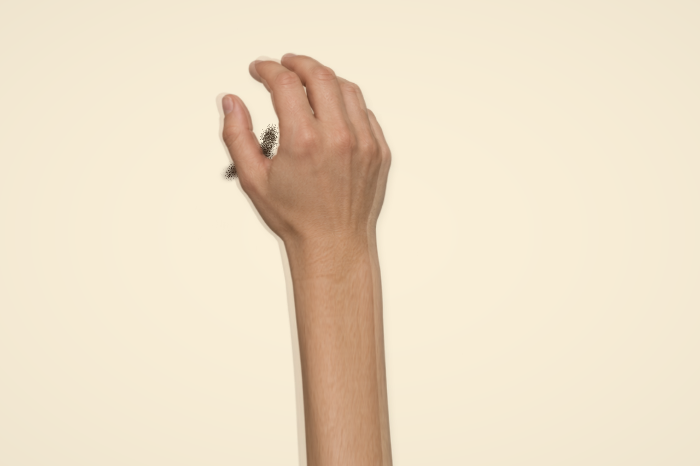

# v18 · 生成手部与程序撒沙

按用户确认，验证「生成手部素材 + 程序控制撒沙」，无需用户照片。新增独立入口 `/art/memories/hands/` 和照片页 `#generated-hands`，保留原版、实拍试镜及照片演出。

## 素材与实际输出

| 文件 | 来源和作用 |
| --- | --- |
| `hand-release-atlas.png` | 内置 imagegen 生成的六姿态透明手部图集，1536 × 1024；不是实拍。完整参数、提示词和原始路径见 [PROMPTS.md](PROMPTS.md)。 |
| `actual-pour-2.7s.png` | 生产网页在 160 步暂停后实际导出的 1280 × 852 合成。手为生成素材，沙为实际演算的沙层与空中供料；未生成最终合成图。 |
| `actual-manual-sand.png` | 按住沙台约 1.5 秒，松手并隐藏手部后实际导出的沉积沙点，1280 × 852。 |
| `actual-process.webm` | 网页实际录制并补齐容器时长的 VP9 视频，1280 × 852，10.2898 秒；正常速度的握沙入场、松指、移动、收手与落定，完整解码无错误。 |

图注：AI 手部纹理与程序沙台的实际合成，非真人演出摄影。没有读取照片、成品蒙版或目标沙画。视频 SHA-256：`32195757C2DE3DADDB5F3D7E8A74F3CC878C11140F560FC4ADCAFA578ACF4477`。

## 实现与操作

`generated-hand.ts` 通过人工标定的掌指与腕部点估计对应关系，用二维网格对齐后混合邻姿态，减轻直接叠图的重影。掌指比例保留，腕部以下纵向延展，使前臂穿出台沿；这会拉伸局部皮肤纹理，不能证明真实解剖运动。无 WebGL2 时退回关键姿态切换，并提示限制。

`generated-pour.ts` 的固定 60 Hz 时间线同时控制手的位置、开合、释放点、高度和供沙。释放点与空中粒子使用同一投影，沙在既有 `StageMaterial` 中下落并进入厚度场，不通过目标图揭示成画；未增加逐颗碰撞或 MPM。自动小样为 10 秒、600 步，从空台形成疏密变化的沙弧。

`generated-hands-demo.ts` 支持暂停、重播、进度、隐藏手部、查看出沙点、PNG 和 WebM。自由模式按住并拖动出沙，松手停止；一把沙约 6 秒用完，松手后重新抓沙。沙层和时间线独立，不修改照片作品、实拍素材或收藏。

WebM 包含 VP9 `BlockGroup` 与 alpha 附加数据。补时长模块按 [Matroska 元素规范](https://www.matroska.org/technical/elements.html) 接受标准有限长度结构并保持编码块原样；遇到位置引用或不支持的结构则保留原容器并提示。测试发现进度更新覆盖拖动目标的问题，已修正为先读取目标再暂停和重放。

## 验证与边界

五入口 TypeScript / Vite 构建通过。浏览器按完整子路径验证独立页和照片页入口、播放、进度定位到 160 步、暂停、出沙点、PNG、按住和松手后实际沉积、完整视频导出，以及关闭弹窗后照片页和既有五件收藏仍可用。未保存、移除或修改这些收藏。最终控制台无警告或错误。

完整常规套件 28 个文件、240 项通过，2 项显式离线规划取证跳过。随后补充 WebM 兼容检查，最终运行撒沙、WebM 与视频导出相关 3 个文件、37 项均通过；新增两个 WebM 测试不包含在前述 240 项数字内。撒沙检查覆盖网格不翻折、释放点连续、动作与供料同步、沉积守恒和拖动 / 重播一致。

没有观众盲测或真机长时性能结论。六姿态间仍有皮肤、指节和轮廓差异；二维对齐、前臂延展及近似阴影不能替代三维关节与沙粒接触。没有新增掌扫、指尖刻画、照片自动演出或任意视角能力。本轮证明生成手部可以接入可操作撒沙演示，未达到完整演出看不出生成痕迹的目标。

代码与编排为本实验原创，保留上游 Scottstts/Sandboard 固定提交 `489cb01e81b11ba575887f7c76760498eb41aaa8` 和既有 GPL-3.0-only 许可。生成素材未使用第三方艺术家作品或用户照片，保留生成来源说明。旧 CC BY 3.0 实拍素材继续使用自己的署名与许可。
