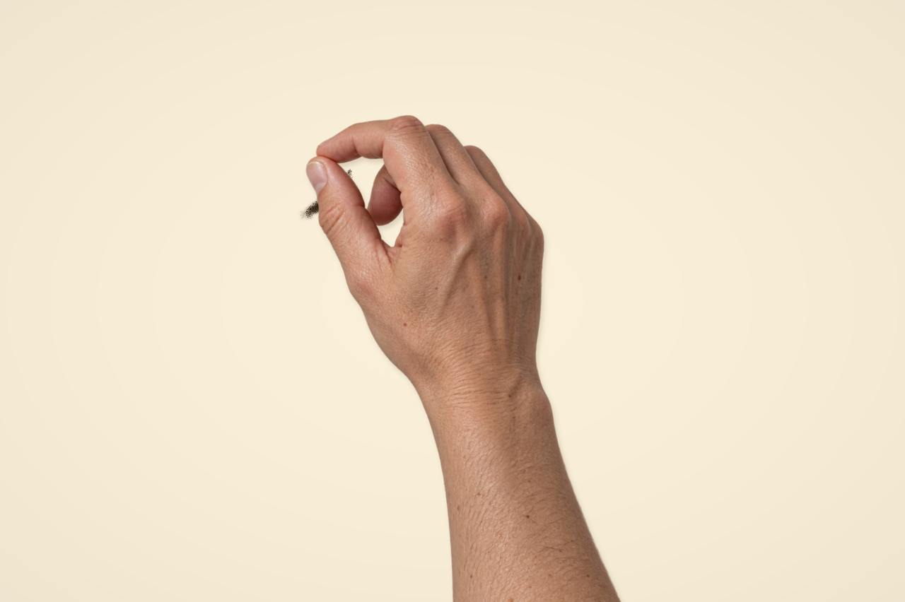

# v19 · 连续手部纹理与窄指缝撒沙

本轮优化 `art/memories/hands/` 的实际产品小样，无需用户照片。照片页 `#generated-hands` 使用同一组件；原版、照片创作与实拍通道保留，旧 [v18 素材及输出](../generated-hand-v18/README.md) 保留作效果比较。

## 实际输出与来源

| 文件 | 作用与来源 |
| --- | --- |
| `hand-pinch.png` | 内置 imagegen 生成的单张右手与连续前臂，1024 × 1536 RGBA；未输入参考照片，原图未离线修改，不是实拍。完整提示词与原始路径见 [PROMPTS.md](PROMPTS.md)。 |
| `actual-fine-2.7s.png` | 生产网页在第 160 步实际导出的 1280 × 852 画面：低手位捻指细流。 |
| `actual-scatter-5s.png` | 第 300 步实际导出的 1280 × 852 画面：抬手散撒。 |
| `actual-manual-sand.png` | 按住、拖动、切换散撒和调整高度，松手后隐藏手部实际导出的沙层，1280 × 852。 |
| `actual-process.webm` | 浏览器正常速度录制的 VP9 视频，1280 × 852、30 fps、10.296299 秒、5,948,357 字节；ffmpeg 完整解码无错误。 |

图注：生成手部源纹理与程序落沙的实际合成；最终画面和视频没有使用图像生成服务。原始素材 SHA-256：`6BBB38CC84AFE5CF7AC3FAEFBF66E967A490118C2ACC64B136903F24D46AED39`。

## 改动与操作

- **皮肤连续性**：单张纹理替代跨六姿态溶解，去掉前臂纵向延展；小幅网格变形只作用于掌指，腕部以下保持原比例。显示时抑制极低透明度背景残影，原始 RGBA 保留。
- **指缝与落点**：出沙点跟随同一局部变形；粒子先从窄口发射，横向速度与重力使落点逐渐扩散。抬手改变飞行时间，手的移动给予横向惯性。开度决定流量，聚团脉动改变疏密。
- **动作演示**：10 秒内依次入场、低手细流、收指停沙、抬手散撒、收手与落定。沙从空台开始，实际进入厚度场，没有成品遮罩或最终图替换。
- **手动模式**：点击「自己撒沙」，按住并拖动。可以切换「捻指细流」「抬手散撒」，调整高度并查看余沙。每次按下重新抓一把，松手停止出沙；已有空中粒子继续落定。供沙按流量积分消耗有限预算，耗尽时间随手法变化。
- **控制与性能**：保留暂停、进度定位、重播、隐藏手部、出沙点、PNG 和过程 WebM；输入有速度过渡，静止且落定后停止材料计算和画面重绘。

`StageMaterial` 的新规则仅对显式启用 `ballistic` 的接触生效，旧接触的供料、随机序列与落点规则保留。材料仍是细粉包与连续厚度场近似，没有逐颗沙粒碰撞和三维手掌接触。没有新增依赖或模型 API。

## 本轮验证与边界

TypeScript / Vite 五入口生产构建通过。完整常规测试 28 文件、246 项通过、2 项显式取证跳过。新增检查覆盖所有开度网格无翻折、前臂比例、释放点连续、开度与供料、两段动作、手动速度过渡、预算耗尽、松手落定、窄口空中扩散、抬手扩大落点、质量守恒和确定性重播。质量使用 Float32 厚度场对应的相对误差范围。

真实浏览器按完整子路径验证播放、160 / 300 步定位、查看指缝、PNG、手动按住与拖动、两手法切换、高度 18→60、余沙变化、松手沉积、隐藏手部和完整视频下载；控制台警告及错误为空。照片页弹窗可打开、关闭后照片选择与旧实拍入口仍启用，既有五件收藏仍可见，未写入或移除收藏。当前 628 像素宽浏览器没有横向溢出；未新增手机真机或跨浏览器测试。

本轮消除了跨姿态溶解这一重影来源，但单张图的小幅变形并不能完成完整握拳、掌扫、翻腕或指尖刻画。皮肤素材、阴影与颗粒渲染仍有合成痕迹，没有观众盲测，不能声称已达到「看不出生成」的完整真人演出目标。下一步需为各手法制作独立、方向一致的动作素材和接触轨迹。

源码、动作和编排为本实验原创；上游固定 Commit `489cb01e81b11ba575887f7c76760498eb41aaa8`、GPL-3.0-only 与旧实拍 CC BY 3.0 署名继续保留，见 [来源说明](../../experiments/sand-art/ATTRIBUTION.md)。
