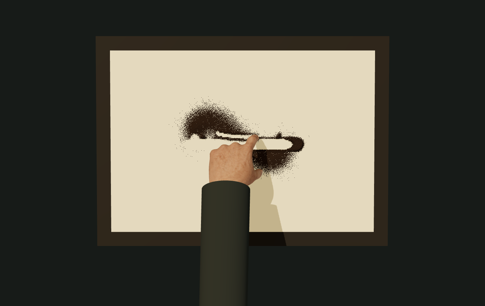

# v20 · 三维手与沙接触小样

2026-10-09 新增可直接播放的产品原型：`art/memories/hands/contact/`。v19 生成手及原版、工作室、舞台、手势创作、照片沙画、实拍通道全部保留。这个版本验证骨骼动作与材料接触，不以真人级画面为验收结论。

## 实际输出

- `actual-finger-17.25s.png`：生产网页在第 1035 帧通过「保存画面」实际导出，俯视指腹划线，未进行离线修图。
- `actual-process.webm`：网页「下载完整过程」实际录制的 20 秒接触过程。空台开始，细撒、散撒、掌缘推沙、指腹划线、抬手落定。没有最终图替换。

图注：CC0 三维手部与原始皮肤纹理，数字沙层和程序袖口的实际渲染；不是实拍，也不是本轮 AI 生成的目标图。

## 素材来源与修改范围

| 文件 | 作者、来源与许可 | SHA-256 |
| --- | --- | --- |
| `hand-posable.glb` | [Innerscene · Posable Anatomical Right Hand](https://www.innerscene.com/tools/library/3d-parts/posable-anatomical-right-hand-f6098b4f)，源页面 2026-10-05 发布；基于 MakeHuman/MPFB，CC0。506,476 字节，16 根骨骼、8120 个网格顶点。原文件保留，无预设动画，无内嵌贴图。 | `d1705ec1317516e79deb5c5ce4ef34e69bf6315bba9025e8a7374fbd0c745f47` |
| `skin-diffuse.png` | jartur69，MakeHuman 官方 [Skins02](https://static.makehumancommunity.org/assets/assetpacks/skins02.html) 中 `jartur69_middleage_slavic_male_with_genitals_and_beard` 的原始扩散纹理，CC0。原名 `Jartur_mid_old_Slavic_Male_with_Genitals_and_Beard_lsdif_lighter.png`；5,615,645 字节，仅重命名。完整身体 UV 图集只映射到裁出的手部模型。 | `0f1a86d78af8bc1e55ae21cfaca0e7308384f789796adc77a78e4d22ccaf419c` |
| `skin-source.mhmat` | 同一资源的原始材质说明，未修改，CC0。其 Blender/MakeHuman 皮下散射参数没有直接移植成真实散射。 | `803a8be0a00ae27db9b9c94778b441e77de8ccacb808d48a3ea25877ae94b69a` |

下载地址：模型 `https://www.innerscene.com/api/library/posable-anatomical-right-hand-f6098b4f/download`；皮肤包 `https://files.makehumancommunity.org/asset_packs/skins02/skins02_cc0.zip`。资源包下载到系统临时目录，仅上述纹理和材质说明进入项目。许可另见 [LICENSE.md](LICENSE.md)。Three.js 0.186.1 使用 npm 官方分发及 MIT 许可证，子项目单独记录依赖。

Sandboard 上游 URL 为 `https://github.com/scottstts/Sandboard`，研究提交 `489cb01e81b11ba575887f7c76760498eb41aaa8`，GPL-3.0-only。本轮没有改动上游原版求解器；这个三维小样复用项目原创 `StageMaterial` 沙层近似。

## 实现和交互

1. 每秒 60 个固定动作步，共 1200 步。手指通过骨骼屈伸改变蒙皮网格，不用二维手部图的跨姿态淡化。
2. 每一步从实际变形后的指腹、拇指和掌缘顶点采样。出沙口跟随当前手部；粒子高度用米制坐标换算，重力为 9.81 m/s²。飞行后把沙量沉积到唯一厚度场。
3. 手按当前局部沙层高度下降，限制皮肤不穿过玻璃。掌缘和指腹只有接近沙面时才移沙；推沙堆在前方，划线把沙移到侧面。抬手关闭接触，剩余粒子继续落定。
4. 同一厚度场驱动三维表面高度、明暗和固定世界坐标中的颗粒细纹。表面颗粒是程序着色近似，空中粒子代表成组细沙。
5. 默认传统俯拍，可以切换斜视、暂停、进度定位、从头重播、按动作定位、隐藏手部或显示接触点，并导出实际 PNG 与 WebM。定位从同一随机种子重新执行；录制时锁住会改变画面的控件，页面离开前台取消录制。

主要代码：`contact-score.ts`、`contact-hand.ts`、`contact-material.ts`、`contact-scene.ts`、`contact-page.ts`。共享 `StageMaterial` 只新增可选实际发射高度与重力参数；原有调用保持默认行为。新增第六个 HTML 构建入口，不覆盖现有作品。

## 验证与已知边界

- TypeScript 与独立生产构建通过；新路由使用相对资源，已在 `/1008_codex_project/001-sandboard/art/memories/hands/contact/` 实际载入模型、皮肤和程序。
- 完整 CPU 测试：30 个文件，251 项通过、2 项跳过。新增 5 项覆盖实际模型骨骼/UV、玻璃接触、完整蒙皮动作移沙、真实发射高度/重力落定、悬空不移沙与确定性重播。
- 桌面内置浏览器实际检查双视角、动作定位、隐藏手部、PNG 导出和完整过程录制；原小样可通过返回入口继续使用。最终视频为 VP9，1491 × 943，容器时长 20.015900 秒，5,015,794 字节；ffmpeg 完整解码无错误，542 帧。录制目标 30 fps，MediaRecorder 容器记录为可变时间戳，不能将 `r_frame_rate` 字段当作实测帧率；本次平均约 27 fps，尚未代表真机性能。
- 手部仍有三维渲染感：网格、皮肤贴图和手指关键帧没有达到摄影级；皮肤凹凸由扩散纹理近似，缺少真正的皮下散射、肌腱联动和精细皱褶。
- 袖口为程序几何，用来接续上游截断的手腕；没有完整的肘部/前臂肌肉骨骼与真实布料变形。自然抓沙、捻指解剖动作和皮肤自碰撞还需更高质量模型及动画。
- 厚度场仍是材料近似，不是每一颗沙的刚体碰撞。局部接触、堆沙坡面、颗粒遮挡、灯箱透光和手指压力还需进一步校准。当前是固定动作验证，尚未接入任意用户照片自动成画。
- 尚未做跨浏览器、真机性能和真人质感盲测，也没有离线电影级渲染；不能据此声称观众无法看出是生成画面。

下一阶段应先升级手部模型的皮肤/褶皱与抓沙动作，提升接触阴影和沙粒堆积，再用同一动作谱做短片质量对照。通过这一关后再接照片成画，避免先扩展业务功能而掩盖材料问题。
