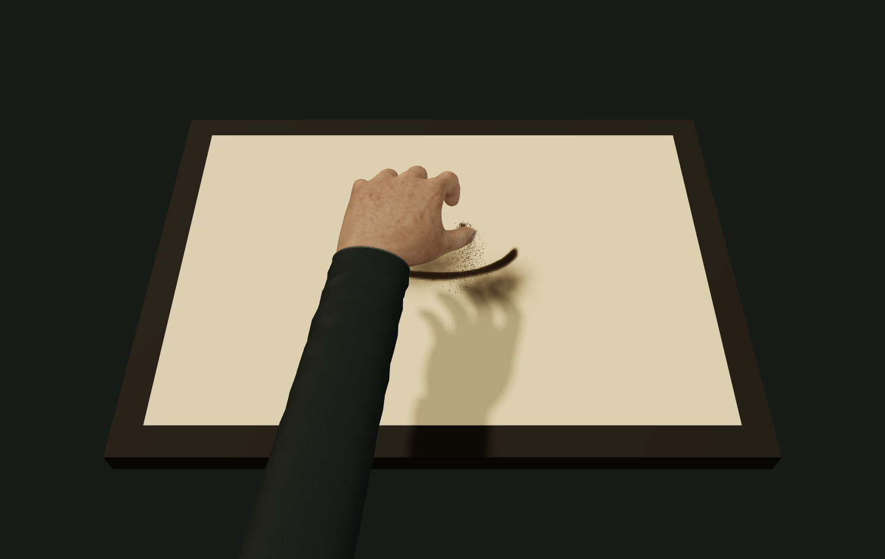

# v21 · 三维手、布料与沙堆细化

2026-10-09，继续优化可播放的 `art/memories/hands/contact/`。这次没有生成或下载新图片、模型，也没有改动上游原版沙盘。沿用 v20 的 CC0 模型、原始皮肤纹理与 Three.js 0.186.1，新增程序材质、布料几何、供沙预算和沙脊滑落。历史能力及 [v20 实际输出](../hand-contact-v20/README.md) 保留。

## 实际输出

- `actual-scatter-8.5s.png`：网页定位第 510 步，斜视，通过「保存画面」导出。
- `actual-finger-17.25s.png`：第 1035 步，斜视，实际指腹划线导出。
- `actual-process.webm`：网页通过「下载完整过程」录制的俯视 20 秒过程，空台到撒沙、掌推、划线和抬手。

图注：三维模型、原始皮肤纹理、程序布料和同一数字沙层的实际渲染。不是实拍，没有离线修图或替换成目标画面。

最终录像为 VP9，1491 × 943，时长 20.001899 秒，7,816,503 字节；ffprobe 实际读取 592 帧，平均约 29.6 fps，ffmpeg 全片解码无错误。这个结果只代表本机本次录制，不代表其他设备性能。

| 实际导出文件 | SHA-256 |
| --- | --- |
| `actual-scatter-8.5s.png` | `53eaf3a1f53ea4a48a0b909365ba3645226a4b137c881d23c9819cbe35ccb46b` |
| `actual-finger-17.25s.png` | `65e7380d16f4566081037c6730d6068dbd499ad3f406b3d63578a8eb1f011c6e` |
| `actual-process.webm` | `b11a8f58c6bd11c862ca8d4651e8a2770248f70e8225213eafe848fb7022ab31` |

## 本轮改动

1. 拇指增加对掌旋转，出沙量参与两指开度。散撒从拇指/食指、中指/无名指、无名指/小指三处变形皮肤之间取世界坐标，粒流预算按 50%、32%、18% 分配；总供料不会因增加出口而变成三倍。细撒和散撒共用一把沙，页面显示相对余量，重播补满。
2. 袖子接续原模型截断的腕部，使用开口渐变圆筒、袖口边和接缝。程序褶皱随手势小幅变形，织纹影响颜色；原皮肤纹理保留，小幅扩散凹凸叠加随机微孔法线与粗糙度。放大检查发现首版微孔过于规则，最终改为随机中心、局部封闭的孔形和距离淡出。
3. 高度取 `density × 0.0008 m`，不再用 8 mm 高度上限压平沙堆。相邻格高度差超过坡度阈值后，每步转移部分超额沙量，交替扫描方向减少偏置。这里的阈值 0.62、速率及高度比例是实验标定值，没有真实砂样测量依据。
4. 沙面采用固定世界坐标中的不规则粒形，在细节不足一个像素时渐变为平均覆盖，避免方格颗粒与闪烁；高覆盖仍表现为密集沙层。灯光和接触阴影柔化，默认镜头稍近。
5. 定位从固定种子重算，显示目标时间；重建期间暂时禁用播放、PNG 和录像，完成后恢复。视角仍可观察，新的定位可取消旧定位，重新开始恢复空台和满预算。

## 来源与许可

原始文件仍位于 `../hand-contact-v20/`，文件没有修改或重新生成。模型、皮肤纹理、哈希和下载来源见 [v20 素材记录](../hand-contact-v20/README.md) 与 [原许可文件](../hand-contact-v20/LICENSE.md)。模型来自 [Innerscene / MakeHuman](https://www.innerscene.com/tools/library/3d-parts/posable-anatomical-right-hand-f6098b4f)，CC0；皮肤来自 jartur69 / MakeHuman [Skins02](https://static.makehumancommunity.org/assets/assetpacks/skins02.html)，CC0。新增代码与程序几何由本实验编写，沿用项目分发许可。

Sandboard 上游为 [scottstts/Sandboard](https://github.com/scottstts/Sandboard)，研究提交 `489cb01e81b11ba575887f7c76760498eb41aaa8`，GPL-3.0-only；本轮只修改独立接触试验，没有修改上游 GPU 求解器、共享 StageMaterial 或用户收藏。

## 验证与边界

- 完整常规测试：31 个文件、255 项通过、2 项显式取证跳过。新增检查验证陡坡减少、非负与质量守恒、低坡不动、封闭边界，以及多出口总供料、耗尽停沙、余沙落定和重播补满。
- 完整蒙皮动作测试以实际出口驱动材料，核对三处发射高度和位置。抬手后不再接触，只允许原沙堆的被动松动；没有把旧的“末尾完全冻结”断言当成滑落错误。
- TypeScript 与六入口生产构建通过，现有子路径预览实际载入所有资源；Three.js 所在入口约 638 kB，有 Vite 大包提示，初次载入及低端设备性能仍需进一步优化。
- 浏览器实际检查双视角、阶段定位/导出锁定、余量、接触位置、隐藏手部、PNG 和完整过程录制。没有进行真实手机、跨浏览器、任意照片或观众盲测；本轮未重跑未修改的上游硬件 GPU 回归。
- 皮肤没有真实透光散射、肌腱联动或皮肤自碰撞，握沙没有粒子与皮肤之间的完整碰撞。袖子是程序几何，没有布料动力学和完整前臂骨骼。
- 沙面仍为高度场、空中粒子为成组采样，尚未实现逐颗沙的刚体碰撞、真实压力形变或沙粒滚动；推沙边缘仍有几何感。局部坡面松动守恒，沿用工具的边界移沙另有材料移除记账。
- 当前效果改善的是可控制的实时小样，尚未达到“看不出生成”的目标，也没有接入任意照片的完整自然成画。下一步应校准真实抓沙、腕指肌腱和接触压力，并使用高质量法线/粗糙度与皮肤透光，再做同一短片的视觉对照。
