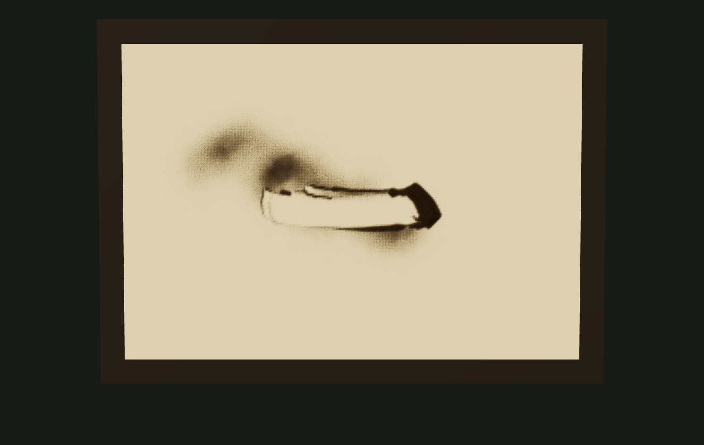
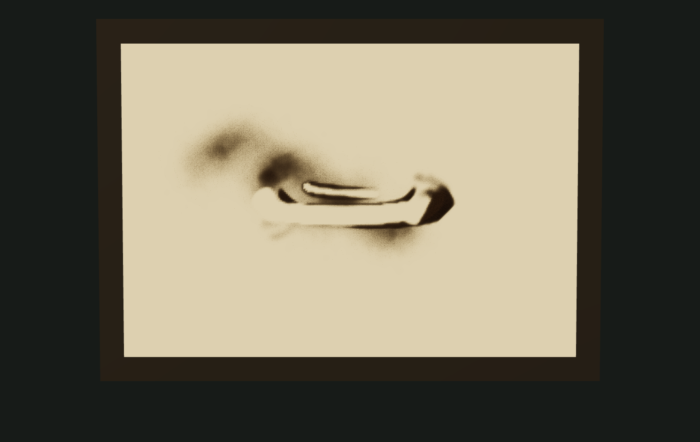

# v22 · 变形皮肤接触与腕指联动

2026-10-09，继续改进 `art/memories/hands/contact/` 的同一 20 秒试验。默认用当前变形皮肤的接触片移沙，页面保留固定工具对照；新增手背张力和指腹压缩的程序形变、腕指协同及渐进力度。当前不是实际抓沙或摄影级演出。

## 实际输出

- `actual-finger-17.25s.png`：第 1035 步、皮肤接触模式，网页导出的手与沙画面。
- `actual-skin-sand-17.25s.png` 与 `actual-brush-sand-17.25s.png`：相同时间、俯视、隐藏手部，分别使用皮肤接触与固定工具。两种模式重新执行全部动作，保持相同供料、动作参数、镜头和种子；手部贴近沙面的高度会随各自沙高调整。不是同一成图叠加不同效果。
- `actual-palm-13.5s.png`：第 810 步的掌缘接触，斜视实际导出。
- `actual-process.webm`：网页按钮录制的皮肤接触完整过程，空台入场、细撒、散撒、掌推、划线、抬手落定。

| 皮肤接触 | 固定工具 |
| --- | --- |
|  |  |

图注：两个实际网页 PNG，隐藏手部以看清沙痕；未离线修图，没有目标图或最终成品替换。固定工具复用旧椭圆/圆形方法，但使用本轮相同的新动作，不能当成 v21 整体画面的逐帧复现。

最终录像为 VP9、1491 × 943、20.002200 秒、7,249,018 字节，实际 553 帧，平均约 27.6 fps。浏览器录制采用时间戳，不能把采集目标 30 fps 当作每秒均有 30 帧；ffprobe 核对元数据，ffmpeg 全片解码无错误。最后浏览器 warning/error 为空。

| 实际输出 | SHA-256 |
| --- | --- |
| `actual-finger-17.25s.png` | `f0c98bad634b830f65a1f2897c021980dcaeba95cdcf274115eeba99392a872c` |
| `actual-palm-13.5s.png` | `128f75a976f1d14a77aece2ca2bcf818b9d533dafaddb799004dcd490e9e4ab6` |
| `actual-skin-sand-17.25s.png` | `e7368ffc77b168bb6a0e8f077e3f7ede9d354533c73c8c191549736d3f66dc08` |
| `actual-brush-sand-17.25s.png` | `0dd71d6b40dcdeb97bce8e6da66b8144f622125e96d83007d46ac100404c2302` |
| `actual-process.webm` | `ebc041fa0b023ff092c9cca79852260e06593746cdd16df2c8b02ff91ceb93dc` |

## 实现与改动

1. 在模型内存中的几何加入相对形变目标，模拟手背随握持略微拉紧、掌内轻微收拢和指腹下压变宽。形变同时改变位置与法线；原 GLB 和皮肤 PNG 不修改。每步采样全部变形顶点，并复用同一世界坐标缓存来取得指缝、指腹、掌缘、最低点和接触轮廓。
2. 动作谱控制握持、各指节开合、腕部俯仰/侧转和相对力度。供沙量参与开度，手指以不同幅度松开；掌推使用轻微弧线。接触开始逐渐下压，末尾逐渐松开，抬起后不再移沙。
3. 从最低皮肤附近的一片顶点投影取得凸轮廓。允许范围随力度增加，小幅柔顺边缘用于网格接触；比较皮肤高度与现有沙高，仅在接近沙面时移沙。连续两步的轮廓共同覆盖经过范围。掌前推沙；指腹按各格所在一侧把沙让到对应边缘，避免每格机械地对半分给两条轨道。
4. 所有被移走的沙通过台内双线性落点加入相同厚度场，木框夹住出界落点。沙脊继续沿用 v21 的渐进松动；沙面新增自身投影，帮助显示堆积高度。没有调用目标图、图像遮罩或末尾显影。
5. 「皮肤接触 / 固定工具」切换后，从同一随机种子重算到当前时间。重建和录制时锁定模式，防止切换落到重建中的早期时刻；导出文件名绑定点击/录制时的模式。接触位置选项在皮肤接触阶段显示轮廓，在撒沙或固定工具阶段显示锚点。

本轮新增 `contact-deformation.ts`、`skin-contact.ts`，修改接触试验的 hand/material/score/scene/page 文件与样式；共享 StageMaterial 和上游 GPU 求解器未改。三维页面以外的模式与用户收藏未修改。v20、v21 的输出保留，旧固定工具仍可操作。

## 来源与许可

沿用 [v20 原素材、版本、哈希](../hand-contact-v20/README.md) 与 [原许可文件](../hand-contact-v20/LICENSE.md)。模型为 [Innerscene / MakeHuman](https://www.innerscene.com/tools/library/3d-parts/posable-anatomical-right-hand-f6098b4f) 的 CC0 蒙皮手，原始皮肤为 jartur69 / MakeHuman [Skins02](https://static.makehumancommunity.org/assets/assetpacks/skins02.html)，CC0；Three.js 0.186.1 为 MIT。本轮没有下载素材、生成 AI 图片或输入私人照片。

上游 [scottstts/Sandboard](https://github.com/scottstts/Sandboard)，研究提交 `489cb01e81b11ba575887f7c76760498eb41aaa8`，GPL-3.0-only，许可原文继续保留在项目中；新接触与形变算法为本实验编写的近似，没有引入额外上游实现。

## 验证与边界

- 最终完整常规测试：32 文件，261 项通过、2 项显式取证跳过。TypeScript 与六入口构建通过；大于 500 kB 的 Three.js 入口提示仍存在，接触 JS 约 647 kB。
- 新检查覆盖轮廓划出沟槽和侧脊、非负与守恒、远处沙层保持、悬空与零力度不移沙、力度影响、掌推/指划分布不同、台沿守恒、确定性重播，以及接触片确实位于当前蒙皮顶点、力度增加面积。
- 完整模型动作测试实际核对掌推和指划都产生移沙；抬手后只执行原沙堆的被动松动。旧末尾完全冻结断言与新松动冲突，改为验证仅允许相同松动、没有额外供沙或接触；没有放弃数值一致性。
- 浏览器核对生产子路径、模式切换保持目标时间、接触轮廓、隐藏手部、双视角、真实 PNG 与 WebM 导出。未重跑未修改的上游硬件 GPU 检查，也没有手机真机、跨浏览器或观众盲测。
- 形变为针对当前模型的手写近似，不是肌肉/肌腱求解，不保证皮肤自碰撞或真实体积守恒。接触片用凸轮廓与低点高度近似，没有完整软组织压力分布；力度是相对控制值，没有牛顿或真实砂样标定。
- 沙面仍为高度场，空中粒子代表采样包，没有粒子与皮肤间的完整碰撞。手中沙仍是预设预算，未实现从台上抓取、握持沙堆、漏沙的完整质量转移。视觉上仍有手部材质、阴影和边缘的三维感，真实摄影目标未通过。

下一步应实现从沙堆取沙、掌内可见沙量和连续漏沙的同一材料记账，再校准皮肤透光与更高质量动作；不能把程序联动称为已经完成真实肌腱或真实抓沙。
