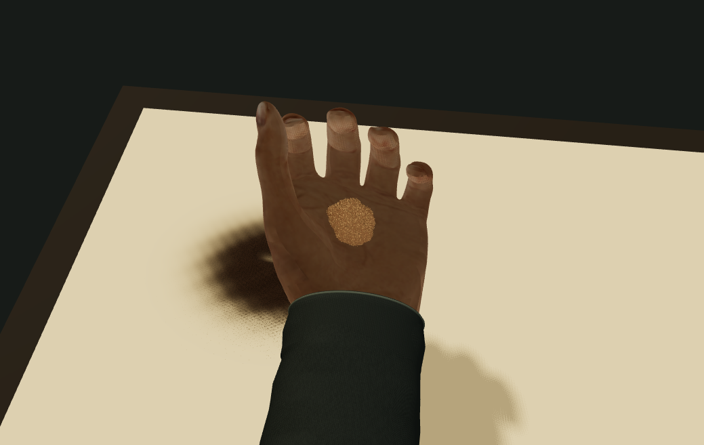

# v23 · 从台上取沙、掌内握持与漏沙

2026-10-09，用户确认继续补齐台上取沙到掌内和漏沙的连续过程。入口仍为 `art/memories/hands/contact/`，新增 24 秒流程，原 20 秒演示与固定工具对照保留。没有新依赖、第三方下载、生成图片或私人照片输入。

## 实际输出

以下均由生产网页按钮直接导出，未离线修图：

- `actual-hold-close-6.5s.png`：翻掌握持的实际近景；掌内沙来自台上取走的材料。
- `actual-fine-close-10.5s.png`：细漏阶段实际近景。
- `actual-fine-side-10.5s.png`：相同时刻的漏沙侧视，观察手部下方的真实空中样本。
- `actual-scatter-close-16s.png`：散漏阶段实际近景。
- `actual-initial-sand.png`、`actual-final-sand-24s.png`：俯视隐藏手部，比较起始沙堆与取沙、漏回和掌推后的台面。
- `actual-process.webm`：网页实际录制的完整 24 秒取沙流程，斜视、显示手部、皮肤接触模式；不是帧图离线拼接。

图注：第 390 步，当前蒙皮掌面上的材料堆和表面颗粒。该段取到约初始沙量的 10.4%，其余留在台上。尚未达到真人摄影质感。

最终录像：VP9、1039 × 657、24.003300 秒、7,550,903 字节，实际 693 帧，平均约 28.9 fps；ffprobe 核对元数据，ffmpeg 全片解码无错误。首轮录像实际 409 帧 / 24.012399 秒，约 17 fps；细粒独立投影低于灯光图精度且增加开销，改为连续堆体投影、细粒保留受光，再录完整相同流程。目录中的视频与掌内/细漏/散漏 PNG 均已替换为优化后的实际导出。这是两次本机录像观察，没有进行严格硬件基准或保证其他设备帧率。

最终七个输出的哈希在 [SHA256SUMS](SHA256SUMS)。根 `npm.cmd run check` 通过，12 个项目的编号、目录、元数据、图片路径与首页索引一致。

## 连续材料与显示

1. 重播只重置初始台上小沙堆，手中为零。确定性厚度分布带小幅不规则边缘；没有目标照片或成品遮罩。
2. 取沙用四指各指节当前蒙皮最低皮肤附近的投影凸轮廓。只有靠近已有沙面且握持增加时移出材料；悬空、空台、停止收拢和容量耗尽不能取入新沙。相邻轮廓覆盖经过范围，移走量按 Float32 写入前后的实际差值累加。
3. 同一数值记账维护台上、掌内、空中与台外。漏沙强度按实际取到的总量分配给细漏与散漏，受手中现有量限制；空中沿用米制重力积分。StageMaterial 的累计供料包含再次发射，因此本流程以初始台量及四处材料作为总量核对，不把再次发射误算成外来供应。
4. 掌面中心与方向取自原模型掌侧的五个实际蒙皮样点。掌内连续堆体积随手中量变化，带不规则轮廓；最多 4096 个实例颗粒用于表面显示，并不在账里再次加质量。整体堆体投影，细粒受光但不逐粒重画阴影。堆形、样本覆盖和沙高度都是近似，未用真实砂样或克数标定。
5. 24 秒动作包含靠近、指腹收拢、抬手翻掌、握持、转腕细漏、散漏、掌推和落定。近景跟随掌面，漏沙侧视跟随当前出口，俯视/斜视保留；播放与进度控制前移，较窄窗口使用完整宽度画面。流程、接触模型和导出名绑定各自状态，重建/录像时禁用冲突控制。

`ContactMaterial()` 默认仍使用原预装预算，原动作谱和测试保持。新流程由页面显式选择 `pickup`；共享 StageMaterial、原版 GPU 算法、生成手部、照片作品和收藏未修改。

## 验证、失败与修正

- `npm.cmd run build`：TypeScript、Vite 8.3.3 六入口生产构建通过。接触入口约 662 kB，Three.js 的大入口提示仍存在。
- `npm.cmd test -- --maxWorkers=2`：33 文件，265 项通过、2 项显式取证跳过。新增检查覆盖靠近/收拢条件、空台与悬空拒绝、容量/耗尽、边界、实际蒙皮全过程守恒、抬手停取、细漏后仍有散漏材料、落定无空中余量、确定性重播和掌内显示随材料变化。完整流程总量误差相对初始量小于 `1e-6`。
- 第一版只采指尖，收拢后指尖离开沙面，导致零取沙。检查实际蒙皮高度后改采各指节的近沙皮肤，保持接触距离门槛，没有直接给手中补预算。
- 后续检查发现细漏提前用尽材料，按动作谱的总漏沙权重分配实际取到的量；最终浮点残量低于 `1e-9` 的 density 记账单位时归零，避免产生极微量的额外空中包。
- 默认高并发完整测试触发本机内存分配失败并出现浏览器图形上下文中断；降低测试并发后完整套件通过。页面增加中断恢复按钮并锁定播放、切换和导出，防止保存空白帧。近景首版堆形像光滑小块，随后降低堆高并加表面实例颗粒，实际握持输出为修正后的版本。
- 本轮未重跑未修改的上游硬件 GPU 回归，没有手机真机、跨浏览器、长时资源或观众盲测。
- 浏览器核对了完整生产子路径、四种视角、隐藏手部与掌内沙同步隐藏、章节定位与导出锁定、旧 20 秒谱切换，以及固定工具重建后仍保持第 1035 步。最终第 1440 步的页面显示台上 100.0%、手中/下落/台外 0.0%；初始与最终裸沙 PNG 已保存，没有写入用户收藏。
- 最后浏览器 warning/error 为空，当前窗口宽度与文档滚动宽度均为 758 像素，没有横向溢出；这不等同手机真机验收。

## 来源与局限

模型、原始纹理及许可沿用 [v20 来源与哈希](../hand-contact-v20/README.md) 和 [原许可文件](../hand-contact-v20/LICENSE.md)：Innerscene / MakeHuman 蒙皮手与 jartur69 / MakeHuman Skins02 为 CC0，Three.js 0.186.1 为 MIT。模型与原始纹理没有改写。

上游 [scottstts/Sandboard](https://github.com/scottstts/Sandboard)，研究提交 `489cb01e81b11ba575887f7c76760498eb41aaa8`，GPL-3.0-only；本轮接触、材料转移、掌内显示与动作谱为本实验的原创近似。

这是材料来源与动作衔接的可操作试验，没有实现真实手部肌肉、软组织压力、掌内逐颗碰撞、粒子与皮肤碰撞或皮肤自碰撞。取沙片用低点高度和凸投影近似，掌内沙堆依附近似掌面，翻腕时由固定动作保持；不能据此声称符合任意倾角的自然漏沙。当前手仍偏暗且有三维感，掌内堆形仍较规则，砂粒尺寸与粗糙度待校准；没有把本流程接入任意照片成画，也未证明观众分辨不出生成。
