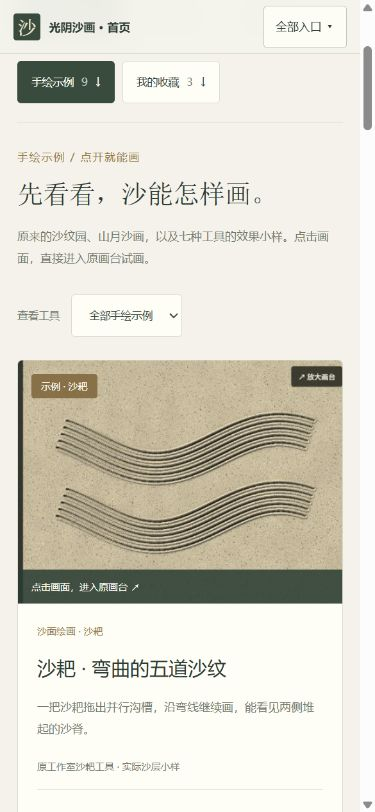
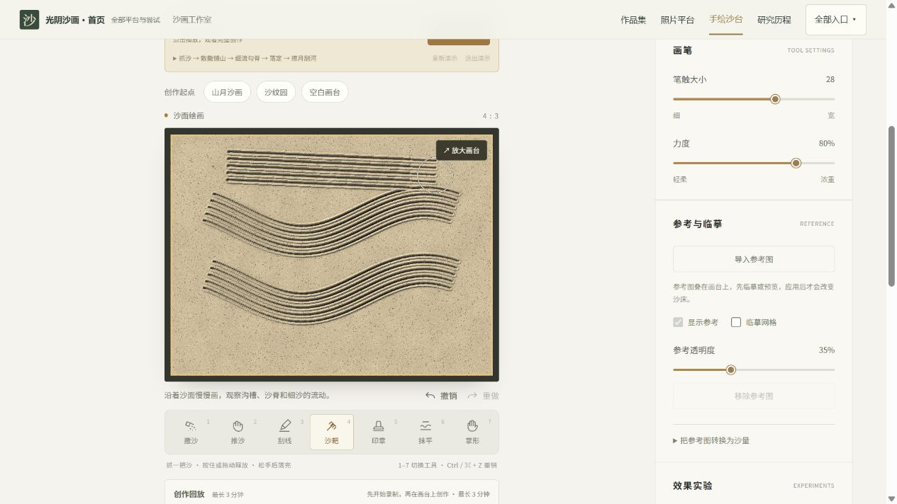

# 手绘示例作品 · 实际画台效果

本地入口：[九幅手绘示例](http://127.0.0.1:4174/1008_codex_project/001-sandboard/art/gallery/#examples)。由首页「手绘示例作品」或统一作品集进入；点击图片即可到原工作室操作。

## 素材与实现

`previews/` 九张 PNG 是 2026-10-10 原 WebGPU 画台的实际截图，包含画台原有的放大按钮，合计约 0.35 MB；全部已实际打开并选中对应工具。同目录上层九张 1536×1152 PNG 为原画台浏览器导出，用于保留实际输出；高清导出的颗粒与小画布的抗锯齿表现不同。网页仅加载轻量预览，不加载这些高清导出。没有新增 AI 图像、真人手部或第三方艺术家作品。

| 示例 | 形成方式与打开后的工具 |
| --- | --- |
| 沙耙 | 两条弯曲五齿笔触；打开为沙面、沙耙 |
| 沙纹园 | 原 `createComposition('surface', 'zen')` 构图；沙耙 |
| 撒沙 | 原空中供沙的细流与散撒，落定后载入；灯箱、撒沙 |
| 山月沙画 | 原 `createComposition('lightbox', 'moon')` 构图；撒沙 |
| 推沙 | 原工具沿折弧推开并聚起沙；沙面、推沙 |
| 刮线 | 原工具从薄沙刮出两条亮线；灯箱、刮线 |
| 印章 | 原心形印章重复盖印；沙面、印章 |
| 抹平 | 原沙耙纹路中央再使用抹平工具；沙面、抹平 |
| 掌形 | 原掌形扫开宽幅亮部；灯箱、掌形 |

两个预设不额外推进材料时间；工具小样在独立临时求解器执行，使用原固定时间步和批处理，再载入可编辑状态。示例生成路径是工具小样编排，不是自动从照片成画，也不宣称真人或大师效果。上游研究版本 `489cb01e81b11ba575887f7c76760498eb41aaa8`、GPL-3.0-only 与原署名继续保留。

## 草稿与实际验证

示例草稿在独立 `sandboard-handdraw-examples` 库中，按示例保存。原手绘库与照片库不迁移。原工作室已有的撤销、模式切换、工具、参考图、录制、工程和图片导出继续保留；保存试画沿用命名作品功能。

- 九幅预览实际加载，九项点击进入对应工具；沙耙筛选两幅、撒沙筛选两幅，其他工具各一幅。
- 在独立 4274 来源，原一件手绘和一件照片收藏保留，沙耙实际新增笔触并保存后变为两手绘、一照片；示例仍九幅。
- 试画刷新后厚度、参考沙床、名称与工具一致。活动量和极小残余速度按原求解器衰减；没有将它们误报为文件逐字节一致。
- 返回原草稿后沙层、参考、设置、名称及转换配置一致，见 [草稿核对](evidence/draft-verification.json)。恢复示例保留已保存的个人副本。
- 390×844 手机展示与原画台进入均验证无横向溢出；画台进入后完整位于视野内。

图注：本地生产网页真实截图，沙耙预览来自原画台。

图注：示例进入后继续绘画，撤销可用；新增笔触保存为个人作品，原草稿独立保留。

验证命令：在 `experiments/sand-art/` 执行 `npm.cmd test -- tests/handdraw-examples.test.ts tests/unified-gallery.test.ts tests/storage.test.ts tests/input.test.ts --maxWorkers=2`、`npm.cmd run build:platform`、`node scripts/validate-platform.mjs`、`node scripts/validate-research.mjs --built`；根目录执行 `npm.cmd run index:build` 与 `npm.cmd run check`。材料与历史素材 SHA-256 保留核对另见本目录 evidence。
