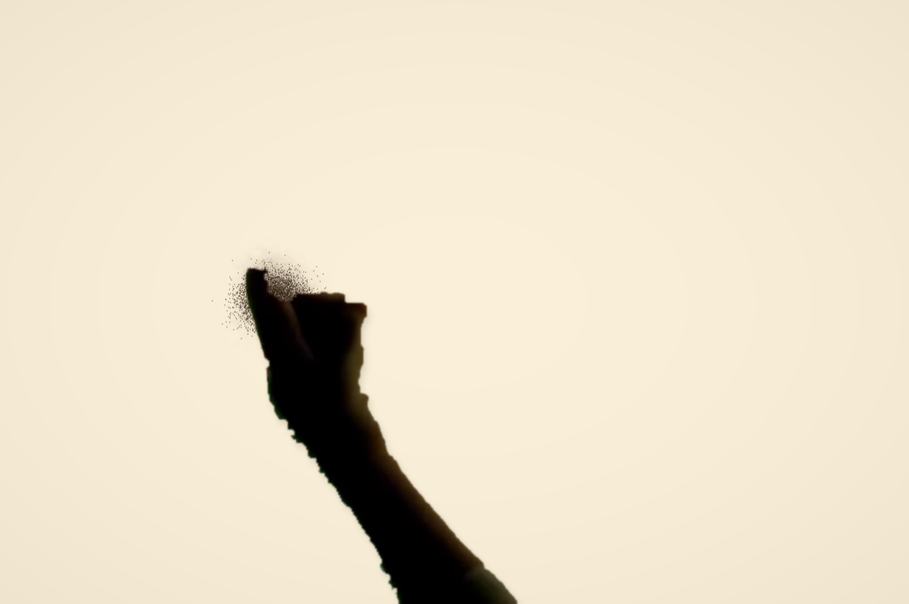

# v17 · 实拍手部接触小样与细笔落定

本轮保留原版、旧工作室、舞台、创作台和已认可的照片效果。新增可运行的真人手部合成小样与照片细笔规则，**尚未达到完整演出看不出生成痕迹的目标**。

## 实际输出与入口

- `/art/memories/#hands`：独立 15 秒接触小样，正常速度，支持暂停、重播、进度拖动与当前画面 PNG。三次短撒复用同一个 1.4 秒真人片段；沙粒由程序实际发射、下落和沉积，无目标图替换。手臂连接下方台沿，沙流位置跟随素材中的接触点，使用与空中沙粒相同的投影。小样不修改照片作品。
- `actual-hand-and-sand.png`：生产网页在 1.0 秒暂停后实际导出的合成，1280 × 852。手为第三方真人视频抠出的原始像素，沙为数字材料；不是新的 AI 图像。
- `/art/memories/#natural`：新的雨窗动作试播，2042 笔、37826 步、630.43 秒模拟时间，默认 10 倍。1337 笔细节添沙只落定，不再自动揉开；最后细节阶段不再追加整片头发和衣身揉沙。
- `natural-window-score.json`：重新用实际材料响应校验的几何动作谱，不含成品厚度或图像遮罩。面部标注范围的透光误差从 0.70533 降到 0.01274，这是局部影调指标，不能代表语义、美术或真实度评分。
- `actual-natural-window.png`：离线执行同一动作谱后的原影调材料输出，768 × 512。
- `actual-natural-granular.png`：生产网页完整执行新动作谱后实际导出的颗粒灯箱画面，1536 × 1024。输入沿用 v12 的 AI 虚构雨窗照片，未使用真人用户照片进行验收。
- `matte-diagnostic.png`：视频抠像中间帧的边缘检查图，不能当作沙画程序成品。

图注：真人手部源像素与模拟沙粒的实际网页导出，当前为背光接触小样。

## 实拍素材及许可

作者 / 制作方：**Телеканал КРТ**。原节目《Почему кот после обеда умывается? – Литовская сказка // Сказки на песке #5》，发布日期 2019-12-17。

来源为 [Wikimedia Commons 原文件](https://commons.wikimedia.org/wiki/File:%D0%9F%D0%BE%D1%87%D0%B5%D0%BC%D1%83_%D0%BA%D0%BE%D1%82_%D0%BF%D0%BE%D1%81%D0%BB%D0%B5_%D0%BE%D0%B1%D0%B5%D0%B4%D0%B0_%D1%83%D0%BC%D1%8B%D0%B2%D0%B0%D0%B5%D1%82%D1%81%D1%8F_%E2%80%93_%D0%9B%D0%B8%D1%82%D0%BE%D0%B2%D1%81%D0%BA%D0%B0%D1%8F_%D1%81%D0%BA%D0%B0%D0%B7%D0%BA%D0%B0_%D0%A1%D0%BA%D0%B0%D0%B7%D0%BA%D0%B8_%D0%BD%D0%B0_%D0%BF%D0%B5%D1%81%D0%BA%D0%B5_-5.webm)，许可 [CC BY 3.0](https://creativecommons.org/licenses/by/3.0/)，[许可全文](LICENSE-CC-BY-3.0.txt)。原文件核对及哈希见 [v16 记录](../material-realism-v16/README.md)。

`recorded-pour.webm` 的改动：取 135–136.4 秒的 35 帧、裁切左侧 800 × 720 区域、移除声音、用暗色前景与形态学分离手臂，排除粘连的红花和绿叶背景，轻微羽化透明边缘，再编码为 VP9 alpha。保留前景 RGB，不生成、补画或扭曲手的解剖结构。抠像仍有锯齿和背景污染；原灯箱背光使肤色偏暗。

接触点轨迹保存在 `pour-calibration.json`；为撒沙接触区做了人工偏移标定，属于近似跟踪，尚未测得真实抓沙量。处理脚本为 [extract-recorded-hand.py](../../experiments/sand-art/scripts/extract-recorded-hand.py)，本地运行需要 OpenCV、NumPy 与 ffmpeg；这些不是网页依赖。源片仅在忽略的本地缓存中，未重复纳入发布。

片段 SHA-256：`22C143708F407DA406E30AB408205557DB47D3207A49BDEA215E0120D608B7AA`。这项 CC BY 3.0 署名与改动说明同时适用于派生手部视频和包含该手部的合成图。数字沙台及新代码沿用项目许可；GPL-3.0-only 上游署名与固定研究提交保留。

## 操作及验证边界

实拍手部素材按撒沙、掌扫、指尖、掌侧分别配置。每种手法独立视频、背景键、大小、截取区间和接触点轨迹；素材帧随当前笔触进度寻址，暂停时不会继续循环。缺少对应实拍素材时不混用其他姿态。标定支持多帧接触点插值，等待视频帧解码时阻止误标旧帧；预览保留原比例。

点击“保存手部素材到本机”可将片段与标定保存在独立 IndexedDB；刷新后恢复。移除后须点击保存，才更新本机库。视频不随照片工程导出，也不上传到服务器。旧照片工程、旧动作谱及原影调继续兼容。

生产浏览器已验证：15 秒小样播放、暂停、进度回跳和 PNG；完整新雨窗动作与工程导出；真实 WebM 载入、透明背景、两帧接触点保存后刷新恢复、手法隔离、坏 MP4 不覆盖原素材、测试素材移除后保存。浏览器导出的全部 393216 个密度值与独立重放一致，同时核对粒子、随机状态、时间和供沙 / 收沙账。另核对约 375 CSS 像素宽度下的小样、暂停及进度控制，没有水平溢出；这是桌面浏览器的布局检查，不是真机长时性能验收。修正直接入口状态被照片加载流程覆盖的问题，`#hands` 可以直接打开小样。

常规测试以单 worker 运行，27 个测试文件、237 项通过，2 项显式离线规划取证跳过；新增覆盖细笔落定、旧规则兼容、指尖手法、完整新演出工程恢复、接触点插值与本机存储。显式离线照片规划取证通过；常规运行跳过两项需要显式素材 / 环境变量的离线规划取证。原版 WebGPU 没有改动，本轮没有重跑旧 GPU 套件。

仍待验证和改进：同一灯箱下的完整撒沙、掌扫和指尖素材尚缺；小样的背光轮廓不等同于肤色近景，重复片段也不等同于连续真人表演。照片规划仍有碎笔和背景斑块，模拟沙层采用连续厚度场，未逐颗求解接触动力学。没有真实用户照片、手机长时间运行或观众盲测的通过结论。
