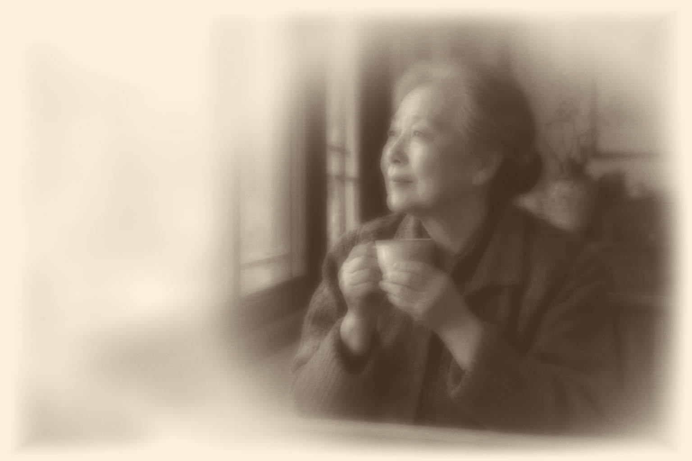
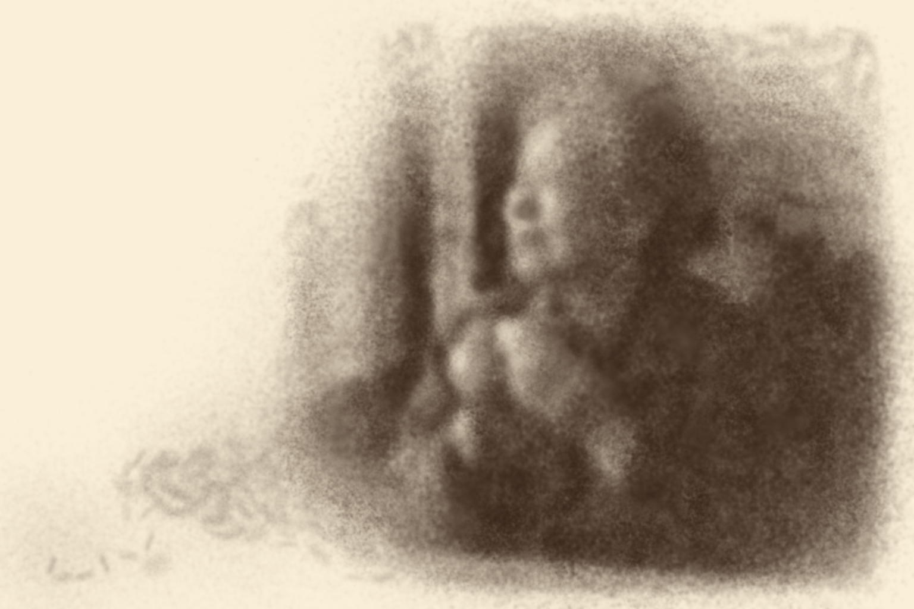

# v13 留白人像与实际成画

输入沿用 [v12 AI 虚构示例照片](../photo-memory-v12/sample-window.png)，完整生成来源与提示词见 [PROMPTS.md](../photo-memory-v12/PROMPTS.md)。本轮没有生成新 AI 图片，也没有使用艺术家作品或用户私人照片。

- `style-preview.png`：照片按留白人像设置直接转换的风格预览，1536 × 1024。它是笔触规划目标，不是实际成画结果。
- `performance.png`：生产网页实际跑完连续添沙、揉沙、收沙步骤后下载的沙层成品，1536 × 1024。粒子、供沙与移除账属于实际材料计算，未在末尾覆盖目标厚度。
- `process.png`：生产网页暂停的实际材料与程序手影，包含六章节、速度、时间轴及风格设置。
- `process-detail.png`：同一页面的画台与播放控制局部截图，保留 AI 示例标记和当前试画局限说明。
- `exhibit.png`：将实际演出成品收藏后进入展映的真实产品截图；作品文字明确标记 AI 示例与当前细节局限。

两图使用同一输入和留白设置；实际演出仍损失眼鼻、手指与杯口结构，不能用较清晰的预览冒充过程成品。该示例共 636.4 秒模拟时间，支持加速和章节跳转。下一步需要改进人物关键形体的笔触规划及添沙、收沙反馈，而非仅增加笔数。

这些结果为程序材料实验，仍需改善人物结构与灰面质量，不声明复现真人或大师沙画。使用与模型见 [照片沙画说明](../../experiments/sand-art/memories/README.md)。
