# 沙画工作室 · Sandboard 独立实验

研究页新增 [理解总览图](http://127.0.0.1:4174/1008_codex_project/001-sandboard/art/research/#overview)：七模块中文长图，原版能力、实际输入输出、材料原理、探索与问题、产品方向及推进步骤。采用保留效果素材和标注的原理示意，支持章节、缩放、下载与文字版；首页直达，原画台、作品库与历史效果继续保留。[图版来源](../../assets/understanding/README.md)。

作品集补入 [历史作品与过程](http://127.0.0.1:4174/1008_codex_project/001-sandboard/art/gallery/#history)：34项记录覆盖v1–v36，柳树、石桥、侧脸、归舟与三幅参考还原可打开对应编排、观看成画并接管；三张AI目标单独标注，十一段历史录像按需播放。九工具示例与个人收藏仍保留。[实现、验证与未完成范围](gallery/README.md)。

作品集新增 [九幅手绘示例](http://127.0.0.1:4174/1008_codex_project/001-sandboard/art/gallery/#examples)：保留的沙纹园、山月构图，以及七工具实际小样。点击预览进入原工作室，载入可编辑沙层并选中相应工具。示例试画单独暂存，支持恢复示例、返回原草稿和保存到个人收藏。预览采用原画台真实截图，既有渲染器、材料算法与历史素材保持原样。[来源、实现与验证](../../assets/handdraw-examples/README.md)。

新增 [手绘与照片统一作品集](gallery/README.md)：首页和所有功能页顶部均可进入，同一列表浏览两类保存作品并回到原画台继续创作。首页七种手绘工具分别直达，原弹窗、照片平台、沙层算法与全部历史效果保留。

保留的自由手绘能力现有直接入口：[沙耙画沙](http://127.0.0.1:4174/1008_codex_project/001-sandboard/art/#mode=surface&tool=rake)、[手绘作品集](http://127.0.0.1:4174/1008_codex_project/001-sandboard/art/#gallery)。照片平台和作品集内也能直接进入原沙台，七种工具、两种画台和手绘作品继续保留。入口只选择原有模式/工具，或打开原作品集；实际试画和重开验证见 [本轮记录](../../assets/handdraw-entry/README.md)。

新增 [统一平台首页](home/README.md)。运行 `npm.cmd run build:platform` 和 `npm.cmd run preview:platform`，打开 `http://127.0.0.1:4174/1008_codex_project/001-sandboard/`。同一站点完整关联原版、三类创作平台、舞台、手与沙试验、各版纪念短片及研究档案；所有功能页顶部均可返回首页或切换完整目录。原工作室仍在 `art/`，所有旧路由和存储保持。

新增独立 [研究历程网页](research/README.md)，入口 `research/`：v1–v36 全覆盖，27 项尝试、11 段按需加载的历史录像，以及 AI 目标 / 照片转换 / 实际材料输出的分类对照。保留所有旧入口；网页不操作作品库或重算沙层。

v36 新增独立 `memories/keepsake/handwork/` 局部推拢试片，构建为十二入口。杯身由左、右、中三笔形成，每一笔先推起前缘沙堆、停驻，再拾已推起的沙；新增材料标签避免抬手误收未触及的底沙。原 v35 灯台留白版保留。照片故事到实际过程导出仍可用，视觉仍是杯子模板与材料近似；[实现与边界](memories/keepsake/handwork/README.md)。

v35 新增独立 `memories/keepsake/sandlight/` 灯台留白试片，构建为十一入口。针对上一版失去沙画感觉，改为先铺厚沙、推开杯身透光处、保留边缘沙脊，并用指腹收出杯口与热气。照片故事的四步流程与真实过程导出继续可用，旧版本完整保留。仍是材料与手法近似，轮廓偏模板化，不能称为实拍或商业纪念片；[实现与边界](memories/keepsake/sandlight/README.md)。

v34 新增独立 `memories/keepsake/composition/`，构建为十入口。完整杯身宽撒、侧面叠沙、外缘收沙与杯身拂光代替空轮廓，连续灰阶与固定粒径分别表现体积和沙纹。独立模块和草稿数据库保留 v33；[实现与边界](memories/keepsake/composition/README.md)。

v33 新增独立 `memories/keepsake/natural/` 杯子质感版，构建现为九入口。提高材料与渲染分辨率，紧致落粒替代宽软核，非均匀连续供料、宽幅铺沙、粗糙掌缘推拢、停驻与分次拾起。v32 页面、七个产品源文件和全部已存证据保持不变；新草稿数据库独立，首次进入只复制旧草稿。查看 [新版本说明](memories/keepsake/natural/README.md)。

v32 新增 `memories/keepsake/` 纪念短片产品入口，构建现为八入口。上传杯子照片与故事，拖框确认比例和杯把 / 托碟，从空台执行 6–9 个连续主动作，导出含片头、字幕和赠言的 WebM、PNG 海报、离线赠礼 HTML 与工程备份。草稿保存在独立本机数据库；v31 与旧算法、素材全部保留。[产品使用与限制](memories/keepsake/README.md)。

v31 新增独立入口 `memories/hands/contact/cup/`：30 秒茶杯手法，9 个手工编排的主动作，不读取照片或目标灰度。`cup-material.ts` 以小步守恒移沙、局部坡度松落与末端拾起实现推拢 / 停驻 / 收走。支持慢放、单笔、三个收沙时刻对照、镜头 / 光线和 PNG / WebM 导出。v30 与旧材料、着色器保持原样，实际结果见 [v31](../../assets/cup-action-v31/README.md)。生产构建现为七入口。

v30 默认“沿形撒收 · 新实验”：沿影调轮廓规划更长曲线，在同一笔内渐变供沙与收沙力度；完整细部章不再十倍闪过，换笔停沙。保留 v29 画质、谱与节奏及更早版本，新增细部撒/收沙实际慢动作。实现、实录和边界见 [v30 记录](../../assets/no-hand-photo-v30/README.md)。

v29 默认“细节撒收 · 新实验”，原照细节离线规划，独立 `motion: sculpt` 启用更窄沙流、可见带沙与更细沙面；`photo-actions.ts` 选择实际谱中明显的动作慢看、保存片段视频。当前 v28、v27 和原版仍可按章节进度对照。实现、实际输出及近似边界见 [v29 记录](../../assets/no-hand-photo-v29/README.md)。

v28 默认进入独立“连续撒收”实验，`gesture-photo-plan.ts` 离线规划长曲线，`gesture-motion.ts` 按弧长与供料起停执行；停沙不自动揉散，收沙留下薄沙脊。新旧章长不同，以章节内进度切换对照。“局部连续 · 保留版”保留 v27 的轨迹、材料规则与章长，原版逐笔和其他入口保留。实际输出、生成方法和边界见 [v28 记录](../../assets/no-hand-photo-v28/README.md)，[v27 记录](../../assets/no-hand-photo-v27/README.md) 保留。

v26 新增 `photo-timing.ts`，以累计观看时间驱动原材料时间步，分章预览约 72.7 秒，章节之间停留 0.8 秒；塑形章节可单独 1 倍回放并自动暂停。`PhotoSurface` 使用固定台面坐标与约 0.48 mm 候选颗粒间距，缩小时降低颗粒噪点、近景解析不规则粒面，提供透光 / 侧光两种呈现。专注模式自适应画布，Esc 可退出；窄屏构图不裁切台面。工具谱和共享材料模型未改，原模式保留。详情见 [v26 记录](../../assets/no-hand-photo-v26/README.md)。

v25 新增 `photo-study.ts` 与 `photo-surface.ts`，在原接触页复用 v17 已校验的 2,042 笔雨窗动作谱。保留同一 `StructuredPainting` 和 768×512 材料精度，通过仅读取密度的 GPU 表面呈现透光、稳定颗粒与高度；原照不进入渲染器。固定近景可选人物、双手与杯子或衣身，章节定位复用演出检查点，1/4/10 倍播放和录像共享同一时间步。原芦苇与手部模式保留。270 项常规测试通过、2 项取证跳过，六入口独立生产构建通过；实际输出见 [v25 记录](../../assets/no-hand-photo-v25/README.md)。当前三维照片镜头只验证雨窗示例，尚未验证任意照片的材质表现，也没有达到实拍质量。

v24 增加 `pour-score.ts`、`pour-camera.ts`、`surface-grains.ts`，同一接触页默认进入 12 秒无手落沙小样，原两个手部流程保留。新模式只有有限供沙和重力落定，不做隐形移沙；共享 StageMaterial 的两个可选参数处理水平惯性和帧内出生时间，省略时旧供料行为不变。稳定表面采样、无手镜头与阴影缓存处理通过实际页面验证；269 项常规测试通过、2 项显式取证跳过，六入口生产构建通过。实际导出、性能问题与修正及材质近似见 [v24 记录](../../assets/no-hand-v24/README.md)。

v23 新增 `pickup-score.ts`、`sand-handful.ts` 和 `held-sand.ts`，在现有三维入口提供 24 秒台上取沙、翻掌握持、细漏/散漏与掌推。初始只有台上沙堆；取走的实际厚度转入手中，再按米制重力落回同一沙层。掌内表面跟随蒙皮掌面，颗粒为显示样本，材料账不重复计量。页面显示四处沙量百分比，支持近景、完整录像和恢复图形中断；20 秒原接触谱与固定工具保留。265 项常规检查通过、2 项显式取证跳过，验证命令采用 `npm.cmd test -- --maxWorkers=2`；六入口独立构建通过。实现、实际输出与局限见 [v23 记录](../../assets/hand-contact-v23/README.md)。以下保留历史版本记录。

v22 增加 `skin-contact.ts` 的投影皮肤接触片移沙，以及 `contact-deformation.ts` 的程序手背张力/指腹压缩。蒙皮顶点同时用于渲染、接触范围和发射位置，渐进力度与腕指动作共同驱动实际沙层；滑落与抬手规则保留。原固定椭圆/圆形工具可在同一页面切换对照，定位与录制期间正确锁定模式，并按录制时的模式命名导出。实际证据和未实现的真实抓沙/肌肉仿真见 [v22 记录](../../assets/hand-contact-v22/README.md)。共享 StageMaterial 与上游 GPU 核心未修改，旧模式与所有收藏保留。

v21 在三维接触页加入 `contact-surface.ts` 和 `sand-relaxation.ts`：皮肤微孔仅影响法线和粗糙度，袖口具有程序褶皱、织纹及接缝；散撒从三处变形网格之间发射，共用有限的一把沙。沙层高度不再被 8 mm 上限压平，过陡坡面在封闭邻格之间逐步移沙。定位期间显示目标时间并暂时禁用播放和导出，避免下载中间帧。255 项常规测试通过、2 项取证跳过，TypeScript 与六入口构建通过。实际导出和近似范围见 [v21 记录](../../assets/hand-contact-v21/README.md)；未改变原版 GPU 求解器或旧模式。

v20 增加独立入口 `memories/hands/contact/`，使用 Three.js 0.186.1、CC0 蒙皮手部模型和原始皮肤贴图，演示 20 秒细流、散撒、掌缘推沙与指腹划线。共六个 HTML 入口，旧手部页可直接进入新试验。指缝和接触点取自变形后的蒙皮顶点，米制重力驱动落沙，接触时移动既有厚度场；离开沙面停止移沙。支持双视角、暂停、定位、隐藏手部、PNG 和 WebM。材料、袖口、皮肤凹凸及动作仍是近似，不能视为真人级效果；实际导出、来源、测试及边界见 [v20 记录](../../assets/hand-contact-v20/README.md)。

v19 优化 `memories/hands/` 的手部纹理和供沙：保留连续前臂原比例，用单素材局部捻指变形代替邻姿态溶解。演示先细流后抬手散撒，手动模式可切换手法、调整高度并查看余沙；速度过渡、窄指缝发射与重力落点使用同一动作状态。仍支持暂停、定位、PNG、WebM 和照片页 `#generated-hands` 弹窗，旧模式保留。素材为 AI 生成、材料为近似模型；说明与实际导出见 [v19 记录](../../assets/generated-hand-v19/README.md)，[v18 基线](../../assets/generated-hand-v18/README.md) 保留。

v17 加入照片页的 15 秒真人手部接触小样（`memories/#hands`）和细笔落定试播（`memories/#natural`）。各手法实拍片段独立配置、按笔触进度寻帧，支持多帧接触标定、本机保存与刷新恢复。当前的真人片段来自有许可的节目素材；完整实拍动作、照片碎笔和材料真实度仍待改善，见 [v17 素材与验证](../../assets/material-realism-v17/README.md)。

v16 增加照片页的颗粒灯箱与原影调对照、实拍手部短片试合成和合成 PNG，首要目标转为真人俯拍的材料与动作可信度。参考视频明确区分为第三方实拍素材；当前仍未达到真人效果，见 [质感试镜说明](memories/README.md) 与 [素材来源和验证](../../assets/material-realism-v16/README.md)。

v15 在照片页加入原照结构框选和后台规划，支持不同人物位置、手与物件的人工标注，以及计算进度和取消。结构演出可以随收藏/可编辑作品保存和重播；新增公园人物明信片的实际成画验证，旧雨窗效果作为基线保留。当前操作、实现及有限验证范围见 [照片模式说明](memories/README.md) 与 [v15 素材](../../assets/photo-guided-v15/README.md)。

v14 在照片沙画页 `memories/#study` 增加固定 AI 示例的单图塑形验证：人工划分人物结构，离线用真实工具响应校验动作，网页从空台执行同一动作谱。可分章查看、接管修画、收藏和导出，默认 10 倍约 52 秒。美术质量与自然动作仍未达到目标，详见 [当前照片模式说明](memories/README.md)；旧工作室、舞台、创作台和照片转换保留。以下为历史版本说明。

当前 v6 在独立沙画工作室中提供自然撒沙和 20 秒「从抓沙到成画」演示：从空灯箱开始，分三把沙铺山、勾脊，再擦月、刮河。新撒沙有连续的强弱变化、多股沙流、密团和稀疏边缘，沙先下落再实际沉积。默认灯箱保留笔迹，沙面与灯箱各自保留作品、设置和撤销/重做记录。原版完整体验仍在 [../../web/](../../web/)；v3 的创作工具、v4 的录制回放和 v5 的传统撒沙记录在下文保留。

新增独立入口 `/art/stage/`，演出原创 56 秒三幕《月下江南》，探索以手工散撒、移沙、留白和连续转场成画的灯箱表演。舞台另有独立手绘沙床与本地草稿，当前工作室、20 秒山月演示和用户作品继续保留。

[项目概览](../../README.md) · [研究笔记](../../notes.md) · [舞台研究记录](stage/RESEARCH.md) · [来源与署名](ATTRIBUTION.md) · [上游仓库](https://github.com/scottstts/Sandboard) · [许可证](LICENSE)

## 照片沙画试画 · v13

照片入口新增「留白人像」，主体位置和范围可调，情绪色调单独选择。点击「看成画过程」从空台通过实际供料、揉沙和收沙成画；支持暂停、章节/进度跳转、1/2/4 倍速、重新成画及接管修改。照片只规划连续曲线笔触，实际演出成品没有末尾覆盖目标厚度。当前仍是照片引导的材料试验，人物细节偏模糊，不是大师级表演或真人动作采集。

[操作与实现说明](memories/README.md) · [风格预览与实际成品对照](../../assets/photo-portrait-v13/README.md)。旧照片影调与下文 v12 产品流程、其他三个入口全部保留。

## 照片沙画产品 · v12 历史记录

新增 `/art/memories/` 的「光阴沙画」创作、私人作品集和展映界面。支持选择照片、四种情绪表达、同构图原照对比、横竖方宽四种比例、影调与颗粒调节、五种局部材料工具及 8 步撤销。收藏可重新编辑，导出提供纯沙画 PNG、纪念画卡、内嵌图片的离线展览和独立 `.sandphoto.json` 工程。默认导出不包含原照，需要时显式勾选。

v12 照片直接转换为可编辑的厚度场，当时未提供成画过程；v13 的曲线材料演出与质量边界见上节。照片与收藏在本浏览器处理和存储，未连接云服务，收藏使用独立数据库。示例照片为明确标注的 AI 虚构场景，实际沙画与画卡由程序导出。

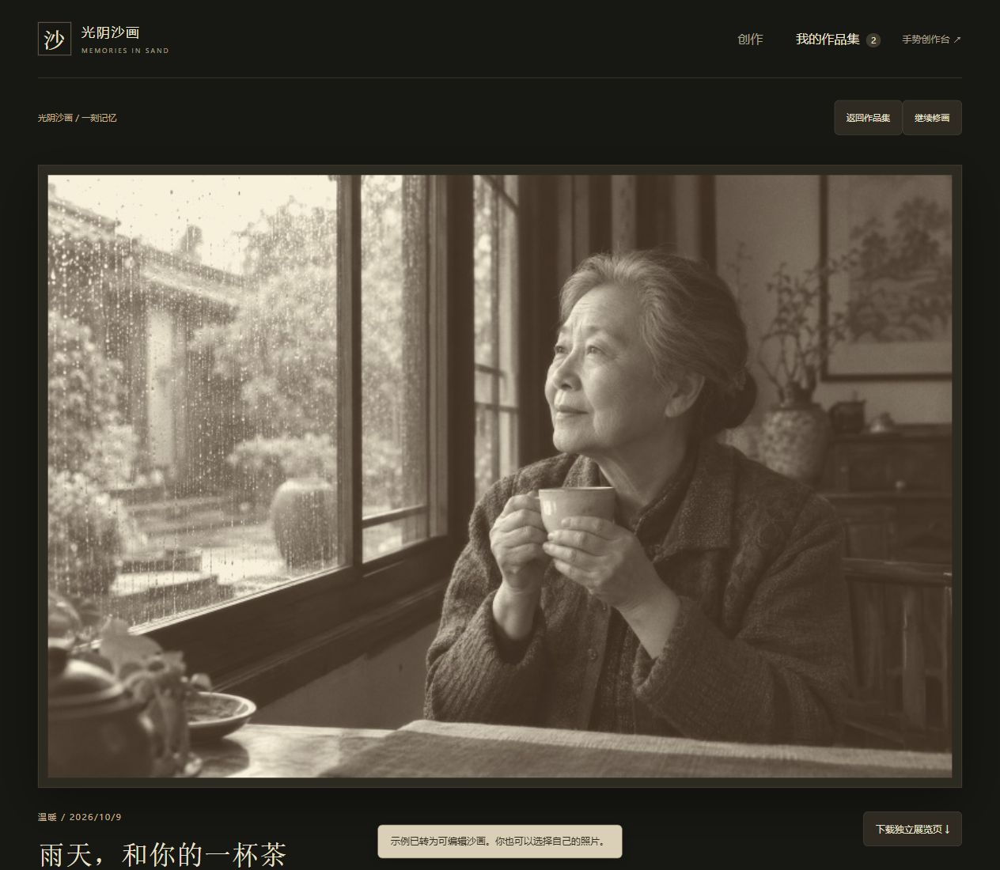

生产入口：`http://127.0.0.1:4174/1008_codex_project/001-sandboard/art/memories/`。开发入口为 `http://127.0.0.1:5174/memories/`，同次构建新增第四个 HTML；既有三个入口保持。操作、模型、存储、格式和验证范围见 [照片沙画说明](memories/README.md)，素材见 [示例提示词](../../assets/photo-memory-v12/PROMPTS.md)。本轮 211 项常规测试与四入口独立构建通过，未重跑旧硬件 GPU 检查。

## 独立舞台沙画 ·《月下江南》

v11 在 `/art/atelier/` 增加柳树、石桥与人物侧脸三种局部塑形演出，首屏默认侧脸。每幅五个章节，以厚沙块和灰面为基础，通过移沙、收沙与少量细节形成画面；无需读取参考图。新增揉沙采用邻格厚度差交换，保持总沙量，均匀沙层不产生凹陷。手动创作共六种工具，掌形与揉沙可调方向、宽厚比。原 v10 的 122.22 秒归舟手势演出为第四个选项，v9 三幅参考成画继续保留在「参考还原」。两种方式均支持播放暂停、0.5 / 1 / 2 / 4 倍速、按章节跳转、观看成品、接管修改、8 步撤销、独立草稿、PNG 与可编辑作品导出/导入。采用 `768 × 432` 沙层，PNG 为 `1536 × 864`。当前说明见 [STUDIES.md](atelier/STUDIES.md)，旧手势见 [GESTURES.md](atelier/GESTURES.md)；原参考算法与验收见 [PRODUCT.md](atelier/PRODUCT.md) 和 [PRODUCT_VERIFICATION.md](atelier/PRODUCT_VERIFICATION.md)。

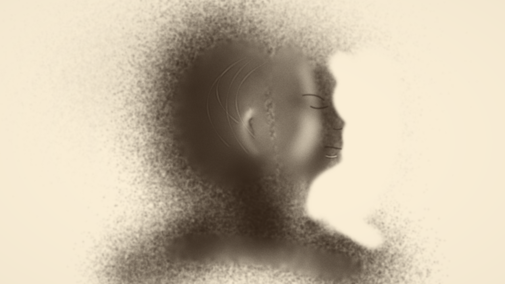

图注：2026-10-09 生产网页真实材料导出。柳树、石桥与侧脸是本实验原创概括造型；程序手影仅提示工具接触，未引入真人表演或大师成品。下面继续保留旧演出图。

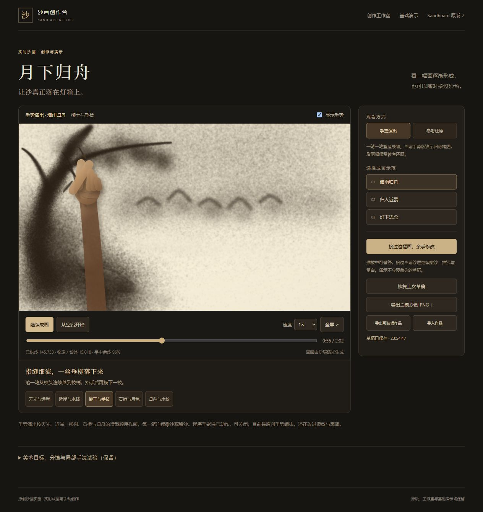

图注：真实生产网页的第 3411 步、56.85 秒；手势沿枝条连续落沙。目前为一幅原创编排的构图演示，仍需改善造型，不宣称复现大师表演。下图是保留的 v9 参考还原成品。

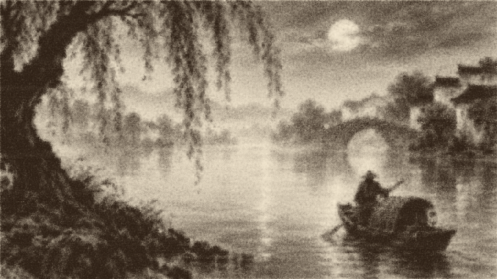

下方折叠保留 v8 美术研究：三幅原创 AI 目标、24 秒静帧分镜预览、与 v7 真实 PNG 导出对照、细节缩放拖动、全屏与目标图下载。这些参考图仍明确标注为 AI 美术目标。

独立的三手法试验区复用 `StageMaterial` 的真实供料与守恒移沙：细撒铺灰、掌侧留白、指尖刻画；沙底也通过实际粒流铺成。可调宽度与力度、手绘、重置沙底/空台、播放或暂停 8.4 秒局部手法演示、导出 `640 × 480` PNG；该保留区仍不建立作品存储。连续转场按 [美术方向与三幕分镜](atelier/ART_DIRECTION.md)研究，64 秒仍为方案。素材与精确提示词见 [PROMPTS.md](../../assets/art-direction-v8/PROMPTS.md)。

新增开发入口 `http://127.0.0.1:5174/atelier/`，同一构建输出 `dist/atelier/index.html` 及 `dist/generated-sandboard/` 三图。生产子路径入口为 `http://127.0.0.1:4174/1008_codex_project/001-sandboard/art/atelier/`。所有新增资源本地打包，不请求第三方艺术作品；依赖与原版许可证保留。

打开 `/stage/`（项目子路径为 `/1008_codex_project/001-sandboard/art/stage/`），画台就绪后自动播放。使用 `#pause` 打开可保持待播状态。三幕共 56 秒模拟时间，人物手势在同一沙层上连续作画、推开、重新构图；每一笔都进入细粉厚度场，不载入成品沙图或以成图蒙版替代工具。

| 章节 | 时间 | 创作过程 |
| --- | --- | --- |
| 沙起月明 | 0–18 秒 | 散撒铺出山影，用指尖擦出月色与亮面 |
| 江水成岸 | 18–36 秒 | 手掌与侧掌整理已有沙层，勾出水岸与江面 |
| 灯火归舟 | 36–56 秒 | 细流添线，移沙留白形成小舟与岸边，最后静置 |

「暂停 / 继续」保留当前位置，「重新表演」从空台开始；时间轴与三个章节按钮可定位，速度为 0.5 / 1 / 1.5 / 2 倍。「显示手势」控制手影，灯箱可全屏观看。手影是程序绘制的手势示意，不是真人录像，也没有使用相机或手势识别。56 秒为固定模拟时长，页面隐藏时暂停推进，实际播放时间也取决于选定速度和本机计算负载。

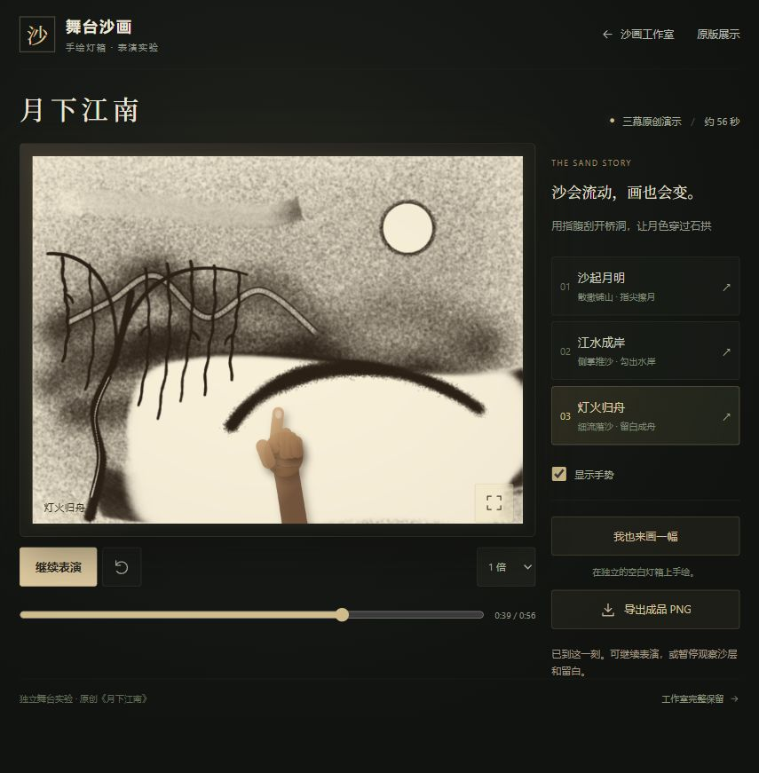

图注：2026-10-08 生产构建真实浏览器完整网页截图，`855 × 871`，停在第 2352 步即 39.2 秒。程序手影提示指尖擦出桥洞的动作，可通过「显示手势」隐藏；它不参与成品 PNG。图片包含舞台界面，完成的纯沙画见 [实际下载的成品 PNG](../../assets/art-stage-jiangnan-v7.png)。

「我也来画一幅」进入另一张独立灯箱，保留暂停的演出位置；第一次是空白台，后续恢复本浏览器的舞台手绘草稿。五种工具分别为散撒、细流、手掌、指尖和侧掌，可调手势大小与力度。清台可撤销，本次运行最多保留 6 次撤销；历史栈不随刷新保存。草稿单独保存沙层、待落沙、确定性随机状态与模拟时间；同一浏览器来源内可恢复，不写入原工作室的草稿、作品集或录制数据库。

舞台导出 `1536 × 1152` PNG，支持演出当前画面或手绘成品；只导出沙层，不含程序手影与界面。舞台没有新增自己的工程文件、作品集或 WebM 录制导出，这些工作室既有能力仍在原入口继续使用。

舞台使用独立 Canvas 2D 材料模型，无需 WebGPU：默认 `768 × 576` 细粉厚度场，每 `1/60` 秒更新下落供料与工具移沙，厚度按指数衰减控制暖色透光，固定微颗粒纹理表现细粉。散撒与细流在宽度、高度和供料分布上不同；落沙采用紧致沉积核，减少孤立黑点。手掌、指尖与侧掌移走的沙分配到边缘或前方，推出台外的部分计入质量账。这是用于表演与手绘的材料近似，没有完整沙粒碰撞求解。

实现、状态隔离与回归覆盖见 [舞台研究记录](stage/RESEARCH.md)。新增舞台与工作室通过多入口一起构建；工作室七工具、两种模式、20 秒抓沙演示、临摹、作品管理、工程与视频功能保持。

## 两种创作模式

| 模式 | 表现与用途 |
| --- | --- |
| 灯箱沙画 | 薄沙透亮、厚沙变暗，用撒沙画暗部、刮沙画亮线；为默认模式 |
| 沙面绘画 | 工具形成沟槽和沙脊，用起伏、光照与阴影表现笔迹 |

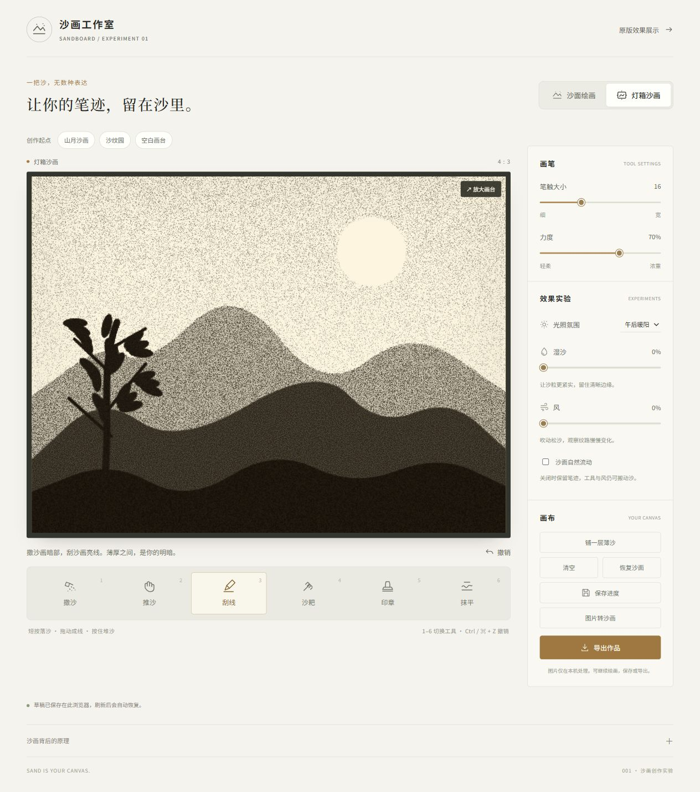

图注：2026-10-08 v2 本地生产构建实测截图，显示灯箱厚薄透光与灰棕颗粒，不包含 v3 新增界面。初版截图保留为 [v1 灯箱](../../assets/art-lightbox.jpg)。

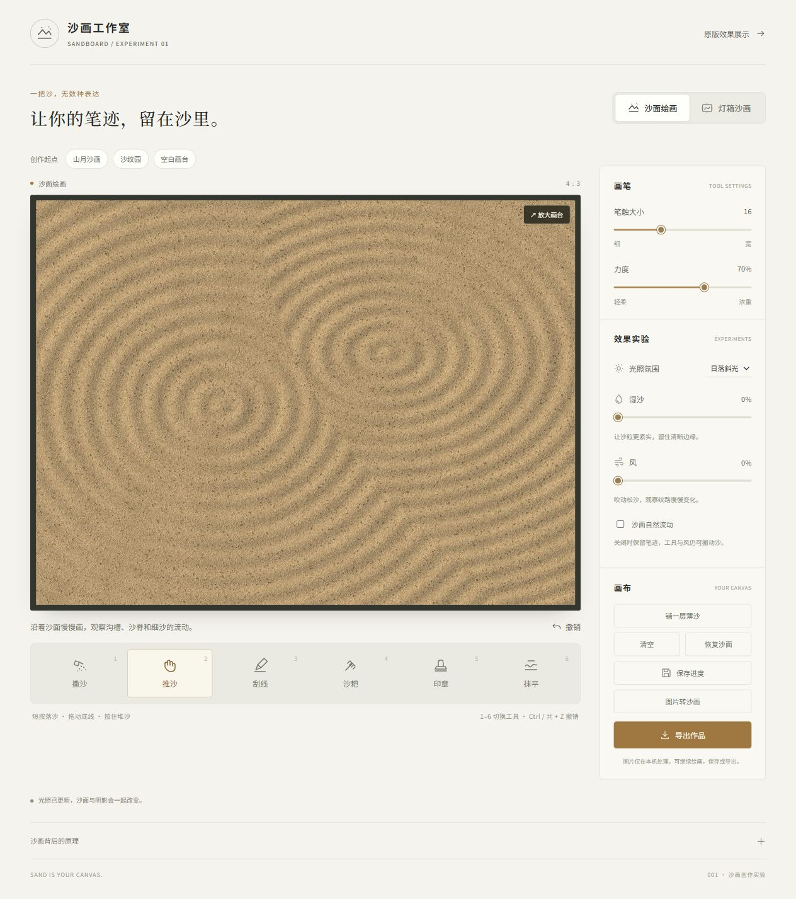

图注：2026-10-08 v2 本地生产构建实测截图，显示沙面起伏、沙纹与光照，不包含 v3 新增界面。初版截图保留为 [v1 沙面](../../assets/art-surface.jpg)。

## 自然撒沙与山月演示 · v6

画台上方「从抓沙到成画」提供「播放沙画演示」。演示从没有沙的灯箱开始，运行真实的撒沙、落定、掌形和刮线计算步骤，持续 20 秒模拟时间；没有预先载入山月高度图，也没有用图片遮罩直接画出结果。

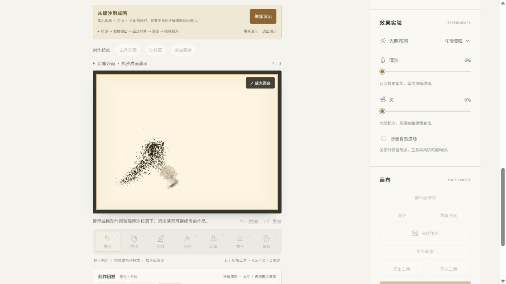

图注：2026-10-08 最终生产构建的真实浏览器截图，`1265 × 712`，演示停在第 240 步即 2 秒。掌心散撒正在形成左山，画面显示虚拟手形、实际飞沙与松散暗山影，没有圆形落区提示；截图包含工作室界面。

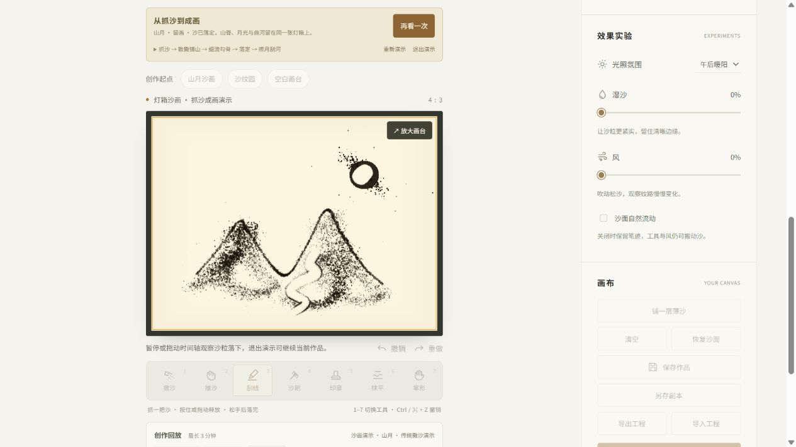

图注：同次真实浏览器截图，`1265 × 712`，显示 20 秒演示完成后的山影、亮月与曲河。沙画从全零沙床经 2400 个实际步骤形成，未载入成品沙床快照。

实际网页导出的 [v6 山月创作 WebM](../../assets/art-natural-demo-v6.webm)：VP9、`1024 × 768`、`20.179099` 秒、600 个解码帧。视频包含虚拟手形提示，不含工作室界面、参考图、网格或声音；已用 ffprobe 检查，并解码查看 2 秒下落与 20 秒成画画面。20 秒是模拟步骤时长，视频时长包含结束画面与编码停留。

| 阶段 | 画面与动作 |
| --- | --- |
| 第一把 | 掌心散撒沿左山绕行，轻重不同的沙簇落成山影，然后等待落定 |
| 第二把 | 再抓沙并散撒右山，抬手高度和撒开范围随手势变化，形成另一侧山影 |
| 第三把 | 一次撒开月旁云沙，再用指缝细流勾两座山脊，最后等待细沙落完 |
| 擦月、刮河、留画 | 掌形移开月旁沙层，刮线描出曲河；末尾保留完成的山月画面 |

播放后同一按钮变为「暂停演示」或「继续演示」；下方创作回放时间轴可定位任意阶段，也可调节回放速度。「重新演示」从空灯箱重播，「退出演示」或「回到创作」返回个人画台。演示使用独立沙床，退出保留个人作品、参考图、撤销历史和最近一次个人录制；演示不会作为新的个人录制自动覆盖本地保存。

演示画面有虚拟手形和阶段说明，用于提示抓沙、散撒与细流动作。演示状态下「实时导出 WebM」附带这一手势提示；个人录制导出仍只保留沙画过程，不带手形、光标或界面。演示中的手形是操作提示，没有相机采集或真实手势识别。

新创作默认使用自然撒沙：指缝细流来自几股连续漂移的源，掌心散撒呈现中心和局部密团、方向偏置与少量远散颗粒，一把撒开每次改变整体方向和聚团比例。强弱变化随时间与位置平滑演进，不是每个计算步重新抽一次白噪声。调整高度、范围、笔触大小和力度，仍使用下文的传统撒沙控制；这与「沙面自然流动」开关不同，后者只控制沙床空闲时的松弛。

实现中，新接触写入 `pour.natural: true` 和实际 `flow` 倍率（`0–2`）。同一倍率先参与手中余沙分配，再写入录制并用于物理发射；一把撒开使用倍率 1。自然粒子包质量不同，但按本步预算归一，保留总沙量。落地时只在相邻最多四格做紧凑双线性沉积，减轻单格尖点，保留沙簇和稀疏边缘。边缘收进沙台，粒子池满时合并质量。

旧 v5 录制缺少 `natural` 时继续使用 v5 的发射随机序列、轨迹和单格落点，缺少整个 `pour` 配置的更早录制仍使用即时沉积。自然模型的检查点保存粒子、随机状态及累计模拟时间，录制中的实际 `flow` 让回放无需重新推测手的松紧。v5 真实下载文件已在新模型中再次硬件重放，高度和工具参考基底逐位一致；详细记录见 [研究笔记](../../notes.md)。

## 画法与效果

| 工具 / 操作 | 用法 |
| --- | --- |
| 撒沙 `1` | 选择指缝细流、掌心散撒或一把撒开；按住/拖动释放，或点一下抛撒一把；松手后继续落完 |
| 推沙 `2` | 按住拖动，搬动沙量、整理轮廓 |
| 刮线 `3` | 拖动形成沟槽或透光亮线，沙会向周围堆积 |
| 沙耙 `4` | 拖动留下五齿平行纹路 |
| 心形印章 `5` | 按住留下心形压痕，拖动可留下连续印记 |
| 抹平 `6` | 按住或拖动让局部沙堆渐趋平缓，保持沙量，不挖出新沟槽 |
| 掌形 `7` | 用可旋转的椭圆接触面搬沙，可调掌形方向与宽窄，形成较宽的手掌笔迹 |
| 清场 | 清空沙台、铺一层薄沙，或恢复当前模式的初始沙面 |
| 撤销 / 重做 | 按钮或 `Ctrl / ⌘ + Z` 撤销，`Ctrl / ⌘ + Shift + Z` 或 `Ctrl / ⌘ + Y` 重做；每个模式共保留最多 10 步 |

笔触大小与力度可调整。光照提供午后、日落、月光，配合表面起伏或灯箱透光；湿沙滑杆让沙更难流动并改变材质，风滑杆让松沙沿固定方向搬运。湿沙与风都属于实时效果近似。

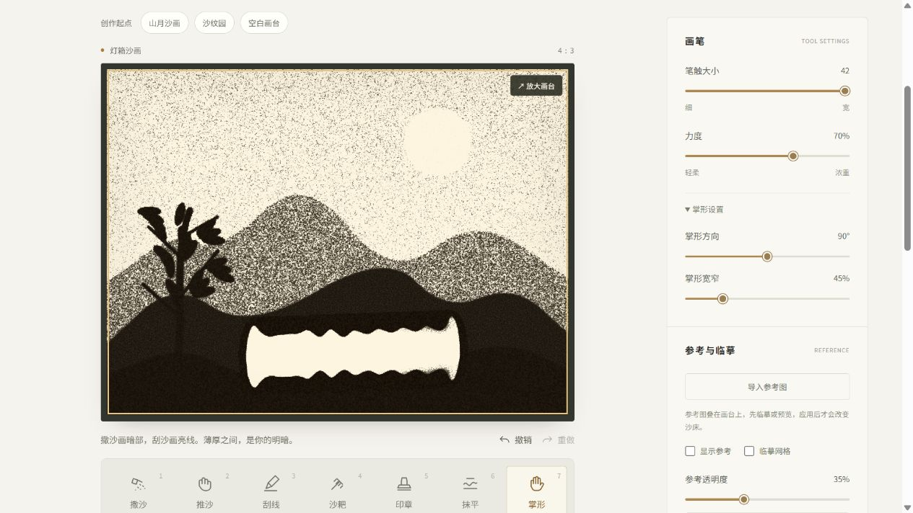

图注：2026-10-08 本地浏览器实测，山月厚沙上快速横扫掌形，半径 42、力度 70%、方向 90°、宽窄 45%。修正后形成连续宽亮面，边缘仍有自然起伏，不保证完全等宽；参考原图与网格均已隐藏。

默认关闭「沙面自然流动」，让没有接触的笔迹保持原状；开启后沙面逐渐松弛。该开关控制无接触时的自然松弛，关闭后撒沙、雕刻、抹平与风仍然生效。传统撒沙从 v5 起使用带高度与速度的空中粒子包，v6 增加自然分股、疏密与流量变化，落定后才增加沙床厚度；没有完整的粒子碰撞或接触力求解。

## 传统抓沙与撒沙（v5 起）

选择「撒沙」，右侧出现「传统撒沙」。初次打开和灯箱新建作品采用干净的空画台，已有草稿继续恢复；仍可主动铺薄沙作为刮画底稿。

1. 点击「抓一把沙」补满手中余沙；每次打开页面已预备一把。
2. 「指缝细流」按住并缓慢移动，形成细线；「掌心散撒」按住铺底或拖动铺明暗；「一把撒开」在画台上点一下，释放一次较大的散沙。
3. 调节「抬手高度」影响离手高度、落下时间和散开距离；「撒开范围」与笔触大小影响落区。力度影响落沙量。
4. 松手后空中的沙继续下落。余沙用尽时停止释放，重新抓沙后继续；落定后自动保存，可推、刮、抹、撤销和导出。

手中库存是本次创作会话的交互预算，刷新重新备沙，不写入工程或历史；撤销作品不会退还已撒出的手中余沙。沙量和高度均为实验相对单位。

空中运动采用固定步长重力和风加速度，并保留少量手部运动惯性。每次释放的量在飞沙和已沉积沙量之间转移，落点写入独立的 GPU 缓冲后进入现有沙床输运。最多 8192 个粒子包，满池时合并质量；边缘落点收进沙台边界。它是用于创作的 2.5D 近似，没有抓取真实手势、完整沙粒碰撞或照片级手部形象。

保存、导出、切模式和历史快照前先完成待落沙；鼠标松开保留可见下落过程。录制起点重置确定性发射器，录制参数包含手势、高度、范围和一次释放量；回放检查点同时保留粒子、速度和随机状态，视频也能显示下落。旧工程和旧录制仍可读取，旧录制未配置传统撒沙的笔触保留原先即时沉积行为。三分钟录制的最后一秒停止新接触并让空中沙落定；录制关闭后的同批剩余步骤不再修改所录画台。

## 创作起点与参考图

画台上方提供「山月沙画」「沙纹园」「空白画台」。模板会直接生成沙床厚度，并关闭风和自然流动；它们是可编辑作品，可以继续撒沙、刮出亮线、推沙或抹平，也可以撤销回到载入前的作品。山月的山景与月亮是程序生成图案，沙纹园是程序生成纹路，没有额外的真实石块障碍。

「导入参考图」在本机读取 PNG、JPEG 或 WebP（不超过 20 MB），保持原图比例居中叠在 4:3 画台上。可切换参考可见性、透明度与临摹网格，直接用七种工具临摹。导入和移除参考图都不直接改动沙床；参考层显示的是原图，不能当成沙粒材质的效果截图。

展开「把参考图转换为沙量」，可调整黑场、白场、中间调、明暗反转和最低/最高厚度。2D 预览只表达厚薄与明暗，不展示 GPU 颗粒和起伏光照；调节只更新预览，点击「应用到沙床」才写入真实可编辑厚度场，并隐藏参考原图。默认灯箱暗处对应厚沙，沙面暗处对应较高的沙层；转换后可以继续绘画、撤销、存档与导出。透明区域及保持比例产生的留白始终只有最低厚度，反转时不会额外堆沙。图片不上传，转换不保留照片原色，也不是三维重建。

转换参数范围与工程文件一致：黑场 `0–254`、白场 `1–255`，且白场大于黑场；中间调 `0.1–5`；厚度 `0–8`，最高不低于最低。厚度依然是无量纲实验数值。

「放大画台」进入全屏，`Esc` 或「返回工作室」退出；画台内提供七种快捷工具，也支持 `1–7` 键切换。宽度不超过 680 像素时同样使用画台内工具，隐藏下方重复工具栏。参考原图与网格始终跟随同一个画布区域；退出全屏后返回工作室参数区。

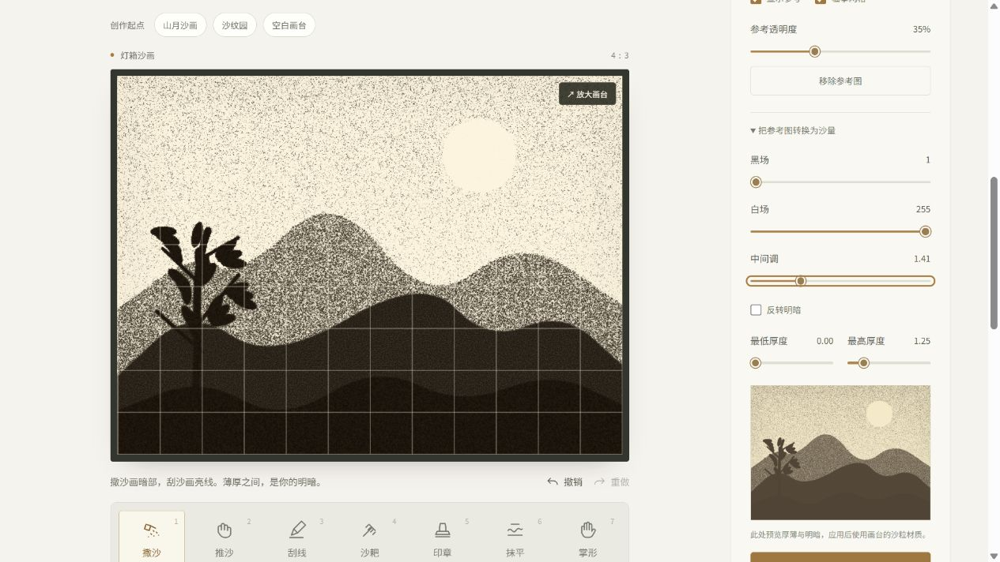

图注：2026-10-08 本地浏览器 `1257 × 720` 实测，左侧为已应用山月沙量的灯箱，同时叠加透明度 35% 的原图参考与网格；右侧为中间调 1.41 的独立 2D 转换预览。此图包含原图临摹层，不是无参考叠加的 PNG 成品。

## 草稿、作品集与导出

完成笔画立即启动异步草稿保存；设置编辑采用 900 毫秒防抖，更改完成时也立即保存。顶部显示待保存、保存中、成功或失败状态。两个模式各有一份 IndexedDB 自动草稿，同一浏览器、同一站点刷新时恢复最近成功保存的沙床、工具参考基底、设置、参考图、转换参数与作品名；撤销/重做栈不持久化。页面退出时尝试先保存，但不能保证关闭浏览器进程瞬间所有异步 IO 已完成。

在「当前作品」输入名称并点击「保存作品」，将当前沙画保留到本地作品集；再次保存更新当前命名作品。「另存副本」创建另一份作品，「打开作品集」用缩略图选择并继续创作，「新建」开启新的画台。自动草稿和命名作品分开存储，笔迹自动保存不会直接覆盖作品集中的命名快照。参考图片与作品只保存在本机浏览器，不提供云同步或协作。

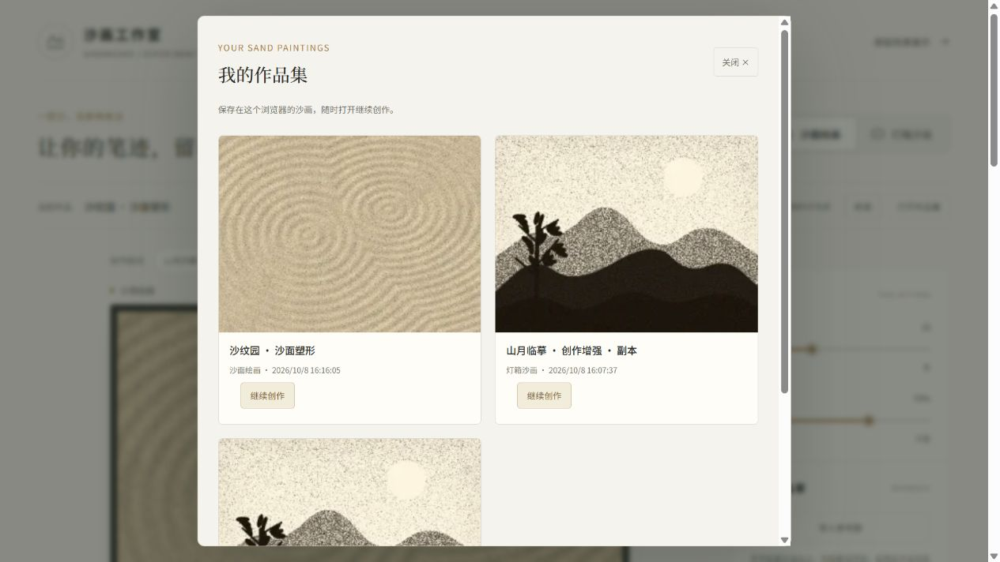

图注：2026-10-08 本地浏览器真实作品集，包含山月原作、副本和沙面作品共三条缩略图；可继续打开对应作品。截图下方第三条作品部分露出，作品集可独立滚动。

「导出工程」生成当前模式的 `.sandart.json`，包含沙床、工具参考基底、创作设置、参考原图、转换参数及作品名；「导入工程」恢复后可继续编辑，也可撤销此次载入。文件不包含撤销/重做栈和操作过程，不沿用导出浏览器的作品编号；导入文件上限 60 MB。工程导入会校验格式、尺寸、数值范围和图片类型，失败时保留当前作品。

「导出作品」将当前画面在 GPU 离屏纹理重新绘制为 `1536 × 1152` PNG，不含工具栏与光标。导出尺寸提高的是绘制分辨率，模拟沙床仍为 `512 × 384`。

PNG 只保存成品像素，不含参考原图、网格、光标和界面；它不能恢复可编辑沙床。v2 已真实下载并查看的作品：[灯箱 PNG 导出](../../assets/art-lightbox-v2.png)。

开发端口 `5174`、预览端口 `4174` 及不同主机名属于不同站点来源，本地草稿与作品集分别存储。

## 创作录制与回放（v4）

在画台下方「创作回放」点击「开始录制」，接着正常绘画，完成后点击「结束录制」。每段录制固定一个创作模式，最长 3 分钟模拟时间；录制期间可以更换工具、调节效果、清空、载入示范和撤销/重做。每段最多保留包含起点在内的 8 个沙床快照，达到时间或快照上限时自动结束。停止后保留最近一段录制到此浏览器，刷新可恢复；开始新的录制不会立刻删除此前成功保存的录制。

「播放回放」使用独立沙床呈现过程，支持暂停、0.5 / 1 / 2 / 4 倍速和时间轴跳转。回放中的光照与沙量变化来自记录的实际步骤；暂停不会继续计算沙床。点击「回到创作」后继续当前作品，创作沙床、参考图和撤销历史保留。录制与回放展示沙画本身，临摹参考图、网格、工具光标不出现在回放成品中。

「保存录制文件」导出 `.sandrecord.json`，包含起始沙床、工具参考基底、实际计算步骤与沙床重建快照；「导入录制」在独立回放画台观看，不覆盖当前作品。录制文件和可编辑 `.sandart.json` 工程文件用途不同，参考原图和本地命名作品编号不包含在录制中。文件会校验版本、尺寸、步数、接触参数与缓冲区；导入大小上限 128 MB。

「实时导出 WebM」将录制重新绘制为 1024 × 768、目标 30 fps 视频，按 1 倍速运行。导出耗时约等于录制时长，GPU 较慢时可能延长；保持页面可见，可以「取消导出」。个人录制视频没有声音，只含沙画，不含手形、参考图、网格、工具栏和光标；v6 内置山月演示导出另附虚拟手形提示。浏览器需要支持 `MediaRecorder` 与画布 `captureStream`，优先 WebM / VP9，再使用 VP8 或 WebM；不支持时显示原因，不申请摄像头或麦克风权限。

视频导出为常见浏览器产生的流式 WebM 补充实际总时长，包含末帧停留，保留原编码帧和时间戳；遇到无法安全修改的容器则保留原文件并说明原因。没有重新生成 Cues 索引，不保证任意播放器都能拖动视频进度，录制文件的工作室时间轴不受这一容器边界影响。

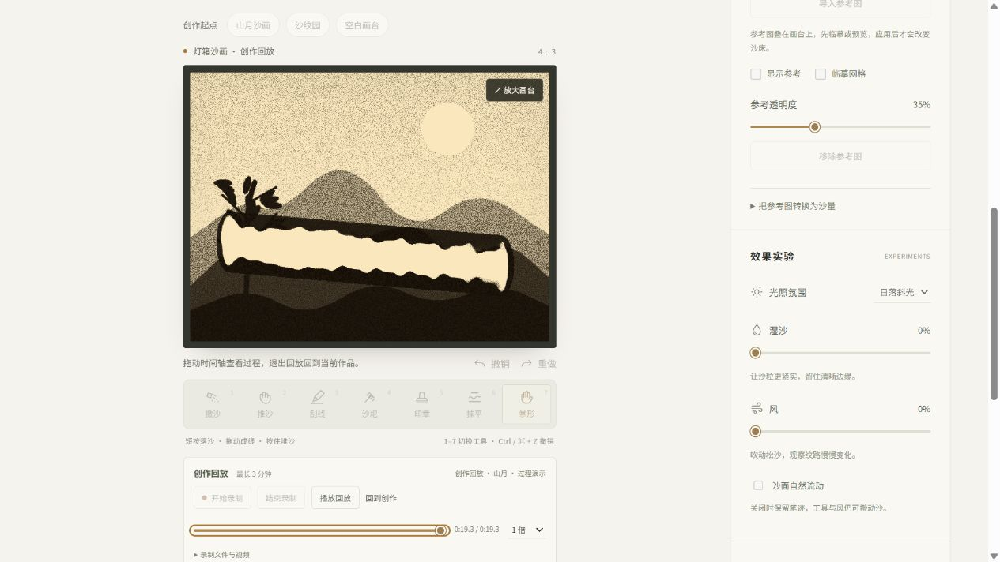

图注：2026-10-08 本地真实回放画台，山月上掌形横扫的过程停在 19.3 秒末尾，时间轴填充至 100%；绘画工具和参数锁定，退出可回到原作品。截图保留工作室上下文，没有临摹原图或网格叠加。

实际从网页导出的 [WebM 过程演示](../../assets/art-replay-v4.webm)：VP9、1024 × 768、约 19.418 秒，解码检查为 580 帧，包含掌形操作和撤销/重做过程。视频不含界面、游标、参考图或声音。

录制保存与草稿使用独立 IndexedDB 数据库。操作过程按 `1/120` 秒计算步骤记录，连续相同步骤压缩为重复次数；清场、示范、应用图片和撤销/重做使用精确快照。起点和快照同时恢复沙床与固定工具参考基底。时间轴在最多 4 个 GPU 检查点之间重算，每批最多 4 步独立提交；长跳转分批让出主线程，GPU 计算完成后再复用参数缓冲。

## 本地运行

需要 Node.js `>=22.12`；工作室需要支持 WebGPU 的浏览器、图形设备，独立舞台使用 Canvas 2D。独立依赖锁定在 [package-lock.json](package-lock.json)，不使用根目录索引工具的依赖。

从仓库根目录执行：

```powershell
cd projects/001-sandboard/experiments/sand-art
npm.cmd ci
npm.cmd run dev -- --host 127.0.0.1 --port 5174
```

开发入口：工作室 `http://127.0.0.1:5174/`，舞台 `http://127.0.0.1:5174/stage/`。通过 HTTP 服务访问；工作室初始化失败时显示 GPU 诊断信息。

构建与测试：

```powershell
npm.cmd run build
npm.cmd test
npm.cmd run test:gpu
```

构建产物位于 `dist/`，工作室入口为 `dist/index.html`，独立舞台为 `dist/stage/index.html`。真实 GPU 测试使用 `webgpu` 包，要求硬件 adapter，不用软件回退冒充硬件验证；舞台材料、演出和存储回归属于 CPU 测试。

项目子路径生产预览：

```powershell
npm.cmd run preview -- --host 127.0.0.1 --port 4174 --strictPort --base /1008_codex_project/001-sandboard/art/
```

访问工作室 `http://127.0.0.1:4174/1008_codex_project/001-sandboard/art/`，或舞台 `http://127.0.0.1:4174/1008_codex_project/001-sandboard/art/stage/`。资源采用相对基址 `./`，子路径是本地发布模拟，尚未上线；原版展示在独立 `4173` 预览端口。正式部署后，舞台用 `../` 返回工作室、`../../` 返回原版展示。

## 实现与边界

参考上游固定 Commit [`489cb01e81b11ba575887f7c76760498eb41aaa8`](https://github.com/scottstts/Sandboard/tree/489cb01e81b11ba575887f7c76760498eb41aaa8) 的高度场与 GPU 双缓冲设计，独立维护两份 `512 × 384` 沙床，每格记录厚度、扰动和水平速度。厚度为无量纲实验数值，不等于物理毫米。

每个 `1/120` 秒步长先生成一次工具接触场，再执行八邻域通量、变形沙脊接收容量与汇总更新。存在雕刻或抹平接触时，这三个输运阶段执行 3 个局部子步，每个使用 `dt / 3`；因此总共 10 次派发，接触场不重复生成。仅撒沙或无工具时按原时间步执行四阶段。每帧最多追赶 4 步，各步 uniform 独立，避免同批提交覆盖参数。撒沙和风的时间率不会因局部子步增加而放大。

接收容量以加载时的 `referenceBuffer` 沙床为固定基底，并为较厚图案保留相应堆积空间；默认薄灯箱仍受 `0.8` 附近的雕刻沙脊上限约束，厚模板不被这一绝对值卡住。清场、模板、图片和草稿加载会更新基底，连续工具步骤不会不断抬高参考。流出仍受可用沙量限制，推沙、刮线、沙耙、印章、抹平、掌形与风在封闭边界内守恒搬运；撒沙按时间增加外部沙量，风与撒沙的独立输运不受雕刻沙脊容量约束。画布重建操作可以撤销。

撤销/重做快照同时记录沙床与工具参考基底，恢复时同步写回两个模拟缓冲和参考缓冲，避免撤销模板后继续使用新模板预算。v3 同时捕获创作设置、参考图、转换参数、作品名和本地作品编号等元数据；恢复参考图时重新生成 Blob URL，替换活动参考时释放旧 URL。新的修改会清空重做分支，总历史容量为 10 步。v3 草稿和工程文件均保留工具参考基底；旧草稿缺少该字段时从加载沙床重建。参数改动纳入当前历史，但撤销/重做栈仍只存在于本次运行。

沙面渲染从厚度梯度计算较平缓的起伏与光照，清空后露出深色哑光画台。灯箱按厚度计算透光：薄层保留不连续的灰棕颗粒，厚层叠加成为暗部。颗粒邻域使用 `u32` 整数散列，在沙床坐标中固定形状、颜色与朝向，并根据像素覆盖进行抗锯齿，避免浮点散列精度造成有方向的条带。

湿度通过稳定坡度阈值、流动性和材质产生效果；风沿固定方向做沙量输运。刮线与沙耙的近直线采样通过 `extendStroke` 共享起始锚点，静止接触延续同一胶囊，偏转或回头时从真实上一采样重新起段；撒、推、印、抹保持各自行为。压力参考从胶囊中心线读取，避免边缘沙坝造成高压环。这减轻了端帽珠圈，厚图能留下连续亮沟，但尾部驻留较短时仍可能逐渐收窄，不保证全线完全同宽。

掌形使用固定几何压力，避免图片厚度中的颗粒被放大成梳齿。松手时在历史快照和 GPU 读回前完成 10 个独立的 `1/120` 秒尾步，约为 83 毫秒模拟接触，帮助快速横扫形成连通宽亮面；这属于工具接触校准，边缘仍可能起伏。

保持笔迹开关用于创作稳定性。没有完整沙粒接触、湿颗粒黏结或空气流场求解，也没有接入原版飞沙、水面、海浪、声音和椰树流程。v5 的独立落沙实现不等于完整颗粒物理或照片级材料重现。

| 模块 | 内容 |
| --- | --- |
| [model.ts](src/model.ts)、[input.ts](src/input.ts)、[main.ts](src/main.ts)、[studio.ts](src/studio.ts) | 类型、轨迹采样、输入队列、模式状态、自动存档与工作室运行协调 |
| [solver.ts](src/solver.ts)、[solver-shaders.ts](src/solver-shaders.ts) | GPU 双缓冲、工具接触与守恒输运 |
| [render.ts](src/render.ts) | 沙面与灯箱绘制 |
| [airborne.ts](src/airborne.ts)、[hand.ts](src/hand.ts) | 可重现的空中粒子包、落点沉积及有限手中余沙分配 |
| [demo.ts](src/demo.ts) | 空灯箱起点、三把有限沙量和 20 秒真实计算步骤构成的山月演示，以及分阶段手形提示 |
| [history.ts](src/history.ts) | 共最多 10 步撤销/重做 GPU 快照，沙床、参考基底与元数据一并恢复 |
| [storage.ts](src/storage.ts) | 各模式自动草稿与命名作品集，使用独立 IndexedDB 存储区 |
| [composition.ts](src/composition.ts) | 程序模板、参考图居中读取、明暗转厚度场与独立 2D 预览 |
| [project-file.ts](src/project-file.ts) | 可编辑 `.sandart.json` 导入/导出与格式、数值校验 |
| [export.ts](src/export.ts) | GPU 离屏绘制、读回和 PNG 编码 |
| [recording.ts](src/recording.ts) | 实际步骤压缩、快照、录制格式校验及最近录制的本地保存 |
| [replay.ts](src/replay.ts) | 独立 GPU 回放画台、时间轴跳转与检查点 |
| [video-export.ts](src/video-export.ts) | 画布重新绘制与可取消的 WebM 视频导出 |
| [webm-duration.ts](src/webm-duration.ts) | 补充流式 WebM 的总时长，支持安全原位修改或无索引容器插入 |
| [ui.ts](src/ui.ts)、[style.css](src/style.css) | 中文工作室界面与响应式布局 |
| [stage/material.ts](src/stage/material.ts) | 独立细粉厚度场、下落供料、指数透光与移沙质量账 |
| [stage/show.ts](src/stage/show.ts)、[stage/hand.ts](src/stage/hand.ts) | 56 秒三幕程序手势轨迹与可开关的手影示意 |
| [stage/main.ts](src/stage/main.ts)、[stage/storage.ts](src/stage/storage.ts) | 演出推进、检查点跳转、独立手绘沙床与草稿、撤销、PNG 导出 |
| [stage/interface.ts](src/stage/interface.ts)、[stage/style.css](src/stage/style.css)、[stage/index.html](stage/index.html) | 独立舞台界面、多入口构建与暖色灯箱布局 |

## 验证记录与后续

2026-10-09 v11 局部塑形：204 项常规测试、TypeScript、三入口生产构建和根索引检查通过。三幅实际成品已从网页导出；手动揉沙改变 3987 个格点且供沙、收沙记录不变，撤销和草稿刷新恢复的全部 331776 个密度值一致。旧归舟手势与归舟参考还原实际导出分别与 v10 / v9 PNG 逐字节一致。本轮没有重跑硬件 GPU 测试或真实触屏检查，具体边界与素材见 [STUDIES.md](atelier/STUDIES.md)。

2026-10-08 至 09 v10 连续手势演出：196 项常规测试、TypeScript 与三入口生产构建通过。新增覆盖抬手换位、真实工具成画、有限供料、质量守恒和检查点确定性续算。浏览器验证逐笔说明、暂停续播、末尾重建、真实 PNG、接管清台撤销和返回进度；撤销后全部 331776 个密度值一致。保留的归舟参考还原导出 PNG 与 v9 文件逐字节相同。当前范围见 [GESTURES.md](atelier/GESTURES.md)；没有重跑硬件 GPU 测试。

2026-10-08 v9 实时创作台：193 项常规测试、TypeScript 与三入口生产构建通过，根索引检查通过。真实浏览器已验证三幅成画、空台散撒、收沙、清空撤销、草稿刷新恢复与工程往返；全部密度值对比保持。实际成品与本轮验证边界见 [v9 验收记录](atelier/PRODUCT_VERIFICATION.md)。历史 v8 记录继续保留。

2026-10-08 v8 创作台：188 项常规测试、TypeScript 与三入口生产构建通过。浏览器已验证三图与 v7 对照、24 秒分镜、缩放/全屏、三种材料手法、暂停续播与 360 像素布局，现有工作室七工具和旧入口保持。真实截图、测试边界及仍待实现的连续演出见 [v8 验收记录](atelier/VERIFICATION.md)。

2026-10-08 新增独立舞台：全项目 185 项 CPU 测试与 72 项真实硬件 GPU 测试通过，舞台新增材料 9 项、连续演出 6 项、独立存储 4 项 CPU 回归。舞台存储回归实际对比其保存前后的 v6 工作室自动草稿与命名作品，保持原值。GPU 回归继续覆盖原有工作室能力；舞台材质本身使用 Canvas 2D，不把这些 GPU 检查归为舞台求解测试。

浏览器已完成 56 秒演出至末尾，主要构图可辨；实际验证散撒、指尖与撤销，手绘后返回演出仍停在第 2569 步（约 42.82 秒），刷新恢复独立舞台手绘草稿。离开手绘前短尾步先落定并保存，五种工具共用这一独立手绘沙床。手动指尖使用大小滑杆的四分之一作为半径，重复微小采样过滤，移动指迹保留搬沙前后的源位置，减轻分段端帽的沙量集中；静止指尖仍可擦出月面。

连续三次 `PageDown` 从演出末尾正确定位到 39.2 秒、第 2352 步，重建采用取消标记与最新目标保护。实际导出 PNG 为 `1536 × 1152`，只包含沙画；两张网页 JPEG 与成品 PNG 已保存查看。`360 × 800` 浏览器视口无横向溢出，手绘工具为约 `59.33 × 61` 像素，满足至少 44 像素触控区域；控制台 warning / error 均为 0。这属于本机窄视口检查，尚未扩展到真实触屏硬件或其他浏览器。

原能力保留另在独立 QA 来源实测：从舞台返回工作室，原 v6 的 20 秒抓沙演示正常开始与退出，退出恢复旧作品「传统撒沙 · 三种手势」和原 30.7 秒个人录制；七工具、导入导出和作品集入口继续保留。工作室在 360 像素视口的 `scrollWidth` 为 345，无横向溢出，新舞台导航为相对 `./stage/`。此测试不在用户 `localhost:4174` 的画台上编辑。

2026-10-08 v6：独立构建、166 项 CPU 测试与 72 项真实硬件 GPU 测试全部通过。自然模型覆盖连续流量变化、方向与疏密分布、不同一把沙形态、紧凑沉积、满池守恒和累计时间检查点；真实 GPU 回归同时验证多 slot 落点、局部工具子步及中途回跳后的确定性重放。旧 v5 的 34 秒下载录制重新运行到末尾，全部高度位与参考基底字节仍与原工程一致。

本机浏览器完成 20 秒独立演示与视频导出验收。退出演示前后，个人作品的全部 `196608` 个高度值逐位差为 0，工具参考基底字节和创作设置相同；退出后恢复计算会改变瞬态活动量，因此不宣称四通道全状态字节相同。手动两把撒沙的实际录制含 `natural: true`、`flow: 1`，每把实际发射 840 单位，手中余沙从 100% 到 76%、再到 52%。`360 × 800` 视口无横向溢出，播放主按钮高 40 像素，重播和退出按钮均为 `60 × 40` 像素；这属于本机窄视口验证，不代替真实手机或触笔测试。下文保留已完成的历史版本记录。

### 历史 v5 · 从手中下落的传统撒沙

2026-10-08 v5：独立构建、143 项常规测试、69 项真实硬件 GPU 测试和根索引检查通过。新增覆盖空中延时、质量转移、三种手势与撒开差异、满池合并、多 slot 沉积、混合工具子步不重复加沙、回放中途粒子及随机状态检查点、新参数往返与旧文件兼容。

网页实际生成的 34 秒、4080 步录制包含五次有效释放：`840 × 4 + 140 = 3500` 单位，第六次空手点击不发射。硬件回放与导出工程的全部 `196608` 个高度值逐位一致，参考基底 `3145728` 字节完全一致；实际新增 `3499.999650`，与预算相差约 `0.000350`，为 Float32 累计误差。末态没有待落粒子或 GPU 错误。

另实际录制三种手势，419 步；[真实视频](../../assets/art-hand-pour-v5.webm) 为 VP9、1024 × 768、3.657099 秒、106 个实际解码帧。导出时重复提交最终落定状态再停止编码，解决了仅等待但未捕获 GPU 最后一帧的问题；已解码查看下落帧和最终落定帧。360 × 800 下无横向溢出，抓沙按钮与七种快捷工具高 42 像素，撒沙滑条触摸区域高 24 像素，验证后恢复普通视口。用户 localhost:4174 草稿保留，试画在独立 4176 来源完成。

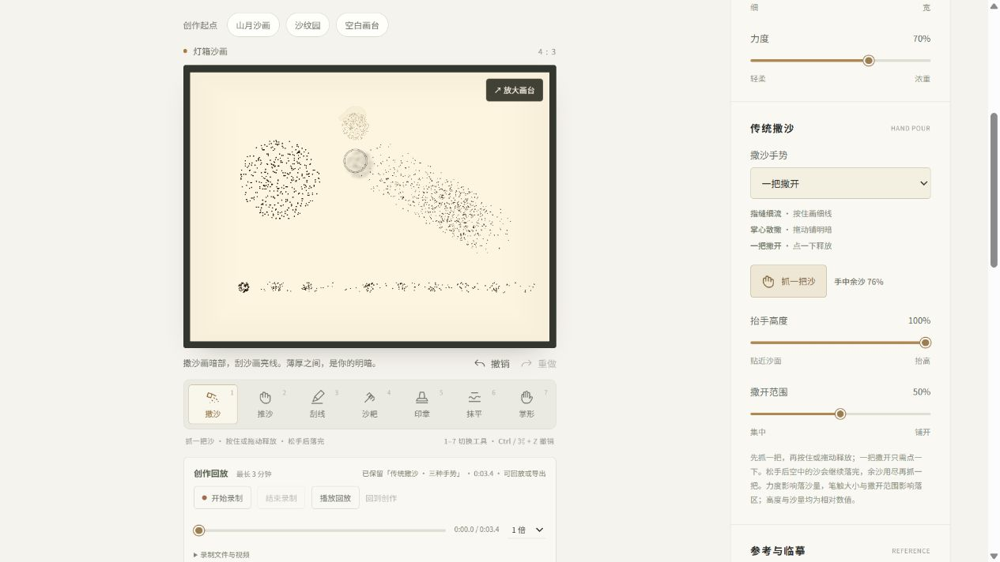

图注：真实网页中的三种手势试画；截取时额外补撒一把，中央可见空中沙、地面软影和淡色虚拟手形，右侧显示一把撒开、高度 100%、范围 50%、余沙 76%。手形为工具提示；成品视频不包含手形或工具界面。

2026-10-08 v4：独立构建、100 项常规测试与 61 项真实硬件 GPU 测试全量通过。常规回归覆盖录制步骤压缩、异步快照保序、限制与失败、录制文件校验/往返/独立存储、视频取消/编码回退/收尾、EBML 容器总时长补齐与无损回退；GPU 新增 5 项独立回放、同 tick 边界顺序、生产网格精确复现、往返跳转与原画保护回归。

真实浏览器第一段 62 步录制包含 19 个掌形计算步和最后 10 个尾步。将下载的录制重新在硬件 GPU 回放，与稍晚导出的原画工程比较，全部 196,608 个高度值位模式相同，工具参考基底的 3 MB 字节完全一致；活动量与速度因原画晚导出时继续衰减而不同。共有 35,013 格高度改变，录制确实保留实际沙量操作。退出回放再导出的原画高度差异为 0，参考基底与标题相同。

第二段真实录制含掌形、撤销/重做与光照变化，刷新恢复 19.3 秒录制；暂停在 5.3 秒时保持位置，0.5 / 4 倍播放、起点/末尾跳转与连续键盘跳到 3.8 秒均通过，键盘焦点保留。有效录制可以导入，不影响当前作品名；非法版本 99 被拒绝，原录制仍可使用。视频取消后额外画布清理、创作控件恢复；完整 WebM 经 ffprobe、ffmpeg 实际解码，VP9、1024 × 768、19.4178 秒、580 帧，首尾画面可见沙床变化。补充总时长不会改变原编码包和解码帧。

最终 `360 × 800` 无横向溢出，七个画台工具高度均为 42 像素，回放按钮至少 40 像素，时间轴操作区域高 24 像素；已恢复普通视口。浏览器 warning / error 为 0。测试仍使用独立 `4176` 来源，用户 `localhost:4174` 草稿保持；其他浏览器、真实触屏和触笔尚未验证。

2026-10-08 v3：独立构建、37 项常规测试、56 项真实硬件 GPU 测试全量通过（求解器 46 项、渲染器 8 项、历史 2 项），覆盖转换参数与透明留白、草稿/作品集隔离、工程往返与无效数据、掌形守恒与快速横扫、撤销/重做分支及状态/参考基底/元数据恢复。

v3 本机浏览器核心流程已完成：真实 PNG 导入与预览保持沙床全为 `0.24`，应用后厚度约为 `0.0128–1.154`；撤销恢复参考显示、重做隐藏参考，笔画撤销/重做使沙床和工具参考基底恢复对应 SHA-256。工程导出再导入保留状态与基底的完整字节；非法版本 `99` 被拒绝，当前作品哈希不变。空作品名可以成功自动保存为默认名称；掌形松手后自动保存，刷新恢复的状态与参考基底 SHA-256 完全一致，标题、半径 42、方向 90° 一并恢复。

作品集原作、副本与沙面三条缩略图可继续打开；移除参考后撤销能重建参考 URL，刷新恢复参考、网格和黑场 1。PNG 实际下载为 `1536 × 1152`。`1257 × 720` 滚动转换区时画台保持可见；`360 × 800` 普通视图无横向溢出，窄屏和全屏七工具完整，参考与画布矩形完全对齐并保持 4:3，退出后恢复正常视口。控制台 warning / error 均为 0。

沙面沙纹园另实测掌形快速横扫，形成平整宽槽及边缘沙脊，撤销/重做通过；槽内仍有沙层，没有完全清空画台。见 [沙面掌形真实截图](../../assets/art-palm-surface-v3.png)。

本轮验收使用独立的 `4176` 测试来源，与用户 `localhost:4174` 的 IndexedDB 草稿和作品集分开。真实触屏、硬件触笔、其他浏览器与线上部署仍未测试。

2026-10-08 初版：独立构建、5 项常规输入/轨迹测试与 27 项真实硬件 GPU 测试通过（求解器 23 项、渲染器 4 项）。旧截图与对应浏览器记录保留为 v1。

v2 独立构建、9 项常规、45 项真实硬件 GPU 测试全部通过（求解器 37 项、渲染器 7 项、历史 1 项）。新增覆盖图片明暗转换、沙纹模板、短按撒沙、完整移动撒沙、采样共同锚点与转角/倒退、连续刮线、静态作品保留、抹平守恒、无沙露台、颗粒方向条带、按压动画，以及模板撤销时沙床、参考基底与两个模拟缓冲一致恢复。

厚底刮线覆盖 `0.7 / 1.1` 两种载入厚度的长段、每段 10 格的顺序短段、同一步 8 段，共 6 项真实 GPU 回归；每条中心线的采样厚度均低于 `0.12`，沙量守恒。这些数值属于无量纲实验厚度。

实际采样辅助函数的 GPU 回归进一步逐列检查连通笔迹：横截面宽 `10–22` 格、边脊波动小于 `0.02`，同时保持沙量守恒。

v2 网页已实测厚图刀笔形成连续亮沟，改善先前孤立亮点；两模式手动保存后刷新，山月灯箱与沙纹园沙面分别恢复。真实下载 `1536 × 1152` PNG 并查看图像通过；上游真实截图已成功导入为沙量，撤销能回到模板。短按撒沙、全屏六工具与退出通过，360 和 1440 像素视口无横向溢出，窄屏画台工具高度为 42 像素。原版精细画质在 `1280 × 720` 视口绘制为 `2560 × 1440`，流畅为 `1280 × 720`，半径 `12 / 18` 和海浪从禁用到可划状态通过。真实触屏与其他浏览器尚未测试，完整过程见 [研究笔记](../../notes.md)。这些结果不替代 v3 新增流程验收。

v1 浏览器记录：笔触已校准，本机核心体验通过，能画出清晰灯箱山形亮线和心形压痕，沙面可见五齿沟槽、沙脊和阴影。撤销、两份草稿保存后刷新恢复、`1536 × 1152` PNG 实际下载、三种光照与湿度变化均已验证，控制台错误与警告为空。强风把沙搬向封闭画台的另一侧，留下迎风侧空区，见 [v1 风实验截图](../../assets/art-wind.jpg)。1440 像素宽屏与 360 像素窄屏均可操作，窄屏没有横向溢出；已验证原版入口及浏览器返回后恢复创作。细笔长线队列截断与静止撒沙重复 8 倍流量已修复，过程见 [研究笔记](../../notes.md)。这些旧记录保留，不代替本轮新增功能验收；真实触屏设备和其他浏览器尚未测试。

石块与贝壳、沙流障碍、彩沙、水流侵蚀与多人协作作为后续实验，当前没有实现。v4 已加入创作录制与回放。原版展示保留其原阶段 42 项常规与 15 项硬件 GPU 测试记录，v2 画质和控制反馈优化后的构建、Lint、44 项常规与 15 项硬件 GPU 回归通过，未改原版求解器或渲染算法；v3、v4 不修改原版。

## 来源与许可

上游项目为 [scottstts/Sandboard](https://github.com/scottstts/Sandboard)，研究版本固定为上述完整 Commit，GPL-3.0-only 原许可证保留在 [LICENSE](LICENSE)。[solver-shaders.ts](src/solver-shaders.ts) 注明参考上游 `src/simulation/flux.ts` 与 `src/simulation/shaders.ts` 的来源，以及零底限、矩形网格、沙画工具、湿度和风等改动。分发本实验时同时提供对应 GPLv3 源码，保留上游署名与许可证。

浏览器图标 `public/logo.png` 沿用该固定上游版本的 `public/logo.png`。颗粒邻域与高度场照明思路参考同版本的 `src/render/`，本轮使用独立整数散列与透光模型，相应来源和修改范围保留于代码注释。

新增 `src/stage/` 的细粉材料、演出轨迹、程序手影、界面与独立存储由本实验编写，《月下江南》为本次原创构图；没有引入电视节目片段、手部照片、录音或成图素材。舞台图标继续使用上述上游 `public/logo.png`，许可证原文件保持。详细范围见 [ATTRIBUTION.md](ATTRIBUTION.md)。
