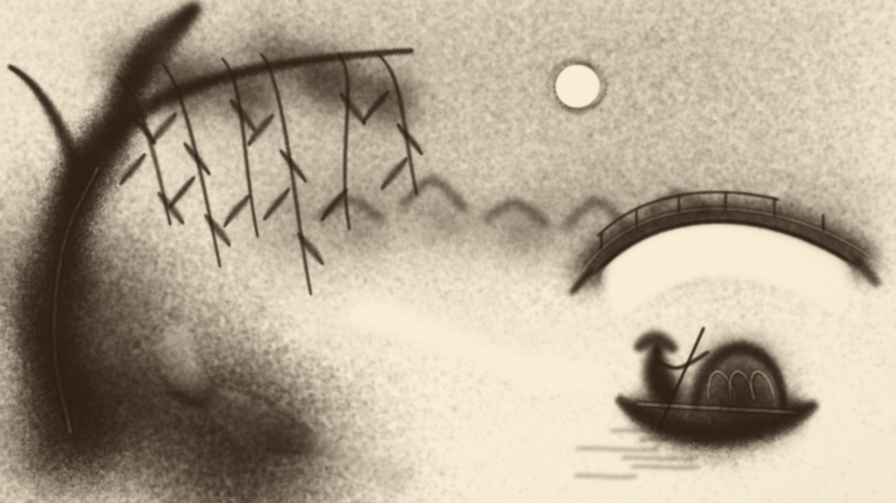

# v10 · 按造型顺序推进的手势演出

历史版本记录。当前 v11 默认侧脸，并增加柳树、石桥局部演出及守恒揉沙；归舟编排作为第四个选项保留。最新能力与验收见 [STUDIES.md](STUDIES.md)，本页继续说明原 v10 实现。

2026-10-08 至 09，针对“成画像打印、看不懂形成方式”的反馈，将创作台首屏改为独立的连续手势演出。旧参考还原控制器按目标图局部明暗补沙，路线往返扫描；真实材料并不能改变这种路径的打印感。因此保留其成品与能力，另外编写按景物结构作画的演示。

入口 `/1008_codex_project/001-sandboard/art/atelier/`。默认「手势演出」、1 倍速与显示手势，`#pause` 保持待播。当前只有归舟构图的手势版本；后两幅自动切换到保留的「参考还原」。

## 实际作画顺序

| 章节 | 起点 | 动作与用途 |
| --- | --- | --- |
| 天光与远岸 | 1.10 秒 | 沿曲线薄撒云灰，叠出轻淡远岸与错落屋舍 |
| 近岸与水路 | 19.38 秒 | 深沙形成左下近岸，掌侧沿弧线移开水光 |
| 柳干与垂枝 | 34.65 秒 | 粗干向上收细，添叶影、逐根垂枝，再从深沙中挑出树皮光 |
| 石桥与月色 | 77.10 秒 | 先撒有厚度的桥身，再移沙打开桥洞、整理余沙，添栏与月色 |
| 归舟与水纹 | 95.60 秒 | 堆出舟腹和乌篷暗面，添人物剪影、挑细光，留下断续水纹 |

全演出 7333 个 `1/60` 秒步骤，约 122.22 秒模拟时间。每一笔是连续路径；笔间有抬手换位，不跨画面连线。下方说明对应当前动作的造型用途，章节按钮定位该段起点。播放速度与设备计算负载会影响实际观看时长。

图注：生产网页真实截图，56.85 秒；程序手影是提示层，不参与导出。

图注：网页控件实际导出的 `1536 × 864` PNG，由空台上的真实工具步骤形成，没有成图贴图或参考厚度写入。

## 路径与材料

[gestures.ts](../src/product/gestures.ts) 不读取图片、明暗目标或像素误差。每笔记录路径、手法、宽度、沙量、时长和用途，路径采用连续曲线与有限段直线。单步最多执行一个接触动作；手影位置与材料接触来自同一笔采样。

撒沙按行进距离和宽度估计供料预算，单笔余沙有限；供料调用 `StageMaterial.step()`，先下落、再沉积。每笔开始重新领取预算，这是演出控制近似，并未模拟真人去沙盘抓取的手部运动。掌侧与指尖把已有沙量搬到接触边缘，收沙移出局部沙并记录质量账。材质和旧舞台的默认参数保持。

当前总供沙 `180065.6123`，收走或台外 `16436.3861`，末态没有待落沙。数值是实验材料单位，不能理解为真实克数。

播放、跳转、暂停与接管复用 [main.ts](../src/product/main.ts)。检查点保存真实材料、当前笔与剩余沙量，恢复后确定性续算。手动工具、8 步撤销、独立草稿、PNG 与 `.sand.json` 沿用 v9；文件保存材料状态，不保存手势演出控制器。旧版本与美术参考折叠区继续保留。

## 验收与边界

196 项常规测试通过，新增回归覆盖顺序、抬手、有限供料、空间明暗关系、守恒和中途快照续算。两项生产网格完整成画测试使用 20 秒时限，避免默认 5 秒被并行模拟负载耗尽；未减小生产网格或放宽数值断言。TypeScript 与三入口生产构建通过，根索引生成与检查通过。

真实浏览器已播放中途暂停、续播、重建到末尾并导出 PNG；接管后清台再撤销，全部 331776 个密度值与接管前逐值一致，返回演出保留原进度。原参考还原仍能独立从空台生成归舟成品，导出 PNG 与 v9 文件逐字节一致。新演出全屏进入和退出通过，控制台 warning/error 为空。测试使用 `127.0.0.1:4174` 独立来源，用户 `localhost:4174` 的作品存储未编辑。本轮视口接口未在测试页实际改变尺寸，不将其记录为新的手机布局验收；旧窄屏记录保留。

这是原创动作编排的沙台原型。柳叶、远屋和人物仍较概括，手影不是录像或动作捕捉；尚未达到大师作品的造型与节奏。只有一幅新手势构图，未新增近景人物、读信场景的连续表演，也未实现同一沙层三幕变画、音画同步或该入口的录像导出。原 WebGPU 工作室、硬件测试历史和录制功能继续保留，本轮没有重跑硬件 GPU 测试。
