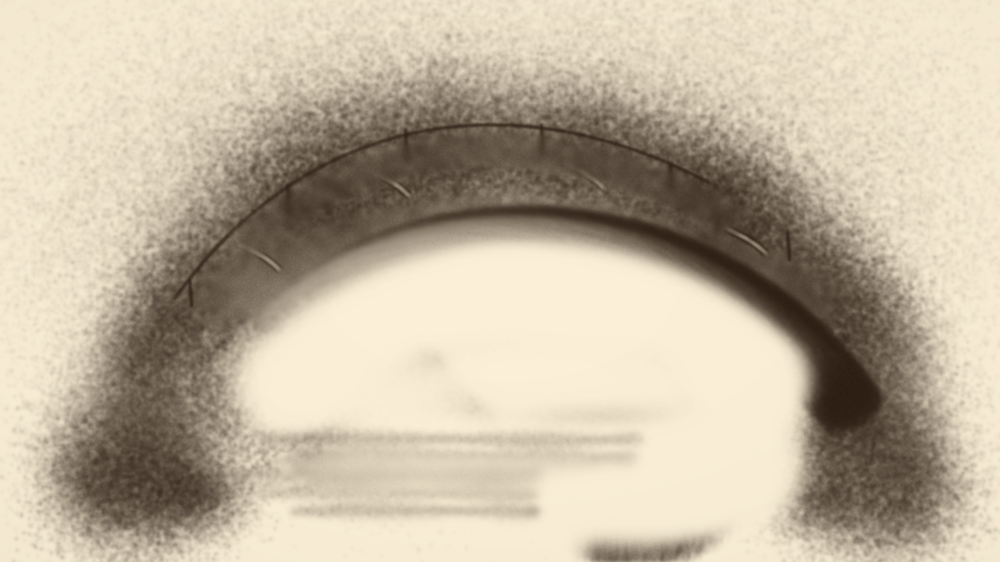
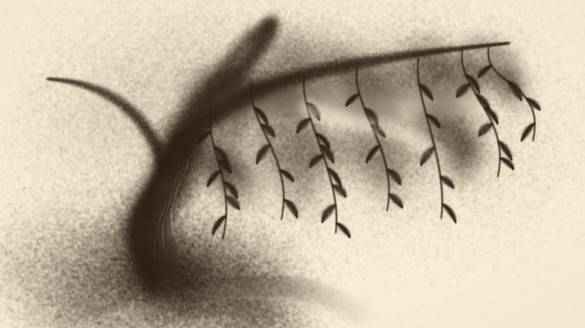

# v11 · 从沙块到形体的局部示范

2026-10-09。针对手势版造型像儿童线描的问题，增加三个可以播放、暂停、分章观看、直接查看成品和接管修改的实际示范。入口仍为 `/1008_codex_project/001-sandboard/art/atelier/`，首屏默认侧脸；`#pause` 保持待播。原归舟手势为第四个选项，三幅参考还原、工作室、基础舞台和原版继续保留。

| 示范 | 模拟步数 / 时长 | 成画顺序 |
| --- | --- | --- |
| 苍柳 · 沙块与叶影 | 5786 / 96.43 秒 | 薄灰与根块 → 粗干与分枝 → 疏密叶影 → 有宽窄的叶片 → 少量树皮光 |
| 石桥 · 从沙块开洞 | 3837 / 63.95 秒 | 岸块 → 实体桥身 → 推开、收去桥洞沙量 → 栏影与石纹 → 水光 |
| 垂眸 · 侧脸塑形 | 5218 / 86.97 秒 | 头部与肩颈沙块 → 整理额鼻唇颏 → 揉出半明面 → 垂眸与耳影 → 发丝与衣领 |

默认 1 倍速，可切换 0.5 / 1 / 2 / 4 倍速；实际观看时间取决于设备负载。每幅五个章节，每笔附动作与造型用途说明。手影是程序提示，位置来自同一材料接触路径，不是真人动作识别；导出的 PNG 不含手影。

## 材料与编排

[studies.ts](../src/product/studies.ts) 记录原创连续路径、宽度、浓淡、供沙预算、接触形状与时长。先用宽沙带堆出形体，薄沙叠成灰面，随后从已有沙中推开亮部、收走多余沙量，最后添少量细节。新编排没有读取图片、明暗目标、误差图或成图蒙版；「观看成品」运行实际步骤到末尾。

撒沙沿已有的下落与沉积模型运行。可选成簇参数让沙流中心随时间缓慢偏移，同一笔具有连贯疏密；可选椭圆形状控制沙带横向范围。旧演出未启用这些参数，其随机采样和实际输出保持。单笔供沙有限，换笔重新领取预算，仍未模拟真人从沙盘抓沙的整个动作。

新增揉沙在椭圆接触区内按相邻格点厚度差交换沙量，每对交换只计算一次，使用平滑接触权重。总沙量守恒，均匀沙层保持原厚度，局部尖峰向邻域柔化；此工具不添沙、不收沙，也不以改变透光参数伪造灰面。首轮实现按接触权重搬沙，产生不应有的亮坑，已改为厚度差驱动并增加均匀灰面回归。石桥开洞时被推到江面的沙堆通过实际收沙动作整理，计入质量账。

沙层为 `768 × 432`，每步 `1/60` 秒，Canvas 2D 指数透光渲染；PNG 导出为 `1536 × 864`。这是细粉厚度场与下落供料的近似，没有完整沙粒碰撞或真人手部几何求解。

## 实际使用

1. 选择柳树、石桥或侧脸，点击「播放成画」观察从空台开始的过程。
2. 用章节按钮定位沙块、移沙或细节阶段；「观看成品」用于直接比较结果。
3. 点击「接过这幅画，亲手修改」，六种工具作用于当前真实沙层。新增「掌腹揉沙」用于整理灰面；掌形与揉沙可调方向和宽厚比。
4. 撤销保留最近 8 次操作，草稿按浏览器来源单独保存。PNG 保存当前画面，`.sand.json` 保存沙层、待落沙与随机状态，支持重新导入；文件不包含自动演出的编排控制器。

「返回成画演示」回到接管前的进度。切换演出会保存当前手动草稿，新演示不会覆盖沙画工作室和基础舞台的数据库。演出检查点带作品身份，禁止跨作品恢复。

## 真实成品与验收

图注：2026-10-09 生产网页控件实际导出的 PNG，均由真实材料步骤生成；没有新生成或下载参考位图。这三张原创概括造型与保留的 AI 美术目标分目录存放。

[真实产品页面](../../../assets/art-studies-v11/product.jpg) 展示默认侧脸及四个手势选项；[桥洞打开前](../../../assets/art-studies-v11/bridge-block.jpg) 停在第 1316 步（21.93 秒），可以看到内部仍是厚沙块，手势说明与实际材料接触相对应。

204 项常规测试通过。新增 8 项覆盖均匀灰面、尖峰柔化与揉沙守恒、旋转接触、可选落沙分布确定性、三幅生产网格完整成画的空间厚度关系，以及中途检查点续算和跨作品拒绝。完整成画测试使用 20 秒时限，未缩小生产网格。TypeScript 与三入口生产构建通过；本轮未重新执行硬件 GPU 回归。

浏览器实际验证三幅成品导出、选择与分章定位、接管、方向 / 宽厚比滑杆、揉沙、撤销和草稿刷新恢复。一次侧脸揉沙改变 3987 个密度格点，供沙与收沙记录不变；总沙量由 113005.76995317491 到 113005.76994998606，差约 0.00000319，为 Float32 误差。撤销、刷新恢复均与原快照全部 331776 个密度值逐值一致。旧归舟手势导出与 v10 成品、归舟参考还原导出与 v9 成品逐字节一致。

## 当前边界

三幅是独立局部示范，不是三幕连续变画。侧脸五官、柳叶分布和桥体结构仍有简化与程式感，未达到大师作品的造型与表演质量；真实手部采集、双手协同、动作编辑器与当前创作台的录像导出仍待实现。工作室已有录制与 WebM 导出继续在原入口使用。本轮浏览器检查在本机执行，未扩大为真实触屏、触笔或跨浏览器验收。
