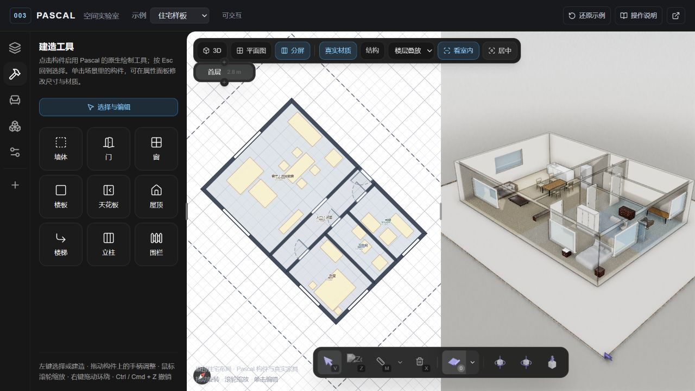
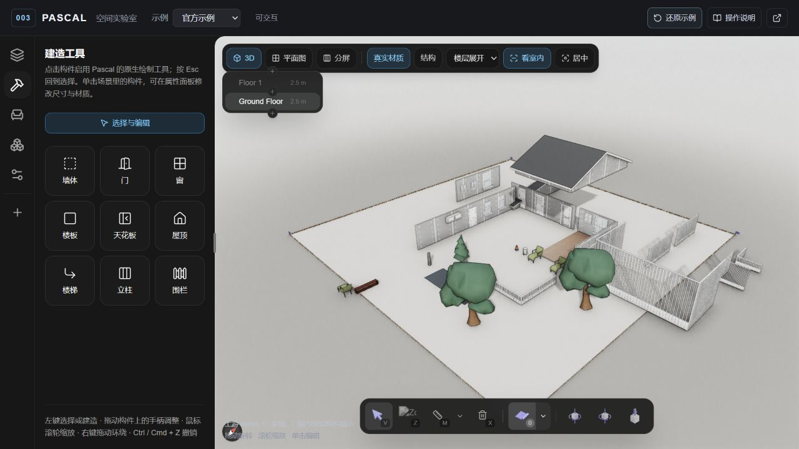

# 003 · Pascal 3D 建筑编辑器

使用 Pascal 发布的真实编辑器组件，在本地展示参数化墙体、门窗开洞、室内家具和 2D / 3D 编辑。默认载入本项目制作的住宅样板，也可切换到官方 `demo_1` 场景；模型、缩略图、图标和音效保存于本地。

[返回总索引](../../README.md) · [原仓库](https://github.com/pascalorg/editor) · [研究笔记](notes.md) · [Web 运行说明](web/README.md) · [来源目录说明](src/README.md)

## 项目理解网页

本地运行后打开 [项目理解总结页](http://127.0.0.1:4187/1008_codex_project/003-pascal-editor/overview/)。页面汇总九类能力、八个模块、五步原理、六类场景、四条复用路线、八个扩展方向和验证边界，首屏采用已有完整引导图，提供四组真实截图、全文/JSON 下载，并可进入真实编辑器。编辑器顶部的「项目理解」可返回此页。

总结页位于独立的 `/overview/` 静态路由，不加载 Pascal 3D 编辑器组件；原编辑器仍在项目根路径。页面说明依据本项目固定基线研究及实际验收，场景用途与开发建议属于分析。

## 一图总结


2026-10-08 总结图，使用内置 imagegen 生成，效果参考本项目的真实分屏截图。能力与原理依据固定源码基线及 npm `1.0.3` 本地验收；使用场景和产品价值为基于这些能力的用途分析。图中已注明宿主补充与尚未验收的流程。可查看 [PNG 原图](assets/pascal-summary.png) 与 [完整生成提示词](assets/pascal-summary.prompt.txt)。

<!-- PASCAL_UNDERSTANDING:START -->
## 全面理解摘要

- **能力**：参数化建筑构件与家具布局、材质显示、2D/3D 分屏、多层查看、选择编辑和撤销重做；本地真实演示保留住宅与官方示例。

- **模块**：core 管节点、状态、注册与空间查询；nodes 提供构件、工具和几何；viewer 负责 3D；editor 负责交互与多视图；另有独立应用、CLI、MCP 与共享 UI。

- **原理**：场景以带 ID 和父子关系的参数节点保存，编辑触发 dirty 更新；构件系统重建几何、处理墙交接和门窗 CSG 开洞，再由 Three.js/R3F 渲染；2D 直接投影同一节点数据。

- **本地实现**：固定四个 npm 包 1.0.3，增加中文宿主、原创住宅、42 类本地资产、114 项材质配套资源、按示例保存的浏览器草稿和完整理解网页。

- **场景**：家装方案试排、家具商品空间展示、户型与楼层教学、房间设计产品原型；测绘参考和设施维护可以作为后续探索，需补足数据与业务。

- **价值**：复用参数—几何—视图的编辑链路，减少基础编辑器开发，把精力投入资产、方案管理、服务流程及自己的产品体验；不预设节省比例或工程精度。

- **复用路线**：可从 Viewer 展示、Editor 嵌入、独立 CLI 或 MCP 路线切入；先完成创建项目—编辑—保存恢复，再接入自己的资产目录、分享与业务规则。

- **扩展方向**：云端项目与版本、商品资产与规则、布局约束与方案比较、受控 AI/MCP、数据交换、测绘参考、自定义构件插件，以及专业服务流程。

- **边界**：官方 Next 完整托管体验尚未进入开源发行；本网站没有账号、云协作或 AI/MCP 后端，完整导出、IFC、专业施工图、真实触摸与工程校验未逐项验收。

- **验证与许可**：已实测墙厚修改及撤销重做、楼层高度保存刷新与还原、家具新增、多层展开和分屏；研究固定 c5eaf51，代码 MIT，材质单独许可待逐项核实，Basis 解码器保留 Apache 2.0。

## 模块与复用入口

| 模块 | 作用 | 本次范围 |
| --- | --- | --- |
| [core](https://github.com/pascalorg/editor/tree/c5eaf51e161ba8653204d543666f5839d6020874/packages/core) | 节点 schema、场景 CRUD、Zustand 状态、历史、注册契约、事件和空间查询。 把设计保存成可编辑数据，协调工具、几何与视图。 | 本次运行 |
| [nodes](https://github.com/pascalorg/editor/tree/c5eaf51e161ba8653204d543666f5839d6020874/packages/nodes) | 内置节点定义、渲染器、建筑工具和几何系统；按插件装载。 把墙、门窗、楼板等参数生成对应几何，处理交接和开洞。 | 本次运行 |
| [viewer](https://github.com/pascalorg/editor/tree/c5eaf51e161ba8653204d543666f5839d6020874/packages/viewer) | React Three Fiber/Three.js 场景、相机、材质、后处理、楼层和遮挡墙查看。 按注册信息显示构件与资产；提供独立 Viewer 嵌入入口。 | 本次运行 |
| [editor](https://github.com/pascalorg/editor/tree/c5eaf51e161ba8653204d543666f5839d6020874/packages/editor) | 选择、直接操控、属性面板、建筑工具和多视图外壳。 接收用户意图，调用场景修改；组合 2D 平面与 3D Viewer。 | 本次运行 |
| [apps/editor](https://github.com/pascalorg/editor/tree/c5eaf51e161ba8653204d543666f5839d6020874/apps/editor) | Next.js 应用，将组件包、场景入口、项目服务与界面装配成独立编辑器。 说明完整应用怎样承载组件；本项目使用自己的静态宿主。 | 源码研究 |
| [cli](https://github.com/pascalorg/editor/tree/c5eaf51e161ba8653204d543666f5839d6020874/packages/cli) | 管理版本化独立编辑器运行时、本地服务和持久数据；固定 README 描述 SQLite 项目存储。 适合评估本地应用路线；运行时、包版本和服务配置需单独核实。 | 未在本次启动 |
| [mcp](https://github.com/pascalorg/editor/tree/c5eaf51e161ba8653204d543666f5839d6020874/packages/mcp) | 向 MCP 客户端暴露场景工具、资源、提示与存储，供 Agent 读取并操作结构化场景。 让模型通过工具改变真实数据；连接、权限、结果检查与回退需另做。 | 未在本次连通 |
| [ui](https://github.com/pascalorg/editor/tree/c5eaf51e161ba8653204d543666f5839d6020874/packages/ui) | 供应用与包复用的基础 UI 组件和界面约定。 减少重复界面实现；品牌样式与具体产品流程由宿主组织。 | 源码研究 |

## 扩展方向与验收

这些方向是待开发分析；没有把原库接口等同于完整产品。

### 云端项目、版本与分享

基础：现有 scene JSON、onLoad/onSave 与编辑历史。

建设：账号和权限、项目 API、场景及资产存储、版本记录、公开分享规则。

验收：修改后保存，换设备重新打开；旧版本能恢复，权限与资产引用正确。

### 自己的商品与家具资产

基础：现有模型、缩略图、尺寸元数据和放置工具。

建设：资产导入、单位与原点规范、模型预算、许可记录、SKU 与商品信息。

验收：已知尺寸对照正确，模型快速载入，位置、占地和业务信息能对应。

### 布局约束与方案比较

基础：参数构件、Zone、占地查询与可保存方案。

建设：通行距离、开门范围、候选布局、差异对照和适合业务的规则。

验收：用人工核对的案例测试；区分占地碰撞与高度、通行、施工约束。

### 受控的 AI / MCP 设计

基础：固定仓库的 MCP 工具路线和可编辑场景。

建设：连接目标服务、核对工具版本、上下文、权限、操作记录与场景验证。

验收：对比修改前后节点，检查尺寸和资源；失败能回退，生成结果可继续编辑。

### 数据交换与工程交付

基础：结构化节点数据以及包内模型、打印导出入口。

建设：选择目标格式、单位与语义映射、版本兼容、资产归档和验收基准。

验收：在目标软件中重开并核对尺寸与内容；IFC、专业施工图和报价逐项验证。

### 图像、扫描与现状参考

基础：源码中的 Guide/Scan 和 capture 扩展契约。

建设：采集来源、坐标标定、尺度对齐、流传输、访问控制与异常恢复。

验收：先核对目标包是否有接口，再用已知尺度场景测试；不承诺自动精确重建。

### 自定义构件与插件

基础：节点定义、schema、渲染器、工具和系统注册。

建设：开发业务构件，补齐参数面板、几何、空间查询和数据迁移。

验收：新增、修改、撤销、保存、重开与多视图都保持一致。

### 面向空间的专业服务

基础：构件 ID、层级和可附加元数据。

建设：将设备、工单、装修服务或资产台账与节点关联，补齐角色、流程与审核。

验收：空间对象与业务记录一致；业务判断由专业规则负责。

完整文字、场景分析和复用路线见 [可下载理解全文](web/public/research/understanding.md) 与 [结构化研究数据](web/app/overview/research.json)。
<!-- PASCAL_UNDERSTANDING:END -->

## 基本信息

| 项目 | 内容 |
| --- | --- |
| 索引编号 | `003` |
| 原仓库 | [pascalorg/editor](https://github.com/pascalorg/editor) |
| 源码研究基线 | [`c5eaf51e161ba8653204d543666f5839d6020874`](https://github.com/pascalorg/editor/tree/c5eaf51e161ba8653204d543666f5839d6020874) |
| 展示组件版本 | `@pascal-app/core`、`viewer`、`editor`、`nodes` 均固定 `1.0.3`；完整依赖由 `web/package-lock.json` 固定 |
| 研究日期 | 2026-10-08 |
| 上游许可证 | MIT，`Copyright (c) 2026 Pascal Group Inc.`；保留于 [src/LICENSE.upstream](src/LICENSE.upstream) 与 [Web 许可](web/public/LICENSE.upstream.txt) |
| Web 技术栈 | 独立 Next.js 宿主、React、Pascal 编辑器组件 |
| 项目子路径 | `/1008_codex_project/003-pascal-editor/` |
| 在线部署 | 尚未发布，索引 `demo` 保持为空 |

源码 Commit 用于解释架构与记录素材出处；本地运行使用锁定的 npm 发布包，未做二者逐文件一致性核对。

## 展示内容

场景中的墙、门窗、楼板和家具由 Pascal 的数据模型与渲染系统处理，可通过原生编辑工具继续修改。住宅样板是本项目制作的 12 × 8 米布局，包含客厅/厨房、过道、卧室、书房与卫生间；标称 96 平方米表示外轮廓面积。默认不设屋顶与显式天花板，方便查看室内。来源与完整节点统计见 [素材清单](assets/SOURCES.md)。

| 观察对象 | 可理解的效果 |
| --- | --- |
| 房屋结构 | 墙、门窗、楼板和其他构件组合为可编辑建筑 |
| 参数化墙体 | 改动位置、厚度或高度后，墙体系统重新生成几何 |
| 门窗开洞 | 门窗依附墙体，布尔几何运算生成洞口 |
| 室内布置 | 本地家具模型与材质进入同一场景，配合选择和编辑工具操作 |
| 2D / 3D | 从平面关系与立体空间两个角度查看同一场景数据 |
| 查看方式 | 3D、平面图、分屏、真实材质/结构、楼层叠放/展开/单层、遮挡墙隐藏和居中 |
| 编辑历史 | 上游场景状态与历史机制支持撤销和重做 |
| 本机草稿 | 两个示例分别保存于当前浏览器；还原示例清除当前示例草稿 |

最新生产构建、TypeScript 检查与完整场景/素材校验已通过。浏览器实际完成住宅 3D / 分屏、室内墙隐藏、墙厚编辑、撤销/重做、自动保存、刷新恢复、还原、家具放置与官方示例楼层展开。本地资源含 42 类家具、114 项材质所需的完整纹理/缩略图、图标、音效和解码器，共 460 文件、约 18.84 MB。根索引、仓库检查与差异格式检查均通过，详细结果见 [研究笔记](notes.md)。



图注：2026-10-08 本地生产子路径的真实浏览器截图，`1280 × 720`。平面图与 3D 共用同一可编辑场景；最终样板已还原到原始布局。



图注：2026-10-08 本地官方示例截图，`1280 × 720`。原始示例经清理和预迁移，使用 npm `1.0.3` 的原生楼层展开能力，屋顶已实际升起。

另见 [原生墙厚编辑](assets/edit-wall.jpg)、[实际新增沙发](assets/place-item.jpg) 与 [390 × 844 窄屏布局](assets/mobile.jpg)。窄屏检查确认页面宽度为 390 像素、没有横向溢出，并可打开建造底部面板；真实触摸设备和全部手机工具尚未逐项验收。

## 本地运行

使用 Node.js 22 或更新版本，在仓库根目录打开 PowerShell：

```powershell
cd projects/003-pascal-editor/web
npm.cmd ci
npm.cmd run dev
```

开发入口为 `http://127.0.0.1:4187/1008_codex_project/003-pascal-editor/`。完整命令见 [Web 说明](web/README.md)。本次工作环境为 Windows、Node.js `22.15.0`、npm `10.9.2`。

生产构建与预览：

```powershell
npm.cmd run typecheck
npm.cmd run check:scenes
npm.cmd run build
npm.cmd run preview
```

静态产物为 `web/out/`。预览用于检查实际构建文件在项目子路径下的加载效果；当前没有公开部署。请通过本地 HTTP 服务访问，渲染后端的实际结果按浏览器验收记录说明。

## 如何体验

1. 默认进入住宅样板，可在顶栏切换官方示例；旋转、缩放 3D 画面，观察房屋、墙体与家具。
2. 切换平面与立体视图，比较墙、门窗和家具的位置关系。
3. 使用编辑器选择工具选中墙或构件，在属性面板查看尺寸和参数；修改后观察几何更新。
4. 在场景树选中楼层，进入「建造」放置构件，或在「家具」中按类别和名称查找本地模型；按 `Esc` 结束工具。
5. 使用撤销恢复编辑，继续查看原场景。需要重新开始时，点击「还原示例」。

家具放置受原生碰撞检查约束。若普通点击被拒绝，可选择其他位置；原生提示支持按住 `Alt` 强制放置。本次已实际验证搜索 `sofa`、选中 `Sofa`、碰撞拒绝以及 `Alt + 单击` 放置，场景家具从 20 件增至 21 件，按 `Esc` 后新沙发仍可被选中编辑。

宿主通过稳定的 `onLoad` / `onSave` 回调装载场景并将修改保存到 `localStorage`。住宅与官方示例使用各自的存储键；同一浏览器与同一站点来源下再次打开时优先载入对应草稿。「还原示例」清除当前示例草稿并恢复初始 JSON。浏览器实测楼层高度从 `2.8` 米改为 `3.5` 米，刷新仍为 `3.5` 米，还原后回到 `2.8` 米。

## 实现原理

Pascal 把建筑保存为结构化节点。节点存放在按 ID 索引的平面字典中，通过 `parentId` 与 `children` 表达场地、建筑、楼层、墙及附属构件的层级关系；墙的位置、厚度、高度等参数与屏幕上的三角网格分开维护。

人工编辑先更新 `core` 中的场景状态，相关节点进入 `dirtyNodes`。帧循环中的几何系统读取变化，计算墙体交接、挤出轮廓，并利用 CSG 对门窗洞口做布尔减法，再更新 Three.js 对象。对象注册表把节点 ID 连接到具体的 3D 对象，减少重复遍历场景。改动参数后，模型仍能继续编辑。

`viewer` 负责 React Three Fiber / Three.js 渲染、相机和查看状态；`editor` 增加工具、选择与面板；`nodes` 提供内置节点定义、渲染器和系统。本地宿主装载内置插件、场景与资源，保留这套上游分工。源码路径与阅读记录见 [notes.md](notes.md)。

上游另有 CLI、MCP 和存储服务，可供 AI 操作场景。本项目展示浏览器编辑器，未把 AI 服务接入或 IFC 流程作为本地已验证功能。

完整建造工具、全部模型导出格式、跨浏览器和真实触摸设备没有逐项验收；当前验证覆盖上述具体操作。浏览器控制台错误为空，仍有原库 BVH / `uv2` 的非阻塞警告。

## 开源编辑器与 Pascal Next

[官方 Pascal Next 预览](https://editor.pascal.app/next) 展示精细住宅、剖切、系统 X-ray、第一人称漫游和环境交互。固定基线的上游 README 明确说明：该托管预览的完整体验尚未属于开源编辑器发行版。

本项目截图和体验说明以本地 npm `1.0.3` 编辑器为准。官方 Next 的完整住宅和宣传画面不作为本地复现证据；对照效果可直接访问官方页面。

## 自己添加的范围

- 创建独立 Next.js 展示宿主，固定 Pascal 依赖与锁文件。
- 添加 `/overview/` 中文项目理解网页、真实截图画廊、交互原理说明与总结图入口；保留真实编辑器并增加相互导航。
- 制作独立住宅样板，加入官方示例切换、按示例分别保存的本机草稿和还原入口。
- 加入中文建造入口、视图切换、本地家具搜索/类别面板与操作说明；实际工具与放置仍由 Pascal 提供。
- 将官方 `demo_1` 场景及资源适配为本地路径；保留原始 JSON，对可加载副本清理缺失 guide、孤儿窗模型及失效父子引用，详见 [素材清单](assets/SOURCES.md)。
- 两份场景预先归一化为 `1.0.3` 节点格式。官方示例保存两个显式 `roof-segment`；住宅将墙面/地板颜色保存为顶层材质表及 `slots` 引用，并标记墙正反面内外属性，适配原生 Editor 先解析 schema 的装载顺序。
- `npm postinstall` 运行 `scripts/prepare-assets.mjs`，通过 TypeScript AST 给固定 `1.0.3` 包内的 `/icons/`、`/audios/` 字面量增加 `NEXT_PUBLIC_BASE_PATH`；安装后可重现，不改变几何或渲染逻辑。
- 同一脚本为原生材质缩略图增加子路径，并将 KTX2 解码器入口适配为当前站点的 `<basePath>/basis/`；复用锁定 Three.js `0.186.0` 附带的 JS / WASM。249 个 512 KTX2 纹理与 65 个缩略图的来源、大小和 SHA-256 由素材清单记录。
- 「居中」通过原生 `fit-scene` 事件适配当前楼层的 XZ 范围，以便完整显示当前层。
- `globals.css`、`elevation.css` 参考固定上游样式，保留 MIT；配置静态导出和子路径预览。
- 保留来源、许可证和研究记录，补充本地验收与真实截图。

本阶段复用上游编辑器与几何算法。依赖、资源、说明和后续实验由本子项目独立维护，根 `package.json` 仍只负责项目索引工具。

## 来源与许可

上游代码与样式按其 MIT 许可保留 Pascal Group Inc. 的版权与许可；复制的家具、图标和音效未发现单独覆盖许可。固定 Commit 的原路径、场景清理和素材 SHA-256 清单入口见 [assets/SOURCES.md](assets/SOURCES.md)。完整仓库许可证同时放在研究资料与 Web 公共文件中，随静态产物保留。

314 个材质文件中，79 个来自固定 Git 提交，235 个来自官方静态站点；后者按真实 URL、获取时间和 HTTP 信息记录，没有归为固定 Commit 文件。材质的单独来源许可未逐项核实，本项目不将全部贴图自动认定为 MIT。Basis Universal 解码器适用 Apache 2.0，许可保留于 [basis/LICENSE](web/public/basis/LICENSE)。

新增中文说明、宿主和路径适配属于本次改动；本仓库尚未为原创内容指定统一许可证。官方 Next 媒体采用单独的 CC BY 4.0 条件，本次不将它们引入为开源编辑器效果图。
