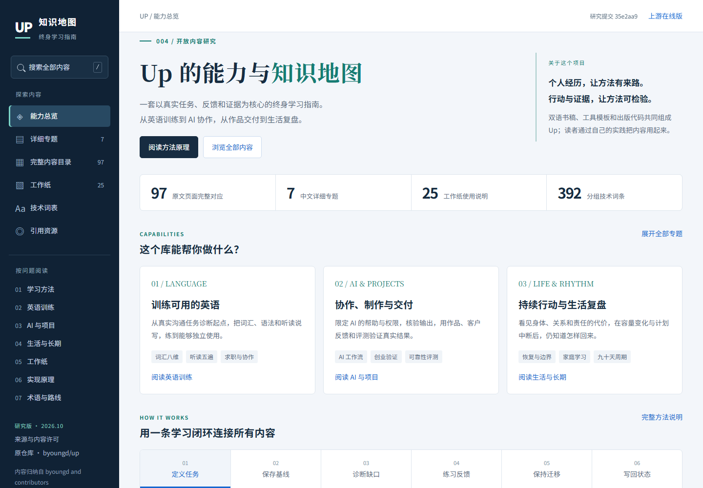

# 004 · Up 终身学习指南：能力总览与完整知识汇总

**Up 的核心能力，是把英语学习、AI 协作、真实项目和生活复盘组织成一套可以执行、保存证据、复测并持续调整的方法。**它通过中英双语网站、电子书和可复制工作纸发布内容。个人经历解释方法的来路，训练章节给出操作步骤，模板帮助读者把步骤用进自己的任务。

[在线完整理解](https://yydshly.github.io/1008_codex_project/004-up-learning-guide/) · [完整理解文档](UNDERSTANDING.md) · [返回总索引](../../README.md) · [本地中文网页](http://127.0.0.1:4194/1008_codex_project/004-up-learning-guide/) · [原仓库](https://github.com/byoungd/up) · [上游在线版](https://byoungd.github.io/up/) · [完整逐页目录](sources/coverage.md) · [研究记录](notes.md)

## 我们的完整理解

[完整理解：能力、模块、原理、价值与八个扩展方向](UNDERSTANDING.md)将已有研究整理为十章，并在网页提供十一项完整摘要。主要能力是学习系统、英语训练、AI协作与真实项目、生活与家庭；工作纸、术语资源与双语出版把这些方法组织成可查、可复制和可执行的内容。

方法原理是任务、独立首版、定向练习、反馈、延迟保持、迁移和状态更新；技术原理是Markdown与导航驱动内容出版。本研究用静态HTML和检索JSON呈现内容，保留完整引导图，不运行自动教学或模型服务。

价值观归纳为真实、诚实、主体性、可持续与负责。实践可以服务岗位沟通、作品交付、团队交接、家庭共同学习与中断恢复。私有工作台、保持提醒、岗位训练包、带出处AI助手、评测、协议协作、多语维护与离线同步是待开发方向，详见完整理解。

## 首先：这个库的能力是什么？

| 能力 | 可以获得的具体帮助 | 原库实际提供的形式 |
| --- | --- | --- |
| 定义任务与诊断起点 | 把愿望转成受众、动作、条件、期限和完成证据；判断缺口来自语言、知识、策略还是环境 | 阅读指南、认知篇、学习状态与诊断表 |
| 训练可用英语 | CEFR 方向、词汇、语法、听读说写、岗位英语；首版、定向练习、撤架、保持和迁移 | 十一页英语专题及配套证据卡 |
| 与 AI 协作学习 | 准备材料，限定帮助，核验输出，分开成品质量与独立能力，跨会话继续任务 | 学习方法、会话协议、任务简报、记录与趋势卡 |
| 把学习变成作品 | 从需求与人工基线出发，完成原型、代码、文稿、测试、反馈和交接 | 作品篇、开发篇、作品简报与评分卡 |
| 设计工作流与评测 | 设置输入、工具、权限、中间结果和失败边界；比较质量、全部工时与成本 | 工作流、评测手册与记录表 |
| 验证创业想法与服务 | 访谈过去行为、比较替代方案、人工试点；核算工时、回款、返工和容量 | 客户发现、小生意手册与实验卡 |
| 管理长期行动与中断 | 按现实容量安排完整、压缩和恢复版本；每周改一个变量，周期结束决定去向 | 第一周、生活系统、节律、九十天与后续章节 |
| 整理经历、选择与关系 | 区分事实、感受、解释与假设；看清代价、责任、可逆性与支持边界 | 个人叙事、恢复、决策、关系和自我认识 |
| 支持家庭共同学习 | 明确学习者、家长、教师和 AI 的职责，让孩子参与目标、反馈与退出 | 家庭学习篇与共同协议 |
| 发布与离线阅读 | 双语导航、本地搜索、阅读进度、工作纸复制/下载、PDF 与 EPUB | VitePress/Vue 静态网站与出版脚本 |

这些能力主要通过读者执行方法、维护私有文件并使用外部工具实现。源码没有提供自动教学、大模型推理服务、账户系统、学习记录云同步或自动能力认证。章节中的企业 AI 网关属于作者关联项目，不能计作 Up 已实现的软件功能。

## 研究基线与覆盖范围

| 项目 | 固定记录 |
| --- | --- |
| 原仓库 | `https://github.com/byoungd/up` |
| 研究提交 | [`35e2aa9ad3a076fe4e8405877cc560df2593838f`](https://github.com/byoungd/up/tree/35e2aa9ad3a076fe4e8405877cc560df2593838f) |
| 提交日期 | 2026-10-07，Asia/Shanghai |
| 研究日期 | 2026-10-09，Asia/Shanghai |
| 包内版本 | `life-level-up-guide` 1.0.0，`private: true`；内容版本以 commit 固定 |
| 导航覆盖 | 97 个中文页面、97 个英文对应文件；英文不重复计作独立知识 |
| 出版覆盖 | 每种语言选 80 个源页面；下载中心、5 个历史归档页与10个词表不在其中 |
| 工作纸 | 工具箱26页含一页演示；加上开卷总览，实际可下载工作纸25组中英版本 |
| 词表与资源 | 十组词表保留392个分组词条，跨组去重340个；中文正文提取67个去重Markdown外链 |
| 内容许可 | CC BY-NC 4.0，署名 `byoungd and contributors` |
| 代码许可 | MIT；许可原文在 [licenses/](licenses/) |
| 本地范围 | 中文改写、专题归纳、逐页摘要、来源索引、独立覆盖检查与中文知识地图网页 |
| 研究状态 | 内容与源码研究完成；未改动或部署上游，未声称运行其完整构建或验证学习效果 |

标题、来源路径、英文对应、日期、SHA-256及逐页摘要见 [inventory.json](sources/inventory.json)。

## 详细知识入口

| 文档 | 展开内容 |
| --- | --- |
| [01 · 学习系统与方法原理](guides/01-learning-system.md) | 任务、基线、错误诊断、主动回忆、反馈、间隔、迁移、证据链、跨会话状态 |
| [02 · 英语训练与求职协作](guides/02-english.md) | CEFR、词汇八维、语法意义、听读五遍、口语互动、写作修订、AI与岗位准备 |
| [03 · AI、项目、创业与评测](guides/03-ai-and-projects.md) | 七步协作、概念层次、趋势实验、作品、开发、资源层、运维、客户、成本与可靠性 |
| [04 · 经历、生活、家庭与长期改变](guides/04-life-and-long-term.md) | 叙事边界、恢复与复工、决策、关系、珍惜、家庭、节律、九十天与自我认识 |
| [05 · 全部工作纸使用说明](guides/05-templates.md) | 25张工作纸的使用时机、字段、产出、职责，以及跨会话演示 |
| [06 · 网站与电子书实现](guides/06-publishing.md) | 导航、构建、搜索、Vue交互、EPUB/PDF、CI、许可与当前元数据差异 |
| [07 · 术语、词表、资源与路线](guides/07-glossary-and-resources.md) | 方法术语、10组技术词表、引用资源分类与按问题的阅读路径 |
| [完整逐页摘要](sources/coverage.md) | 97页逐项对应原文、英文与本地专题，含导语、后记和历史归档 |
| [引用资源索引](sources/resources.md) | 中文正文Markdown外链与来源；另有[JSON](sources/resources.json) |
| [完整技术词表](sources/word-lists.md) | 十组392个分组词条全部保留，原始拼写与固定来源可核对 |
| [来源与许可](SOURCES.md) | 上游观点、本地改写、未验证范围、历史信息及关联产品 |

## 原理概览

方法上，先缩小任务，用独立样本暴露缺口；练习与反馈修当前高影响问题；撤掉材料和AI后复测，再改变主题、受众或环境检验迁移。分别衡量即时表现、延迟保持和真实应用，避免以熟悉感、打卡或漂亮终稿判断能力。

技术上，Markdown是主要内容输入，导航同时驱动双语目录、工作纸和出版选页；VitePress生成静态网站，Vue提供轻量交互，脚本把书稿生成EPUB，再排版为PDF。学习状态由读者保存在自己的文件里，新AI会话读取文件继续当前任务。

## 一图理解核心方向与价值观

[网页阅读与保存原图](https://yydshly.github.io/1008_codex_project/004-up-learning-guide/#/map) · [原图](assets/up-core-map.png) · [文字版与生成记录](assets/up-core-map-prompt.md)


按“核心方向 → 能力 → 行动闭环 → 价值观”阅读。每次回看，用底部三问找到下一步：我在解决什么？证据在哪里？下一步能小到什么程度？本图是对固定版本的研究归纳与改写，不是上游作者的原文图示。

## 中文网页呈现

[打开本地知识地图](http://127.0.0.1:4194/1008_codex_project/004-up-learning-guide/) · [网页运行与实现说明](web/README.md)



2026-10-09 本地生产截图，1440×1000。页面是本研究独立实现，完整使用上面七篇专题和资料索引。支持全文搜索、段落目录、工作纸分类、词表筛选、来源域名筛选及Markdown下载；手机端提供展开导航和正文阅读。

```powershell
cd projects/004-up-learning-guide/web
npm.cmd ci --ignore-scripts
npm.cmd run build
npm.cmd run check
npm.cmd run preview
```

生产产物为 `web/dist/`。已验证 `/1008_codex_project/004-up-learning-guide/` 子路径、深链接刷新与390px手机布局；已通过GitHub Pages部署并核验公开HTTPS，在线入口为[Up完整理解](https://yydshly.github.io/1008_codex_project/004-up-learning-guide/)；本地预览继续可用。

## 阅读与维护

先理解能力，再选一个实际问题和一张工作纸。英语按技能进入；AI项目从人工基线、验收与失败出口开始；长期学习先完成一周；复用内容与代码先看不同许可。

本研究提供完整目录覆盖与操作解释，不把个人经历、合成案例和研究平均结果写成个人效果保证。健康、法律、财务段落说明上游语境与专业边界，不提供个体处置方案。

研究扫描脚本只使用Node标准库，网页构建依赖独立保存在web子项目。重新生成来源清单时，将上游checkout固定到记录commit，然后执行：

```powershell
node projects/004-up-learning-guide/src/inspect-upstream.mjs <上游checkout绝对路径>
node projects/004-up-learning-guide/src/verify-research.mjs <上游checkout绝对路径>
npm.cmd run index:build
npm.cmd run check
```

来源脚本核对版本、97条摘要、英文对应及专题文件，输出来源哈希、资源索引和完整词表；文档脚本核对本地/固定版本链接与许可副本。两项检查及根索引校验已通过，具体记录见notes。上游自身构建条件见网站实现文档。
