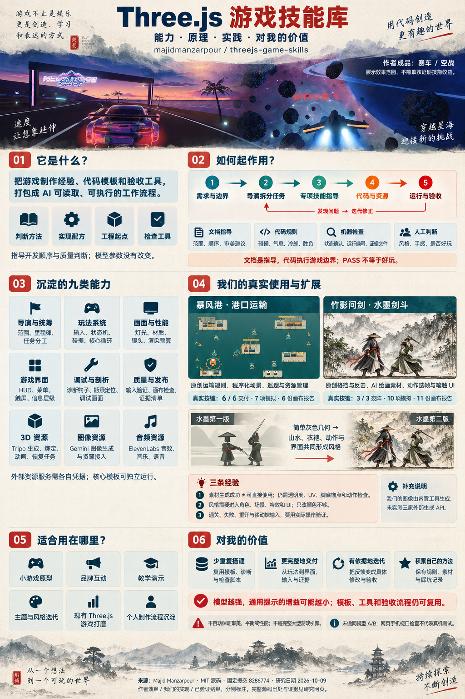
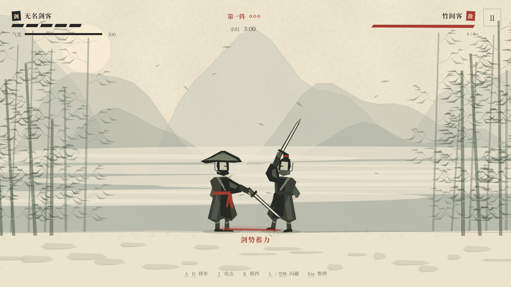
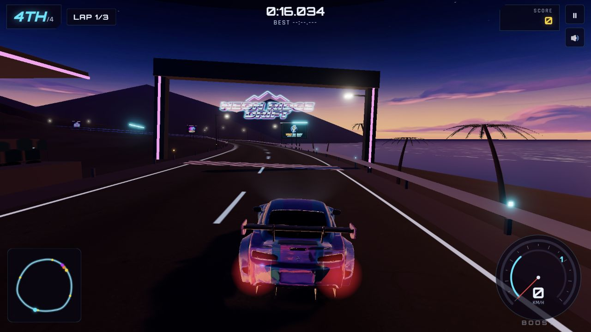
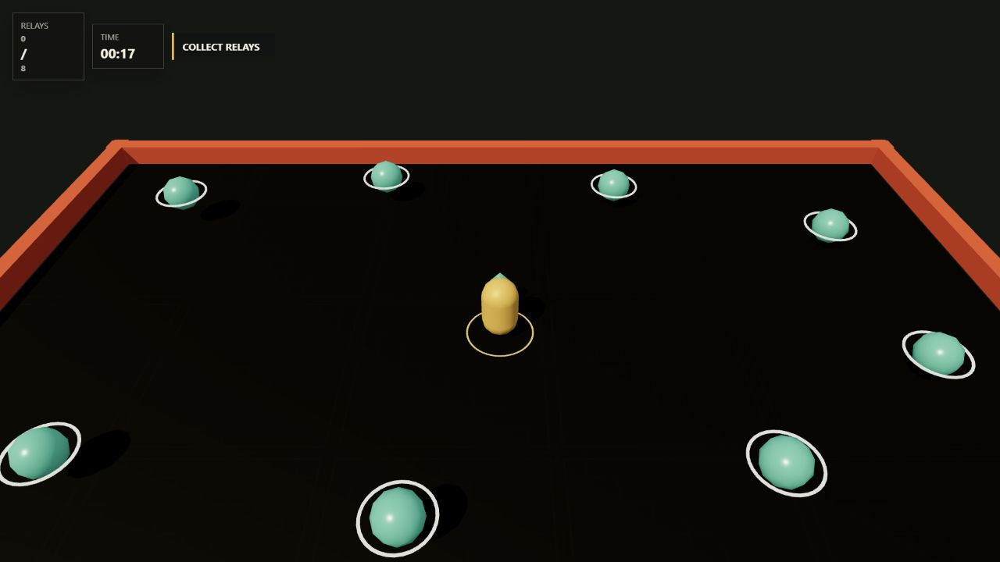

# 005 · Three.js 游戏技能研究

一张图汇总库的能力、原理、场景和个人价值，结合两款原创游戏及水墨风格前后对照，说明上游提供什么、我们新增什么。提供实际试玩、作者五款原始效果、九类技能、可运行工具、约束与验证边界。

[返回总索引](../../README.md) · [原仓库](https://github.com/majidmanzarpour/threejs-game-skills) · [研究笔记](notes.md) · [中文展示页源码](web/index.html)

## 一图总览：能力、原理、实践与个人价值



[下载完整 PNG](assets/capability-overview-v1.png) · [图片制作与参考记录](assets/overview/README.md)

把游戏制作经验、实现配方、工程起点和验收工具，打包成 AI 可以读取、调用和迭代的制作流程。

它把作者的制作判断变成可复用资源。模型仍负责理解需求、写代码和做取舍；宿主决定可用工具，运行代码决定游戏行为。

总览图由 Codex 内置 image_gen 生成，以作者赛车、空战和我们的港口、水墨两版实际截图为视觉参考。背景经过重新组合，属于解释性图文；原始截图与实际输入证据分别保留。源码研究、我们的实现和已验证结果不互相替代。

## 完整理解摘要（2026-10-12）

- **能力**：把小游戏制作经验组织成 AI 可读取和执行的工作流，覆盖需求统筹、玩法手感、画面、界面、排障、验收，以及 3D、图像和声音资源；开发者仍需实现具体游戏。
- **模块**：九类技能以 SKILL.md、references、scripts、assets 四层组织；包含制作文档、实现配方、脚本与 Vite/TypeScript/Three.js 起始工程，外部素材服务是可选依赖。
- **原理**：需求与边界→导演拆分→专项技能→代码和资源→运行与验收→反馈迭代。经验进入模型上下文，脚本提供执行与检查；不改变模型参数，也没有独立常驻游戏生成器。
- **硬功能**：工程生成、画布检查、证据校验、自动试玩模板；Tripo 模型/绑定/动画与任务恢复、Gemini 图像、ElevenLabs 音频脚本。实际输入机器人与素材接入需按项目改写。
- **约束**：文档指导顺序与取舍；游戏代码执行碰撞、消耗、冷却和胜负；接口与清单检查确认状态、运行编号和文件。渲染超预算可能只警告，PASS 不能证明审美、手感或好玩。
- **效果与本地扩展**：保留作者五款在线游戏原始截图和上游收集模板；原创暴风港运输与竹影问剑剑斗。水墨第二版新增绘画素材、姿态 UV、脚底锚点、笔触特效和题款 UI，保留第一版对照。
- **场景**：小游戏或机制原型、品牌活动互动、教学演示、主题风格迭代、既有 Three.js 游戏打磨，以及个人制作流程积累；适合规模可控、需要完整交付和可重复验收的项目。
- **价值**：复用工程与检查，补齐界面、资源、失败重开和触控；把主观反馈转成具体修改与证据。模型提升可能缩小通用提示增益，工具与流程仍可复用，净省时和品质收益未量化。
- **复用路线**：可只借制作方法，或复用模板、诊断与 QA，或适配素材服务，再沉淀自己的规则和素材库。先确定玩法、平台、预算、资源策略与验收，按任务选择技能。
- **扩展方向**：个人导演简报、风格与资产规范、玩法组件、素材流水线、跨设备性能预算、真实输入回归、同模型对照评测与发布归档，均是可继续开发的方向，当前未作为产品交付。
- **验证与边界**：暴风港真实按键交付 6/6，7 项模拟和 6 份画布报告；剑斗破阵 3/3，10 项模拟和 11 份最终画布报告。未验证外部生成 API、真实手机或同模型 A/B；有限姿态不是连续骨骼动画。
- **来源与许可**：固定上游提交 8286774b22a2566bf894dbc825825c16921866af，源码 MIT，作者 Majid Manzarpour。总览图和水墨资产由内置 image_gen 生成；原作独立素材许可不自动随源码 MIT 改变。

## 四层模块：入口、判断、执行与工程

### SKILL.md · 任务入口

告诉模型何时使用、先读取什么、要交付哪些产物。

输入：游戏需求、风格、预算、宿主工具与已有代码。

产物：制作顺序、任务范围、专项能力的选择与交付约定。

边界：需要宿主发现或主动加载；文件本身不会后台执行，也不能修改模型权重。

### references · 判断与配方

保存手感、碰撞、shader、视觉评分、UI、排障与证据方法。

输入：当前玩法、镜头、设备约束和观察到的问题。

产物：可参考的实现方案、校准目标、排查步骤和检查点。

边界：配方与内部评分仍需判断和适配，不是自动审美或性能认证。

### scripts · 可执行工具

建立工程、检查画布与证据，调用外部素材 API，记录和恢复部分任务。

输入：项目目录、URL、状态清单或素材描述；服务工具还需要凭据。

产物：工程、PNG、报告、模型与音频、任务记录或校验结果。

边界：不同脚本有不同接口；文件有效不代表资源已经正确进入游戏。

### assets · 工程与测试模板

提供 Vite/TypeScript/Three.js 收集小游戏及自动试玩模板。

输入：起始工程与待实现的游戏专属规则。

产物：可运行的输入、模拟、渲染、镜头、触控和诊断基础。

边界：五款作者成品并不是五套完整游戏源码模板；新玩法和测试路线仍需开发。

## 核心原理：四层资源如何起作用

### 判断方法：先做什么，如何取舍

SKILL.md 与参考文档规定范围、制作顺序、视觉层次和验收关注点。模型读取后据此推理；宿主需要支持技能发现或明确加载文档。

限制：文字指导不能强制模型永不偏离，也不会改变模型权重。

[固定版本出处](https://github.com/majidmanzarpour/threejs-game-skills/blob/8286774b22a2566bf894dbc825825c16921866af/skills/threejs-game-director/SKILL.md)

### 实现配方：问题怎么落到实现

手感、碰撞选型、材质、灯光、shader、UI 和排障配方，减少从零组织实现方案的工作。具体数值、机制与美术选择仍由开发者确定。

限制：配方需要适配游戏，不能自动保证审美、平衡或稳定帧率。

[固定版本出处](https://github.com/majidmanzarpour/threejs-game-skills/blob/8286774b22a2566bf894dbc825825c16921866af/skills/threejs-gameplay-systems/references/game-feel.md)

### 工程起点：可运行的基础代码

生成脚本复制 Vite / TypeScript / Three.js 模板，已有移动、冲刺、拾取、碰撞、镜头、触屏与诊断结构。它提供一个小型收集游戏起点。

限制：赛车、桌球、空战、运输与剑斗的专属系统仍需继续实现。

[固定版本出处](https://github.com/majidmanzarpour/threejs-game-skills/blob/8286774b22a2566bf894dbc825825c16921866af/skills/threejs-gameplay-systems/scripts/create_threejs_game.py)

### 工具与契约：执行、恢复和检查

画布检查、证据清单校验、自动试玩模板，以及外部素材生成脚本，使部分要求能由程序确认；资源任务还提供记录、恢复与文件校验。

限制：凭据、额度和工具权限由宿主提供；有效文件与 PASS 不能证明游戏好玩。

[固定版本出处](https://github.com/majidmanzarpour/threejs-game-skills/blob/8286774b22a2566bf894dbc825825c16921866af/skills/threejs-game-director/scripts/check_evidence.py)

制作链：需求与边界 → 导演拆分 → 专项技能 → 代码与资源 → 运行与验收。验收发现问题后，回到实现继续修改。

1. **需求与边界**：玩法、风格、平台、时限。把“做个好看的游戏”收敛为核心循环、目标设备、资产策略和完成条件。
2. **导演拆分**：里程碑与任务约定。统筹实现顺序，给专项工作明确输入输出。是否能开子代理，取决于宿主能力与授权。
3. **专项技能**：玩法 / 画面 / UI / 资源方案。按任务读取对应技能与参考配方。技能包不是每次都必须把九类能力全部执行一遍。
4. **代码与资源**：真实运行的游戏。复用模板、编写游戏专属系统、生成或制作素材，再把它们接入场景、动画与交互。
5. **运行与验收**：输入、画面、报告和证据。实际试玩、检查诊断与资源状态，保存同一轮证据。发现问题就回到实现继续修改。

### “控制”在哪一层执行？

| 强度 | 约束 | 例子 | 边界 |
| --- | --- | --- | --- |
| 软指导 | 文档约束 | 先跑通核心循环，再打磨风格；UI 要反馈生命和操作状态。 | 影响模型的决策顺序和关注点。是否遵守，需要检查最终结果。 |
| 运行时规则 | 代码约束 | 本次剑斗：0.22 秒接招窗口、气息成本、闪避冷却、一次破绽一次强反击。 | 由实际游戏代码执行。这些具体数值是我们的设计，不是技能包预设的玩法。 |
| 机器可拒绝 | 接口与证据约束 | 状态确认不符、运行编号过期、报告或证据文件缺失，会被检查器拒绝。 | 能核对约定字段、钩子与文件。画面预算超限仍可能是 PASS + WARNING，需另行处理。 |
| 观察与判断 | 质量约束 | 风格是否统一、动作是否自然、玩法是否好玩、实际输入是否正确。 | 仍需看画面、操作、听音频和分析数据。截图与文件通过不能代替这些判断。 |

## 我们的扩展与理解

| 水墨第一版：几何原型 | 水墨第二版：素材与战斗接入 |
| --- | --- |
|  |  |

第一版已经可玩，用户反馈太简单、看不出风格。第二版增加绘画资产、逐姿态 UV 与脚底锚点、动作、笔触和 UI，并重新验证。它是投入额外资源与时间的历史迭代，没有控制预算，不能当作有技能／无技能的公平对照。

| 环节 | 库提供 | 我们实现与扩展 |
| --- | --- | --- |
| 制作流程 | 导演与专项技能的顺序、参考方法、任务和证据契约。 | 选择港口运输与侧视剑斗；把模糊需求变成可玩的两套核心循环。 |
| 工程与玩法 | Three.js 工程模板、输入、镜头、碰撞与诊断结构。 | 运输容量、巡逻、EMP、热量；三轮剑斗、格挡、反击、气息和胜负。 |
| 视觉与素材 | 画面、UI、素材生成与接入的配方和检查方法。 | 程序化港口；内置图像工具生成水墨山水与人物，修正透明度、UV、脚底和动作接入。 |
| 测试与交付 | 画布检查器、证据校验器、自动试玩模板与调试方法。 | 按这两款游戏改写实际输入机器人；补充失败、重开、移动端布局与动作周期验证。 |

### 风格是一组共同工作的选择

第一版已可玩，但简单几何人物与灰色山水没有形成明显水墨风格。第二版把绘画场景、完整衣袍、动作姿态、笔触特效、题款和朱砂 UI 一起接入。

理解：只改变颜色或给提示词加“水墨”不够；需要观察运行画面，再修改具体资产与反馈。

### 生成成功不等于素材可用

两次人物图集仍有刀尖跨格。最后使用逐姿态 UV、脚底锚点和独立攻击图片，并让四份资源就绪后再开始。

理解：生成 API 的工作流价值包含失败恢复、检查和接入；出图只是中间产物。

### 规则来自设计，边界由代码执行

剑斗检查发现同一破绽可连续造成两次三倍伤害，修正为一次强反击消耗破绽。格挡窗口、气息与冷却都写进模拟规则。

理解：技能帮助提出实现和验收问题，具体机制仍要实现并用行为测试确认。

### 截图与真正玩过是两种证据

画面检查使用预设状态冻结截图；通关、失败和重开使用实际按键或指针输入。暴风港交付 6/6，竹影问剑完成 3/3。

理解：截图证明某状态能渲染；实际输入验证操作到结果的链路。两者都不能自动证明长期可玩性。

### 性能必须同时看资源成本

水墨 active-play 的 draw call 从 122 降为 19，三角形从 7479 降为 2850；四份 PNG 同时增加 9.76 MB 文件、约 34 MB RGBA / mipmap 内存。

理解：低 draw call 不表示加载更快或显存更少。仍需真机、帧率、首次加载和内存测量。

### 适配宿主，才能复用方法

本次读取六类制作技能，并使用图像技能的素材方法；生成图片调用 Codex 内置工具。Tripo、Gemini、ElevenLabs 的实时 API 均未实测。

理解：方法可以迁移，工具调用需要适配。人物当前是绘画贴片与有限姿态切换，没有连续骨骼动画。

## 使用场景

### 小游戏与机制原型

先做一局完整的收集、躲避、运输或对战循环。需要快速获得可运行工程、清晰反馈和可检查的胜负路径。

限制：复杂机制仍要设计与验证，模板不会自动补齐。

### 品牌与活动互动

产品主题的短局挑战、活动小游戏或网页试玩。玩法规模有限，强调可辨识风格、页面入口和不同屏幕布局。

限制：品牌素材许可、埋点和上线要求需要另外处理。

### 教学与交互演示

通过场景、操作和即时反馈说明一项知识或流程。Three.js 场景与 UI 结合，便于把概念变成可操作演示。

限制：内容正确性与教学效果需要独立确认。

### 主题与风格迭代

像本次一样，保持核心战斗规则，改进水墨场景、人物与反馈。参考配方、素材检查和实际截图帮助把“太简单”转成修改项。

限制：图集、锚点、动画与 UI 接入仍需工程工作。

### 已有 Three.js 游戏打磨

排查输入错误、模糊信号、卡顿或缺失的失败重开。可选择使用调试、技术美术、UI、QA 技能。

限制：诊断钩子与检查器需要接入现有工程，未必能直接运行。

### 个人制作流程沉淀

保存自己的需求模板、玩法参数、素材问题、报告和发布步骤。把一次项目的经验变成下次可复用的工作起点。

限制：依赖、API、浏览器与审美判断仍需持续维护。

复杂多人同步、账号服务、经济系统、反作弊与大型内容生产需要另外设计。AAA 命名表达画面目标，不是质量认证；素材使用权、真实手机性能和上线要求需要分别确认。

## 对我的价值与实际用法

- **减少重复搭建**：复用工程、输入、诊断与检查脚本，把精力更多放到游戏专属玩法和风格。价值是否超过读取与适配成本，取决于项目。
- **更完整地交付**：提醒自己覆盖菜单、触屏、失败重开、资源加载和证据，降低只做出一个可看场景就停止的概率。
- **让修改有依据**：把“风格不明显”转成场景、角色、动作、UI 的具体问题；把“感觉不对”转成可重复输入与状态检查。
- **形成自己的方法库**：积累需求、规则、素材版本和踩坑记录。真正长期可复用的部分，是能执行、能检查、能持续修订的个人经验。

模型提升后，通用知识提示的增益可能缩小；工程、工具与验收流程仍可复用。是否净省时、减少返工或提高品质，需要固定模型、资源、预算与时间做对照，本研究尚未量化。

### 四条复用路线

- **借用制作方法**：已有工程时，先读导演、玩法、图形和 UI 的对应方法，用需求简报和验收清单改善决策；不必同时执行所有资源生成器。
- **复用工程与 QA**：新项目从起始模板切入，完成一局胜负、失败重开与触控，再接诊断钩子、实际输入机器人和同轮画布证据。
- **适配自己的素材工具**：把生成、版本、检查、接入分开记录。可沿用上游服务，也可像本次一样用宿主图像工具，核查透明度、图集边界、锚点和动作。
- **沉淀个人能力包**：保留需求、规则参数、资产约定、失败尝试和发布记录，抽取反复有效的部分。维护工具与验收成本，再用下一款完整游戏检验复用价值。

### 八项可继续开发的方向

以下均为研究规划，尚未作为扩展产品交付。

#### 个人导演与需求模板

切入点：Director 的简报、里程碑与任务约定。

增加个人偏好的类型、设备、预算、资产策略和停止条件，生成可复用的项目简报。

先验证：下一款游戏是否减少遗漏与人工纠正；先比较简报，不直接增加复杂编排。

#### 风格与资产规范

切入点：Graphics、UI、图像方法与本次水墨素材接入。

保存调色、镜头、字形、材质、动作尺寸、透明度与图集锚点，建立可替换的主题包。

先验证：同一规则换主题后角色、场景、反馈与 UI 是否一致，是否仍能真实通关。

#### 玩法组件与状态机

切入点：Gameplay 的 Simulation、输入与碰撞结构。

抽取经过检验的收集、运输、接招、冷却、资源和胜负模块，保留明确状态和事件接口。

先验证：用另一类游戏测试组合；避免把本次规则硬编码成所有游戏的默认玩法。

#### 素材生成与接入流水线

切入点：3D、图像、声音脚本和任务恢复记录。

加入资源版本、指纹、许可、成本、人工预览、压缩与运行时资源清单；适配不同提供者。

先验证：生成后可正确加载、定位、运动、触发和混音；重复请求、恢复与费用需单独验证。

#### 跨设备性能预算

切入点：Debug / QA 的诊断、画布预算与我们的资源成本对照。

把 draw call、三角形、纹理、首次加载、帧时间与内存联结到设备档位和画质选项。

先验证：用真实手机与桌面测量，不能仅依据 PASS、低调用数或模拟手机视口。

#### 真实输入与回归验收

切入点：自动试玩模板、状态钩子和两款游戏的输入机器人。

保存通关、失败、重开、触控、动作与资源加载测试，区分状态截图和真实操作证据。

先验证：规则或风格改动后仍能完成路径；固定种子之外增加设备与难度覆盖。

#### 同模型、同资源的收益评测

切入点：Director 的 workflow-evaluations 方法。

固定模型、需求、资产、预算和时限，比较简短需求、详细验收、详细验收加技能包。

先验证：记录缺陷、人工纠正、耗时、费用和玩家评价，区分通用提示增益与工具复用。

#### 发布与作品归档

切入点：QA 证据清单、独立构建与本次 Pages 发布。

串接 CI、试玩入口、原图、操作录像、来源许可、版本和未验证事项，形成个人作品库。

先验证：从干净依赖构建，公开子路径、下载和实际游戏输入通过，原图与证据可追溯。

可以改写的需求示例：

```text
做一款可在桌面与手机浏览器运行的 Three.js 小游戏。
核心循环：观察对手 → 接招 → 反击；一局三轮，包含胜利、失败、重开与暂停。
风格：干笔水墨，场景、角色、特效与 UI 使用一致的视觉语言。
资源：优先可独立运行；若生成素材，先检查透明度、图集边界、脚底和动作接入。
使用相关技能完成工程与实现；先跑通玩法，再打磨画面。
验收：真实按键通关与失败重开、手机指针操作、资源加载、实际画布报告和同轮证据。
交付：试玩入口、源码、素材来源、报告及未验证事项。
```


## 真实使用：竹影问剑水墨剑客


第二次读取同样六个制作技能，实际运行上游脚手架，开发原创侧视剑斗。根据“风格不明显”的反馈，第二版读取图像素材检查流程，使用内置 image_gen 制作山水、斗笠剑客与三位对手，再通过 Three.js 姿态贴片、脚底锚点、笔触刀光和题款 UI 接入真实战斗。三位对手依次登场；格挡起手 0.22 秒可接招，失衡反击造成三点伤害，气息与闪避冷却写进代码。

真实键盘完成三阵；待机受击失败与重开、手机方向按钮和闪避分别通过。十项模拟行为、第二轮十一份实际 GPU 画布报告和上游证据检查通过。A / D 移步，J 攻击，K 格挡，L / 空格闪避，Esc 暂停。试玩：<http://127.0.0.1:4191/1008_codex_project/005-threejs-game-skills/ink/>。

技能提供制作方法、工程起点与检查工具，水墨场景和玩法由本实验编写；生成素材由内置工具提供，未调用上游 Gemini API。当前使用有限姿态切换与衣摆变形，没有连续骨骼动画；同模型 A/B、真实手机性能、音频听感未验证。见[实验说明](experiments/ink-swordsman/README.md)、[美术来源](assets/ink-art/README.md)与[实测证据](experiments/ink-swordsman/artifacts/final-evidence.md)。

## 真实使用：暴风港能源运输


实际读取 director、gameplay、graphics、UI、debug、QA 六个技能，运行上游脚手架，开发新运输机制、三阶段巡逻和原创程序化港口。150 秒内运回六枚能源，每次最多两枚；交付修复艇体，加速受热量限制，EMP 可禁用附近巡逻。

真实键盘输入完成三次返航交付 6/6；追撞失败与重开、手机视口摇杆分别通过。七项模拟行为检查、六份实际 GPU 画布报告和上游证据检查通过。截图和状态设置不替代通关输入证据。具体作用、来源、失败尝试与限制见[实验说明](experiments/storm-harbor/README.md)和[实测记录](experiments/storm-harbor/artifacts/final-evidence.md)。

试玩：<http://127.0.0.1:4191/1008_codex_project/005-threejs-game-skills/play/>。展示页保留通关录像与技能转化说明。WASD / 方向键驾驶，Shift 加速，空格 EMP，Esc 暂停；手机布局提供摇杆与按钮。

库提供流程、工程和验收工具；港口、玩法、UI、关卡仍由本实验开发。没有调用外部付费素材 API，尚未验证同模型 A/B 净收益、真实手机性能与音频听感。

## 展示效果



2026-10-09 打开作者在线演示，在起跑后采集的真实截图。展示页另收录台球、太空战斗、海豚探索与陀螺竞技场。动态站点没有公开部署提交，无法确认与研究源码提交完全一致。

| 演示 | 内容 | 实测范围 |
| --- | --- | --- |
| [霓虹漂移赛车](https://ridgedrift.netlify.app/) | 夕照海岸、霓虹赛道、车辆模型与完整仪表。漂移、加速和圈数组成一套清晰的赛车界面。 | 进入比赛；本次截图为起跑后状态。前序实测按住加速键时，速度表和车辆位置发生变化。 |
| [台球竞技场](https://snookerarena.netlify.app/) | 木质球桌、球体高光与击球视角；力度、旋转和瞄准辅助一起围绕击球决策组织。 | 已打开球桌与击球界面。站点当前标题标注 9-Ball；尚未验证完整球局和规则正确性。 |
| [太空战斗](https://starshipdogfight.netlify.app/) | 陨石场、行星背景、引擎光与雷达。护盾、船体、推进和导弹信息服务于波次战斗。 | 已进入单人第一波，界面显示 6 个敌人。截图和计数不构成战斗平衡或性能基准。 |
| [海豚探索](https://tidesinger.netlify.app/) | 水下色调、岩石、海草与海豚构成探索场景。海域选择、生命和氧气界面围绕探索展开。 | 已从标题进入海域选择，再进入 Sunlit Shallows 第一关。后续四个海域未解锁验证。 |
| [陀螺竞技场](https://ripcore.netlify.app/) | 圆形竞技场、金属陀螺与比赛界面。快速对战、锦标赛和车库提供不同入口。 | 已打开快速对战入口与准备界面；本研究不将菜单可用等同于完整对战已验证。 |

展示页支持选择截图、按需在页内载入一款作者游戏，以及打开原站。切换或返回截图会移除旧 iframe；无法嵌入时可打开原站。没有复制五款游戏的运行源码与全部资产。截图保留原作者 Majid Manzarpour 署名，见 [素材来源](assets/README.md)。

## 内置起点



experiments/scaffold/ 由原 create_threejs_game.py 实际生成。移动、冲刺、触控、碰撞、计分、镜头和音效保持上游实现。本地仅修改项目名、相对资源路径和锁文件。作者成品的赛车、台球与海豚玩法需要继续实现。

## 研究基线

| 信息 | 内容 |
| --- | --- |
| 原作者 | Majid Manzarpour |
| 原仓库 | https://github.com/majidmanzarpour/threejs-game-skills |
| 完整 Commit | `8286774b22a2566bf894dbc825825c16921866af` |
| 版本／Tag | package.json 0.1.0；该提交未标记 tag |
| 日期 | 2026-10-09，Asia/Shanghai |
| 上游许可 | MIT，[src/LICENSE.upstream](src/LICENSE.upstream) |
| 本次范围 | 中文分析、演示展示、约束实验、内置模板复现、原创水墨剑斗与运输游戏的真实制作和验证 |
| 状态 | 本次研究与制作实验已完成；付费生成、真实手机性能和收益对照未验证 |
| 在线发布 | 尚未部署，根索引 demo 为空 |

## 沉淀能力与对应功能

知识与流程由模型读取，工程模板、服务脚本与检查工具提供具体复用物。文字指令依赖模型遵循；程序只检查明确定义的条件。

### 总导演 · threejs-game-director

**沉淀的判断。** 把需求转换成制作顺序和完成标准：先证明玩法，再建立实际镜头下的代表场景，最后扩展内容并验收。小改动采用对应范围的检查。

**怎么做。** AI 读取入口 SKILL.md，再按阶段读取其他技能；用项目进度文件保留决定、已完成资源、待处理任务和缺陷。宿主支持时才可并行分工。

**对应功能／产物。** 设计简报、玩法循环、关卡计划、artifacts/game-progress.md、最终证据记录。

**如何约束。** 主要通过文字指令约束 AI；check_evidence.py 对声明的证据文件提供独立检查。

**限制。** 流程执行依赖模型和宿主；没有一个常驻调度器自动保证每个阶段完成。读取技能名称也不等于实际执行。

来源：[threejs-game-director/SKILL.md](https://github.com/majidmanzarpour/threejs-game-skills/blob/8286774b22a2566bf894dbc825825c16921866af/skills/threejs-game-director/SKILL.md) · [references/evidence-manifest.md](https://github.com/majidmanzarpour/threejs-game-skills/blob/8286774b22a2566bf894dbc825825c16921866af/skills/threejs-game-director/references/evidence-manifest.md)

### 玩法与手感 · threejs-gameplay-systems

**沉淀的判断。** 明确玩家行为、目标、风险、奖励、失败和重开；空间布局应改变玩家决策。手感按输入响应、运动曲线、接触反馈、镜头、声画同步推进。

**怎么做。** create_threejs_game.py 复制内置工程并改项目名；InputController、Loop、实体、碰撞、镜头、音频和 HUD 已有职责边界。参考资料给出物理选型与手感实现。

**对应功能／产物。** 可运行的 Vite / TypeScript / Three.js 工程；移动、冲刺、收集物品、计分、触控与诊断接口。

**如何约束。** 模板提供真实实现；“输入约 100ms 内可见反馈”等手感目标属于指导，仍需实际测量。

**限制。** 起点是收集物品的小场地，没有包含完整赛车、射击或台球系统。扩展时要自己维护随机种子与测试接口。

来源：[threejs-gameplay-systems/SKILL.md](https://github.com/majidmanzarpour/threejs-game-skills/blob/8286774b22a2566bf894dbc825825c16921866af/skills/threejs-gameplay-systems/SKILL.md) · [references/game-feel.md](https://github.com/majidmanzarpour/threejs-game-skills/blob/8286774b22a2566bf894dbc825825c16921866af/skills/threejs-gameplay-systems/references/game-feel.md) · [scripts/create_threejs_game.py](https://github.com/majidmanzarpour/threejs-game-skills/blob/8286774b22a2566bf894dbc825825c16921866af/skills/threejs-gameplay-systems/scripts/create_threejs_game.py)

### 画面与技术美术 · threejs-aaa-graphics-builder

**沉淀的判断。** 从轮廓、模型层次和材质组织入手，再处理灯光和特效。主角、危险物、奖励、环境、UI 都应能在游玩时被辨认。

**怎么做。** 提供造型、材质、Shader 和渲染配方；以三张校准截图与十类评分对照画面。重复细节采用实例化，远景按需要降低细节。

**对应功能／产物。** 模型工厂、共享材质库、世界模块、事件特效、渲染设置、视觉评分和资源预算。

**如何约束。** Premium 目标为各项至少 2、均分至少 2.3；预算由 inspector 报告，视觉评分由观察者判断。

**限制。** 评分是本项目的工作标准，不能证明商业 3A 质量。颜色熵、边缘密度和亮度差异也不能自动判断美感。

来源：[references/visual-scorecard.md](https://github.com/majidmanzarpour/threejs-game-skills/blob/8286774b22a2566bf894dbc825825c16921866af/skills/threejs-aaa-graphics-builder/references/visual-scorecard.md) · [references/technical-art.md](https://github.com/majidmanzarpour/threejs-game-skills/blob/8286774b22a2566bf894dbc825825c16921866af/skills/threejs-aaa-graphics-builder/references/technical-art.md) · [references/shader-cookbook.md](https://github.com/majidmanzarpour/threejs-game-skills/blob/8286774b22a2566bf894dbc825825c16921866af/skills/threejs-aaa-graphics-builder/references/shader-cookbook.md)

### 界面与触控 · threejs-game-ui-designer

**沉淀的判断。** 优先显示生存状态、目标和即时反馈。HUD 不遮住玩家与威胁；分数和时间变化时保持布局稳定；触控和键盘发出相同操作意图。

**怎么做。** 梳理游玩、暂停、胜负、加载和错误状态；使用固定宽度数字、安全区和约 44 CSS px 的触控目标；处理 pointercancel、失焦等释放事件。

**对应功能／产物。** HUD、菜单、状态切换、触摸摇杆、操作按钮、响应式与文字适配检查。

**如何约束。** 参考资料规定检查点，模板实现部分触控。适配和防遮挡主要靠浏览器观察验证。

**限制。** 没有为所有游戏提供自动布局器；输入中断、长文本、横竖屏和缩放仍需要逐场景测试。

来源：[threejs-game-ui-designer/SKILL.md](https://github.com/majidmanzarpour/threejs-game-skills/blob/8286774b22a2566bf894dbc825825c16921866af/skills/threejs-game-ui-designer/SKILL.md) · [references/ui-patterns.md](https://github.com/majidmanzarpour/threejs-game-skills/blob/8286774b22a2566bf894dbc825825c16921866af/skills/threejs-game-ui-designer/references/ui-patterns.md)

### 调试与性能 · threejs-debug-profiler

**沉淀的判断。** 沿运行错误、资产加载、相机与可见性、尺寸和渲染开销排查；在真实目标设备和 GPU 上解释性能。

**怎么做。** 读取控制台、网络与 renderer.info；模板每帧公开位置、得分、绘制次数、三角形、几何和纹理数量。检查软件渲染回退。

**对应功能／产物。** 错误证据、渲染诊断、瓶颈定位与具体修复。

**如何约束。** 计数可以机器读取；选择修复措施依赖开发判断。资源超预算会报告，不自动降画质。

**限制。** DPR、绘制次数和三角形只反映部分成本；手机浏览器模拟不能代替真实手机性能验证。

来源：[threejs-debug-profiler/SKILL.md](https://github.com/majidmanzarpour/threejs-game-skills/blob/8286774b22a2566bf894dbc825825c16921866af/skills/threejs-debug-profiler/SKILL.md) · [references/debug-playbook.md](https://github.com/majidmanzarpour/threejs-game-skills/blob/8286774b22a2566bf894dbc825825c16921866af/skills/threejs-debug-profiler/references/debug-playbook.md)

### 测试与交付 · threejs-qa-release

**沉淀的判断。** 把显示、操作、进展、失败重开和生产构建分别验证。截图覆盖声明的视口与状态，旧报告不会自动成为新证据。

**怎么做。** Playwright inspector 检查画布、错误和预算；固定随机种子与状态接口支持复现；自动试玩模板记录移动、得分与卡死窗口；Python checker 对照 manifest。

**对应功能／产物。** 截图、JSON 诊断、自动试玩指标、生产构建和交付记录。

**如何约束。** 缺少状态接口、错误确认、缺失文件和 run ID 不匹配可被脚本拒绝；超预算仅提示。

**限制。** 自动试玩要按每款游戏改输入脚本。状态确认只能证明接口返回一致，不能证明名为 boss 的状态真的有 Boss；截图通过也不能证明好玩。

来源：[threejs-qa-release/SKILL.md](https://github.com/majidmanzarpour/threejs-game-skills/blob/8286774b22a2566bf894dbc825825c16921866af/skills/threejs-qa-release/SKILL.md) · [scripts/inspect-threejs-canvas.mjs](https://github.com/majidmanzarpour/threejs-game-skills/blob/8286774b22a2566bf894dbc825825c16921866af/skills/threejs-qa-release/scripts/inspect-threejs-canvas.mjs) · [references/playtest-bot.md](https://github.com/majidmanzarpour/threejs-game-skills/blob/8286774b22a2566bf894dbc825825c16921866af/skills/threejs-qa-release/references/playtest-bot.md)

### 3D 素材工程 · threejs-3d-generator

**沉淀的判断。** 将生成、贴图、预绑定检查、骨骼、动画和导入分成阶段；检查实际镜头下的轮廓、比例、朝向、碰撞代理和动作。

**怎么做。** Python 脚本调用 Tripo；记录任务 ID 和检查点，提供 status / download / resume、阶段停点、锁与 GLB 骨骼动画校验。

**对应功能／产物。** 模型、贴图、绑定、动画文件，任务日志和导入诊断。

**如何约束。** 检查点与部分骨骼问题有代码校验；模型是否漂亮、动作是否合适需检查预览与游戏中的运动。

**限制。** 需要账号密钥、额度和服务可用性；提供者变化需要维护。恢复机制减少重复请求风险，无法保证外部服务绝不重复计费。

来源：[scripts/threejs_3d_asset.py](https://github.com/majidmanzarpour/threejs-game-skills/blob/8286774b22a2566bf894dbc825825c16921866af/skills/threejs-3d-generator/scripts/threejs_3d_asset.py) · [references/threejs-integration.md](https://github.com/majidmanzarpour/threejs-game-skills/blob/8286774b22a2566bf894dbc825825c16921866af/skills/threejs-3d-generator/references/threejs-integration.md) · [references/asset-recovery.md](https://github.com/majidmanzarpour/threejs-game-skills/blob/8286774b22a2566bf894dbc825825c16921866af/skills/threejs-game-director/references/asset-recovery.md)

### 图片与概念素材 · threejs-image-generator

**沉淀的判断。** 按用途准备概念、纹理、天空、图标和菜单美术；图转 3D 的输入应具有完整对象、清楚轮廓和材质分区。

**怎么做。** generate_image.py 调用 Gemini 图片 API，支持文字生成和输入图编辑，保存本地文件后再压缩、贴图或交给 3D 工具。

**对应功能／产物。** PNG 图片及概念、纹理、贴花、图标和界面素材。

**如何约束。** 输入、格式与输出可程序处理；画面风格和图转 3D 适用性由观察确认。

**限制。** 透明背景、无缝贴图、UV 和图集不会因提示词自动保证；该命令没有 Tripo 式的任务恢复接口。

来源：[threejs-image-generator/SKILL.md](https://github.com/majidmanzarpour/threejs-game-skills/blob/8286774b22a2566bf894dbc825825c16921866af/skills/threejs-image-generator/SKILL.md) · [scripts/generate_image.py](https://github.com/majidmanzarpour/threejs-game-skills/blob/8286774b22a2566bf894dbc825825c16921866af/skills/threejs-image-generator/scripts/generate_image.py)

### 声音与事件接入 · threejs-audio-generator

**沉淀的判断。** 为游戏已有事件安排音效、音乐、环境声和语音；按暂停、重开和音量组管理生命周期，先试听代表素材再批量生成。

**怎么做。** Python 脚本调用 ElevenLabs 生成音效、音乐、TTS、声音转换和清理；运行时通过 Web Audio 加载并由事件触发。

**对应功能／产物。** 音频文件、事件对应关系、循环点、音量组与播放管理。

**如何约束。** 服务返回与文件可以检查；浏览器手势解锁、循环衔接和响度需要实际播放验证。

**限制。** 需要密钥、额度和对应服务权限；音乐自然循环仍需处理。此命令也没有 Tripo 的任务检查点恢复能力。

来源：[threejs-audio-generator/SKILL.md](https://github.com/majidmanzarpour/threejs-game-skills/blob/8286774b22a2566bf894dbc825825c16921866af/skills/threejs-audio-generator/SKILL.md) · [scripts/threejs_audio_asset.py](https://github.com/majidmanzarpour/threejs-game-skills/blob/8286774b22a2566bf894dbc825825c16921866af/skills/threejs-audio-generator/scripts/threejs_audio_asset.py)


## 可执行的硬功能

| 功能 | 源码 | 输入输出 | 检查和限制 | 本次验证 |
| --- | --- | --- | --- | --- |
| 建立工程 | [create_threejs_game.py](https://github.com/majidmanzarpour/threejs-game-skills/blob/8286774b22a2566bf894dbc825825c16921866af/skills/threejs-gameplay-systems/scripts/create_threejs_game.py) | 目标目录 → 复制工程、修改包名 | 非空目录默认拒绝；--force 会覆盖同名文件。 | 本次实际生成起始工程，并提供独立本地试玩。 |
| 画布检查 | [inspect-threejs-canvas.mjs](https://github.com/majidmanzarpour/threejs-game-skills/blob/8286774b22a2566bf894dbc825825c16921866af/skills/threejs-qa-release/scripts/inspect-threejs-canvas.mjs) | 本地 URL + 状态清单 → 截图、像素指标、错误、预算 | 缺失接口和错误状态确认拒绝；超预算仅报告。 | 暴风港六份、水墨剑客第二版十一份实际 GPU 报告 PASS；所查状态最大分别为 70 / 22 次调用。绘画资产增加约 9.76 MB，低调用数不等于低加载成本。 |
| 证据校验 | [check_evidence.py](https://github.com/majidmanzarpour/threejs-game-skills/blob/8286774b22a2566bf894dbc825825c16921866af/skills/threejs-game-director/scripts/check_evidence.py) | 工程 + manifest → 声明状态和文件的一致性检查 | run ID、视口、状态、文件、已有错误记录不匹配时失败。 | 暴风港六份、水墨剑客第二版十一份实际报告全部确认，附动作录像；另用合成输入验证正常清单、旧 run ID 与缺失报告。 |
| 自动试玩 | [bot-playtest.template.ts](https://github.com/majidmanzarpour/threejs-game-skills/blob/8286774b22a2566bf894dbc825825c16921866af/skills/threejs-gameplay-systems/assets/threejs-vite-game/tests/bot-playtest.template.ts) | 按游戏改写的操作序列 → 移动、得分、卡死窗口 | 需要每款游戏定义有效输入和断言。 | 两款原创游戏均实际通过通关、失败重开和手机输入：暴风港六枚交付，水墨剑客六次接招过三阵；作者成品未自动测试。 |
| 3D 生成与恢复 | [threejs_3d_asset.py](https://github.com/majidmanzarpour/threejs-game-skills/blob/8286774b22a2566bf894dbc825825c16921866af/skills/threejs-3d-generator/scripts/threejs_3d_asset.py) | 文字 / 图片 + Tripo → 模型、骨骼、动画、检查点 | 本地恢复与校验；外部输出仍需观察。 | 包含在 74 项 Python 辅助测试中；服务响应使用模拟，未调用付费生成。 |
| 图片生成 | [generate_image.py](https://github.com/majidmanzarpour/threejs-game-skills/blob/8286774b22a2566bf894dbc825825c16921866af/skills/threejs-image-generator/scripts/generate_image.py) | 描述 / 输入图 + Gemini → 图片文件 | 服务权限、预算和输出内容取决于提供者。 | 未运行上游 Gemini 服务；水墨第二版读取素材方法，改用 Codex 内置 image_gen 实际生成和编辑六次，并接入最终四份 PNG。 |
| 声音生成 | [threejs_audio_asset.py](https://github.com/majidmanzarpour/threejs-game-skills/blob/8286774b22a2566bf894dbc825825c16921866af/skills/threejs-audio-generator/scripts/threejs_audio_asset.py) | 提示 / 文本 / 音频 + ElevenLabs → 音频文件 | 文件成功不等于循环、触发和混音正确。 | 仅源码分析，未进行真实服务生成。 |

[本地约束实验输出](src/constraint-cases.json)由[独立驱动脚本](src/check-constraints.mjs)实际调用上游工具生成。报告输入为合成夹具，截图为已有真实截图；实验不代表真实游戏质量或 GPU 性能。

## 约束实现与边界

| 强度 | 对象 | 实现 | 覆盖不到的部分 |
| --- | --- | --- | --- |
| 文字指导 | 任务范围与制作顺序 | 用户的风格、预算和范围优先；先跑通玩法，再做代表场景，最后扩展。通过技能文件指导模型执行。 | 遵循程度取决于模型。流程文件不能强制它形成正确创意或完成每一步。 |
| 观察评分 | 画面质量门槛 | 用十类评分与校准截图审视实际游玩画面；Premium 的内部目标是各项 ≥ 2、均分 ≥ 2.3。 | 没有自动审美裁判；内部评分需要有人或模型判断，分数无法直接证明商业作品品质。 |
| 提示指标 | 渲染资源预算 | 桌面建议 300 次绘制、75 万三角形；手机建议 150 次绘制、30 万三角形。脚本列出超预算项。 | 这些是可调整起点；报告可以同时出现 PASS 和 over-budget，不会自动降画质或阻止发布。 |
| 机器拒绝 | 截图状态与证据一致性 | 状态钩子必须返回匹配确认；清单声明 run ID、视口、状态和文件；缺失或不匹配使检查失败。 | 检查的是声明和记录，不能辨认 Boss 是否真实存在，不能证明操作测试和构建确实运行过。 |
| 代码 + 流程 | 外部任务恢复 | Tripo 用任务 ID、检查点、阶段停点、文件指纹和锁继续已有任务；按认证、额度、输入和临时故障分类处理。 | Gemini 和 ElevenLabs 没有同一恢复接口；任何服务都可能失败或变更，付费输出质量仍需验证。 |

实验结果：一致清单通过；旧 run ID、缺失报告和错误状态确认被拒绝；超预算的正常画布报告仍为 PASS + WARNING。证据检查不能证明审美、好玩、音频体验、构建或输入测试确实运行。

## 相比直接让模型开发

基于源码的判断：只有简短需求时，技能包补充顺序和验收；已有详细需求时，增量更多来自模板与工具；已经提供同等资源时，剩余价值主要在打包、发现、维护和一致性。

通用建议的增益可能随模型提升而缩小；代码与检查仍可能减少重复工作，也带来读取、执行和维护成本。本研究没有量化净收益，作者演示不能单独归因于技能包。

后续可固定模型、需求、资源、预算和时限，对照简短需求、详细需求与验收、详细需求加技能包，记录行为、缺陷、人工纠正、耗时和费用。见[上游评测方法](https://github.com/majidmanzarpour/threejs-game-skills/blob/8286774b22a2566bf894dbc825825c16921866af/skills/threejs-game-director/references/workflow-evaluations.md)。

## 本地运行

Windows，Node.js 22.15.0、npm 10.9.2。展示页无第三方运行依赖；模板独立维护锁文件。

```powershell
cd projects/005-threejs-game-skills/experiments/scaffold
npm.cmd ci
npm.cmd run build
cd ../storm-harbor
npm.cmd ci
npm.cmd run build
cd ../ink-swordsman
npm.cmd ci
npm.cmd run build
cd ../../web
npm.cmd ci
npm.cmd run build
npm.cmd run preview
```

展示页：<http://127.0.0.1:4191/1008_codex_project/005-threejs-game-skills/>。

内置模板：<http://127.0.0.1:4191/1008_codex_project/005-threejs-game-skills/starter/>。

原创暴风港：<http://127.0.0.1:4191/1008_codex_project/005-threejs-game-skills/play/>。实验额外提供独立开发 / 生产预览与行为、输入、画布检查命令，见其 README。

原创竹影问剑：<http://127.0.0.1:4191/1008_codex_project/005-threejs-game-skills/ink/>。两款原创游戏保留独立玩法、依赖与验收记录。

修改 web/content.js、web/extension-content.js 或 web/publication-content.js 后执行 npm.cmd run research:docs 同步说明；node src/sync-catalog.mjs 同步 005 索引，再在根运行 npm.cmd run index:build。web 下 npm.cmd run dev 会先构建完整产物再从根路径预览；源文件修改后重新启动，无热更新。约束实验在项目目录执行 node src/check-constraints.mjs，默认使用 PATH 中的 python；可用 THREEJS_RESEARCH_PYTHON 指定解释器。

## 公开网页部署

部署目标：https://yydshly.github.io/1008_codex_project/005-threejs-game-skills/。统一 GitHub Pages 流程完整构建 001、002、003、004、005、013；最终公开访问与登记以 src/publication-verification.json 为准。不能把本地构建或预期地址当作部署成功。

005 需分别 npm ci 安装 web、experiments/scaffold、experiments/storm-harbor、experiments/ink-swordsman 的锁定依赖。node web/scripts/build-games.mjs 独立编译三个游戏，node web/scripts/build.mjs 打包研究页，node web/scripts/audit.mjs 检查完整静态摘要、原图、来源与试玩资源。根 npm run build:site 将整个 web/dist/ 复制到 .cache/pages-site/005-threejs-game-skills/，随后 node scripts/validate-site.mjs 验证所有已发布项目。

保留 assets、data、三款游戏、原始引导图、生成提示与来源、真实输入录像和许可证；资源均以相对路径引用。公开站点不调用生成 API 或模型，不部署账号、多人服务或云存储。静态摘要、模块与扩展规划写入 HTML；原有能力切换和小游戏需要 JavaScript。

## 来源与改动

两个 src/tools/ 上游副本逐字保留，SHA-256 见 [upstream-files.json](src/upstream-files.json)。模板来源为固定提交 skills/threejs-gameplay-systems/assets/threejs-vite-game/，改动见[模板说明](experiments/scaffold/README.md)。上游版权与 MIT 文件随源码和 Web 产物保留；独立游戏素材的许可不因源码 MIT 自动改变。

中文数据、总览图、网页、构建预览、文档生成与实验驱动为本研究新增。暴风港的来源、保留模块和重写范围见实验说明及 skill-usage.json；原版模板继续保留。未安装全局技能或修改模型设置；水墨素材与总览图调用 Codex 内置 image_gen，未调用 Tripo、Gemini、ElevenLabs 的外部生成 API。只读 upstream/ 在 Git 中忽略，下载方法见 notes.md。
