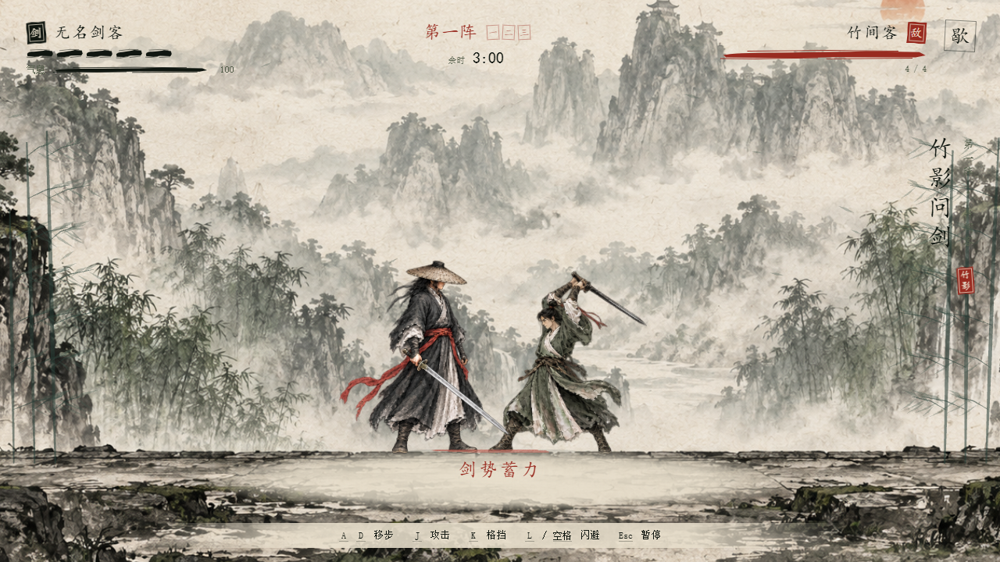

# 竹影问剑 · 水墨剑客

第二次真实使用 Three.js 游戏技能库制作的原创场景。它将侧视剑斗、暖纸墨色、朱红预告和三轮对手组合成一局可玩的小游戏，与暴风港运输游戏保留独立入口。



试玩：<http://127.0.0.1:4191/1008_codex_project/005-threejs-game-skills/ink/>。

## 如何玩

180 秒内依次击败竹间客、破阵者、墨影。玩家五格生命、气息上限 100；敌人生命为 4 / 5 / 6，后两场交替使用更慢但伤害更高的重斩。

- A / D 或左右方向键移动；J 出剑；K 格挡；L / 空格闪避；Esc / P 暂停。
- 朱红蓄力接近满时格挡：起手 0.22 秒内可接住出剑，敌人失衡后立即攻击，造成三点伤害。一次强反击消耗该破绽。
- 普通出剑在敌人收招或靠近时造成一点伤害；敌人蓄力和出剑期间会防住攻击。
- 攻击消耗 14 气息、格挡 24、闪避 28；停手恢复。闪避早段可避伤，冷却 0.8 秒。
- 每过一阵恢复一格生命和全部气息。三阵全过获胜，生命或余时归零失败；可暂停、重开、静音和减少动态。
- 手机布局提供左右按住按钮及斩 / 御 / 闪按钮；失焦与页面隐藏自动暂停并释放输入。

## 实际应用的沉淀能力

原仓库 [majidmanzarpour/threejs-game-skills](https://github.com/majidmanzarpour/threejs-game-skills)，作者 Majid Manzarpour，MIT。固定提交 `8286774b22a2566bf894dbc825825c16921866af`，2026-10-09，Asia/Shanghai；保留 [LICENSE.upstream](LICENSE.upstream)。

| 读取的技能 | 本次落点 | 具体约束 |
| --- | --- | --- |
| director | 玩家目标、核心循环、三轮关卡、接口契约；按其明确要求分工制作图形和 UI | 单个 Game 持有状态与主循环；制作记录与证据清单 |
| gameplay | 实际运行上游脚手架，保留主循环和渲染创建器；重写剑斗模拟 | 固定 1/60 秒模拟，攻击范围、动作时长、格挡窗口、气息、冷却、胜负写入代码 |
| graphics | 第二版以干笔山水、完整人物衣袍和动作、笔触刀光建立风格 | 透明图集选帧、单独完整攻击姿态、脚底锚点、衣摆变形；特效读取实际战斗状态 |
| image-generator 方法 | 按素材类型、透明背景、动作布局和实际使用效果检查素材，改用内置 image_gen 提供图像 | 六次生成与编辑；跨格刀尖不能直接使用，修为独立攻击文件；不声称调用上游 Gemini API |
| UI | 状态优先级、完整菜单、反馈与手机操作 | UI 只读 UiFrame；输入通过 Controls；指针取消、失焦、暂停清理；可滚动菜单和焦点管理 |
| debug | 实际画布、GPU、控制台及 renderer.info 诊断 | 原画布脚本；生产测试接口仅显式 ?qa=1 开放；普通试玩不暴露测试钩子 |
| QA | 实际输入进度、失败重开、视口截图与证据检查 | 真实键盘测试不设置关卡进度；截图状态通过独立契约确认；运行上游 check_evidence.py |

[skill-usage.json](artifacts/skill-usage.json) 保存实际读取资源与来源哈希。新增实现见 Simulation、InkWorld、InkInput、InkUI、InkAudio；第二版美术与 UI 的过程见 [art-notes-v2](artifacts/art-notes-v2.md)、[ui-notes-v2](artifacts/ui-notes-v2.md)，[素材和提示词来源](../../assets/ink-art/README.md)。

库提供制作顺序、工程起点、参考方法和验收工具。水墨风格、剑客、战斗规则和关卡由本实验编写；库没有修改模型参数，也没有内置这款游戏。一次案例不能量化相对同模型直接开发的净收益，尚未进行 A/B 对照。

## 运行与验证

Windows、Node.js 22.15.0、npm 10.9.2；独立 Three.js 0.184 / TypeScript 6 / Vite 8 工程。初始锁文件沿用模板修复结果；本项目随后运行 npm audit fix 更新构建链补丁，记录见 .cache/audit-before.json（本地留档），修正后审计为零漏洞。

```powershell
npm.cmd ci
npm.cmd run build
npm.cmd run dev
```

开发端口 5198，生产预览 `npm.cmd run preview` 为 4198。整合后的 ink/ 使用相对资源路径，返回按钮通过 ../ 回到研究页。

```powershell
npm.cmd run test:simulation
npx.cmd playwright install --no-shell chromium
npm.cmd test
# 保持生产预览运行后：
npm.cmd run verify:visual
npm.cmd run test:visual
python ../../upstream/skills/threejs-game-director/scripts/check_evidence.py . --manifest artifacts/evidence.json
```

实际结果、截图使用方式与边界见 [final-evidence.md](artifacts/final-evidence.md)。测试执行同一 Simulation，并通过浏览器实际键盘 / 指针输入验证；状态设置仅用于截图，不代替通关证明。

## 来源、风格与限制

本工程由上游 create_threejs_game.py 实际生成；main.ts、Loop.ts、Renderer.ts 和画布检查脚本逐字保留。random.ts 为模板保留但本玩法未调用：剑斗规则是确定性的，seed 42 为证据协议标记，不影响战斗。其余原模板模块留作参考，当前入口没有运行旧收集玩法。

这是原创 2.5D 短局。第一版是程序化纸纹、山林与关节几何；第二版使用内置 image_gen 绘画素材，通过 Three.js 正交镜头、透明贴片选帧、脚底对齐、衣摆变形和事件特效呈现，范围检测实现剑斗。人物只有有限姿态，尚无连续骨骼绑定动画；没有真实阴影和后处理。音效由 WebAudio 合成，尚未验证听感。手机检查使用桌面 Chromium 视口模拟，未验证真实手机 GPU、Safari 和多指触屏。当前未在线发布。
