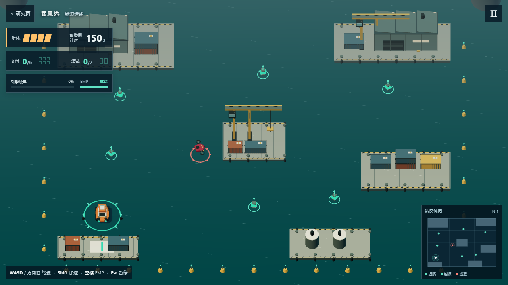

# 暴风港 · 能源运输

这是一次真实使用 Three.js 游戏技能库的制作实验。读取技能、运行上游脚手架，从其工程起点开发新的港口运输游戏，再用实际键盘、指针、模拟行为和 WebGL 画布报告验证。



画面来自生产构建的真实 WebGL 渲染，种子 42、出航状态。程序化港口和游戏实现由本实验新增。截图不是概念图，场景可实际操作。

本地整合入口：<http://127.0.0.1:4191/1008_codex_project/005-threejs-game-skills/play/>。

## 如何玩

风暴封港前，把六枚应急能源运回西南青绿基地。驶近能源自动拾取，每次最多两枚；驶入基地自动交付并修复一格艇体。150 秒耗尽或四格艇体归零失败，六枚交付获胜。

- WASD / 方向键驾驶；Shift 加速；空格释放 EMP；Esc / P 暂停。
- 手机布局使用左侧摇杆与右侧加速、EMP 按钮。
- 加速产生热量，过热后强制冷却至 25% 才能恢复加速。
- EMP 影响七米内巡逻机，禁用 3.5 秒，冷却九秒。
- 每交付两枚增加一架巡逻机。先做西侧短途，随后绕中央码头走北侧，最后完成南侧航段。
- 暂停界面可静音和减少动态；失焦自动暂停；失败与胜利都可重开。

## 实际用了哪些技能

原库：<https://github.com/majidmanzarpour/threejs-game-skills>；作者 Majid Manzarpour；研究提交 `8286774b22a2566bf894dbc825825c16921866af`；MIT，保留 [LICENSE.upstream](LICENSE.upstream)。2026-10-09，Asia/Shanghai。

| 实际读取的技能 | 提供的制作方法 / 复用物 | 本次落实 | 如何限制 |
| --- | --- | --- | --- |
| threejs-game-director | 先玩家目标和循环，再关卡、实现、验证；模块与证据契约 | design-brief、core-loop、level-plan；统一 Controls / UiFrame / WorldFrame；按其明确分工要求开展图形和 UI 协作 | 一个 Game 持有模拟状态与主循环；提交说明必须区分检查与未验证项 |
| threejs-gameplay-systems | create_threejs_game.py 工程、固定循环、手感和物理选型参考 | 实际生成本工程；保留 Loop / Renderer / seeded random；重写运输、热量、EMP、碰撞和三阶段航线 | 1/60 固定模拟步长；圆与 AABB 碰撞；装载上限、热量门槛、冷却、胜负条件写进代码 |
| threejs-aaa-graphics-builder | 轮廓 → 材质 → 灯光 → 状态细节；共享素材和性能预算 | Extrude 船体、Lathe 浮筒、吊机、仓库、容器、能源和巡逻；共享角色材质、按材质合并几何 | 一盏 1024 阴影灯，无后处理；目标不受雾 / 色调映射冲淡；效果读取真实状态 |
| threejs-game-ui-designer | 生存 / 目标 / 反馈层次、完整状态与移动输入规范 | 中文菜单、HUD、暂停、胜负重开、真实港区简图、触控摇杆；焦点管理和取消释放 | UI 只读 UiFrame 并发送 UiIntent；触控目标至少 44 px；失焦清除输入；单次 Esc 只切换一次 |
| threejs-debug-profiler | 实际 canvas、GPU、错误、渲染统计的诊断流程与检查脚本 | 运行原 inspect-threejs-canvas.mjs；实测桌面 / 手机布局和后期状态 | 诊断仅 DEV 或显式 ?qa=1 开放；普通生产试玩没有全局测试钩子；预算通过不等于帧率通过 |
| threejs-qa-release | 输入推进、失败重开、软锁、状态截图与交付检查参考 / 测试模板 | 改写真实键盘航线和指针摇杆测试；保存六份画布报告；实际运行原 check_evidence.py | 通关测试不调用进度设置；截图报告按 runId / state 契约核验；截图设置状态仅用于画面检查 |

具体读取文件及 SHA-256 见 [skill-usage.json](artifacts/skill-usage.json)。美术与 UI 的逐项转化见 [art-notes](artifacts/art-notes.md)、[ui-notes](artifacts/ui-notes.md)。这六个技能是制作时实际读取并遵循的本地文档，没有安装到全局技能目录。

## 库的价值与模型的工作

这次能观察到的价值是：得到可运行工程起点、按顺序推进的制作清单、可复用诊断脚本和明确证据结构。它让“读懂规范 → 写出实现 → 看真实结果 → 修正 → 留下证据”有具体落点。

港口、运输逻辑、巡逻、热量、EMP、UI 和合成音效仍由模型在本实验中编写。库不附带这款成品，也没有改变模型参数。实际画面曾把能源和巡逻的颜色冲淡，仍需观察、定位雾与色调映射的问题，再修改对应材质。

这是一次应用案例，不能单独证明比同模型直接开发更快或质量更高。尚未进行同需求、同资源、同预算的 A/B 对照。Tripo、Gemini、ElevenLabs 三种素材服务没有调用；音效使用原创 WebAudio 合成，不代表音频生成技能被验证。

## 运行与验证

Windows，Node.js 22.15.0、npm 10.9.2。运行依赖在此项目独立维护；锁文件固定 Three.js 0.184、Vite 8、TypeScript 6。首次依赖锁文件修复沿用模板复现实验的结果。

```powershell
cd projects/005-threejs-game-skills/experiments/storm-harbor
npm.cmd ci
npm.cmd run build
npm.cmd run dev
```

开发入口 <http://127.0.0.1:5197/>。生产独立预览运行 `npm.cmd run preview`，入口 <http://127.0.0.1:4197/>；独立根路径预览中的“研究页”返回根路径，整合在 `play/` 后正确返回研究页。

```powershell
npm.cmd run test:simulation
npx.cmd playwright install --no-shell chromium
npm.cmd test
```

浏览器测试使用完整 GPU Chromium 和一个 worker。三个针对性场景分别在对应设备项目执行，另外三项组合按设计跳过。QA 钩子只用于诊断与状态检查；通关、失败、摇杆测试从菜单通过实际输入推进。

画面检查需要先保持 4197 的生产预览运行：

```powershell
npm.cmd run verify:visual
python ../../upstream/skills/threejs-game-director/scripts/check_evidence.py . --manifest artifacts/evidence.json
```

检查器与上游源码通过项目 [notes.md](../../notes.md) 中的方法获取。当前运行记录、真实指标、失败尝试和验证边界见 [final-evidence](artifacts/final-evidence.md)。

## 来源和改动范围

本工程由固定提交的 `skills/threejs-gameplay-systems/scripts/create_threejs_game.py` 生成。运行中继续复用上游 `src/main.ts`、`src/core/Loop.ts`、`src/core/Renderer.ts`、`src/utils/random.ts`，以及 `scripts/inspect-threejs-canvas.mjs`。这些文件的逐字一致性记录在 skill-usage.json。

Game、Simulation、level、contracts、HarborWorld、HarborUI、HarborInput、HarborAudio、HTML / CSS 和本实验测试为新写 / 重写。模板其他 entity / system 与原始测试模板保留供参考，但游戏入口没有导入它们；没有把未使用的模板模块当成本实验运行能力。包名、相对 base、端口、QA 配置与诊断类型在副本修改。上游原版小游戏继续独立保存在 `../scaffold/`。

不引入外部游戏资产，不读取 API 密钥。程序化美术和合成声音来自本实验代码；不宣称 AAA 品质、完整真实手机性能或已验证听感。已通过独立生产构建，接入 Web 时完整复制 `dist/` 到 `web/dist/play/`，相对资源路径为 `base: './'`。
