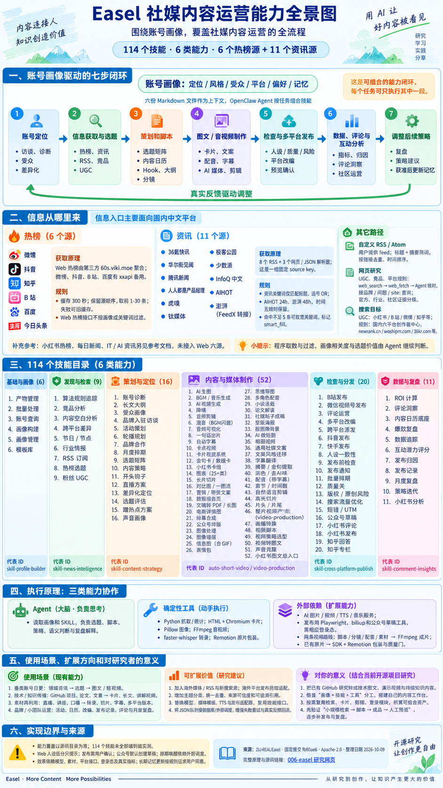

# 006 · Easel 社媒智能体研究

围绕账号画像，覆盖社媒内容运营的全流程。从固定源码整理114个技能、8个系统模块、信息来源与过滤、媒体制作、平台发布、评论和反馈，说明使用场景、个人研究价值、复用路线与可扩展方向。

[返回总索引](../../README.md) · [原仓库](https://github.com/ZJU-REAL/Easel) · [研究笔记](notes.md) · [素材说明](assets/README.md)

## 基线与交付

| 项目 | 内容 |
| --- | --- |
| 编号 | `006`，目录 `projects/006-easel/` |
| 研究提交 | [`fb80ae6dd6fc26f5553efcb293ee6d93ef253f02`](https://github.com/ZJU-REAL/Easel/commit/fb80ae6dd6fc26f5553efcb293ee6d93ef253f02) |
| 上游提交时间 | 2026-10-07 08:32:22 UTC |
| 源码研究日期 | 2026-10-09 |
| 完整理解整理日期 | 2026-10-12 |
| 上游许可 | Apache-2.0；保留 [原始许可](src/LICENSE.upstream) |
| 交付 | 独立静态研究网页；全部 114 个 Skill、8 个系统模块、27 条来源路径、制作发布链路与核验记录 |
| 在线部署 | [完整理解与能力图谱](https://yydshly.github.io/1008_codex_project/006-easel/)；已接入统一GitHub Pages并核验公开HTTPS，状态和验证范围见[发布记录](src/publication-verification.json) |

## 我们对项目的完整理解

**定位与能力**：Easel 把账号定位、信息获取与选题、策划脚本、图文音视频制作、检查与多平台发布、数据评论分析、策略调整组织在账号画像周围。114 个技能让个人或小团队按任务调用一段或多个环节，六份 Markdown 保存定位、风格、受众、平台、偏好和记忆。

**模块与原理**：八个系统模块以 OpenClaw 为编排核心：Agent 读画像与 SKILL 决定行动，Python 工具获取和过滤信息、管理文件与状态；HTML/Chromium、Pillow、FFmpeg、faster-whisper 和 Remotion 分别承担排版、图像、合成、转录与原片包装，外部模型和平台适配器承担生成与发布。

**信息与产出**：信息入口主要面向国内：微博、抖音、知乎、B站、百度、头条六个热榜，以及8个RSS和3个网页/JSON资讯解析器。程序取数与筛选之后，Agent 结合画像评估相关度和选题；可留下带来源的情报、内容策略、脚本分镜、图文音视频、平台稿件或公众号草稿，以及发布和复盘记录。

**场景与个人价值**：既可运营垂类账号、品牌活动和评论，也可把自己的 GitHub 项目研究、论文和文章转成技术卡片、长文与讲解视频，或将讲座和口播改为切片和多平台版本。对当前研究的直接价值是积累可复用的来源、画像、写作规则、媒体模板和产物，逐步形成自己的内容工作台。

**复用与扩展**：可以只借用技能文档和来源清单、独立复用媒体与统计脚本、运行完整工作台，或接入自己的系统。后续可扩展海外信源与平台、统一去重和引用、带出处的检索、人工审稿、数据库队列、账号权限、成本观测及真实反馈评测；这些方向要补充工程实现和验证。

**范围与边界**：研究保留固定提交fb80ae6、Apache-2.0许可及5项通过/1项Windows自检失败的记录。技能目录覆盖不等于全部端到端实测；Web预检主要提醒且检查母版，公众号默认创建草稿，定时队列的实际发送依赖Agent/调度。发布网页提供可追溯研究和原图，不运行模型、社媒登录或真实发布服务。

## 能力全景图



[打开原图](assets/capability-map.png) · [完整生成规格与文字内容](assets/capability-map-prompt.md)

2026-10-09 使用内置 image_gen 生成的中文研究说明图，依据固定提交和已整理的事实清单。覆盖七步闭环、全部 114 个技能展示名、国内热榜和资讯来源、执行分工、使用场景、扩展建议以及对开源项目研究的价值。技能名称在图中使用简写，精确 id、原理和源码证据见网页完整目录。扩展价值与“对你的意义”属于结合本研究用途的建议。原生图片尺寸 941×1672；目标版式和全部文字保留在生成规格中。

## 本地打开

Node.js 22+，网页无第三方依赖；不需要 Easel 的模型 key、社媒登录或 Python 环境。

```powershell
cd F:\codex_project\1008_codex_project\projects\006-easel\web
npm.cmd ci
npm.cmd run build
npm.cmd run preview
```

访问 [本地研究网页](http://127.0.0.1:4206/1008_codex_project/006-easel/)。产物在 `web/dist/`，资源使用相对路径。Hash 路由可直接打开和刷新，例如 `#search`、`#capabilities?layer=discover`。

网页六个章节（完整理解可在禁用脚本时阅读；检索、筛选和详情使用JavaScript）：

1. **项目与架构**：实际 Agent 调用结构、8 个系统模块与适用场景。
2. **搜索与过滤**：端点、抓取方式、解析字段、关键词、时间窗、去重、排序、缓存与降级；离线样本实验台对照程序规则。
3. **全部能力**：114 项全文检索与分层筛选；每项有能力、原理、流程、引用工具、完整 Skill 原文与缺失引用提示。
4. **制作与发布**：六维画像到脚本、FFmpeg／模型／Remotion 制作路线，以及 Web 预检与各平台分发的实际行为。
5. **场景与扩展**：6类场景、4项个人价值、4条复用路线、8项待开发方向及边界。
6. **源码与验证**：固定提交行号、关键结论、离线通过／失败项与覆盖范围。

## 完整摘要与执行原理

- **定位**：以六维账号画像组织上下文，由 OpenClaw Agent 按任务组合检索、策划、创作、发布和复盘，形成可选择环节的社媒运营闭环。
- **能力**：114 个技能分为基础画像 6、发现检索 9、策划定位 16、内容媒体 52、检查分发 20、数据复盘 11；逐项保留能力、机制、流程和原文。
- **模块**：画像、Agent 编排、React/FastAPI 工作台、文字知识创作、确定性媒体、生成模型适配、SDK/Remotion 原片产线、平台分发与复盘八部分协作。
- **原理**：画像 Markdown 与 SKILL 指导 Agent 决策；Python 固化获取、过滤、统计和状态，FFmpeg/Pillow/Chromium 处理媒体，生成与发布通过外部服务或平台适配器。
- **信息源**：主要面向国内：微博、抖音、知乎、B站、百度、头条六个热榜；8个RSS加36氪、华尔街见闻、腾讯新闻，共11个资讯源，另有自定义RSS、网页研究和账号资料。
- **搜索过滤**：热榜通过第三方聚合和备用接口取数、缓存300秒；资讯筛标题且不足5条会放宽；自定义RSS筛标题和摘要、去重排序；画像语义判断由Agent完成。
- **制作分发**：支持文案、卡片、图像、配音、字幕、剪辑和短视频；FFmpeg分镜合成与Remotion原片包装两条路线，向小红书、抖音、B站、公众号、快手、视频号、知乎适配。
- **反馈**：发布记录、指标快照、归因、ROI、评论洞察、社区运营和复盘建议组成后续环节；真实数据和用户获准的记忆更新用于调整策略。
- **场景**：垂类账号日常运营、GitHub与论文知识传播、直播口播素材再利用、品牌活动、评论维护及多平台内容协作；每种场景说明输入、产物和条件。
- **价值**：把开源研究转成可持续图文与讲解内容，复用画像—技能—工具分工；可分别借用技能规则、媒体脚本、完整工作台或自建系统接口。
- **方向**：海外信源与发布适配、来源治理、检索与知识库、人工审核、数据库调度、多账号权限、成本观测和真实反馈评测；八项均为研究建议。
- **边界与验证**：固定fb80ae6、Apache-2.0；5项离线核验通过、1项上游Windows自检失败。未运行全部技能或真实发稿；公众号默认草稿，队列执行依赖上层Agent与外部调度。

### 七步运营闭环

01. **账号定位**：访谈目标、领域、风格与受众，读取可访问账号资料，生成和维护六维画像。 产出：identity/style/audience/platforms/preferences/memory。
02. **信息获取与选题**：热榜、资讯、RSS和网页研究先取得证据，再由Agent结合画像判断相关度、时效和创作价值。 产出：带来源的情报、候选选题与选择理由。
03. **策划和脚本**：将方向组织成内容矩阵和排期，编写Hook、大纲、台词、镜头、字幕与封面建议。 产出：内容策略、脚本、分镜与日历。
04. **图文／音视频制作**：按任务选择排版、图像、音频、字幕、视频工具和外部模型；FFmpeg合成短视频，原片包装走SDK/Remotion。 产出：卡片、文章、音频、字幕、成片与项目文件。
05. **检查与多平台发布**：按平台改编，检查质量、人设与风险，预览确认，再调用对应平台适配器；公众号入口交付草稿。 产出：平台版本、预检报告、稿件或草稿与状态。
06. **数据、评论与互动分析**：采集真实指标和评论，记录发布，计算统计，组织评论洞察、互动回复建议和效果复盘。 产出：指标、日志、归因、评论分类与运营建议。
07. **调整后续策略**：结合真实结果解释内容表现，更新下一轮选题、风格和排期；长期画像记忆按规则获准后写回。 产出：复盘结论、策略方案与获准的记忆更新。

### 八个系统模块

| 模块 | 技术与执行原理 |
| --- | --- |
| 账号画像 | identity / style / audience / platforms / preferences / memory。六份 Markdown 文件分别保存定位、风格、受众、平台、偏好和记忆。Web 表单确定性生成初稿，再后台增强；每轮传画像名和路径，由 Agent 读取。 |
| Agent 编排 | OpenClaw + SKILL.md。CLI 和 Web 把“请执行 /技能”及输入交给 OpenClaw subprocess。任务可按需组合发现、策划、制作、发布与复盘，不强制每次跑完整五步。 |
| 工作台与数据 | React / TypeScript + FastAPI。会话流、模型与画像配置、内容库、媒体预览、热榜、选题池、内容日历、登录与发布中心。后端连接文件、Agent 和工具；不是静态宣传站。 |
| 文字与知识创作 | LLM + 字数 / 状态脚本。语言模型负责文案、脚本、策略与解释。Python 固化字数、状态和统计，帮助跨章、跨镜续作；没有附带自训练文本基础模型。 |
| 确定性媒体 | FFmpeg / Pillow / Chromium。FFmpeg 做音视频处理与合成；Pillow 做图片操作；HTML/CSS 在 Chromium 中截图成卡片。ASR、去背景等另用本地模型。 |
| 生成模型适配 | 图片 / 视频 / TTS / 音乐 provider。统一脚本读取环境配置，向外部服务提交任务、轮询、下载。能力依赖服务开放、模型、费用和 key；内网 MaaS 路线不是普遍可用接口。 |
| 原片包装产线 | video-pipeline-sdk + Remotion。薄壳转发给仓库内置 SDK；带运行态、问题／作答、程序质量门、设计表与预览人审停点。与 FFmpeg 配图短视频是两条不同路线。 |
| 平台分发与复盘 | Playwright / biliup / 公众号草稿。发布按平台走不同适配器，成功后记录日历和日志。再从真实数据计算表现，Agent 给改进建议；长期记忆写回需按规则征求用户同意。 |

### 使用场景与产物

| 场景 | 输入与过程 | 产出与条件 |
| --- | --- | --- |
| 垂类账号日常运营 | 账号画像、指定领域、资讯来源和目标平台；收集热点／资讯，评估选题，组织日历，再创作与预览 | 情报简报、候选选题、脚本和图文／短视频；持续提供自己的判断与真实效果数据；主题筛选需要核对补充项。 |
| 开源项目与技术知识传播 | 已核对的GitHub研究、源码说明和演示素材；抽取问题、原理和价值，转成大纲、技术卡片、长文或讲解脚本 | 带出处的介绍内容、配图、字幕和演示视频；保留版本、许可与来源；用真实项目效果支持能力描述。 |
| 论文与文档解读 | 用户文档、PDF、arXiv资料及论文图表；定向摄取与Agent解读，按受众组织图文或讲解 | 知识卡片、论文解读、公众号排版或讲解视频；核对公式、图表和引用；这是资料输入路径，未提供全学术库持续索引。 |
| 直播、讲座和口播再利用 | 有使用权限的音视频、台词和品牌素材；转录、分章、高光切片、字幕、配音、重构画幅与包装 | 短切片、字幕稿、图文文章与各平台媒体版本；按素材选择FFmpeg工具或原片SDK，预览声音、字幕与画面。 |
| 品牌活动与小团队协作 | 品牌目标、受众、活动档期、素材和账号权限；访谈、活动／合作方案、内容矩阵、多平台改编与排期 | 活动方案、日历、成品、派发计划与发布记录；登录态、授权和平台条件要齐备；团队权限和持久任务调度需要进一步建设。 |
| 评论维护与反馈复盘 | 自己的可访问评论、发布日志、指标和历史内容；需求／情绪归纳、回复建议、负面反馈分级、数据与内容复盘 | 评论洞察、互动草稿、改进选题和策略调整；评论写操作需用户授权；建议、指标计算和真实因果结论分别判断。 |

### 对当前开源研究的意义

- **让研究成果成为持续内容**：把已核对的开源项目理解转成技术图文、脚本和演示视频。来源、版本与边界继续保留，便于用同一份研究适配不同受众。 一次源码分析可派生结构图、公众号长文、小红书卡片和B站讲解脚本；发布仍需预览与平台条件。
- **积累自己的内容资产**：六维画像、模板、素材索引、脚本、分镜和产物形成可复用文件资产。后续研究能接着沿用风格和写作规则，减少重复组织。 为“开源项目研究”维护受众和风格画像，保存图文模板，并保留每个项目的输入和成品。
- **理解Agent和工具怎样分工**：可研究Agent的判断如何通过技能规则落到确定性工具，再将模型、抓取、媒体和平台接口分别维护。这个组织方法也适用于其他有产物的任务。 先借用RSS过滤和卡片渲染，再按需要接脚本、语音或原片包装，保持每段输出可检查。
- **为自己的工作台提供起点**：可以按需复用技能文档、来源清单、媒体脚本和发布适配器，逐步形成自己的知识传播与内容运营流程。投入取决于目标、依赖和平台维护。 先跑通“选源→脚本→成品→人工预览”，用真实反馈决定是否投入自动排期与多平台分发。

### 四条复用路线

- **借用资料与技能规则**：SKILL.md、画像结构、选题／创作流程和来源清单。准备条件：选择适合任务的模型与工具，保留来源与规则边界。第一步：先在已有研究材料上完成一篇带出处的内容和预览稿。
- **独立复用工具链**：RSS、过滤、卡片、音视频、统计和状态脚本。准备条件：为所选工具配置Python／FFmpeg／Chromium或模型依赖；核对输入输出。第一步：只选择一个信息源和一种成品形式，逐段确认获取、过滤与媒体质量。
- **运行完整工作台**：React/FastAPI界面、OpenClaw、账号画像、工具与平台适配。准备条件：按上游安装运行环境，配置模型服务和必要登录态；当前研究站不提供该后端。第一步：先做本地素材的单任务，验证文件产物、会话与预览，再接来源和平台。
- **接入自己的运营系统**：可复用文件结构、技能接口与工具，另建业务、账号、队列和审核层。准备条件：设计持久状态、任务幂等、授权、观测和真实反馈数据模型。第一步：把已验证的最小链路包装成任务接口，保留输入、状态、产物与用户确认。

### 八项可扩展方向（研究建议）

- **海外与垂直信源**：已有基础为已有自定义RSS和Agent网页研究入口。需要补充：增加海外／行业feed、语言与时间窗配置、来源注册和可用性监测；海外发布平台需另做适配。 价值：让同一套内容流程覆盖更广的信息与受众。
- **来源治理与统一过滤**：已有基础为热榜、资讯和RSS目前有不同程序规则。需要补充：统一去重、主题标签、时间与来源可信度；保留获取时间、引用和smart_fill状态，增加失败记录。 价值：让候选选题更可追溯，并能解释保留或排除原因。
- **带出处的检索与知识库**：已有基础为画像、资料、产物与Agent语义分析可复用。需要补充：为自己的研究和历史内容建立索引，回答与脚本回指具体版本和片段；记忆写入继续保留批准过程。 价值：复用已核对知识，同时减少来源和版本混淆。
- **审核与平台版本检查**：已有基础为已有质量、人设、风险Skill和Web用户确认。需要补充：增加独立审核状态、逐平台有效文案与媒体检查、明确阻断规则和复核记录；区分模型建议与程序约束。 价值：让内容交付与发布决策更容易检查和追责。
- **持久队列与调度**：已有基础为已有JSON排期和派发计划。需要补充：接数据库、外部调度和执行worker，补幂等、超时、重试、部分成功恢复及明确的人工接管状态。 价值：将单次工具调用推进为可维护的持续运营流程。
- **多账号与团队权限**：已有基础为已有画像、平台登录态和内容工作台。需要补充：补账号隔离、角色权限、凭证管理、审批与操作记录，并核对各平台写操作授权。 价值：支持团队协作时保护账号边界和发布责任。
- **模型、成本与运行观测**：已有基础为已有多种媒体provider和确定性工具。需要补充：记录模型、版本、参数、耗时、费用、失败和产物；支持provider替换、预算与小样评估。 价值：能按目标比较质量和投入，定位链路中不稳定的步骤。
- **真实反馈与效果评测**：已有基础为已有发布日志、指标和评论复盘Skill。需要补充：明确采集时间与指标口径，关联内容版本和平台，补对照实验与人工反馈，区分相关性和效果原因。 价值：让下一轮策略基于可核对的数据，而不是只依赖模型评分。

详细结构化资料见 [publication.json](web/publication.json)。以上扩展与个人用途属于研究归纳；实际能力与实现证据沿用固定基线。

## 研究结论

Easel 是 OpenClaw Agent 驱动的社媒内容工作台。用户提出任务，画像提供账号上下文，Agent 读取需要的 Skill，再调用检索、媒体、模型与发布工具。“定账号方向→搜索→制作视频→发布”是一种可组合任务，而不是后端规定每次必须执行的固定流水线。

### 全部技能按实际目录计数

| 层 | 数量 | 内容 |
| --- | ---: | --- |
| 基础与画像 | 6 | 画像构建／管理、已登录账号、模板、批处理与产物管理 |
| 发现 | 9 | 热榜、资讯、RSS、竞品、算法、UGC、内容空白、跨平台差异与事件 |
| 策划 | 16 | 定位、受众、诊断、策略、选题、Hook、大纲、矩阵、活动、合作与日历 |
| 制作 | 52 | 文字、卡片、图像、图表、音频、字幕、视频、短剧、小说和论文解读 |
| 发布 | 20 | 改编、质量／风险、人设、清单、排期、通知、短链、评论与平台发布 |
| 归因 | 11 | 日志、快照、统计、评论、内容复盘、评分、ROI、策略与外部小红书分析 |
| 合计 | **114** | 对应 114 个 `skills/openclaw/*/SKILL.md` |

上游 README 徽章仍为 113，能力地图的制作层为 51。这里以固定提交实际文件为准，不把目录数等同全部技能都在当前环境实测可用。

### 搜索与过滤的真实边界

| 路径 | 原始来源与获取 | 程序过滤 |
| --- | --- | --- |
| Web 热榜 6 源 | 微博、抖音、知乎、B站、百度、头条；`60s.viki.moe` 主源，4 个平台配置 `xxapi.cn` 备用，urllib JSON | 平台 key、300 秒缓存、原顺序截前 1–30 条；没有画像或关键词筛选 |
| 资讯专用 3 源 | 36氪 HTML，华尔街见闻 JSON、腾讯新闻 JSON | 标题关键词子串，逗号 OR，忽略大小写，每源 limit |
| 资讯 RSS 8 源 | 人人都是产品经理、虎嗅、钛媒体、极客公园、少数派、InfoQ中文、AIHOT、澎湃（FeedX 转接） | 标题关键词；只有 AIHOT 24h 和澎湃 48h，日期解析失败保留 |
| 自定义 RSS／Atom | 用户给 `--url` 或 `--feeds` 清单；urllib＋XML | 标题＋摘要关键词、`--since`、链接去重、时间排序、统一 limit；未知日期保留 |
| 网页研究 | OpenClaw `web_search`／`web_fetch`；竞品、UGC、平台规则、需求词和 `site:` 搜索 | Agent 按 Skill 核对来源、相关度、需求与时效；搜索 provider 由运行配置决定 |

资讯关键词命中不足 5 条时会无关键词补充，标记 `smart_fill`；严格主题检索不能忽略这些标记。`--deep` 只是另抓网页、清除部分标签后截前 3000 字符。普通资讯合并没有统一去重和排序。

热榜参考文档还列小红书、每日新闻、IT、AI 资讯与 03c3；这些不在 Web 六源雷达或资讯 11 源注册表内。各源当前在线可用性没有逐一实时验证，网页明确显示“源码已核对／未实时请求”。

### 制作与发布

- 六维画像是 `identity/style/audience/platforms/preferences/memory` Markdown；Web 先确定性写初稿，后台 Agent 增强，不是模型训练。
- 文案与分镜主要由 Agent 生成；卡片用 HTML/CSS＋Chromium 截图，图片编辑用确定性工具，语音转录用 faster-whisper。
- `auto-short-video` 编排配图／片段、配音、字幕、BGM，`assemble.py` 用 FFmpeg 合成。默认逐句配图＋Ken Burns 动效。已有原片包装的 `video-production` 另转内置 SDK／Remotion。
- 图片、视频、音乐、音色的生成模型由外部 provider 提供，需要配置与相应权限；适配代码不等同真实 key 验证成功。
- Web 发布前的合规与人设预检仅提醒；低人设分不阻断。预检检查母版标题正文，发布发送逐平台覆盖版本，不能视为逐平台媒体完整复审。
- “一稿多改”是单独操作，发布按钮不会自动先改编。用户确认后才调用平台发布。
- 小红书、抖音及通用网页发布走 Playwright；B站 Web 分支用 biliup。公众号 Web 路线创建**草稿**。
- `publish_dispatch.py` 生成派发计划；`publish_queue.py run --exec` 也不自行发稿。实际执行和周期唤醒依赖上层 Agent／cron。

## 实验和验证范围

5 项离线核验通过：派发约束和路由、队列状态、农历锚点、正确 Windows URI 的 RSS 完整过滤，以及资讯原始过滤函数。

上游 `rss_digest.py selftest` 在 Windows 上失败：把 `C:\...` 拼为 `file://C:\...`，本地拉取失败；原文件不改，独立实验改用 `Path.as_uri()` 调同一个原 `cmd_fetch`，摘要命中、去重、时间窗及未知日期保留通过。

[机器可读核验记录](web/verification.json) · [完整技能资料](web/capabilities.json) · [事实与行号](web/facts.json)

没有端到端运行全部 114 项、调用付费模型、登录社媒账号或真实发布。研究网页构建和浏览器验证与原 Easel 的运营效果测试是不同范围。

## 重建研究资料

需 Python 3.10+ 和访问 GitHub 的网络。源缓存在 `src/upstream/`，不提交；构建网页直接使用已生成 JSON，不依赖下载。

```powershell
python -X utf8 projects/006-easel/src/collect_upstream.py
python -X utf8 projects/006-easel/src/build_research.py
python -X utf8 projects/006-easel/src/build_facts.py
python -X utf8 projects/006-easel/src/verify_research.py
```

[来源文件校验清单](src/upstream-manifest.json) 保存路径、字节数和 SHA-256。源码脚本及差异说明见 [src/README.md](src/README.md)。

## 来源与许可

上游为 ZJU-REAL/Easel，固定 commit 见表。复制的 Skill 正文、展示名和许可来自该版本，版权归相应贡献者；保留 Apache-2.0 文本与 [署名说明](src/ATTRIBUTION.md)。

原创范围：研究整理脚本、逐技能机制说明、事实与行号整理、离线核验、HTML/CSS/JavaScript 研究界面。没有改变上游程序处理或发布规则。截图来自这份原创研究网页。
