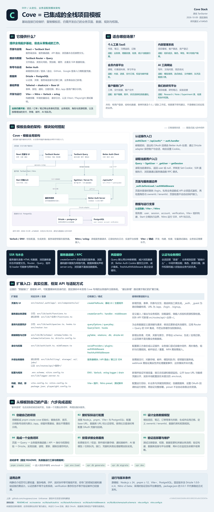
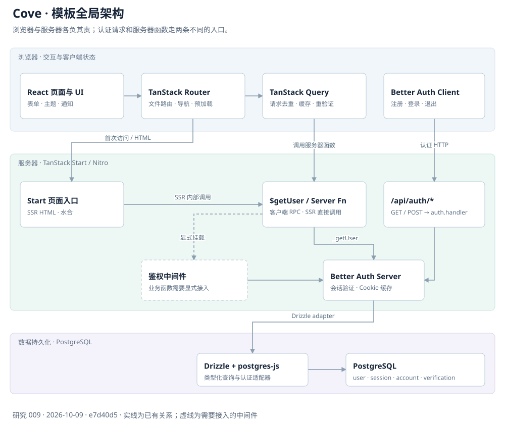
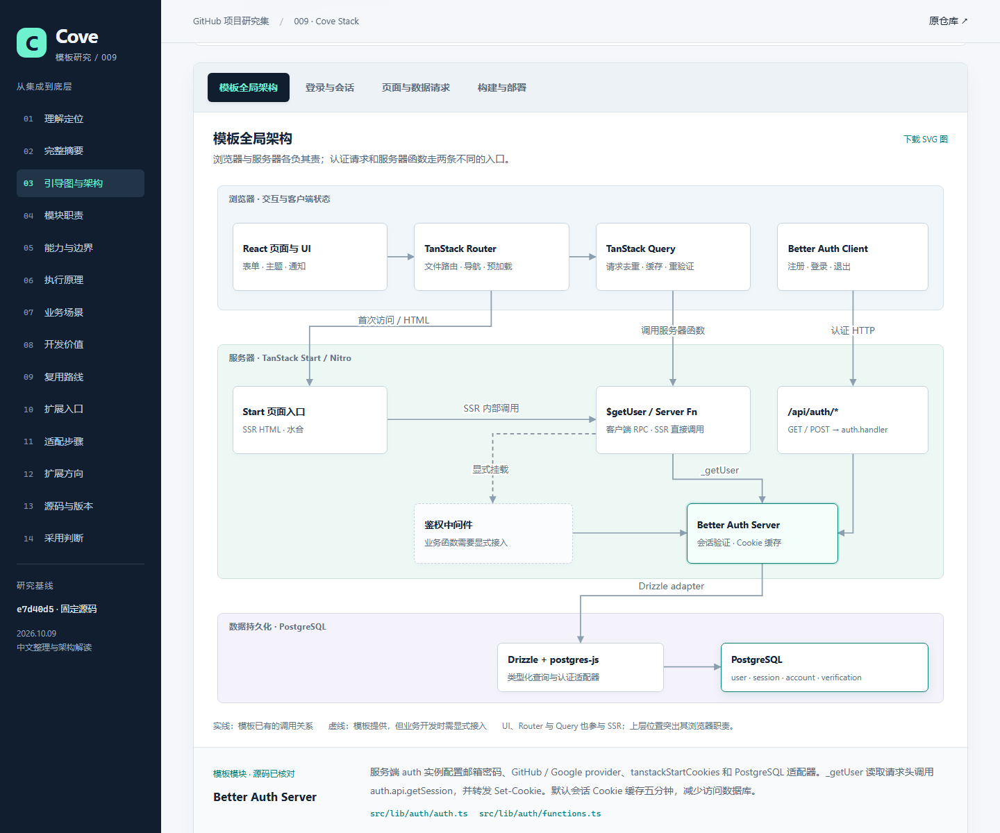

# 009 · Cove 全栈模板架构研究

用中文网页整理 Cove 的能力、执行原理、适用场景和扩展方向，并把模板模块对应回真实源码。

2026-10-12 已补全并公开部署 14 章完整理解：12 项摘要、8 组模块、6 项价值、4 条复用路线、8 处扩展接口、6 步适配与8项扩展建议。沿用既有完整原图，新增缩放阅读和资料下载；GitHub Pages 干净 Linux 环境完整构建、32 项公开 HTTPS 与真实浏览器核验均通过。

[在线完整研究](https://yydshly.github.io/1008_codex_project/009-cove/) · [可缩放原图阅读器](https://yydshly.github.io/1008_codex_project/009-cove/map.html) · [发布核验](src/publication-verification.json)

[完整理解与来源](understanding.md) · [发布内容源](web/publication.mjs) · [既有完整引导图](assets/cove-overview.png)

[返回总索引](../../README.md) · [原仓库](https://github.com/mugnavo/cove) · [研究笔记](notes.md) · [网页说明](web/README.md)

## 研究基线

| 项目 | 内容 |
| --- | --- |
| 研究日期 | 2026-10-09 |
| 固定提交 | e7d40d524b6526d80c803fd092f6fa8bf2029f8e |
| 提交日期与说明 | 2026-10-08 · chore: upgrade deps |
| 版本识别 | 按完整 commit 固定；package.json 的 0.0.1 是模板包字段，没有据此认定正式稳定发布 |
| 原仓库 | https://github.com/mugnavo/cove |
| 上游许可 | [Unlicense](https://github.com/mugnavo/cove/blob/e7d40d524b6526d80c803fd092f6fa8bf2029f8e/LICENSE)，原文保存在 [src/LICENSE.upstream.txt](src/LICENSE.upstream.txt) |
| 本项目范围 | 原创中文分析、静态研究网页、一张完整高清总览与四张交互架构图；未修改或运行上游业务模板 |
| 来源登记 | [源码清单与文件摘要](src/source-manifest.json) |
| 在线演示 | [完整中文研究](https://yydshly.github.io/1008_codex_project/009-cove/)；公开核验通过后已登记索引 demo |

## 核心理解

Cove 是一套预先集成的全栈起步模板。使用它创建项目，再增加自己的业务页面、数据库表、服务器逻辑和授权规则。它节省基础设施集成工作，业务仍需要实际开发。

已有基础包括 React、TanStack Start / Router / Query、Better Auth、Drizzle / PostgreSQL、Tailwind / shadcn/ui / Base UI、Vite+ / Nitro，以及环境变量验证、日志和轻量测试。

默认 /app 页面只演示当前用户和受保护路由；没有完整的管理后台、计费、组织权限、上传或 AI 调用。GitHub / Google 登录已有配置入口，需接入自己的 OAuth 凭据和回调设置。

## 一张图完整理解

[查看 / 下载高清 PNG](assets/cove-overview.png) · [独立可编辑图源](assets/cove-overview.html) · [生成与排版检查记录](assets/cove-overview-render.json) · [网页中的总览入口](https://yydshly.github.io/1008_codex_project/009-cove/#summary-figure)

2026-10-09 原创中文总览，2700 × 6471 像素。依据上述固定源码绘制；已有能力、配置项与建议新增模块均有说明。“预留接口”对应框架 API、配置与目录约定，固定源码中未发现 Cove 专用的业务插件注册系统。

单图将网页中的八类能力合并为六组基础，整理六类场景、四条模块调用说明、四个核心机制、八个扩展入口、六步适配和启动命令。架构模块复用本项目原创 SVG，中文和路径由代码排版，图源自包含，可离线打开；高清图已接入研究网页。

## 模板架构

网页提供四张架构图，点击模块可读取职责、执行边界和固定提交的源码链接。

1. **模板全局架构**：浏览器页面、Router、Query、认证客户端、SSR、服务器函数、认证 API、会话、中间件、Drizzle 与 PostgreSQL。
2. **登录与会话**：邮箱密码流程、可选 OAuth 分支、认证请求、数据库持久化和 Cookie。
3. **页面与数据请求**：首次 SSR、_auth.beforeLoad、authQueryOptions、$getUser / _getUser、getSession、查询状态恢复及后续浏览器导航。
4. **构建与部署**：源文件、Vite+ 和插件、浏览器包、服务器包、Nitro 运行和部署条件。

图为本项目根据固定源码原创绘制；虚线表示模板提供但业务需要显式接入的中间件，不代表 $getUser 自动挂载了它。

[登录与会话图](assets/architecture-login.svg) · [页面与请求图](assets/architecture-request.svg) · [构建与部署图](assets/architecture-build.svg)

2026-10-12 公开网页的实际浏览器截图；展示本项目原创研究网页。[手机截图](assets/mobile.png) · [浏览器验收记录](src/public-browser-checks.json)

### 关键连接

- 页面路由来自 src/routes，生成 src/routeTree.gen.ts；_auth / _guest 为路径隐藏的布局，URL 为 /app、/login、/signup。
- src/router.tsx 创建 Router、QueryClient 和 SSR Query 集成；Router 和 Query 也参与服务器渲染。
- 认证客户端的注册、登录、退出请求走 /api/auth/*，GET / POST 由 auth.handler 处理。
- 当前用户查询走服务器函数 $getUser，内部 _getUser 读取请求头并调用 auth.api.getSession，转发 Set-Cookie，返回 user 或 null。
- Better Auth 用 Drizzle adapter 访问 PostgreSQL；数据库模块声明 server-only。
- Query 客户端缓存与 Better Auth 五分钟 Cookie 会话缓存分别减少两段请求；它们不等于会话有效期。
- authMiddleware / freshAuthMiddleware 是可复用的服务器鉴权工具，业务服务器函数或 API 需要显式接入；角色和资源归属仍须自行校验。

## 能力、业务和扩展

网页包含 8 类能力及边界、6 个执行原理、6 类业务场景、6 个扩展方向和 18 组源码职责映射。

上述六个扩展方向是 2026-10-09 初稿分组。完整发布版进一步分为业务数据、组织授权、支付权益、文件内容、邮件通知、AI / 任务队列、检索报表和运行维护八项，分别说明位置和建议验收，均属于待开发方向。

价值方面，模板帮助复用基础接线、维护类型与执行边界、理解身份和授权分工、学习全栈链路、沉淀自己的工程起点和选择运行服务；实际省时或性能提升未量化。使用时可整体采用、参考连接方法、择取模块，或建立我们的研究工作区。详细说明见完整理解。

适合有账号、结构化数据、表单列表和工作区的业务，例如个人工具、内部管理、会员内容、AI 工具外壳和客户门户。场景判断为本项目基于技术组合提出的建议，不是上游已实现功能。

以本仓库的研究平台为例，可增加 Project / Research、Note、Experiment 等数据模型，实现收藏、笔记和实验记录；后续按需接组织授权、支付、文件 / 邮件、AI / 队列和运行监控。网页中建议新增的路径均有标记。

## 本地构建与访问

研究网页是原创的 HTML / CSS / JavaScript 静态站点，无第三方运行依赖。只需要 Node.js ≥ 22；不需要 PostgreSQL 或 OAuth 凭据。

~~~powershell
cd projects/009-cove/web
npm.cmd ci
npm.cmd run build
npm.cmd run preview
~~~

访问 [本地研究网页](http://127.0.0.1:4209/1008_codex_project/009-cove/)。

独立产物位于 web/dist/。所有网页资源使用相对路径，预览服务默认监听 127.0.0.1:4209，支持完整子路径、高清总览和图源、SVG 下载、项目说明和验证记录。

~~~powershell
node scripts/serve.mjs --dir dist --port 4209 --base /1008_codex_project/009-cove/
~~~

原始 Cove 模板的运行条件是 Node.js ≥ 24、pnpm ≥ 12、Vite+ 和 PostgreSQL，还需配置认证密钥和环境变量。本文研究网页的构建成功不代表已经验证原模板的登录或部署。

## 验证范围与限制

本研究固定源码并检查实际模块、调用关系、认证表、缓存、路由及依赖版本；验证独立静态构建、总览 PNG 加载 / 下载与图源一致性、子路径资源、四图切换、模块详情、键盘和窄屏展示。实测结果与截图见研究笔记和 assets/。

没有运行 Cove 后端、真实 OAuth、数据库迁移或部署性能测试。固定版本含 Drizzle v1 RC 与 Nitro v3 beta，采用模板构建产品时应核对自己的运行平台、依赖升级和业务边界。

## 来源与改动

- 来源为 mugnavo/cove 的固定 commit 与官方原理文档；网页逐条提供源码链接。
- 未复制上游应用代码或图片。只保存上游许可原文和源码路径 / 文件摘要，用原创文字解释架构。
- 网页、构建 / 预览脚本与架构图均为本项目原创；图中模块关系来自源码，建议扩展明确单独标记。
- 浏览器截图来自本项目实际构建后的网页，不是上游运行截图。
