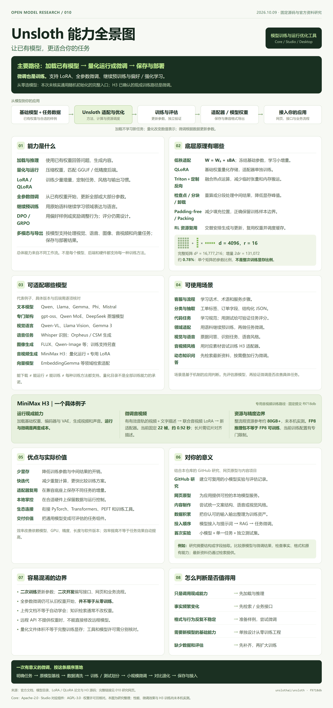
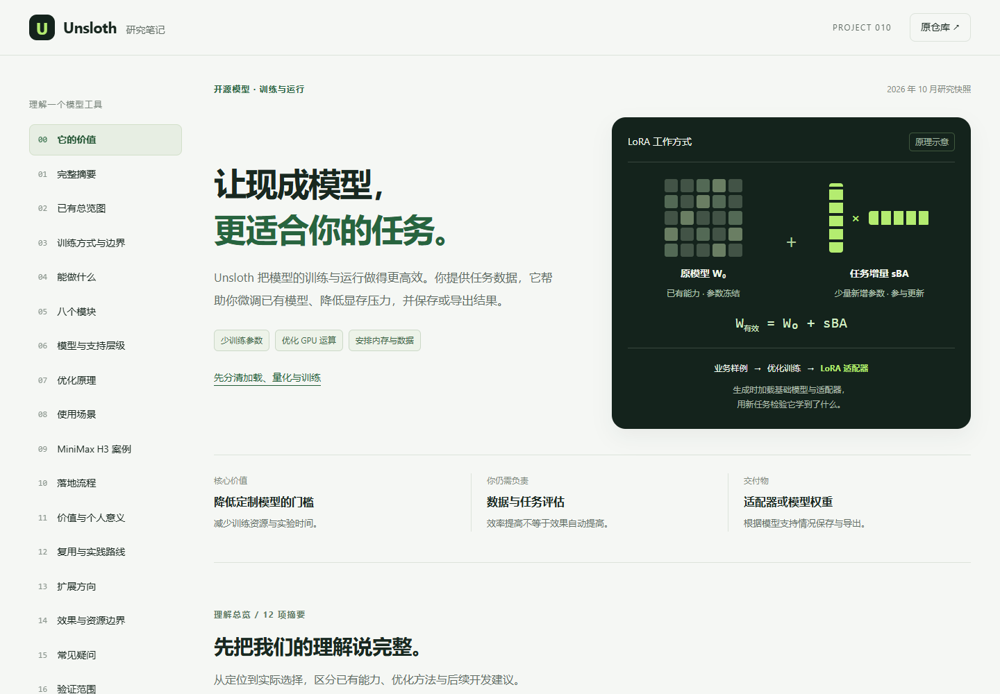
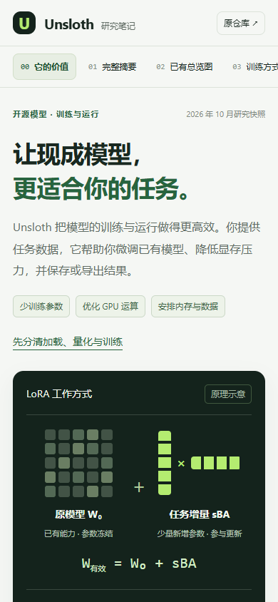

# 010 · Unsloth 模型训练与原理研究

整理我们对 Unsloth 的完整理解，覆盖能力、模块、训练与效率原理、代表模型、使用场景、个人价值、复用和可扩展方向。沿用已有引导图，单独核对 MiniMax H3 和从零训练边界。

[在线完整研究](https://yydshly.github.io/1008_codex_project/010-unsloth/) · [可缩放一图阅读](https://yydshly.github.io/1008_codex_project/010-unsloth/map.html) · [返回总索引](../../README.md) · [原仓库](https://github.com/unslothai/unsloth) · [完整理解](understanding.md) · [研究记录](notes.md) · [Web 说明](web/README.md)

## 来源、版本与改动范围

| 项目 | 内容 |
| --- | --- |
| 上游 | unslothai / unsloth |
| 固定提交 | [f9718db128218f43b7e0b03604baa4a9a6633028](https://github.com/unslothai/unsloth/tree/f9718db128218f43b7e0b03604baa4a9a6633028) |
| 日期 | 2026-10-09 研究与原图；2026-10-12 完整整理 |
| 许可 | [Core Apache-2.0](https://github.com/unslothai/unsloth/blob/f9718db128218f43b7e0b03604baa4a9a6633028/LICENSE)；[Studio AGPL-3.0](https://github.com/unslothai/unsloth/blob/f9718db128218f43b7e0b03604baa4a9a6633028/studio/LICENSE.AGPL-3.0)；模型权重另有许可 |
| 本地改动 | 原创中文研究、HTML/CSS/JS 网页、计算示意、原图阅读器与发布审计；没有复制或修改上游模型程序 |
| 验证对象 | 独立研究网页、统一静态发布与原图完整性；没有模型推理、GPU 训练、性能复现或微调效果实测 |
| 在线状态 | [已部署并核验](https://yydshly.github.io/1008_codex_project/010-unsloth/)；正式 demo 在 HTTPS 与浏览器验证通过后登记 |

官方文档与模型卡可能继续更新。源码固定到研究提交；26 项来源随网页出版，建议与未实测的效果分别标明。

## 完整摘要

- **定位**：围绕已有开放权重模型的训练与运行工具：Core 提供 Python 优化，Studio / Desktop 提供工作台；重点是更低成本地把通用模型适配到自己的任务。
- **能力**：加载推理、量化、LoRA / QLoRA、全参数微调、继续预训练、DPO / GRPO 等后训练、部分多模态适配、保存导出与应用连接；每项需匹配模型、格式和后端。
- **模块**：按职责理解为模型加载适配、数据模板、训练方法、计算内核、显存与批次调度、多模态专用路径、保存导出、运行工作台八部分；依托 PyTorch、Transformers、PEFT、TRL 等生态。
- **训练原理**：LoRA 冻结底座并学习低秩增量，QLoRA 量化冻结权重以减少存储；SFT 从样例学习任务，继续预训练学习语料，偏好与强化学习按选择或奖励更新。微调本身就是训练。
- **效率原理**：模型计算补丁、Triton 融合内核与定制反向减少搬运和临时张量；分块损失、梯度检查点与卸载降低峰值，packing 减少填充，部分 RL 路径复用推理和训练资源。
- **代表模型**：文本 Qwen / Llama / Gemma / Phi / Mistral，MoE 与专门架构 gpt-oss / Qwen MoE，视觉语言、Whisper / Orpheus / CSM 语音、部分图像扩散、MiniMax H3 音视频和 EmbeddingGemma；列举不等于全部训练方式通用。
- **H3 案例**：提供 GGUF、FP8 / INT8 运行版本；固定源码的训练路径加载预训练 H3，冻结底座后训练音视频 LoRA。要求有声音的视频与描述，22 帧约 0.92 秒窗口，整流程资源参考约 80GB+，未本机实测。
- **场景**：客服表达与流程、分类抽取与 JSON、领域语言、代码规范及可评分任务、视觉和语音适配、品牌音视频风格实验；经常更新的事实优先检索 / 工具，按需叠加行为微调。
- **价值**：降低定制实验的显存压力和迭代成本，保存可复用适配器，增加本地运行与交付选择；对本仓库可用于研究内容表达、资料抽取和应用原型，效果与节省比例均需独立评测。
- **复用路线**：可只用量化模型本地运行，或以小型文本模型做单任务 LoRA，再接检索与业务应用，最后探索视觉 / 语音 / H3；先建立原模型基线、独立测试集和可比较的结果。
- **扩展方向**：版本化数据集、模型支持矩阵、可复现实验台、适配器注册表、RAG + 微调组合、行业任务包、多模态素材管线、任务队列与成本观测八项；均为后续开发建议。
- **边界与许可**：本次未核实通用随机初始化完整入口，H3 已确认路径是二次训练；不能宣传一键从零造模型，也不能说不支持训练。固定 f9718db；Core Apache-2.0、Studio AGPL-3.0，权重独立许可；本站只验证研究网页。

## 引导图前的理解

**它解决什么问题**：你已经有一个基础模型，但希望它更遵守自己的格式、术语、任务或风格。Unsloth 优化加载、适配与训练过程，让定制实验更容易开展；模型是否学好仍由数据、目标和评测决定。

**从哪里开始**：加载权重是使用已有参数，量化是改变存储表示，微调是更新参数，二次开发是围绕模型写应用。全参数微调也可以从已有权重开始；本次没有核实从随机参数得到全新模型的通用完整流程。

**底层如何协作**：Core 在支持的模型上接入 Transformers / PEFT，并替换热点计算；Triton 和自定义梯度减少临时开销，分块、检查点和卸载管理显存，紧凑批次减少填充，训练器完成数据与优化更新。

**哪些模型与场景**：文本、MoE、视觉语言、语音、向量和部分扩散模型有不同支持路径。客服、抽取、代码和风格适配可以做训练实验，实时文档问答可组合检索。H3 的量化运行与短片音视频 LoRA 是两条分别核对的路径。

**对我的价值与顺序**：把这份研究变成可执行的判断：先选一个可检验的小任务，测原模型，再准备独立样例训练 LoRA，比较正确性与成本，最后接入应用。可以沉淀个人数据集、适配器和评测资料，再决定是否投入复杂多模态训练。

**怎样阅读这张图**：沿用我们 2026-10-09 制作的完整 2400 × 5091 总览图，不裁切、不重画。图概括能力、原理、模型、场景与个人价值；网页补全模块、支持层级、复用与扩展。源码有固定提交，性能和 GPU 训练效果尚未在本机复现。



沿用我们 2026-10-09 制作的完整图，2400 × 5091，1,457,393 字节，SHA-256 为 `60cb16a2becaafa153668e0a585cac4a95fda470285dda55f438380c4921918f`。不裁切、不重画；图为原创排版研究，非模型生成效果。

[原图](assets/unsloth-overview.png) · [图中文字与来源](assets/unsloth-overview-content.md) · [原图稿](assets/unsloth-overview.html) · [制作记录](assets/unsloth-overview-generation.json)

内置生图首次请求发生网络错误；最终使用原创 HTML / CSS 排版，通过浏览器导出，完整记录保留在 assets。最新要求复用已有图，因此本次没有重新生成图片。

## 网页交付

十八章涵盖价值、完整摘要、原图、训练方式、能力、模块、模型、原理、场景、H3、流程、个人意义、复用、扩展、限制、FAQ、证据与来源。正文在构建时生成，禁用 JavaScript 仍可阅读。

- 六个原理面板与六个场景面板支持鼠标、键盘、链接、刷新与返回。
- LoRA 参数计算和填充位置计算只解释数学关系，不预测整机显存或速度。
- 原图阅读器支持适合宽度、50%、100% 和滑块，原图字节不变。
- 提供完整理解 Markdown、结构化 publication.json、来源与验证记录下载。
- 首页索引十二项摘要与图前六段介绍共用出版数据；八模块、七类模型、六项价值、四条复用路线与八项扩展附条件和验收依据。

## 构建、预览与验证

要求 Node.js 22+。网页无第三方运行依赖，不需要 GPU、模型权重或 API 密钥。

```powershell
npm.cmd ci --prefix projects/010-unsloth/web
npm.cmd run build --prefix projects/010-unsloth/web
npm.cmd run check --prefix projects/010-unsloth/web
cd projects/010-unsloth/web
npm.cmd run preview
```

本地入口：`http://127.0.0.1:4197/1008_codex_project/010-unsloth/`。输出为 web/dist，采用相对资源路径。原图阅读器为 map.html。

统一发布走 scripts/build-site.mjs 与 .github/workflows/pages.yml 的明确允许名单。它们保留所有已有公开项目，增加 010；root npm run check、npm test 与 scripts/validate-site.mjs 验证目录、摘要、完整介绍、资源和原图。

浏览器验证可设置 PLAYWRIGHT_PACKAGE 指向已有 Playwright 包，再运行 src/verify-web.mjs。真实检查涵盖 1440 / 1024 / 768 / 390 / 320px、全部面板、计算器、历史定位、无脚本阅读、下载与原图哈希；记录保存在 verification.json，检查结果以实际运行后写入的数据为准。

## 具体模块、原理与开发方向

[完整理解](understanding.md) 按能力、八模块、六机制、七类模型、六场景、H3、六项价值、四条复用、三步实践和八项扩展逐项展开，并附 26 项来源。该文件由网页出版数据生成，避免摘要与正文各写一份产生差异。

## 真实网页截图





截图为本项目浏览器运行结果，图形来自原创 HTML/CSS。模型能力、生成效果和 GPU 性能不包含在网页验证中。

## 发布核验（2026-10-12）

[首次部署运行 38236966981](https://github.com/yydshly/1008_codex_project/actions/runs/38236966981)成功，内容提交为 `771d863`。公开 HTTPS 检查通过 29 个入口和资源，既有九个子项目入口保留，线上原图尺寸、字节数与 SHA-256 一致。线上真实浏览器再次验证十八章、面板与键盘、历史定位、计算、原图缩放、五档屏宽、无脚本阅读和下载，无脚本错误或失败资源。

[发布记录](src/publication-verification.json) · [HTTP 记录](src/public-http-checks.json) · [浏览器记录](src/public-browser-checks.json)。这些验证只证明研究网页可用，不证明模型效果或 GPU 性能。
