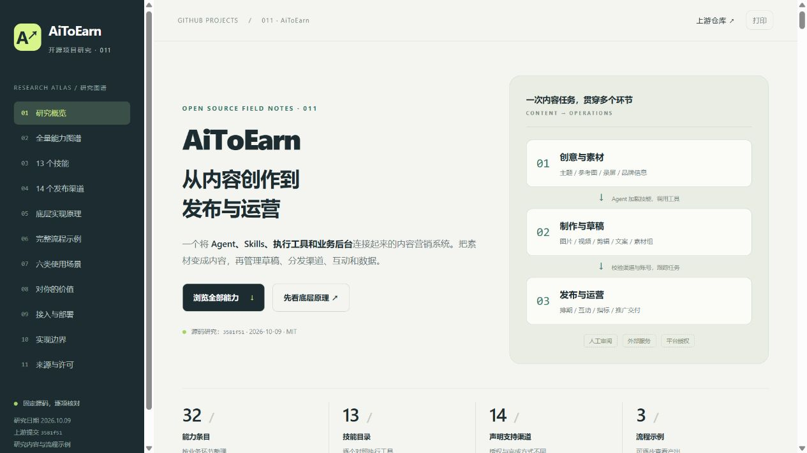

# 011 · AiToEarn 内容营销能力与原理研究

中文网页完整整理 AiToEarn 的创作、发布、互动、分析和推广业务，回答它能做什么、如何实现、适合哪些场景，以及对当前 GitHub 项目研究集的价值。

- 上游：[yikart/AiToEarn](https://github.com/yikart/AiToEarn)
- 研究提交：[3581f511293236044e56fad67958cfcea0def6b5](https://github.com/yikart/AiToEarn/commit/3581f511293236044e56fad67958cfcea0def6b5)，提交时间2026-09-18，研究日期2026-10-09。
- 许可证：MIT，Copyright (c) 2025 AiToEarn。[保留原文](src/LICENSE.upstream.txt)。
- 覆盖：32项能力、13个技能、14个平台、6层原理、3个流程、6类场景、6项个人价值、10项边界；74份文档/代码与6张真实上游图片有SHA-256记录。
- 在线：[完整能力、模块与原理](https://yydshly.github.io/1008_codex_project/011-aitoearn/) · [原图阅读器](https://yydshly.github.io/1008_codex_project/011-aitoearn/map.html) · [真实图文](https://yydshly.github.io/1008_codex_project/011-aitoearn/#real-demo)。
- 真实实测：安装13个原版技能与GPT适配入口，已完成3张实际生成图、中文文案和本地图文草稿。进入网页“真实效果实测”查看成品、下载与记录。

## 完整理解与发布范围

2026-10-12 补全18章：12项首页/网页一致摘要、6段引导介绍、8个职责模块、6个执行机制、4条复用路线、4步实践和8项扩展建议；保留32项能力、13技能、14渠道及参数、6层关系、3个解释流程、6类场景、6项价值和10项边界。

核心结论是 Agent、技能、工具与后台共同形成内容营销系统。当前最适合你的路线，是把固定研究与真实素材做成可审阅图文，再接一个渠道并保存最终作品；视频、多语言、团队审核和反馈实验按需求逐步接入。每项扩展列出输入、交付物和验收依据，并明确属于建议。

完整正文在构建时写入HTML，禁用脚本仍可读。新增 map.html 原图缩放、understanding.md 完整理解与 publication.json 结构化资料。首页和本页摘要/引导介绍直接读取根 projects.json，原图字节与实测记录保留。

发布的是原创静态研究及图文档案；上游后台、数据库、模型、云视频处理和社交授权不由 GitHub Pages 运行。已安装技能供本仓库的 GPT/Codex 使用，网页直接展示此前真实成品，无需读者先安装技能。

## 一张图完整总览

[查看完整总览图](assets/aitoearn-overview.png)汇总八个主题：原理、八类32项能力、13技能与14渠道、本次真实图文演示、六类场景、个人价值、六步扩展建议和接入边界。


内置image_gen工具参照3张实际成品排版，实际输出941×1672 PNG；提示词请求更大尺寸未生效，未做后期放大。原始演示PNG仍保留。[可复制文字稿](assets/aitoearn-overview.md)、[原始提示词](assets/aitoearn-overview-prompt.txt)和[来源/尺寸/哈希与人工检查记录](assets/aitoearn-overview-record.json)一并保存。扩展方向为建议，视频和原后台发布等尚未实测。

网页新增[一图完整总览](http://127.0.0.1:4201/1008_codex_project/011-aitoearn/#summary-figure)，支持打开原图与下载。

## 项目内技能与实际效果

原版13个技能安装在本子项目的`.agents/skills/`，固定上游SHA，文件原文未修改，许可在`.agents/LICENSE.upstream.txt`。根项目`.agents/skills/aitoearn-gpt-content/SKILL.md`提供GPT适配入口，后续对话可使用：

```text
$aitoearn-gpt-content 把011项目研究做成三张介绍图和一篇中文图文草稿
```

GPT/Codex读取研究结论和技能方法，负责规划、文案与提示词；当前图像工具完成实际生成。上游默认Gemini工具接口被映射为会话的`image_gen.imagegen`，并非只改一个模型名。工具没有公开底层图像模型编号。没有内容MCP时按适配规则保存本地JSON草稿，不编造远端草稿或发布任务。

本次真实场景是“把我们已经做完的AiToEarn源码研究转成可传播的介绍图文”。三个产出分别介绍内容流程、四部分原理与一次实际创作步骤。图片主要中文文字正确，风格一致；第一、第三张多出了未要求的装饰小字，完整保留结果和审阅意见。[实验说明、调用记录与复用方法](experiments/research-to-post/README.md)详细列出本次验证范围。

[直接打开真实效果](http://127.0.0.1:4201/1008_codex_project/011-aitoearn/#real-demo)。本次没有运行原项目后台、视频云加工、社交账号授权或真实发布。

## 主要结论

AiToEarn 的完整结构是 **Agent + Skills + 执行工具 + 内容营销后台**。Skills描述流程，Agent选择和编排，工具调用生成模型、Sharp、ffmpeg、云剪辑和业务API，后台管理素材、草稿、账号、排期、任务状态与指标。它面向个人媒体，也面向商家、品牌和代运营。

对本仓库最贴合的用途，是把已核对的研究、截图和录屏组织成可审阅的图文/视频草稿，再验证单渠道发布；另一项价值是研究技能、工具和异步任务工程。

页面区分源码实现、官方描述与待核验项。13个技能中11个找到对应工具，封面技能仍写旧接口，采集技能缺少当前Agent工具；部分插件互动仍开发中，发布有用户接续，指标多为可选。详见[完整研究](research.md)和[验证记录](notes.md)。

## 本地运行

原生 HTML/CSS/JavaScript，Node.js内置模块构建，无第三方依赖。需要Node.js22+，本次22.15.0。

```powershell
cd projects/011-aitoearn
node src/write-research.mjs
cd web
npm.cmd ci
npm.cmd run build
npm.cmd run check
npm.cmd run preview
```

打开[本地网页](http://127.0.0.1:4201/1008_codex_project/011-aitoearn/)。产物`web/dist/`，所有资源与下载均为相对路径，支持统一发布子目录。

发布接入 `.github/workflows/pages.yml` 与根 `npm run build:site`，完整产物复制到 `.cache/pages-site/011-aitoearn/`。`npm run check --prefix projects/011-aitoearn/web` 审计18章、摘要一致性、相对资源及原图哈希；统一发布继续保留001–010与013。

交互包括能力搜索/分类/证据筛选、详情展开、平台筛选与完整规则、六层架构切换、三个七步流程、12组工具声明、图片放大、全文/来源下载、打印和手机目录。主体HTML在构建时生成，关闭JavaScript仍可阅读全文。

“真实效果实测”另有3张成品放大/下载、文案复制、完整成品ZIP、结构化草稿和提示词下载。此区展示已完成的执行结果；三个预设七步流程仍是解释示例。

## 目录与来源

- `web/content.js`：原创结构化研究，逐项固定源码链接。
- `web/render.js`、`app.js`、`styles.css`：独立网页与交互。
- `web/scripts/`：无依赖构建与子路径预览。
- `src/fetch-references.mjs`：按固定SHA下载参考，不执行上游。
- `src/source-manifest.json`：来源路径、URL、字节数和SHA-256。
- `src/implementation-inventory.json`：14个平台完整限制、12组工具声明；静态提取脚本extract-inventory.mjs不执行上游。
- `src/write-research.mjs`：生成中文全文。
- `assets/`：六张作者图片、真实网页截图与署名。
- `assets/research-to-post/`：本次工具实际生成的三张PNG，来源、尺寸与哈希见实验run.json。
- `experiments/research-to-post/`：输入快照、计划、提示词、实际调用、草稿、预检脚本与成品包。
- `.agents/skills/`：13个上游原版技能，安装来源与SHA-256见src/skill-installation.json。
- 根项目`.agents/skills/aitoearn-gpt-content/`：原创GPT适配入口，按可用工具映射执行与本地保存。
- `upstream/`：ignored，本地74份参考资料。

原创范围为研究、网页、流程示例、GPT适配、图文实测和构建/预检工具。原版技能保留原文；未修改或运行上游应用。图片/许可保留原作者署名。运行`node src/fetch-references.mjs`可重新获取相同版本；跟进新版本应显式改SHA并重新核验结论。



2026-10-09真实浏览器截图。已验证桌面/手机交互、锚点刷新与子路径资源，验证细节见notes.md。

新增图像工具执行和人工画质审阅实测；没有授权社交账号、真实发布或业务反馈，工具未返回计费金额，不能据此推导收入、调用价格或节省时间比例。

## 公开发布核验

2026-10-12 已通过既有GitHub Pages发布。首次[部署运行](https://github.com/yydshly/1008_codex_project/actions/runs/38244805400)的干净Linux构建、全部审计和部署成功；37个011公开页面/资源、11个既有项目与研究总入口通过，原图与三张真实图哈希一致。真实浏览器核验18章、摘要、搜索、真实图片放大、原图缩放、手机目录、390/320布局与深链接刷新；详细范围见[src/publication-verification.json](src/publication-verification.json)、[HTTP记录](src/public-http-checks.json)与[浏览器记录](src/public-browser-checks.json)。源码研究和图文实测仍固定于3581f51，发布不代表视频加工、社交发布或推广结算已完成。
