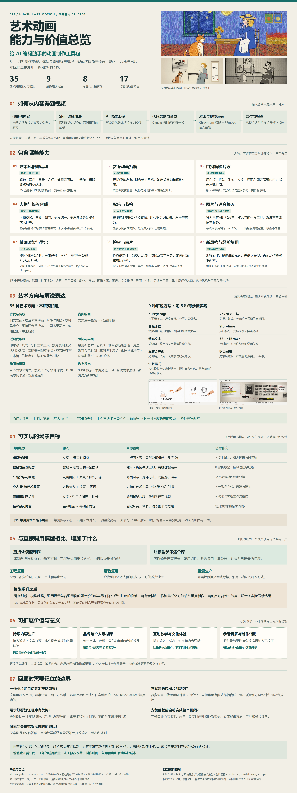
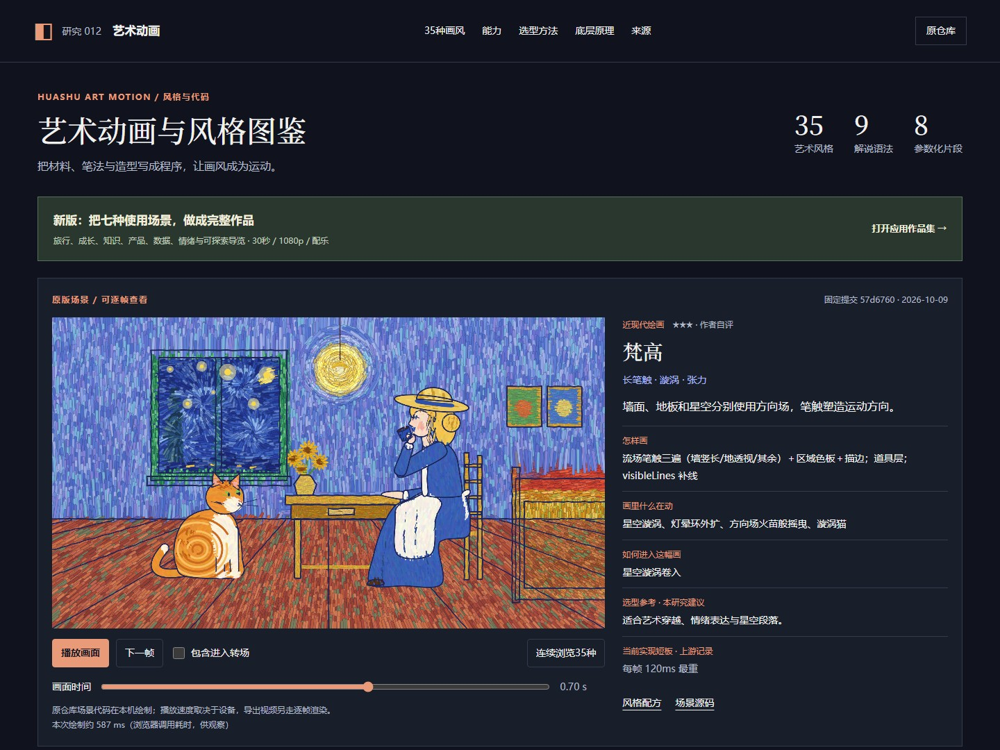
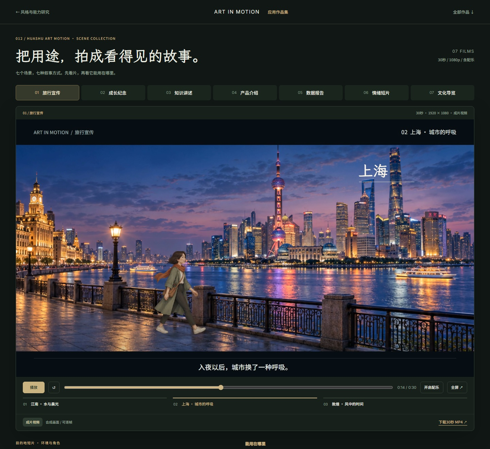

# 012 · Huashu 艺术动画能力与风格研究

<!-- HUASHU_PUBLICATION:START -->
[完整研究网页](https://yydshly.github.io/1008_codex_project/012-huashu-art-motion/) · [高清图与完整理解](https://yydshly.github.io/1008_codex_project/012-huashu-art-motion/overview/) · [七部新增作品](https://yydshly.github.io/1008_codex_project/012-huashu-art-motion/scenarios/) · [原图](assets/understanding/overview.png)

公开网页已实际核验；30 项真实浏览器检查、44 项页面与媒体检查通过，既有项目入口正常，原图哈希一致。部署运行：[38249747137](https://github.com/yydshly/1008_codex_project/actions/runs/38249747137)。详见 [发布记录](src/publication-verification.json)、[HTTP 明细](src/public-http-checks.json)、[浏览器明细](src/public-browser-checks.json)。

## 完整理解与复用路线（2026-10-12）

上游：https://github.com/alchaincyf/huashu-art-motion；固定提交：`57d67608ab458f57d9b153b1a2831b921e22498b`。原始研究及引导图为 2026-10-09，本次整理保留原图字节。

### 十二项摘要

**核心定位**：给 AI 编码助手的动画制作工具包：Skill 提供任务流程与制作知识，模型理解内容、选择方向并编程，现成工程负责绘画、动画、合成和出片。

**能力范围**：艺术场景、解说片段、参考动画拆解、角色长卷、配乐节拍、图片语音接入、精确渲染导出、QA 与经验复用，共九项职责。

**视觉与表达**：35 份艺术风格配方及场景，覆盖六组视觉方向；另有九种解说表达，前八种有参数化实现，讲解员式提供语法与整片参考。画风和表达方式分别选型。

**系统模块**：任务与知识入口、参考分析、风格绘制、解释组件、角色世界、音频素材、时间渲染、质量检查及经验回流；17 个 JS 绘画动画库支撑执行。

**底层原理**：Canvas 按 renderFrame(t) 重画，纯时间函数、种子随机、全局编舞与离屏转场维持连续性；Chromium 逐帧取图，FFmpeg 编码并合入音轨。

**输入与交付**：输入主题、文案、数据、参考片、图片或录音；工程/JSON 控制时长、尺寸、帧率和出现时间。交付静帧、MP4、横竖屏及透明 ProRes 剪辑片段。

**照片与人物**：照片通常需要外部生图或自备一致动作帧，再改写场景、统一材质并合成。很多背景由代码生成；任意整图一键动画化和稳定复杂表演尚非通用现成能力。

**使用目标**：口播科普、数据报告、产品教程、艺术短片、透明剪辑组件与品牌系列；每类都需要相应脚本、数据、真实素材和时间轴，最终品质取决于制作。

**相对模型的价值**：同一模型可复用已写好的组件、参数、导出工具和问题记录，减少部分重复实现；直接模型也能制作。尚无同任务对照证明稳定提质或量化效率收益。

**模型提升与复用**：通用提示和普通示例的额外价值可能下降；经过审片的模板、自有视觉资产和制作流水线仍可能省事。先验证解说、图表、产品与剪辑片段的实际复用收益。

**可扩展方向**：内容批量生产、品牌模板、剪辑集成、互动教学与文化体验、参考分镜辅助、角色资产治理、自动渲染及对照评估八条路线；均注明新增工程与验收目标。

**研究效果与边界**：保留 35 个原版场景与 34 个转场的运行记录、七部独立制作的 30 秒 1080p 作品和原始高清引导图；新增生成美术与制作贡献另记，不等同原库品质优势。

### 图前引导

**如何理解**：AI 先理解你想表达什么，再分别决定画面长什么样、用什么方式解释；Skill 帮它找到配方、范例和工具，代码把场景和内容按时间组织成视频。

**包含什么**：35 种艺术方向、九种解说方法（八种有参数实现）、17 个绘画动画模块，以及参考拆解、角色合成、配乐、媒体接入、渲染、QA 与经验记录。它没有内置新的训练模型。

**如何使用**：可以修改艺术场景制作短片，也可以给片段 JSON 换文字或数据，或导出透明片段插入已有视频。照片转人物还需动作素材和场景适配；完整口播需脚本、录音与时间轴。

**价值与替代性**：增量主要是工程和经验复用。模型越强，通用指导越易被替代；打磨好的模板、自有素材和工作流能否节省成本，要用同任务成片、修改次数、时间与维护成本验证。

**下一步方向**：优先做可重复的解说、数据、产品和剪辑组件；再扩展品牌批量流水线、角色资产、参考分镜工具或互动学习体验。后者需要新增输入、状态和内容逻辑。

**如何看效果**：以下沿用已生成的 3200×8524 完整 PNG，含原版静帧与解说研究图，可放大和下载。35 个动态原例与七部新增作品均可观看；扩展建议、外部生成与原库贡献分别说明。

引导图：3200×8524 PNG，4210861 字节；SHA-256：`36c93996b411490a1562e0601fe5aa15b7d02617d6855dbd42a88ed2c42f3c45`。

### 九个职责模块

**任务与制作知识**：按任务读取风格、表达、角色和整片制作说明。Skill 是编码助手的工作指引，执行能力来自模型及工具。

**参考拆解**：根据图像变化寻找候选转场、提取关键帧与运动热图，并拟合节拍；测量结果仍需人或模型解释。

**风格画法与材质**：从材料、笔触、配色、造型和光影构建画面；35 场景把画法与运动规则组合起来，成熟度各异。

**解说表达组件**：图形关系、图表、文字、界面与拼贴帮助解释内容；八种片段可参数化，讲解员式仍依赖素材和整片制作。

**角色与连续世界**：共享骨架、动作参数、角色帧与连续编舞。个人形象穿越艺术世界只是其中一种叙事；动作帧质量与一致性需另行制作。

**声音与媒体**：导入素材与录音、规划 BPM 和音效；图片生成依赖当前工具，系统朗读为 macOS 路线，服务音色需要配置。

**时间、相机与输出**：按时间求动作与相机，转场中两场景继续绘制；固定帧率逐帧输出再编码。适用于可重复渲染和剪辑组件。

**技术 QA 与人工审片**：确定性、性能、动感、流畅和框景检查提供问题线索；叙事、审美、文字可读性与角色表演仍需看成片。

**配方与经验回流**：确认静帧、编舞、转场，再把有效参数和失败原因写回资料。积累的是知识和工程资产，未训练新生成模型。

- 任务与制作知识：[SKILL.md](https://github.com/alchaincyf/huashu-art-motion/blob/57d67608ab458f57d9b153b1a2831b921e22498b/SKILL.md)
- 参考拆解：[scripts/analyze/breakdown.py](https://github.com/alchaincyf/huashu-art-motion/blob/57d67608ab458f57d9b153b1a2831b921e22498b/scripts/analyze/breakdown.py)
- 风格画法与材质：[scripts/engine/lib/paint.js](https://github.com/alchaincyf/huashu-art-motion/blob/57d67608ab458f57d9b153b1a2831b921e22498b/scripts/engine/lib/paint.js)
- 解说表达组件：[references/09-视频动画语法.md](https://github.com/alchaincyf/huashu-art-motion/blob/57d67608ab458f57d9b153b1a2831b921e22498b/references/09-%E8%A7%86%E9%A2%91%E5%8A%A8%E7%94%BB%E8%AF%AD%E6%B3%95.md)
- 角色与连续世界：[references/10-角色.md](https://github.com/alchaincyf/huashu-art-motion/blob/57d67608ab458f57d9b153b1a2831b921e22498b/references/10-%E8%A7%92%E8%89%B2.md)
- 声音与媒体：[references/05-节奏与配乐.md](https://github.com/alchaincyf/huashu-art-motion/blob/57d67608ab458f57d9b153b1a2831b921e22498b/references/05-%E8%8A%82%E5%A5%8F%E4%B8%8E%E9%85%8D%E4%B9%90.md)
- 时间、相机与输出：[scripts/engine/engine.js](https://github.com/alchaincyf/huashu-art-motion/blob/57d67608ab458f57d9b153b1a2831b921e22498b/scripts/engine/engine.js)
- 技术 QA 与人工审片：[scripts/qa.py](https://github.com/alchaincyf/huashu-art-motion/blob/57d67608ab458f57d9b153b1a2831b921e22498b/scripts/qa.py)
- 配方与经验回流：[references/08-风格作者规范.md](https://github.com/alchaincyf/huashu-art-motion/blob/57d67608ab458f57d9b153b1a2831b921e22498b/references/08-%E9%A3%8E%E6%A0%BC%E4%BD%9C%E8%80%85%E8%A7%84%E8%8C%83.md)

### 17 个绘画动画库

- [util.js](https://github.com/alchaincyf/huashu-art-motion/blob/57d67608ab458f57d9b153b1a2831b921e22498b/scripts/engine/lib/util.js)：尺寸、数学、随机等基础工具
- [paint.js](https://github.com/alchaincyf/huashu-art-motion/blob/57d67608ab458f57d9b153b1a2831b921e22498b/scripts/engine/lib/paint.js)：噪声、纹理、手绘线与绘画基础
- [brush.js](https://github.com/alchaincyf/huashu-art-motion/blob/57d67608ab458f57d9b153b1a2831b921e22498b/scripts/engine/lib/brush.js)：毛笔、墨晕、水彩、厚涂等笔法
- [render.js](https://github.com/alchaincyf/huashu-art-motion/blob/57d67608ab458f57d9b153b1a2831b921e22498b/scripts/engine/lib/render.js)：网点、点彩、赛璐珞、光影与皮影
- [post.js](https://github.com/alchaincyf/huashu-art-motion/blob/57d67608ab458f57d9b153b1a2831b921e22498b/scripts/engine/lib/post.js)：VHS、胶片、泛光与媒介叠层
- [rig.js](https://github.com/alchaincyf/huashu-art-motion/blob/57d67608ab458f57d9b153b1a2831b921e22498b/scripts/engine/lib/rig.js)：少女与猫的共享角色骨架
- [rig_huashu.js](https://github.com/alchaincyf/huashu-art-motion/blob/57d67608ab458f57d9b153b1a2831b921e22498b/scripts/engine/lib/rig_huashu.js)：作者形象骨架
- [toon.js](https://github.com/alchaincyf/huashu-art-motion/blob/57d67608ab458f57d9b153b1a2831b921e22498b/scripts/engine/lib/toon.js)：扁平角色、姿势、口型与漫画符号
- [kit.js](https://github.com/alchaincyf/huashu-art-motion/blob/57d67608ab458f57d9b153b1a2831b921e22498b/scripts/engine/lib/kit.js)：点列、路径、画面扭曲与跨场景编舞
- [motion.js](https://github.com/alchaincyf/huashu-art-motion/blob/57d67608ab458f57d9b153b1a2831b921e22498b/scripts/engine/lib/motion.js)：缓动、弹簧、步进、错开与拍号
- [camera.js](https://github.com/alchaincyf/huashu-art-motion/blob/57d67608ab458f57d9b153b1a2831b921e22498b/scripts/engine/lib/camera.js)：连续世界相机的位置、缩放与旋转
- [diagram.js](https://github.com/alchaincyf/huashu-art-motion/blob/57d67608ab458f57d9b153b1a2831b921e22498b/scripts/engine/lib/diagram.js)：图解、逐笔描出、白板和形变
- [chart.js](https://github.com/alchaincyf/huashu-art-motion/blob/57d67608ab458f57d9b153b1a2831b921e22498b/scripts/engine/lib/chart.js)：比例尺、柱线图与数据标注
- [typo.js](https://github.com/alchaincyf/huashu-art-motion/blob/57d67608ab458f57d9b153b1a2831b921e22498b/scripts/engine/lib/typo.js)：逐字、打字、遮罩、数字和强调
- [ui.js](https://github.com/alchaincyf/huashu-art-motion/blob/57d67608ab458f57d9b153b1a2831b921e22498b/scripts/engine/lib/ui.js)：界面卡片、光扫与伪透视
- [collage.js](https://github.com/alchaincyf/huashu-art-motion/blob/57d67608ab458f57d9b153b1a2831b921e22498b/scripts/engine/lib/collage.js)：纸纹、撕纸、胶带、红线与拼贴
- [fonts.js](https://github.com/alchaincyf/huashu-art-motion/blob/57d67608ab458f57d9b153b1a2831b921e22498b/scripts/engine/lib/fonts.js)：独立字体文件注册与加载

### 六个制作机制

**理解内容并选择两条方向**：先明确要解释的概念、情绪或结论；艺术风格决定视觉语言，解说方法决定信息如何出现。Skill 给出具体做法，选择和改写仍由模型或人完成。

**从参考作品找到风格规则**：观察材料、笔法、造型、配色和构图；拆解脚本提供镜头与运动线索。先让静帧可辨识，再设置一个主动作、二至四个母题循环及同语言转场。

**用确定时间绘制每一帧**：renderFrame(t) 以时间求画面，运动函数不读墙钟，随机使用种子。角色可以沿全局时间连续运动，场景局部时间负责该段出现与变化。

**组合代码绘制和媒体素材**：背景、纹理、图表和字可由 Canvas 重画；图片、有限角色帧与录音作为输入合成。照片一般先准备一致动作帧，不能把一张照片自动当作完整表演。

**精准取帧并编码出片**：按 duration、fps、width、height 及 cues/data 组织场景；Chromium 取出目标帧，FFmpeg 生成视频和音轨，也可输出静帧及带 alpha 的 ProRes。

**检查并形成可复用版本**：检查确定性、效率、运动和布局，再人工审片。保留脚本、参数、素材、来源与问题记录；效果提升需用同任务对照验证，示范不能替代生产验收。

### 四条复用路线

**修改现有艺术场景**：输入 主题、画风、故事和角色素材；目标 有指定画法与运动规则的艺术短片；实际要做：选择相近场景，修改构图、角色、动作和镜头；先确认静帧再出片。。

**复用参数化解说片段**：输入 文字、数据、时长、尺寸与出现时间；目标 图表、白板、文字、拼贴或 UI 解释片段；实际要做：沿用组件并填参数；需核对内容、图形关系、节奏和可读性。。

**接入现有剪辑流程**：输入 指定时间点的引用、说明、图表与音轨；目标 透明动画层或普通 MP4 插入片段；实际要做：开发稳定模板与输入映射，导出片段，在剪辑器里配合口播；完整时间轴由调用方提供。。

**积累自己的制作资产**：输入 品牌规范、角色动作帧与已经审过的镜头；目标 持续复用的模板、素材和版本记录；实际要做：固定字体、色板、镜头和参数，记录许可与质量要求；品牌生产系统需要继续开发。。

### 八个扩展方向（待开发）

**内容批量生产**：输入 每期文案、数据和录音时间轴；产出 固定模板的系列视频与渲染清单；需补 新增数据适配、任务队列、失败重试和版本记录；验收 同模板换内容后语义、时间和版面正确；计量真实制作时间。

**品牌模板库**：输入 品牌规范、主题与经过审核的素材；产出 片头、章节、图表与片尾等统一组件；需补 新增视觉约束、可变区域与人工审核；验收 多期输出一致，换字和换数据仍清晰。

**剪辑器集成**：输入 片段 JSON、指定入出点与透明需求；产出 可插入剪辑时间线的组件包；需补 新增调用接口、格式适配、安装与预览；验收 透明边缘、音画同步、尺寸与帧率符合目标软件。

**互动教学与文化体验**：输入 知识节点、场景素材与学习目标；产出 可探索、点击和响应操作的学习场景；需补 新增输入、状态、热点、规则与反馈；原像素闯关只是视频；验收 操作触发正确内容，用户能完成指定理解或探索任务。

**参考片与分镜辅助**：输入 参考视频及目标内容；产出 候选镜头、视觉规则与可编辑分镜；需补 连接已有测量脚本与语义分析、人工校正界面；验收 人工确认镜头与节奏，避免把变化检测当剧情理解。

**角色与素材治理**：输入 人物参考、授权记录与动作需求；产出 一致角色帧、背景层及素材清单；需补 新增身份与姿态校验、素材版本和许可管理；验收 跨镜头形象与动作连续，实际素材可追溯。

**自动渲染与质量门槛**：输入 已确认工程、输出规格与资源预算；产出 可重复渲染、自动检查和人工审片记录；需补 新增运行环境封装、资源上限、日志与质量阈值；验收 重渲染一致，失败可定位，文字/音画/帧数通过检查。

**同模型对照与经验版本**：输入 相同任务、模型、预算和验收标准；产出 有库/无库的质量、工时与修改对照；需补 建立对照任务集，记录成本并回写有效配方；验收 用实际净收益决定是否保留工具；模型升级后重新比较。

### 效果与验证口径

已有验证：35 个上游场景、34 个转场实际绘制；另有本研究制作的 7 部 30 秒作品。未把外部媒体接入、成片审美或生产收益视为全面验证。
尚未完成同任务、同模型的有库 / 无库对照，不能据此断言显著提质或节省多少时间。
价值验证看：同一任务的成片质量、人工修改次数、制作时间、复用程度和后续维护成本。

35 个原例由固定上游代码运行；七部新增作品使用独立生成美术和场景制作。外部生图、配音、完整口播与任意照片自动化均不视为全面验收。代码/文档 MIT，字体 OFL；作者形象与解说媒体仅用于 Skill 示范和研究说明，配乐另保留署名和许可。
<!-- HUASHU_PUBLICATION:END -->

基于固定源码整理能力、底层实现和风格发现方法；用原版Canvas引擎展示35种艺术风格。它提供Skill方法、可复用动画工程与制作经验；价值取决于实际省下的工作与成片结果。

[返回总索引](../../README.md) · [原仓库](https://github.com/alchaincyf/huashu-art-motion) · [研究笔记](notes.md)

<!-- UNDERSTANDING:START -->
## 能力与价值理解总览

这个库是给AI编码助手的动画制作工具包：Skill组织步骤，模型理解内容并修改工程，场景与组件负责绘画、动作、合成和导出。其实际增量在于工程和经验复用；成片品质与效率优势尚未通过同任务、同模型的有库/无库对照证明。

[打开高清总览](https://yydshly.github.io/1008_codex_project/012-huashu-art-motion/overview/) · [下载3200×8524 PNG](assets/understanding/overview.png) · [结构化内容](web/understanding.mjs) · [素材与渲染来源](assets/understanding/manifest.json)

- 原库事实：35份风格配方与场景、9种解说方法（8种有参数实现）、17个绘画动画模块；另有拆解、角色合成、配乐、媒体接入、渲染与检查工具。
- 可制作目标：口播解释、数据内容、产品教程、个人艺术叙事和剪辑片段。品牌批量模板、互动教学与制作辅助需要继续开发。
- 图片边界：照片通常还需生成动作帧、改写场景并合成；任意整图的一键动画化不是现成通用能力。
- 价值判断：模型增强可能降低通用指导的额外价值；经过打磨的模板、素材与工作流仍可能节省重复制作。现阶段按实际贡献选用。
- 验证口径：原版场景运行、本研究新增作品与潜在扩展分开；新增美术和独立制作不能全部归因于原库。解说截图只用于该Skill研究说明。

网页首页新增“理解总览”，独立overview/提供100%–400%缩放、原图下载、手机阅读与七部分完整文字。37项真实浏览器检查通过，见[验证记录](assets/understanding/browser-report.json)。
<!-- UNDERSTANDING:END -->

## 研究基线

| 信息 | 内容 |
| --- | --- |
| 日期 | 2026-10-09（北京时间） |
| 完整提交 | `57d67608ab458f57d9b153b1a2831b921e22498b` |
| 标签/版本 | 固定提交；没有对应tag |
| 上游代码与文档 | MIT；原文保留于[src/LICENSE.upstream.txt](src/LICENSE.upstream.txt) |
| 字体许可 | 各自OFL；保留于[src/upstream-engine/lib/fonts/LICENSES.md](src/upstream-engine/lib/fonts/LICENSES.md) |
| 素材例外 | 作者角色、含该角色的总览图与示范素材仅用于原Skill示范，不随MIT授权其他用途 |
| 研究状态 | 能力与原理、35种风格展示完成；作品版实际生成美术、合成并导出七片，未接入客户账号或外部视频生成 |
| 演示 | 本地预览；当前未上线，根索引demo为空 |

## 查看效果

本地生产网页截图。主画面使用未修改的原版场景、绘画库与引擎；中文说明、分类、搜索、控制与来源导航为本研究原创。

- 35种风格均有本机真实渲染静帧、视觉描述、绘画方法、运动、转场、适用方向和上游短板。
- 可选择单幅画面、播放/暂停、下一帧、拖动时间、查看进入转场、连续浏览完整35段样片。
- 静帧与研究正文在HTML中，关闭JavaScript仍可阅读；动态画面需要浏览器脚本。
- 作者的3段GIF与8种解说语法截图保留来源，用于说明原Skill效果。

## 本地构建与预览

Node.js 22或更新版本。网页没有第三方构建/运行依赖，不需要模型、账号、API密钥、Python或FFmpeg。

~~~powershell
cd projects/012-huashu-art-motion/web
npm.cmd run build
npm.cmd run preview
~~~

打开 http://127.0.0.1:4212/1008_codex_project/012-huashu-art-motion/ 。`#style=17_ink`可直接定位水墨并刷新。

产物为`web/dist/`。所有资源使用相对路径，原版引擎位于`engine/`；后续发布必须复制完整产物，保留字体、图片、研究文件与许可。页面通过HTTP服务打开，直接双击file://不能完整运行原版场景的XHR与字体加载。

## 能力汇总

### 艺术风格动画 · 35份配方 + 35个场景

从构图、笔法和材质出发，用Canvas绘画；画中元素、风格纹理和签名转场都可由代码控制。

边界：配方是起点，角色与背景的风格一致性仍需打磨。

[固定源码依据](https://github.com/alchaincyf/huashu-art-motion/blob/57d67608ab458f57d9b153b1a2831b921e22498b/references/04-%E7%BA%AF%E4%BB%A3%E7%A0%81%E7%BB%98%E5%88%B6.md)

### 解说视频动画 · 9种语法 · 8种参数化实现

白板、信息拼贴、动态文字、图表等表达方式，用JSON指定内容与出现时间，支持横竖屏和字幕留位。

边界：第9种讲解员式提供语法卡与参考代码，需自备角色；部分整片目录是代码快照。

[固定源码依据](https://github.com/alchaincyf/huashu-art-motion/blob/57d67608ab458f57d9b153b1a2831b921e22498b/references/09-%E8%A7%86%E9%A2%91%E5%8A%A8%E7%94%BB%E8%AF%AD%E6%B3%95.md)

### 参考动画拆解 · 关键帧 · 节拍 · 运动热图

用帧差寻找候选转场，拟合节拍网格，输出关键帧与运动热图，辅助理解哪里在动以及如何切换。

边界：候选剪点来自图像变化阈值，大动作可能被误判；理解风格还需要观察原作。

[固定源码依据](https://github.com/alchaincyf/huashu-art-motion/blob/57d67608ab458f57d9b153b1a2831b921e22498b/scripts/analyze/breakdown.py)

### 长卷与角色 · 连续世界 · 动作帧合成

角色横向走过世界边界；用分段场景组织长卷，人物可采用已有动作帧或生成帧，代码负责摆放与换帧。

边界：长卷附带3段示范；复杂人物素材需自行准备，角色帧通常是有限动画。

[固定源码依据](https://github.com/alchaincyf/huashu-art-motion/blob/57d67608ab458f57d9b153b1a2831b921e22498b/references/11-%E9%95%BF%E5%8D%B7%E7%A9%BF%E8%B6%8A%E7%89%87.md)

### 声音与素材接入 · 已有素材 · 可选外部生成

已有图片与音轨可直接导入；代码配乐可按BPM组织动机和音效。外部生图、系统声音与语音复刻按需接入。

边界：媒体生成取决于实际工具和配置；Windows系统声音后端尚未实现。

[固定源码依据](https://github.com/alchaincyf/huashu-art-motion/blob/57d67608ab458f57d9b153b1a2831b921e22498b/references/compatibility.md)

### 出片与验收 · 逐帧输出 · 透明底 · QA

Chromium逐帧读取Canvas，FFmpeg编码；可导出静帧、MP4和透明ProRes片段，并检查稳定、运动和文字布局。

边界：QA提供数字和问题线索，美术质量与叙事效果仍需审片判断。

[固定源码依据](https://github.com/alchaincyf/huashu-art-motion/blob/57d67608ab458f57d9b153b1a2831b921e22498b/scripts/qa.py)

### 九种解说动画语法

- **Kurzgesagt**：扁平无描边、尺度穿行、分层讲清概念。 [语法卡](https://github.com/alchaincyf/huashu-art-motion/blob/57d67608ab458f57d9b153b1a2831b921e22498b/references/%E5%8A%A8%E7%94%BB%E8%AF%AD%E6%B3%95/y1_kurzgesagt.md)
- **Vox 信息拼贴**：剪报、红线、荧光笔与累积信息桌面。 [语法卡](https://github.com/alchaincyf/huashu-art-motion/blob/57d67608ab458f57d9b153b1a2831b921e22498b/references/%E5%8A%A8%E7%94%BB%E8%AF%AD%E6%B3%95/y2_vox.md)
- **白板手绘**：笔尖逐步揭开线稿，跟随口播建立关系。 [语法卡](https://github.com/alchaincyf/huashu-art-motion/blob/57d67608ab458f57d9b153b1a2831b921e22498b/references/%E5%8A%A8%E7%94%BB%E8%AF%AD%E6%B3%95/y3_whiteboard.md)
- **Storytime**：反应特写、角色表演和笑点停顿。 [语法卡](https://github.com/alchaincyf/huashu-art-motion/blob/57d67608ab458f57d9b153b1a2831b921e22498b/references/%E5%8A%A8%E7%94%BB%E8%AF%AD%E6%B3%95/y4_storytime.md)
- **动态文字**：关键词、数字与文字节奏推动信息。 [语法卡](https://github.com/alchaincyf/huashu-art-motion/blob/57d67608ab458f57d9b153b1a2831b921e22498b/references/%E5%8A%A8%E7%94%BB%E8%AF%AD%E6%B3%95/y5_kinetic_type.md)
- **3Blue1Brown**：用对象形变与连续运动说明关系。 [语法卡](https://github.com/alchaincyf/huashu-art-motion/blob/57d67608ab458f57d9b153b1a2831b921e22498b/references/%E5%8A%A8%E7%94%BB%E8%AF%AD%E6%B3%95/t1_3b1b.md)
- **发布会界面**：光斑底、卡片、大数字与层级揭示。 [语法卡](https://github.com/alchaincyf/huashu-art-motion/blob/57d67608ab458f57d9b153b1a2831b921e22498b/references/%E5%8A%A8%E7%94%BB%E8%AF%AD%E6%B3%95/t2_keynote_ui.md)
- **财经图表**：先轴后数据，在关键时点突出一件事。 [语法卡](https://github.com/alchaincyf/huashu-art-motion/blob/57d67608ab458f57d9b153b1a2831b921e22498b/references/%E5%8A%A8%E7%94%BB%E8%AF%AD%E6%B3%95/t3_finance_chart.md)
- **讲解员式**：人物换帧与信息板结合；提供参考代码，需自备角色。 [语法卡](https://github.com/alchaincyf/huashu-art-motion/blob/57d67608ab458f57d9b153b1a2831b921e22498b/references/%E5%8A%A8%E7%94%BB%E8%AF%AD%E6%B3%95/y6_presenter_explainer.md)

前8种附参数化片段与示范，第9种讲解员式提供语法卡和整片参考。口播转录和完整时间轴仍由调用方的视频管线提供；整片参考目录不能一概当作开箱即用工程。

## 35种艺术方向

以下类别与适用方向为本研究归组；名称、绘画手法、运动、转场、质量和短板来自上游索引。艺术流派、艺术家、媒介和数字观感混合登记，条目不是互斥的艺术史分类。

| 风格/上游配方 | 本研究类别 | 视觉描述 | 母题运动 | 进入转场 | 当前成熟度与短板 |
| --- | --- | --- | --- | --- | --- |
| [洞穴岩画](https://github.com/alchaincyf/huashu-art-motion/blob/57d67608ab458f57d9b153b1a2831b921e22498b/references/%E9%A3%8E%E6%A0%BC%E9%85%8D%E6%96%B9/01_cave.md) | 古代与传统 | 炭点与赭石进入岩壁，轮廓带有手工刻画的毛边。 | 动物两姿态交替奔跑、火光摇曳、余烬 | （开场） | ★★★；人形太卡通，不够原始 |
| [埃及墓室壁画](https://github.com/alchaincyf/huashu-art-motion/blob/57d67608ab458f57d9b153b1a2831b921e22498b/references/%E9%A3%8E%E6%A0%BC%E9%85%8D%E6%96%B9/02_egypt.md) | 古代与传统 | 侧脸配正面眼、平涂细线与象形字共同建立壁画语言。 | 圣甲虫推日、阿顿光线小手开合、象形字逐笔重写 | 挂毯竖条落下回弹 | ★★★；端杯肘偏僵 |
| [阿提卡黑绘](https://github.com/alchaincyf/huashu-art-motion/blob/57d67608ab458f57d9b153b1a2831b921e22498b/references/%E9%A3%8E%E6%A0%BC%E9%85%8D%E6%96%B9/03_greek.md) | 古代与传统 | 黑色人物剪影与陶土色刻线相互衬托，回纹提供秩序。 | 回纹带反向滚动、船起伏海豚跃、里拉琴摆 | 陶瓶滚筒转面 | ★★★；裙摆偏厚 |
| [庞贝马赛克](https://github.com/alchaincyf/huashu-art-motion/blob/57d67608ab458f57d9b153b1a2831b921e22498b/references/%E9%A3%8E%E6%A0%BC%E9%85%8D%E6%96%B9/04_roman.md) | 古代与传统 | 用石块排列和灰浆缝隙构成图像，保持砖块布局稳定。 | 波浪纹边框顺时针流、维苏威冒烟溅火星 | 马赛克砖从猫处翻面扩散 | ★★★；小尺度下脸部细节少 |
| [哥特泥金手抄本](https://github.com/alchaincyf/huashu-art-motion/blob/57d67608ab458f57d9b153b1a2831b921e22498b/references/%E9%A3%8E%E6%A0%BC%E9%85%8D%E6%96%B9/05_gothic.md) | 古代与传统 | 金属高光、细密装饰和纸面质感形成泥金手抄本效果。 | 金箔斜向高光扫过、藤蔓摇、蜗牛爬、老鼠跑 | 羊皮纸翻页 | ★★★；金发像兜帽 |
| [文艺复兴晕涂](https://github.com/alchaincyf/huashu-art-motion/blob/57d67608ab458f57d9b153b1a2831b921e22498b/references/%E9%A3%8E%E6%A0%BC%E9%85%8D%E6%96%B9/06_renaissance.md) | 古典绘画 | 轻模糊与清晰层叠加，辅以黄釉、龟裂和画布痕迹。 | 达芬奇扑翼机飞过、河面碎光、浮尘 | 窗口神光 | ★★；猫偏卡通；整体偏静 |
| [印象派](https://github.com/alchaincyf/huashu-art-motion/blob/57d67608ab458f57d9b153b1a2831b921e22498b/references/%E9%A3%8E%E6%A0%BC%E9%85%8D%E6%96%B9/08_impressionism.md) | 近现代绘画 | 固定位置的短笔触从区域色板取色，强调光而非硬轮廓。 | 光斑漂移明灭、罂粟摇、云走、丝带飘 | 笔触色点铺满 | ★★；脸和手被笔触打碎 |
| [梵高](https://github.com/alchaincyf/huashu-art-motion/blob/57d67608ab458f57d9b153b1a2831b921e22498b/references/%E9%A3%8E%E6%A0%BC%E9%85%8D%E6%96%B9/09_postimp.md) | 近现代绘画 | 墙面、地板和星空分别使用方向场，笔触塑造运动方向。 | 星空漩涡、灯晕环外扩、方向场火苗般摇曳、漩涡猫 | 星空漩涡卷入 | ★★★；每帧 120ms 最重 |
| [慕夏新艺术](https://github.com/alchaincyf/huashu-art-motion/blob/57d67608ab458f57d9b153b1a2831b921e22498b/references/%E9%A3%8E%E6%A0%BC%E9%85%8D%E6%96%B9/10_nouveau.md) | 装饰与平面 | 外粗内细的有机曲线、花卉与光环组织画面。 | 太阳升起、光环转、花摇、S 形热气、卷发波 | 金边有机形生长 | ★★★；猫姿势僵 |
| [分析立体主义](https://github.com/alchaincyf/huashu-art-motion/blob/57d67608ab458f57d9b153b1a2831b921e22498b/references/%E9%A3%8E%E6%A0%BC%E9%85%8D%E6%96%B9/11_cubism.md) | 近现代绘画 | 半透明几何切面叠出空间，人物可同时保留多个观察角度。 | CAFÉ 字母跳换、窗格碎面滑、报纸颤 | 几何碎片错位拼合 | ★★；偏亮，深褐大面不够 |
| [包豪斯](https://github.com/alchaincyf/huashu-art-motion/blob/57d67608ab458f57d9b153b1a2831b921e22498b/references/%E9%A3%8E%E6%A0%BC%E9%85%8D%E6%96%B9/12_bauhaus.md) | 装饰与平面 | 圆、方、三角和关节盘代替复杂造型，构图由几何关系驱动。 | 指针杆转陡、蒙德里安格换色、猫拨球 | 红黄蓝几何旋转放大 | ★★★；猫头偏离骨架位 |
| [利希滕斯坦波普](https://github.com/alchaincyf/huashu-art-motion/blob/57d67608ab458f57d9b153b1a2831b921e22498b/references/%E9%A3%8E%E6%A0%BC%E9%85%8D%E6%96%B9/13_pop.md) | 装饰与平面 | 本戴点、粗黑轮廓与拟声框形成鲜明的印刷漫画语言。 | 沃霍尔四格换色、思考点闪、猫扭臀、拟声框抖 | 闪电＋网点化 | ★★★；— |
| [8-bit 像素](https://github.com/alchaincyf/huashu-art-motion/blob/57d67608ab458f57d9b153b1a2831b921e22498b/references/%E9%A3%8E%E6%A0%BC%E9%85%8D%E6%96%B9/14_8bit.md) | 数字视觉 | 在240×135画布逐像素绘制，再用最近邻放大。 | 尾巴、HUD 心闪、问号块顶金币（15–30fps 步进） | 像素块放大缩小 | ★★★；猫头压窗台 |
| [早期光追 CGI](https://github.com/alchaincyf/huashu-art-motion/blob/57d67608ab458f57d9b153b1a2831b921e22498b/references/%E9%A3%8E%E6%A0%BC%E9%85%8D%E6%96%B9/15_raytrace.md) | 数字视觉 | 硬高光、环境映射和地面倒影营造早期电脑图像观感。 | 紫环旋转、镜头光晕、猫眼绿光 | 绿色线框→扫描线渲染 | ★★；猫腿直柱、脸像面具 |
| [当代扁平插画](https://github.com/alchaincyf/huashu-art-motion/blob/57d67608ab458f57d9b153b1a2831b921e22498b/references/%E9%A3%8E%E6%A0%BC%E9%85%8D%E6%96%B9/16_2026.md) | 数字视觉 | 无描边色块配颗粒密度，角色的表演和二次动作成为重点。 | 角色表演（跳/拍杯/碎裂/惊呼/签名）、阻尼二次动作 | 三色同心环光圈 | ★★★；— |
| [中国水墨写意](https://github.com/alchaincyf/huashu-art-motion/blob/57d67608ab458f57d9b153b1a2831b921e22498b/references/%E9%A3%8E%E6%A0%BC%E9%85%8D%E6%96%B9/17_ink.md) | 古代与传统 | 纸作为底，墨逐层增加；纸色留白参与造型。 | 开场笔触自己写出、墨晕扩散、虾须动 | （速通里开场） | ★★；人物不够写意（审片 6/10） |
| [克里姆特金色时期](https://github.com/alchaincyf/huashu-art-motion/blob/57d67608ab458f57d9b153b1a2831b921e22498b/references/%E9%A3%8E%E6%A0%BC%E9%85%8D%E6%96%B9/18_klimt.md) | 装饰与平面 | 金箔和螺旋、眼形纹样交织，平面金袍与脸部形成层次。 | 袍上眼形纹轮流眨、金屑飘 | 金箔从头部螺旋铺开 | ★★★；桌上的手没接袖子 |
| [蒙克表现主义](https://github.com/alchaincyf/huashu-art-motion/blob/57d67608ab458f57d9b153b1a2831b921e22498b/references/%E9%A3%8E%E6%A0%BC%E9%85%8D%E6%96%B9/19_munch.md) | 近现代绘画 | 长笔触沿流场弯曲，整幅画用行位移产生不安的运动。 | 整幅画扭动、血色天空流 | 呐喊色带从上往下压 | ★★；墙面曾被读成梵高 |
| [敦煌壁画](https://github.com/alchaincyf/huashu-art-motion/blob/57d67608ab458f57d9b153b1a2831b921e22498b/references/%E9%A3%8E%E6%A0%BC%E9%85%8D%E6%96%B9/20_dunhuang.md) | 古代与传统 | 土红底、矿物色与背景剥落纹构成壁画的时间痕迹。 | 飞天飘带、天花飘、灯焰 | 飘带扫过、旧画剥落下落 | ★★；飞天造型粗 |
| [草间弥生波点](https://github.com/alchaincyf/huashu-art-motion/blob/57d67608ab458f57d9b153b1a2831b921e22498b/references/%E9%A3%8E%E6%A0%BC%E9%85%8D%E6%96%B9/21_kusama.md) | 装饰与平面 | 不规则圆点、网格和重复图案构成强烈的视觉节律。 | 波点从猫处一圈圈胀缩、南瓜、无限镜屋 | 波点长出 clip 新画 | ★★★；人物与墙同色靠轮廓撑 |
| [俄国构成主义](https://github.com/alchaincyf/huashu-art-motion/blob/57d67608ab458f57d9b153b1a2831b921e22498b/references/%E9%A3%8E%E6%A0%BC%E9%85%8D%E6%96%B9/22_constructivism.md) | 装饰与平面 | 灰度网点照片与红楔黑圆相接，文字具有盖章般的力量。 | 标语逐字盖章再波浪跳 | （B 片开场） | ★★★；缺喇叭形文字锥 |
| [达利超现实](https://github.com/alchaincyf/huashu-art-motion/blob/57d67608ab458f57d9b153b1a2831b921e22498b/references/%E9%A3%8E%E6%A0%BC%E9%85%8D%E6%96%B9/23_dali.md) | 近现代绘画 | 软物体变形与剪切长影打破日常的物理直觉。 | 钟往下流、长腿象走、蚂蚁绕表、影子变长 | 新画带圆头液滴往下流 | ★★；人物偏矢量插画 |
| [霍珀美国现实主义](https://github.com/alchaincyf/huashu-art-motion/blob/57d67608ab458f57d9b153b1a2831b921e22498b/references/%E9%A3%8E%E6%A0%BC%E9%85%8D%E6%96%B9/24_hopper.md) | 近现代绘画 | 亮版与暗版通过光块裁切结合，光线组织人物与空间。 | 光斑缓移扫过脸、墙上人影同步喝茶 | 硬边阳光扫过 | ★★★；猫全程在阴影里 |
| [吉卜力水彩背景](https://github.com/alchaincyf/huashu-art-motion/blob/57d67608ab458f57d9b153b1a2831b921e22498b/references/%E9%A3%8E%E6%A0%BC%E9%85%8D%E6%96%B9/25_ghibli.md) | 动画与漫画 | 透明叠色与水痕边营造背景，赛璐璐阴影组织人物。 | 纱帘被风鼓起、草叶成片摆、树影光斑 | 湿纸晕开 | ★★；人物不如背景 |
| [蒸汽波/赛博霓虹](https://github.com/alchaincyf/huashu-art-motion/blob/57d67608ab458f57d9b153b1a2831b921e22498b/references/%E9%A3%8E%E6%A0%BC%E9%85%8D%E6%96%B9/26_vaporwave.md) | 数字视觉 | 双色辉光、透视网格、扫描线和通道错位形成数字怀旧。 | 落日横条上移、网格前滚、招牌闪、跟踪噪声带 | VHS 撕裂＋上滚 | ★★★；部件交界也发光 |
| [漫威 Kirby 银河时代](https://github.com/alchaincyf/huashu-art-motion/blob/57d67608ab458f57d9b153b1a2831b921e22498b/references/%E9%A3%8E%E6%A0%BC%E9%85%8D%E6%96%B9/27_kirby.md) | 动画与漫画 | 四色网点、黑块阴影、排线与能量点组织漫画冲击力。 | 拟声大字、分格猫眼特写、能量点 | （C 片开场） | ★★；更像利希滕斯坦，缺 Kirby 透视与方块手 |
| [莫奈睡莲与日本桥](https://github.com/alchaincyf/huashu-art-motion/blob/57d67608ab458f57d9b153b1a2831b921e22498b/references/%E9%A3%8E%E6%A0%BC%E9%85%8D%E6%96%B9/28_monet.md) | 近现代绘画 | 短笔触与色彩倒影围绕日本桥和池水展开。 | 睡莲漂、柳影晃、涟漪扩散 | 水波荡开 | ★★；墙是池水、地是木头的空间别扭 |
| [修拉点彩](https://github.com/alchaincyf/huashu-art-motion/blob/57d67608ab458f57d9b153b1a2831b921e22498b/references/%E9%A3%8E%E6%A0%BC%E9%85%8D%E6%96%B9/29_seurat.md) | 近现代绘画 | 纯色点按比例并置，以补色和密度塑造明暗。 | 光渗、点在呼吸 | 画面结晶成圆点 | ★★；偏静；网格规整 |
| [马蒂斯剪纸](https://github.com/alchaincyf/huashu-art-motion/blob/57d67608ab458f57d9b153b1a2831b921e22498b/references/%E9%A3%8E%E6%A0%BC%E9%85%8D%E6%96%B9/30_matisse.md) | 装饰与平面 | 不规则剪刀边、纸片投影和饱和色块构成拼贴。 | 纸片飘动、海藻摆 | 钉着剪纸的蓝纸扫过 | ★★★；水粉刷痕偏重 |
| [凯斯·哈林](https://github.com/alchaincyf/huashu-art-motion/blob/57d67608ab458f57d9b153b1a2831b921e22498b/references/%E9%A3%8E%E6%A0%BC%E9%85%8D%E6%96%B9/31_haring.md) | 装饰与平面 | 等宽黑线和放射动作线把身体简化为跳舞符号。 | 小人按 8fps 硬切跳舞、一切跟 BPM 弹跳 | 跳舞小人放大、身体里是新画 | ★★★；少女不够哈林 |
| [伦勃朗明暗](https://github.com/alchaincyf/huashu-art-motion/blob/57d67608ab458f57d9b153b1a2831b921e22498b/references/%E9%A3%8E%E6%A0%BC%E9%85%8D%E6%96%B9/32_rembrandt.md) | 古典绘画 | 画面先绘成亮版，再整体乘上窗光与烛光构成的光照图。 | 光柱浮尘、云影让窗光明暗 | 老胶片光圈收放 | ★；人物扁平（审片 5/10），最该重做 |
| [1930 橡皮管卡通](https://github.com/alchaincyf/huashu-art-motion/blob/57d67608ab458f57d9b153b1a2831b921e22498b/references/%E9%A3%8E%E6%A0%BC%E9%85%8D%E6%96%B9/33_rubberhose.md) | 动画与漫画 | 白手套、柔软四肢与12fps步进形成早期卡通观感。 | 一切按节拍弹跳 | （幕后点灯前的老片） | ★★★；运动大半是胶片噪声 |
| [中国皮影](https://github.com/alchaincyf/huashu-art-motion/blob/57d67608ab458f57d9b153b1a2831b921e22498b/references/%E9%A3%8E%E6%A0%BC%E9%85%8D%E6%96%B9/34_shadowpuppet.md) | 古代与传统 | 半透明叠片和铆钉关节结合幕后灯光，保留皮影的媒介特征。 | 杆子操控僵直关节、手腕甩 | 幕后点灯 | ★★★；重叠处相乘发黑；121ms 偏慢 |
| [新海诚光影](https://github.com/alchaincyf/huashu-art-motion/blob/57d67608ab458f57d9b153b1a2831b921e22498b/references/%E9%A3%8E%E6%A0%BC%E9%85%8D%E6%96%B9/35_shinkai.md) | 动画与漫画 | 积雨云、硬阴影带与斜向扫光塑造明亮的动画光影。 | 光粒飘、云移 | 斜向扫光 | ★★；室内背景密度不够 |
| [毕加索蓝色时期](https://github.com/alchaincyf/huashu-art-motion/blob/57d67608ab458f57d9b153b1a2831b921e22498b/references/%E9%A3%8E%E6%A0%BC%E9%85%8D%E6%96%B9/36_picasso_blue.md) | 近现代绘画 | 单色蓝调、宽笔触与粗轮廓配合拉长的人体。 | 缓慢呼吸 | 颜色抽成蓝再宽笔刷过 | ★★；造型不够忧郁 |

作者自评为20种★★★、14种★★、1种★。伦勃朗需重做；角色不够融入背景是普遍短板。编号最大为36但07不在当前发布的索引/场景中，实际为35；旧说明里的36不用于本研究统计。

上图来自作者固定提交，引用用于该Skill的研究说明；其角色素材不随MIT授权其他用途。

## 风格的思路与寻找方法

项目起点是复刻Tak的Art History Speedrun，先提取场景、运动和转场机制，再通过新风格实验扩充。库提供可查询的配方，风格发现依赖对原作的观察与艺术知识；没有自动搜索全网并判定最佳画风的推荐系统。

1. **从原作找线索**：有参考片就拆出构图、关键帧与运动热图；没有参考片就查原作图像及美术史资料，写下3—5个辨识元素。
2. **拆成视觉规则**：分别记录材料、造型、配色、笔法与母题。例如水墨的纸、飞白、浓淡墨和留白，不能只剩一个黑白滤镜。
3. **还原制作过程**：想清楚现实中如何刷、刻、印、贴、镶嵌或渲染，再写成可复用的绘画算法，优先借用最接近的库和场景。
4. **先比较静帧**：保持同一构图做三个方向，与参考作品并排看。先确认风格、人物和背景成立，再进入动画。
5. **让母题自己运动**：给辨识元素安排自然动作：水会颤、纸会飘、金会闪、墨会洇。一个主动作配2—4个母题循环，并用同样语言做转场。
6. **验证并留下配方**：检查能否认出画风、人物是否融入、动作是否清晰、画面是否闪烁和穿帮；把参数、性能、短板和正确经验写进卡片。

已知艺术家：查索引、读卡片和源码。只有参考图：描述色、形、线、材质和光影，提出候选后对照原作。只有感觉：把它转成具体视觉要求，用同一构图比较三个方向；例如宁静自然可先比较莫奈、水墨和水彩，这是本研究的建议。新风格可从最近的渲染器起步，把关键参数、运动、签名转场与短板写进新卡片。

## 底层原理

需求/口播/参考 → AI读取Skill与配方 → 场景代码或JSON → Canvas按时间绘制 → Chromium逐帧取PNG → FFmpeg编码与合入音轨。

1. **Skill 组织制作判断**：按任务读取方法、风格卡和示范代码。AI助手承担理解与编程，仓库提供流程、接口、规则和经验。 [依据](https://github.com/alchaincyf/huashu-art-motion/blob/57d67608ab458f57d9b153b1a2831b921e22498b/SKILL.md)
2. **把画风写成绘画算法**：几何底稿经过笔触、网点、墨晕、光照或镶嵌处理。不同材料与笔法决定画面辨识度。 [依据](https://github.com/alchaincyf/huashu-art-motion/blob/57d67608ab458f57d9b153b1a2831b921e22498b/references/04-%E7%BA%AF%E4%BB%A3%E7%A0%81%E7%BB%98%E5%88%B6.md)
3. **时间决定每一帧**：renderFrame(t)选择段落，再调用场景draw。全片时间保持编舞连续，局部时间驱动段内动作；随机使用固定种子。 [依据](https://github.com/alchaincyf/huashu-art-motion/blob/57d67608ab458f57d9b153b1a2831b921e22498b/scripts/engine/engine.js)
4. **转场沿用风格语言**：旧画和新画进入两个离屏画布，再按进度合成。星空用漩涡、墨色用晕开、像素用块状变化。 [依据](https://github.com/alchaincyf/huashu-art-motion/blob/57d67608ab458f57d9b153b1a2831b921e22498b/scripts/engine/transitions.js)
5. **口播用时间锚对齐**：JSON给出grammar、duration、fps和cues，决定元素出现的时刻；片段帧数为round(duration×fps)。已有音轨在编码后合入。 [依据](https://github.com/alchaincyf/huashu-art-motion/blob/57d67608ab458f57d9b153b1a2831b921e22498b/scripts/engine/clip.js)
6. **用测量辅助审片**：帧差、运动面积、静止帧比例、渲染耗时、文字外框和转场冒烟检查帮助定位问题；经验阈值不能替代视觉判断。 [依据](https://github.com/alchaincyf/huashu-art-motion/blob/57d67608ab458f57d9b153b1a2831b921e22498b/scripts/qa.py)

原版35种风格图鉴直接播放Canvas；新增七场景另实际导出MP4。重场景可能无法实时达到30/60fps；这不影响按确定时间逐帧导出的原流程。人物采用已有或生成动作帧时通常是有限帧动画，精细人物表现取决于素材和风格一致性。

## 验证与边界

已实际运行 35 个场景，检查 34 个进入转场在25%、50%、75%时的绘制；全部场景在0.70秒重复绘制一致。0条场景错误，0条失败资源请求。

详细记录：[原版场景渲染](assets/render-verification.json)、[浏览器集成验证](assets/browser-verification.json)、[来源SHA清单](src/source-manifest.json)。场景运动测量只比较两帧，不冒称运行了完整上游qa.py或验证了艺术质量。

原版研究阶段的外部媒体能力是源码/文档核对；本次作品版实际使用内置image_gen生成美术和人物帧，导出七片，未调用外部图生视频、语音复刻或口播整片。作者的兼容性文档说明安装与在线执行是不同层面的验证，Windows系统声音后端尚未实现。

## 来源、许可与改动范围

- 上游：https://github.com/alchaincyf/huashu-art-motion，完整commit见基线。
- `src/upstream-engine/`保留106个原版文件，含35个场景、17个绘画/动画库、字体和转场；复制内容未修改，SHA清单可核对。
- `src/references/`保留风格卡与核心方法文档；`src/README.upstream.md`保留作者来源、致谢和许可例外。
- `assets/styles/`为原版代码本机生成的720×405静帧，时间0.70秒，不含角标；`assets/upstream/`为明确标注的作者示范素材。
- 原创部分：中文研究、分类与选型建议、静态构建、浏览器宿主、筛选控制、截图与验证脚本。没有改变原版绘画算法。
- 原作者注明：艺术史场景构图和少女＋猫设定沿用Tak的原片思路，仓库不含其原片截图或音频。本研究也未引入这些原片素材。
- 未复制作者人物帧库、口播整片和Arphic笔顺数据；字体OFL与作者示范素材的限制继续适用。

## 七场景作品版（2026-10-09）

上一版只有代码原型，未达到用户要求的使用场景效果。本版重新制作环境美术、透明人物动作、完整产品界面与数据报告，并加入录制配乐、镜头、局部运动和字幕。

[打开应用作品集](https://yydshly.github.io/1008_codex_project/012-huashu-art-motion/scenarios/)，可看片、定位章节、全屏、开配乐与下载。文化导览点击“开始探索”后可行走、选择路线，并走近四个对象查看。

七部作品：旅行宣传、成长纪念、知识讲述、产品介绍、数据报告、情绪短片、文化导览。每部30秒，1920×1080、24fps、H.264/AAC；实际逐帧出片7×720=5040帧。角色为虚构原创人物，产品与业务数据为明示示例；配乐Dreamer由Kevin MacLeod创作、CC BY 4.0。

详见[作品制作与使用方向](production-research.md)、[实际渲染报告](assets/production/render-report.json)、[端到端验证](assets/production/browser-report.json)、[素材与音乐署名](assets/production/CREDITS.md)、[实际生图提示词](assets/production/prompts.json)。旧版保存在[实验记录](experiments/scenario-v1/README.md)，原35种风格展示继续保留。
