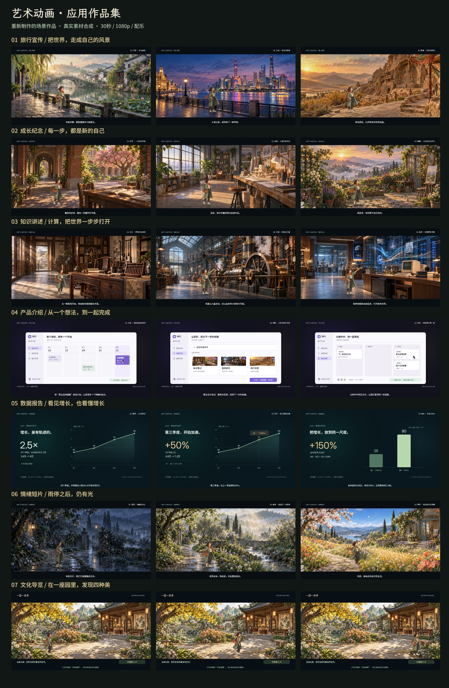

# 七场景作品版：从使用场景到完整影片

这版针对用户对上一版“只有代码生成效果、缺少可用场景效果”的反馈重新制作。原型没有删掉，源码保存在experiments/scenario-v1/，旧视频仍在assets/scenarios/。正式入口scenarios/现展示本次作品版。

## 实际交付

七部30秒影片，每部1920×1080、24fps、H.264视频与AAC配乐，三段叙事；合计5040帧。另有21张章节静帧、七张封面、一张作品总览，以及可亲自行走、查看四种对象的园林导览。网页直接播放完整MP4，保留合成画面、章节定位、配乐开关、全屏与下载。

本地入口：http://127.0.0.1:4212/1008_codex_project/012-huashu-art-motion/scenarios/ 。可以用#scene=travel、product、data或interactive直接定位作品。

## 七种用途如何改变表达

| 方向 | 场景与故事 | 做出的实际效果 | 后续替换什么 |
| --- | --- | --- | --- |
| 旅行宣传 | 江南晨光、上海蓝调、敦煌日落 | 宽幅环境原画、旅行者步态与停留、独立水光/前景/花瓣、推镜、三段字幕与音乐 | 地点原画、经过核实的介绍、品牌与目的地信息 |
| 成长纪念 | 校园好奇、工作室创造、花园新章 | 连贯人物形象、读书和舒展姿势、生活环境细节、章节节奏与花瓣 | 个人动作帧、真实经历与阶段、个人结尾文案 |
| 知识讲述 | 古代书房、工业车间、计算机展厅 | 真实器物结构的原画、指向姿势、蒸汽与数据流、三个时代的镜头关系 | 经过核实的器物/史实、旁白和教学图示 |
| 产品介绍 | 虚构“同行”的日历、检索、看板 | 可读的完整软件结构、指针、任务加入、资料选择、状态交付，列计数同步 | 自有产品界面、真实功能步骤、品牌和业务数据 |
| 数据报告 | 示例报名36→48→72→90千人 | 统一刻度与单位、动态折线、第三季度+50%聚焦、全年+150%对比 | 有来源的数据、指标、结论和配色 |
| 情绪短片 | 雨幕、雨后晨光、晴天花园 | 雨线和涟漪、色调变化、人物舒展、环境局部运动与录制音乐 | 情绪文案、音乐与相应授权、人物与场景 |
| 文化导览 | 一座相连的园林和展亭 | 实际行走、路线选择、靠近后查看银杏/花朵/陶瓶/画作、四个发现持续记录 | 真实场馆图与展品说明、路线和热点数据 |

## 这次真正复用了什么

直接加载固定上游U与MO时间库，实际使用MO.smooth、MO.expoOut等时间函数；原版106个引擎文件未改。更大的复用是上游的制作方法：先做成立的静帧，再准备动作帧和独立层，按确定时间编舞，逐帧合成与验收。

四个人物影片与园林走“生成/现有素材＋角色帧＋代码合成”路线；产品与数据走代码绘制的版式与信息动画路线。因此原库的价值仍是风格、方法和组织规则；这组素材、影片故事、软件界面、互动和工程不是它开箱即用的七个模板。

## 实际制作链

1. 内置image_gen生成七张正式素材，完整提示词在assets/production/prompts.json；没有模型CLI、API密钥或真人照片。
2. prepare-production.py只读取图片尺寸、SHA和Alpha，计算16个姿势的源区域与脚底锚点，不修改PNG。实际步态使用四个有效姿势；原始图中重复的走路姿势没有算作更多独立帧。
3. production-scenes.js按原画实际边界切场景，保持电影窗口比例；人物光照、接触影、前景、局部循环、字幕和章节按renderFrame(t)合成。
4. 音乐从Kevin MacLeod官方来源取得，CC BY 4.0；截取、响度统一、淡入淡出与AAC编码，所有七片均保留署名。
5. render-production.mjs使用真实Chromium Canvas帧，以JPEG质量0.96送入FFmpeg，H.264 CRF18出片。输出并非纯PNG无损中间流程；最终交付为1080p有损编码MP4。
6. 静帧审阅修正人物位置、前景重影、软件状态与计数；完整出片后再实际解码、对照合成画面，并检查网页与导览操作。

## 已说明的使用边界

这是完整可观看、下载和探索的示例作品，并不等于已接入真实客户内容。人物是虚构原创角色；产品“同行”、个人经历和报名数据是样例。旅行地标、器物与历史构图为艺术意象，正式对外课程或城市宣传要换成经过核实的内容。

人物表演属于有限帧插画动画，包含走路、停留、指向、读书和舒展。没有调用外部图生视频，也不把帧库合成说成真人级连续表演；细致的口型、身体转面和真实人与器物接触需要更多单独设计的动作帧。环境原画实际宽度约1080像素，按电影窗口合成到1080p输出，未声称原画原生4K。

## 重建与验证

网页构建不需要第三方运行依赖；重新出片另需本机Python/Pillow、Playwright/Chromium、FFmpeg。脚本支持PLAYWRIGHT_MODULE、FFMPEG_BIN和RESEARCH_URL覆盖本机路径。

~~~powershell
npm.cmd run build --prefix projects/012-huashu-art-motion/web
# 另开一个终端运行本地预览
npm.cmd run preview --prefix projects/012-huashu-art-motion/web
python projects/012-huashu-art-motion/src/prepare-production.py
node projects/012-huashu-art-motion/src/render-production.mjs --stills
node projects/012-huashu-art-motion/src/render-production.mjs
npm.cmd run build --prefix projects/012-huashu-art-motion/web
node projects/012-huashu-art-motion/src/verify-production.mjs
node projects/012-huashu-art-motion/src/verify-browser.mjs
node projects/012-huashu-art-motion/src/update-production.mjs
npm.cmd run index:build
npm.cmd run check
~~~

render-production支持--only=travel重做单片，--stills只生成审阅静帧。实际记录：[渲染与编码](assets/production/render-report.json)、[网页与视频解码验证](assets/production/browser-report.json)、[素材及音乐署名](assets/production/CREDITS.md)。最后的验证报告以真实执行结果为准。
