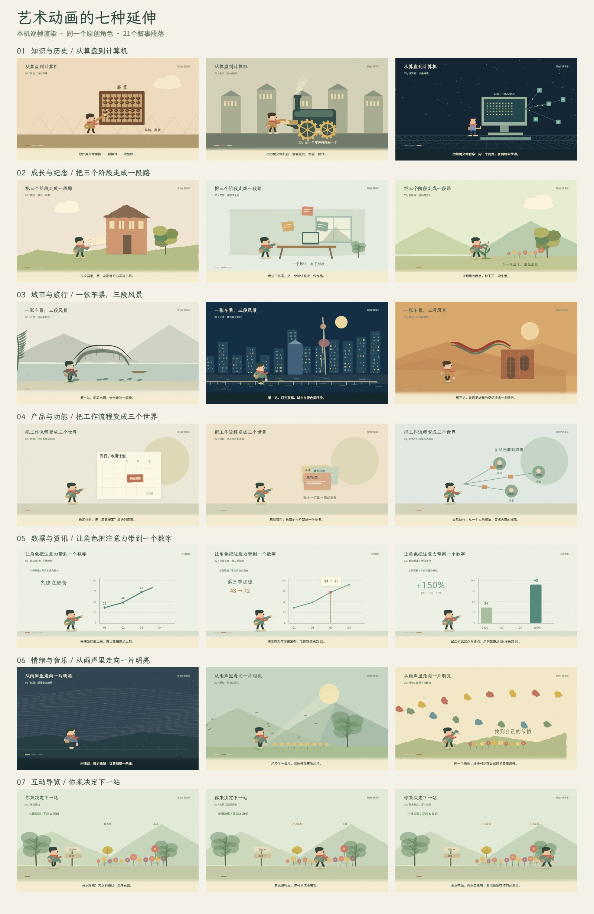

# 七个扩展场景的实际制作

这是本研究在固定上游 `57d67608ab458f57d9b153b1a2831b921e22498b` 基础上的新作品，日期2026-10-09。它们展示扩展方向的实际动画效果，不是原作者附带的七个现成模板。

入口：[场景实验室](http://127.0.0.1:4212/1008_codex_project/012-huashu-art-motion/scenarios/)。原有35种风格图鉴继续保留。

| 方向 | 实际故事与画面 | 与原库的关系 |
| --- | --- | --- |
| 知识与历史 | 算盘拨珠 → 蒸汽活塞与联动齿轮 → 像素电脑与网络 | MO缓动、手绘线与分段事件；新绘三个计算工具时代 |
| 成长与纪念 | 校园书页 → 工作室纸片组合 → 播种后枝叶生长 | PAINT.cut、watercolor、brush、leaf；经历为虚构样例 |
| 城市与旅行 | 江南拱桥与池水 → 上海夜景灯窗 → 敦煌沙丘与飘带 | 墨笔、洗染、母题循环和视差镜头；地标为艺术化意象 |
| 产品与功能 | 卡片进入日历 → 资料聚集 → 成果沿连线抵达团队 | MO.spring、时间锚与信息揭示；虚构产品“同行”，不连接实际后台 |
| 数据与资讯 | 坐标与折线逐段出现 → 第三季高亮 → 起终点对比 | MO.smooth与财经图表语法；36、48、72、90明确为示例数据 |
| 情绪与音乐 | 蓝灰雨幕慢步 → 水彩风与光 → 彩纸舞蹈 | 有限帧步态、洗染、剪纸与节拍；本研究新合成三段短配乐 |
| 互动导览 | 小镇路口 → 花园或展馆 → 走近并查看四种物品 | 绘画方法可复用；键盘/触摸、路线、命中范围与发现状态为新开发 |



## 如何看

每片18秒，包含三个6秒段落。可播放、暂停、拖动时间或点击章节；切到“成片视频”观看同一绘制结果的H.264 MP4。七片均以960×540、24fps逐帧编码，共3024帧；情绪片合入原创合成配乐，其余六片用字幕表达叙事，未生成口播。

互动导览提供两种观看方式：自动演示展示一条预设花园路线；“接管角色”后，方向键或按住按钮行走，点击路面前往位置。选择花园/展馆会实际重绘对应景物。走到物品80画布像素范围内，点击物品、查看按钮或按空格，添加发现记录。四种物品分别为银杏叶、花朵、陶瓶和画作。视频只记录预设路线，不包含交互能力。

## 怎样实现

`web/scenarios/scenes.js` 是新编写的场景绘画和角色代码。它调用固定上游的 `U.rng`、`MO.smooth`、`MO.spring`、`MO.step`、`PAINT.roughPath`、`PAINT.cut`、`PAINT.watercolor`、`PAINT.brush` 和 `PAINT.leaf`。上游原文件没有修改，原许可继续保留。

人物“圆圆”为原创代码骨架：圆脸、红围巾、小挎包保持识别；绘画材料和衣服颜色随环境变化。步行、拨珠、摇动、指向、读书、播种与跳舞以时间计算姿态，不需要下载或生成真人图像。像素段另用矩形和步进时间绘制同一角色。替换为个人形象时仍需另外准备动作帧与一致的画风，不能由本演示自动完成。

场景以 id、时间 t、显式互动状态为输入。三个章节用横向推移连接；旅行与情绪段增加近远景视差。纸张随机点固定，手绘线和洗染使用种子，时间拖回同一点会得到相同图像。UI播放、视频播放、导览状态在 `app.js` 管理。

配乐由 `src/render-scenarios.mjs` 用正弦基音与泛音、衰减包络合成，三个6秒段落从稀疏小调到较明亮的和弦，最后加快到120BPM。输出单声道22050Hz WAV，FFmpeg编码成AAC合入情绪片。没有使用第三方音乐。

## 复现与验证

```powershell
cd projects/012-huashu-art-motion/web
npm.cmd run build
npm.cmd run preview
cd ..
node src/render-scenarios.mjs
npm.cmd run build --prefix web
node src/verify-scenarios.mjs
```

网页构建不需第三方依赖。出片脚本额外需要Playwright和FFmpeg；可用 `PLAYWRIGHT_MODULE`、`FFMPEG_BIN`、`RESEARCH_URL` 指定安装位置和地址。默认使用本机已配置的依赖，不需要API密钥。

实际输出在 `assets/scenarios/`：七个MP4、七张封面、21张章节静帧、总览、配乐、渲染记录与浏览器验证。`render-report.json` 比较冷/热取帧的完整Canvas数据，检查九个时间点的缩略图哈希；`browser-report.json` 记录播放、时间拖动、深链接、视频解码/定位、键盘与触摸导览、手机布局。数字检查用于定位问题，不自动评价美术质量。

本演示主要验证短动画的视觉叙事和扩展工程。产品、数据、人生故事使用明示样例；没有接入真实账号、地图、业务数据，也没有合成真人身份或语音。当前为本地研究预览，尚未公开部署。

## 来源与许可

- 原库：[alchaincyf/huashu-art-motion](https://github.com/alchaincyf/huashu-art-motion)，固定SHA见首段；原代码MIT原文保留在 `src/LICENSE.upstream.txt`。
- 直接调用的上游工具为 `src/upstream-engine/lib/{util,motion,paint,kit,brush}.js`，逐文件SHA仍由 `src/source-manifest.json` 核对。
- 使用已保存的Noto Sans SC与霞鹜文楷字体；字体OFL原文保留在 `src/upstream-engine/lib/fonts/`。
- 场景、题材、角色、交互和合成音乐为本研究原创，未使用作者个人形象、作者人物帧库或第三方成片。
