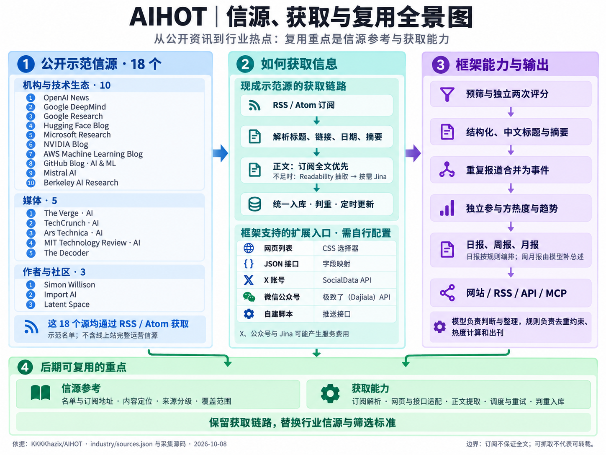

# 013 · AIHOT 信源与资讯引擎研究

AIHOT 是一个可自托管的行业资讯引擎：从已配置来源采集资料、筛选、写成中文阅读内容，再组织为事件、热度和固定刊期。本项目提供中文研究网页与来源参考，保留 2026-10-08 的完整引导图。

[返回总索引](../../README.md) · [原仓库](https://github.com/KKKKhazix/AIHOT) · [研究笔记](notes.md) · [研究数据](src/research.json) · [Web 说明](web/README.md)

## 研究对象与执行范围

| 项目 | 记录 |
| --- | --- |
| 编号 | `013`，目录 `projects/013-aihot/` |
| 上游 | [KKKKhazix/AIHOT](https://github.com/KKKKhazix/AIHOT) |
| 固定研究提交 | [6e67a9d9e8d87b95b8118a8a0b328a9bebd2bb48](https://github.com/KKKKhazix/AIHOT/tree/6e67a9d9e8d87b95b8118a8a0b328a9bebd2bb48) |
| 初次研究 / 图解基线 | 2026-10-08 |
| 本次整理日期 | 2026-10-12，北京时间 |
| 上游代码许可 | [MIT 原文](src/upstream/LICENSE)，另见 [NOTICE](src/upstream/NOTICE) |
| 本地成果 | 中文研究数据、完整引导图、来源配置摘录、独立静态研究网页 |
| 实际执行边界 | 阅读固定提交文档与源码；未运行上游后端、数据库、API 或真实模型，未调用付费采集 |
| Web 发布 | 部署核验成功后才登记在线演示；结果以根索引与发布核验记录为准 |

“源码已实现”表示固定提交存在相关逻辑，不代表本研究已验证真实生产信源上的精度、长期可用性或费用。行业迁移、多租户、个性化和问答等方向均有规划标记。

## 完整引导图

[查看高清原图](assets/aihot-overview.png)



复用我们 2026-10-08 整理的完整 PNG，作为解释图，非上游运行截图。18 个源均是订阅示范；X、公众号、网页和 JSON 是框架另可配置的入口。细节以研究数据与固定提交证据为准。

## 能力与边界

| 能力 | 实现方式 | 判断边界 |
| --- | --- | --- |
| 多源采集 | RSS/Atom/RDF、网页 CSS、JSON、X、公众号、外部推送 | 18 个示范源全部是 rss；其他入口另配置 |
| 材料处理 | URL 判重、修订、日期补齐、Readability、可选 Jina | 订阅未必含全文，动态页面未必可读 |
| 行业精选 | 预筛、同一模型两次评分、分级门槛 | 注意力价值不能替代事实核验 |
| 中文阅读 | 标题、答案先行摘要、理由、结构化与翻译 | 仍可能误抽取或幻觉，关键主张回原文 |
| 事件组织 | 报道 → 一次发生 → 持续事件 | 同公司或主题不等于同事件 |
| 热度 | 独立参与方去重、时间衰减与趋势 | 反映接入来源，不是全网热搜 |
| 固定刊期 | 规则日报、从日报汇编周月报 | 日报不调模型；周月只生成总述与导读 |
| 多出口 | 主题、检索、RSS、API、MCP、Agent Markdown | 共享公开范围、代表与全文许可 |
| 编辑评测 | SelectBench、关系评测、综述对比 | 各有范围，一个 F1 不能代表整站 |
| 后台运维 | 诊断、回执、调用上限、恢复、飞书、备份 | 需要凭据、持久化与持续运营 |

[research.json](src/research.json) 展开 13 项能力、17 个模块、9 步原理、6 种获取、场景、复用与扩展，并附固定源码证据。

## 原理：资料怎样变成事件与刊期

```text
已配置来源 / 外部推送
    ↓
判重 → 补日期与正文 → 确定材料修订
    ↓
预筛 → 同一模型两次评分 + 结构抽取
    ↓
中文标题、摘要、理由 → 可选全文翻译
    ↓
report（报道）→ fact（一次发生）→ story（持续事件）
    ↓
publication（统一公开范围、许可、证据与精选代表）
    ↓
事件热度 / 综述 / 规则日报 / 汇编周月报
    ↓
网页、RSS、API、MCP、Agent Markdown与可选通知
```

1. **材料先行。** 普通文章只有标题，没有正文、订阅摘要或帖子文字时等待材料，不凭标题评分或写文案。未知发布时间先不公开；首次导入与发现时已过时的资料归档。
2. **双评分用同一个模型。** `runScores` 选定一个评分模型，同一标准、同一输入依次独立调用两次。默认 T1=60、T1_5=65、T2=76；两次之和 ≥ 2 × 门槛才够分，显示平均向下取整。够分后仍须归组确认新信息。
3. **五轴在提示词内部计算。** 实质份量、信息增量、证据强度、共振面、可用性按内容类型加权；模型只输出 `attentionScore`。代码校验最终整数范围，没有接收五轴并逐项验算。
4. **召回与关系判断分开。** 普通报道在最近 14 天候选池用标题摘要向量，无向量时可按文字重合度降级；同 URL/native 回复或引用提供额外候选。模型区分同次发生、直接后续、无关与综合稿，人工归属优先。
5. **讨论信号不同。** `hot_signal` 只附着已有事实/事件，不自行创建事件；优先 native 引用，否则依赖向量。不能把普通报道的文字降级泛化给讨论帖。
6. **热度按 participant。** 48 小时窗口每个独立参与方只算一次，以其最近证据时间按 24 小时半衰期衰减，与 6 小时前比较。机构渠道和媒体矩阵需正确归属；采集落后和覆盖变化可使趋势未知。
7. **出刊以规则为主。** 默认北京时间日报 08:00、周报周一 10:00、月报每月 1 日 10:30。日报最多 12 件正文、10 条快讯，同源正文最多 2 条；周月从日报去重取最多 20/30 件，模型只写总述与栏目导读。已有刊期默认不重写，失败或停机会补刊。

[评分代码](https://github.com/KKKKhazix/AIHOT/blob/6e67a9d9e8d87b95b8118a8a0b328a9bebd2bb48/packages/backend/src/editorial/analyze.ts) · [归组说明](https://github.com/KKKKhazix/AIHOT/blob/6e67a9d9e8d87b95b8118a8a0b328a9bebd2bb48/docs/grouping.md) · [热度规则](https://github.com/KKKKhazix/AIHOT/blob/6e67a9d9e8d87b95b8118a8a0b328a9bebd2bb48/packages/backend/src/events/hot.ts) · [出刊规则](https://github.com/KKKKhazix/AIHOT/blob/6e67a9d9e8d87b95b8118a8a0b328a9bebd2bb48/docs/selection.md)

## 18 个示范源与定位

清单来自固定提交的 [sources.json](src/upstream/sources.json)，不是线上完整来源名单。下表是研究判断；地址是否返回有效 feed 要看单独的核验时间与结果，不能只凭 HTTP 200 认定。

| 分组 | 来源 | 信息价值 | 局限 |
| --- | --- | --- | --- |
| 机构与技术生态 | OpenAI News | 一手模型、产品与研究发布 | 公告不自动证明宣传效果 |
| 机构与技术生态 | Google DeepMind | 模型、基础研究与科学 AI | 偏自己的研究方向 |
| 机构与技术生态 | Google Research | 多领域研究与方法 | 不是纯生成式 AI 新闻 |
| 机构与技术生态 | Hugging Face Blog | 开源模型、工具与实践 | 混合生态推广、教程和社区 |
| 机构与技术生态 | Microsoft Research | 研究、科学与工程方向 | 成果未必已产品化 |
| 机构与技术生态 | NVIDIA Blog | 芯片、计算、生态和应用 | 厂商视角，并非全是 AI |
| 机构与技术生态 | AWS Machine Learning Blog | 云上部署与教程 | 偏 AWS，需筛选可迁移价值 |
| 机构与技术生态 | GitHub Blog · AI & ML | Copilot、开发工具与实践 | 偏自身产品和生态 |
| 机构与技术生态 | Mistral AI | 模型、产品与公司发布 | 清单地址需核对是否真为 feed |
| 机构与技术生态 | Berkeley AI Research | 学术方法与研究解读 | 非全领域论文覆盖 |
| 媒体 | The Verge · AI | 产品、科技与社会影响 | 报道、短讯和评论混合 |
| 媒体 | TechCrunch · AI | 创业、融资与商业 | 不能代替技术验证 |
| 媒体 | Ars Technica · AI | 技术解释、科学和政策 | 需区分观点与事实 |
| 媒体 | MIT Technology Review · AI | 趋势与商业/社会影响 | 部分正文需订阅 |
| 媒体 | The Decoder | AI 专题、研究与欧洲观察 | 短讯可能引用其他媒体 |
| 作者与社区 | Simon Willison | 模型实践、工具与开发实验 | 个体选题、短链接与摘录混合 |
| 作者与社区 | Import AI | 研究与治理周刊 | 作者观点强，非即时快讯 |
| 作者与社区 | Latent Space | AI 工程、访谈与社区实践 | 访谈/播客文字完整度不一 |

前 10 个示范源在上游标 T1，后 8 个标 T2；本清单没有 T1_5。全部用 rss 适配器，Simon Willison 的地址是 Atom。Hugging Face、GitHub 等属于技术生态，不误称为传统新闻媒体。

同一公告可被多家重复或引用，多报道适合观察关注度，不等于多份独立事实验证。可从 JSON 复制各 feedUrl，先检查可用性和条目，再按目标读者补国内、竞品和专业研究源。

## 六种获取方式

| kind | 原理 | 接入条件 |
| --- | --- | --- |
| `rss` | XML 订阅解析，兼容 RSS/Atom/RDF | 可访问 feedUrl |
| `web_list` | HTTP HTML 与 CSS 条目/字段；指定列表格式 | 真实节点、稳定选择器 |
| `json_list` | 数组路径、字段路径与 URL 模板 | 可访问接口与确认字段 |
| `x_search` | SocialData 账号/条件搜索 | key、服务与请求预算 |
| `mp_account` | 极致了 Dajiala 按公众号取资料 | key、ghid、服务可用 |
| `external` | Bearer 认证 POST 推送元数据 | 自建脚本与 INGEST_TOKEN |

`research.json → acquisition` 有六个真实 schema 例子、源码与注意点。网页/JSON 用 `example.com`，X/公众号用占位账号，不登记成现成源。外部接口接收 `title/url/publishedAt/author/raw` 等元数据，没有通用 `bodyHtml/bodyText` 推送字段。

普通 HTML 列表不执行 JavaScript；要走 Jina 列表读取需显式配置。文章正文补取的 Readability → 可选 Jina 是另一个阶段。RSS 未必含全文，抓到全文也不代表允许显示或再分发。

## 模块架构与复用价值

上游三个常驻进程：api 用 Fastify 提供接口；worker 用 pg-boss 执行采集、模型与排程；web 用 React Router SSR 通过 HTTP 读 api，不接触数据库或模型凭据。

通用模块在 `packages/backend/src/`：sources、content、editorial、events、publication、reports、providers、notify、operations、admin。contracts 定义跨进程类型；site 管站点身份、品牌、接口、时间和模型；industry 管信源、分类、词表、提示词与门槛。专属业务通过 modules 与 site/modules 清单接入。

值得借鉴的设计：

- **统一公开读取。** 网页、RSS、API、MCP、原文、译文、Markdown、报告和分享图都经 publication。原材料存在 content/数据库，不能绕过公开和许可规则直接分发。
- **页面与付费处理分离。** 页面读取已有结果，模型由 worker 调用，刷新页面不重复生成。
- **材料修订与阶段记录。** 正文变化会生成新输入版本，模型结果、人工决策和公开投影可追踪。
- **付费回执。** 结果先存再用、重试可复用；结果不明时需恢复或核对，不能保证永不重复计费。
- **规则与模型分工。** 代表报道、刊期和日报条目由规则控制，模型做判断、写作及有限总述。

## 场景、运营门槛与成本

适合来源固定且持续更新、读者口味明确的领域：行业晨报、竞品发布、开发者资讯、团队情报和 Agent 资讯源。主要价值是减少跨源重复阅读与编报，让编辑经验可版本化和评测。

真正门槛在来源与标准：确定合法可信的源，定义重要和噪声，标注 100–200 条真实资料并保留留出集，比较质量、覆盖率与成本。默认 AI 门槛不能直接证明其他行业效果。

费用包括主机、模型 token、向量、付费采集、代理和存储。作者记录示范初次导入 152 条约 930 次模型调用，这是上游试跑样例，本研究未重跑或据此推算月费。分钟、小时、每日上限控制调用次数，超限可暂停，不是精确人民币预算。

## 复用路线与后续方向

1. 先在自己的阅读器或脚本借用来源清单，核对更新量、可用性与重复。
2. 再借采集与材料层：RSS 优先、JSON 次之，必要时维护 CSS，保留日期与修订规则。
3. 借编辑评测：改行业提示词、词表与事实结构，金标校准后再自动发布。
4. 借事件模型和统一出口：report/fact/story 降重复，许可、撤回与代表报道一致。
5. 需要后台和报告时完整部署，并承担数据库、凭据、告警、备份及运营。

后续可开发中文行业包、人工审稿、团队权限/多租户、个人订阅、更多通知渠道、带出处问答、来源变更监测和影音/专属模块。网页明确标为规划或增强方向：当前 MCP/API 不等于自由问答产品，管理员后台不等于多租户，浏览器收藏不等于读者账户。

## 本地构建与预览

本地静态研究网页使用 **Node.js 22+ 和内置模块，无第三方构建依赖**。上游引擎另需 Node.js 24.11+、PostgreSQL 16/17 或 Docker、模型凭据与长期运行进程，不能把两者运行条件混淆。

仓库根目录执行：

```powershell
npm.cmd run build --prefix projects/013-aihot/web
npm.cmd run check --prefix projects/013-aihot/web
npm.cmd run preview --prefix projects/013-aihot/web
```

输出目录：`projects/013-aihot/web/dist/`。预览端口 `4213`，子路径 `/1008_codex_project/013-aihot/`；本地地址 `http://localhost:4213/1008_codex_project/013-aihot/`。Linux/macOS 用 `npm` 替代 `npm.cmd`。无需 .env、数据库或 API key。

根目录还需 `npm.cmd run check`；索引工具有改动时运行 `npm.cmd test`。构建、浏览器、子路径及发布结果由实际执行后补记，不预写已通过。

## 来源、许可与本地改动

上游代码 Copyright (c) 2026 数字生命卡兹克，使用 MIT。AIHOT 名称与 Logo 不在 MIT 授权范围，自建运营站应使用自己的品牌。Noto Sans SC 字体另受 SIL OFL 1.1 约束。来源文章属于各发布者，全文展示及 RSS 再分发默认关闭。

保留的上游摘录：[sources.json](src/upstream/sources.json)、[selection.ts](src/upstream/selection.ts)、[LICENSE](src/upstream/LICENSE)、[NOTICE](src/upstream/NOTICE)。中文研究为自己的分析，证据链接固定到研究 commit；既有引导图复用我们生成的素材。

本地新增范围为研究资料、静态阅读页和核验记录；未改写或运行上游引擎，未复制发布者文章全文，未部署完整后端。示例不含真实凭据。
